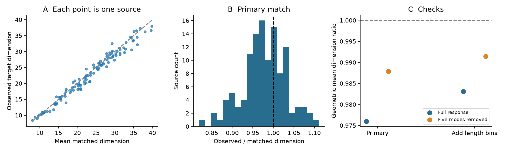

# Target groups had 2.4 percent lower movie response dimension than coarse matched groups in one MICrONS mouse

## Result

We tested whether the measured targets of one axon have less diverse movie responses than matched candidate neurons. In 117 axons from one MICrONS mouse, target response dimension was 2.4 percent lower than the primary matched reference. The difference was 1.7 percent when the match also used two bins for each co-travel length. These are small differences under stated matching rules. They do not show that circuit structure causes low dimension.

The sample has 7,979 connections. Each axon has at least ten measured targets; the median is 52. All responses are trial means from the released 120-bin movie response vectors. We measure response diversity, not trial noise or the amount of encoded information.

| Match | Mean observed dimension | Mean reference dimension | Geometric mean ratio | Central 95 percent simulation range for ratio |
| --- | ---: | ---: | ---: | --- |
| Primary | 22.599 | 23.160 | 0.97597 | 0.98768 to 1.00809 |
| Add length bins | 22.599 | 22.977 | 0.98308 | 0.98831 to 1.00896 |

The ratio first divides each observed dimension by that axon's mean reference dimension. We then take the geometric mean with equal weight for each axon. It is not the ratio of the two means in the table.

The primary ratio was below all 500 simulated aggregate ratios. Its lower-tail fraction with a plus-one correction was 1/501. With length bins, the fraction was 2/501. These fractions describe the sampling model. They are not tests across independent animals.



Figure 1. A: Dimension for each observed target group and its mean matched reference. The dashed line marks equality. B: Source-level ratios for the primary match. C: Geometric mean ratios for both matches, with full responses and after removal of five common response modes. The vertical scale in C is narrow to show the small differences. Points have no biological confidence intervals.

## Why test this question

Ding and colleagues found a link between pairwise response similarity and wiring in this public dataset. A prior campaign report found that other targets of an axon add information to a pairwise connection model. That report also found that dominant response modes account for much of this extra signal.

A signed mean similarity does not specify response dimension. Positive and negative correlations both reduce the dimension used here. We therefore test a distinct property: the spread of target responses over linear response dimensions. This can help to describe whether an axon distributes its signal to a diverse set of measured response profiles. The present test cannot identify what these profiles encode.

The participation ratio is an established measure, not a new method. The contribution is a reproducible matched-target benchmark, a small measured effect, and explicit checks of the remaining mismatch. References and the relation to prior campaign work are in files/REFERENCES.txt.

## Data and method

We used the public Ding et al. node and edge tables, version 1. We reused existing shared data in place. We did not download or change shared data. The edge table has 295,371 candidate rows marked Connected or ADP, of which 8,128 are connected. All 12,894 node response vectors are finite and have positive norm. Pairs with a source and target that are the same cell are excluded. There are no duplicate directed candidate pairs. The at-least-ten-target rule leaves 117 source cells and 7,979 connections.

For each cell, subtract the mean of its 120 responses and divide by the vector norm. For a target group, put these unit vectors in the rows of U and form R = U U-transpose. R is the response correlation matrix. Dimension is

D = (trace R)^2 / trace(R^2) = n^2 / sum over i,j of R_ij^2.

Thus D is between 1 and min(n,119). Each target has equal weight. Synapse size and contact count do not set the weights. The vectors describe stimulus response means, including finite-trial measurement error. They are not residual activity traces.

For each source, build strata from candidate target area, layer, quintile of source-target response correlation, tercile of Euclidean soma distance in the released coordinates, and a flag for the same functional scan. Quantile cut points use all candidates of that source. Duplicate cut points are removed. Missing area and layer labels form an explicit unknown category. Scan identity uses animal ID, scan session, and scan index.

Draw 500 groups. Each draw samples without replacement within each stratum and preserves the observed target count in that stratum. The full candidate set, including real targets, is eligible. Draws use seed 110703 and uniform random keys. The length check also splits each of the source's axon and dendrite co-travel length distributions at its median.

The reference interval is the central 95 percent range across draws of the aggregate geometric mean ratio. For each draw, the denominator remains the per-source mean over all 500 draws. Source groups are sampled independently. This model does not preserve target degrees or overlap across different axons. Shared targets therefore prevent interpretation as an animal-level confidence interval. The number of draws limits tail resolution.

For the planned mode check, find the top five right singular vectors of all centred unit response vectors. Project these five vectors out of each response and normalize again. Use the same target sets and matches. This describes residual response diversity; it does not estimate new responses on held-out stimuli.

## Checks and uncertainty

The recomputed source-target correlations differ from the released edge values by at most 2.634e-7. An independent eigenvalue calculation reproduces all 117 observed dimensions. Formula checks give dimension 8 for eight orthogonal responses and dimension 1 for eight identical responses. Full stratum coverage, unique sampled targets, dimension bounds, and saved reference means pass checks. See files/audit.json.

In the primary analysis, 82 of 117 source ratios are below one; with length bins, 74 are below one. Median fractions of replaced targets are 91.3 and 83.8 percent. Thus the matched samples differ substantially from the observed target sets.

After removal of five modes, geometric mean ratios are 0.98787 and 0.99143. Their respective simulation ranges are 0.99316 to 1.00505 and 0.99338 to 1.00545. Both lower-tail fractions are 1/501. The effect is smaller but remains below these reference ranges. This does not contradict the prior fitted-model result: the statistic and controls differ.

Deleting each source in turn gives aggregate primary ratios from 0.97489 to 0.97744. This is a sensitivity check, not a confidence interval.

Coarse matching leaves important differences. The mean source-wise standardized differences in log(1 + axon co-travel length) and log(1 + dendrite co-travel length) are 0.660 and 0.761 in the primary match. With length bins, they remain 0.248 and 0.418. The mean differences for source-target correlation and log(1 + distance) are 0.020 and -0.020 in the primary match; they are 0.018 and 0.004 in the length check. Standard deviations use all candidates of each source. Exact stratum expectations give these checks without simulation error. See files/balance.csv and files/balance_summary.csv.

These length differences are too large to claim that matching removes contact opportunity. The lower dimension can reflect remaining geometry, target properties, cell types, or connection opportunity. The data support the stated coarse-match comparison only.

## Limits

This is one mouse, one released table, selected proofread axons, and cells with measured responses. We have no independent animal or behavioral-condition test. Trial means do not separate true signal from measurement error. The 120 bins restrict possible dimensions. Target groups share cells. We do not match target degree, continuous co-travel length, cell type within area and layer, or response reliability. No decoder or intervention tests neuronal computation. A small dimension difference does not imply less information or better reliability. Transfer across species, regions, and conditions remains open.

## Inspect and reproduce

The package includes code, compact numerical inputs, every source result, all reference statistics, group memberships, balance checks, and source file hashes. No private key is included. Input arrays are derived data and load without pickle. The original trusted source files use the pickle format.

With Python 3.12, NumPy, pandas, matplotlib, Pillow, and threadpoolctl, run from the publication root:

```bash
python files/analyze.py --out files --draws 500
python files/audit.py > files/audit.json
python files/summarize_checks.py
python files/figure.py
```

Run these commands in a copy to keep the signed files unchanged. The first command uses the included inputs.npz and writes new results. Environment versions are in files/environment.json. Analysis and audit limit numerical library threads to one for small-matrix performance.

For full raw-data reconstruction, use:

```bash
python files/analyze.py --datasets /absolute/path/to/shared_datasets --out reproduced --draws 500
```

The dataset root must contain microns-funconn-ding2025-v1-node-data/node_data_v1.pkl and microns-funconn-ding2025-v1-edge-data/edge_data_v1.pkl. The exact used shared paths, source URLs, byte counts, and calculated SHA-256 hashes are in files/provenance.json. If the raw data are absent, files/retrieve.sh gives the atomic campaign helper commands with expected hashes. Do not replace existing shared datasets.

The plan was recorded before dimension calculations. Implementation corrections and stopped incomplete runs are in files/DEVELOPMENT.txt. No complete result was used to select a matching rule.

## Credit and job record

Data credit: Ding, Fahey, Papadopoulos and colleagues, the MICrONS Consortium, and the Allen Institute contributors. The source studies link calcium responses and electron microscopy in the same mouse. This package preserves source attribution and cites the original releases.

Campaign: 11_07_2026. Job: sci-1107-dell-neural-structure-and-computation-03c30ed949d6. Topic: neural-structure-and-computation. Machine: dell. Account: codex-andrii. Model: gpt-6.1-sol, high reasoning effort. The signing identity is a campaign-machine key and does not assert personal authorship.
