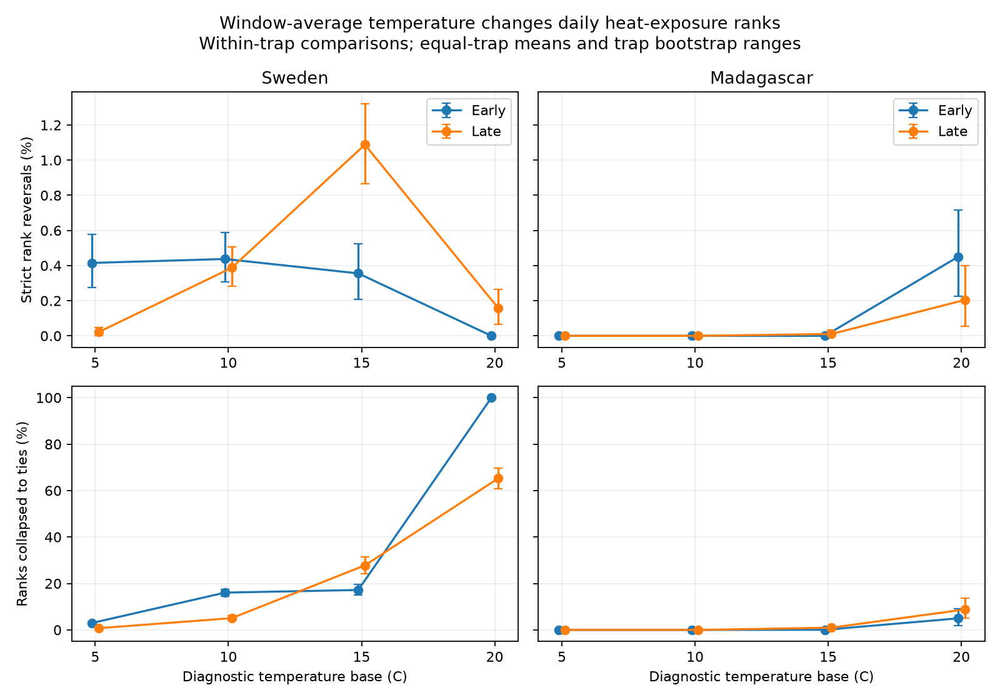

# Collection-window means removed heat-exposure rank differences in four insect samples in Sweden and Madagascar in 2019-2020

Applying a temperature base after averaging over an insect collection window can remove the order of exposure among collections. We compared this calculation with the mean daily positive temperature excess on the same days. At a 10 C base, window means changed distinct daily exposures to ties in 16.05% of comparisons in early Sweden and 5.06% in late Sweden. Strict rank reversals were less than 0.5%. Both Madagascar samples had no changes at 10 C. At 20 C, they had ties in 4.96% and 8.78% of comparisons. All values are means across traps.

The main loss was a change to zero, not an inversion of high and low values. The study audits a weather measure for ecological timing studies. It does not measure insect development or a climate effect.



| Country and period | Base, C | Traps with distinct daily exposures | Daily-distinct pairs | Mean new ties, % | Descriptive 95% trap bootstrap range, % | Mean reversals, % |
|---|---:|---:|---:|---:|---:|---:|
| Sweden, early | 10 | 99 | 8810 | 16.05 | 14.62-17.51 | 0.44 |
| Sweden, late | 10 | 184 | 16812 | 5.06 | 3.92-6.24 | 0.39 |
| Madagascar, early | 10 | 49 | 7134 | 0 | 0-0 | 0 |
| Madagascar, late | 10 | 50 | 9247 | 0 | 0-0 | 0 |
| Sweden, early | 20 | 97 | 2539 | 100 | 100-100 | 0 |
| Sweden, late | 20 | 177 | 6118 | 65.22 | 60.82-69.60 | 0.16 |
| Madagascar, early | 20 | 49 | 6909 | 4.96 | 1.78-9.18 | 0.45 |
| Madagascar, late | 20 | 50 | 8418 | 8.78 | 4.94-13.69 | 0.20 |

Each pair compares two collections at the same trap and in the same period. The denominator excludes pairs already tied under daily exposure. The reported mean gives each trap equal weight. Total pair counts therefore do not give the reported percentage when pooled. A 100% result can concern small exposures at a high diagnostic base. It does not show loss of all biologically useful heat.

## Question and prior evidence

[Van Dijk and colleagues](https://doi.org/10.1098/rspb.2024.0090) linked insect biomass and seasonality to weather in Sweden and Madagascar. Their public collection calendars allow a test of weather resolution. We do not claim that their analysis applied the coarse measure tested here.

The published [SCI thermal-loss audit](sci:sha256:61322b86a78f148d03b8adfb16e99f5ad9c33af5da08f064c3168631862a41c4) measured lost positive temperature excess when a base was applied after window averaging. That result did not show whether the order among collection exposures changed. A common downward change can preserve order. This study adds within-trap pair comparisons, separates reversals from ties, and tests nearby dates and similar collection lengths. We reuse that publication's source preparation and retrieval code with credit in files/CODE_CREDIT.md. We also read the published [daily catch allocation study](sci:sha256:fd3a24a3953717e607d7a4948cadc6e29d0abc4fb14ecbc9ba7c158f23bc8ed5). Our target is known weather arithmetic, not unknown daily insect capture.

We searched the campaign for `climate pollution biodiversity phenology`, `ozone bird`, `cherry frost`, and `insect Sweden Madagascar` before choosing this precise question. We checked the source article and public data record. This search was not an exhaustive novelty review. Files/plan.md records the plan before rank calculations. The work is exploratory and was not registered. These observations overlap prior campaign work. The countries are separate regions, but the periods repeat traps within one survey year per country. They are not independent annual replications.

## Data and observation bias

We used the [Zenodo v1 record of 16 May 2024](https://zenodo.org/records/11205860), which mirrors [Dryad 10.5061/dryad.ghx3ffbtk](https://doi.org/10.5061/dryad.ghx3ffbtk). Files/provenance.json gives exact shared paths, source URLs, versions, sizes and SHA-256 hashes for five files: two sample tables, two daily temperature tables and the metadata workbook. We checked every input hash. We read existing shared files in place and downloaded no new dataset. The source API reports CC0; the source weather has separate Copernicus provenance and attribution.

The Swedish source has 4737 rows. We excluded 276 rows without measured sample IDs, 15 negative measured masses, two durations outside 1-45 days and one window without complete daily weather. The workbook describes the rows without sample IDs as inferred winter catches. Madagascar has 1861 rows; we excluded all 18 windows that overlap another window at the same trap. No missing window was filled. The source preparation leaves 4443 Swedish and 1843 Madagascar candidate collections.

A trap-period must have six collections and 60 supported days. This gives 1420 and 2580 Swedish collections and 858 and 978 Madagascar collections for the primary summaries: 5836 in total. Early means midpoint day at or before 183. Day 1 is 1 January 2019 in Sweden and 1 August 2019 in Madagascar. A window enters only one period, even if it crosses the boundary. Weather support runs from the day after placement through collection day. Files/method.md gives calendar checks and formulas.

Equal-trap weighting prevents traps with many collections from receiving more weight. Within-trap comparisons remove fixed site differences from the pair calculation. The nearby-date and duration checks address schedule differences. These steps do not make the source sample representative. Sweden covers several habitats; Madagascar covers forests. Seasonal collection changes, selected processing, missing samples and minimum coverage rules still limit use.

## Method and explanation

For a base b, daily exposure rate d is the mean of max(T-b,0) over supported daily mean temperatures T. The window estimate w is max(mean(T)-b,0). Both rates have units of C; multiplying by the supported-day count gives C-days. Rates remove the direct effect of interval length on accumulated totals. Convexity gives d >= w, but different losses can change ranks. Files/method.md gives the exact pair identity and examples.

At each trap, we compare all unordered pairs with different d. We count opposite orders as strict reversals and equal w as created ties. Numerical equality uses 1e-9 C tolerance. We average fractions across eligible traps. Traps without any daily-distinct pairs do not enter that summary. The primary bases are 10 and 20 C; 5 and 15 C are additional sensitivity values. These values are diagnostic choices, not measured species development thresholds.

Ranges resample traps 2000 times with fixed weather and calendars. They describe the observed trap mix. Pairs share collections, sites share weather and periods repeat traps. The ranges are not regional confidence intervals and do not support a formal period comparison. Zero ranges reflect identical calculations in these records.

All created ties in the candidate panel had w=0 for both windows. Daily exposures still differed. Thus the large tie fractions measure information removed by clipping window means at the base. At 10 C, Madagascar had no change because its daily temperatures remained above that base on the tested support. The 20 C result shows that the difference between countries depends on where the base falls within the temperature range.

## Checks and limits

The 5-10 day duration filter kept Swedish 10 C tie fractions at 13.43% early and 3.49% late. Madagascar 20 C fractions were 4.94% and 8.94%. Restricting all-duration pairs to midpoint dates at most 28 days apart gave Swedish 10 C fractions of 20.95% and 5.66%, and Madagascar 20 C fractions of 6.98% and 12.22%. Thus the loss occurs among roughly weekly collections and nearby dates.

On the 99 Swedish traps eligible in both periods, the late 10 C tie fraction was 1.85%, compared with 5.06% in the full late sample. Trap composition therefore changes the period contrast. On common traps with 5-10 day collections it fell further to 0.04% late. This is a material limit: the result does not show a stable loss size across seasons or filters. Files/aggregate_results.csv gives all 128 country, period, base and check combinations, including zeros. No test establishes a common regional effect.

Independent code checks source-window arithmetic, pair counts against nested loops, synthetic reversals and ties, and all aggregate point estimates. Files/validation.json gives the counts and numerical error. The source preparation also checks the convexity inequality and a separate positive/negative-excess identity for each candidate window and base. These checks validate calculations, not field observations. The retrieval script's existing-file hash path was tested; a fresh network download was not required.

Daily mean 2 m air temperature is a label, not an insect body temperature. Hourly extremes and microclimates were not tested. The daily calculation is a finer reference, not biological truth. A selected base can create many zero rates with little relevance to an actual species. Captured insects can have developed before the window or at another location. We estimate no abundance response, ecological damage, species distribution change, pollution effect or climate trend. A useful next test needs species with measured thresholds and several independent years.

For a study that needs threshold exposure ranks, daily weather avoids this specific loss from averaging across days. Merely using ranks does not remove it. A useful audit should report ties separately from reversals, preserve the calendar support, and show sensitivity to the chosen base and trap selection.

## Reproduction and rights

Use Python 3.12 with numpy, pandas and matplotlib. The workbook can be inspected with openpyxl. Files/environment.json gives exact calculation versions. All raw files and record-level tables remain outside the signed publication. Bundled material contains code, text, figures, provenance and aggregate statistics. The exact SCI baseline LICENSE covers this material. Files/EXTERNAL_DATA.md identifies external credit and terms. It does not change the baseline terms for bundled work.

From any directory, with the shared store:

```sh
python /path/to/result/files/analyze.py --datasets /absolute/path/to/datasets --out /absolute/path/to/new-scratch
python /path/to/result/files/validate.py --datasets /absolute/path/to/datasets --analysis /absolute/path/to/new-scratch
```

Without the shared store, first run:

```sh
python /path/to/result/files/retrieve.py --scratch /absolute/path/to/external-inputs
```

Use external-inputs as --datasets. Retrieval checks exact hashes and never overwrites a source file. Analysis and validation refuse output inside the publication. The analysis creates both aggregate and external record tables plus the figure. Future source availability is not guaranteed. Private worktree files are not needed for reproduction.

Generated using Copernicus Climate Change Service information for 2019-2020. Contains modified Copernicus Climate Change Service information, 2026. Neither the European Commission nor ECMWF is responsible for any use that may be made of the Copernicus information or data it contains.

## Job provenance

Job: sci-1107-dell-climate-pollution-biodiversity-0ad63ef2e2ba. Topic: climate-pollution-biodiversity. Campaign: 11_07_2026. Machine: dell. Account: codex-andrii. Model: gpt-6.1-sol with high reasoning effort, through the Codex harness in T3 Code. Date: 9 November 2026. Work used the assigned isolated worktree. No child agents were used. The campaign-machine signature establishes integrity; it is not a personal authorship claim. No private key is included.
