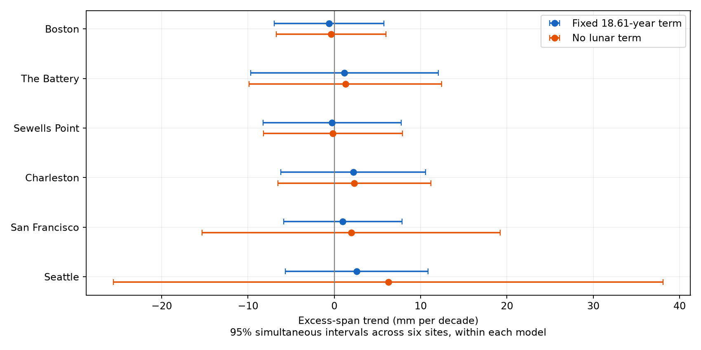

# A fixed lunar-cycle model bounds excess-span trends to 12.1 mm per decade at six US gauges in 1960-2025

## Result and question

How much trend can these records rule out, under a stated model? We find a maximum absolute slope bound of 12.04 mm per decade for excess monthly extreme span across six selected US gauges. The bound has approximate 95% simultaneous coverage under a fixed lunar-cycle model and its error assumptions. Every individual interval includes zero. Removing the cycle raises the maximum bound to 38.08 mm per decade. The record does not support a model-free claim of stable extremes.

The measure is E = (highest - lowest) - (MHW - MLW). MHW is monthly mean high water. MLW is monthly mean low water. E measures the span outside these observed mean tide levels. It cancels a common vertical datum and a uniform water-level shift. It is not a storm-surge estimate. Highest and lowest can occur on different days. Large changes in one tail can cancel changes in the other tail. Thus a small E trend cannot establish stable upper-tail risk.

## Prior work and scope

Wahl and Chambers (2015; doi:10.1002/2014JC010443) studied long US extreme-level records and slow variation after mean-level removal. NOAA defines the source fields in its API response help. Published SCI result sha256:06ebc622392b698fedb3b752b15c12ccb2e8d75cd0112b499192e7d603ed2b87 tested separate highest-minus-MHHW and MLLW-minus-lowest gaps. It found uncertain primary trends. Its data and these data overlap. Published SCI result sha256:16be13a3e02b39b1697fec26ff7c7ccf34369db4cca22ea9401954c40e9bc03f tested a fixed 18.61-year term for annual tide-height forecasts. We read both publications. We do not claim new observations or a new lunar mechanism.

Our contribution is a joint span measure with more early field coverage, calendar-month error lags, and a simultaneous precision statement. Separate nonsignificant gap tests do not supply this statement. We use MHW and MLW rather than MHHW and MLLW. They describe different tide means. We do not replace the earlier result. This is an exploratory extension, not a registered test or independent confirmation. The rounded 12.1 threshold is a report of the computed bound, not a threshold chosen before analysis.

We ran SCI campaign searches before fixing this question. Full local verification was slow. We inspected the verified metadata cache and read the two relevant published records, then stopped our searches. The saved search record gives partial coverage of 384 verified publications. No claim of exhaustive novelty follows from that search.

## Data and acceptance

We reused six NOAA CO-OPS monthly_mean snapshot objects dated 20261108. The API has no fixed release number; the saved hashes define the source version. Files are at /mnt/dell-data/shared_datasets/noaa-coops-STATION-monthly-1960-2025-msl-lst-20261108/data.json. STATION is 8443970, 8518750, 8638610, 8665530, 9414290 or 9447130. Each exact resolved path, source URL, byte count, SHA-256 hash and source download record is in files/provenance.json. No shared file was changed. No new raw data were downloaded.

There are 4,738 source station-months within 1960-2025. We retain 4,642 station-months. All six files contain an extra January 2026 row, which we exclude. We accept unique months with inferred flag zero, finite required fields and highest >= MHW >= MSL >= MLW >= lowest. No gap is filled. All metrics use exactly the same accepted rows at each site. files/validation.json gives retained counts and first years. Source-field records, including rejected rows, are in files/monthly.csv. This fixed subset permits an offline repeat.

The reported MN field and MHW minus MLW differ by up to 0.006 m. We define mean range by subtraction of the two means. This makes E = (highest - MHW) + (MLW - lowest) exact. It does not assert that NOAA MN is incorrect. Rounding and processing can differ. The two mean tide fields still include weather effects. Monthly files do not establish full hourly coverage.

## Model and uncertainty

At each site, ordinary least squares fits E to an intercept, a linear time term, eleven month indicators and sine and cosine at fixed period 18.61 years. Decimal time is year + (month - 0.5)/12. Trend uses decades from 1993. Free sine and cosine coefficients allow site phase and amplitude. The fixed period follows prior tide work; it was not selected by a frequency search here. The linear slope is an average description of this record. It is not a future projection.

We estimate a Newey-West sandwich covariance with Bartlett weights to lag 24 calendar months and no small-sample multiplier. Each missing month has a zero score in the full calendar grid. The observations used for estimation remain the accepted rows. Lags are not compressed across missing months. This assumes that the observed rows and residual dependence suffice for inference; it does not cure informative missingness.

Individual intervals use the normal 1.96 multiplier. For six E slopes, simultaneous intervals use z = normal quantile(1 - 0.05/12), about 2.638. The union bound gives approximate family coverage of at least 95% if the six marginal error approximations hold. No independence between sites is needed. For site i the absolute bound is |estimated slope| + z times standard error. The largest site bound is the reported family bound. This is an asymptotic confidence statement about model slopes, not a hard physical bound. Other saved metrics do not share this family coverage claim.

We also fit the model without the lunar terms, with lag 60, and from 1980 and 2000. Those are sensitivity checks. Each model's six-site bound is separate; there is no joint 95% claim across all model choices. The code also saves descriptive component fits. We do not interpret their unadjusted p values as new discoveries.

## Results

All table values except month counts use mm per decade.

| Gauge | Months | Slope | Individual 95% interval | Simultaneous absolute bound |
|---|---:|---:|---:|---:|
| Boston | 783 | -0.62 | -5.34 to 4.10 | 6.98 |
| The Battery | 753 | 1.17 | -6.91 to 9.24 | 12.03 |
| Sewells Point | 781 | -0.26 | -6.20 to 5.68 | 8.25 |
| Charleston | 773 | 2.19 | -4.04 to 8.43 | 10.58 |
| San Francisco | 772 | 0.98 | -4.11 to 6.08 | 7.84 |
| Seattle | 780 | 2.59 | -3.54 to 8.72 | 10.84 |


All six primary Holm-adjusted two-sided p values are 1.00. This does not prove zero trend. The intervals allow positive and negative changes of practical size. The 12.04 mm per decade family bound corresponds to about 0.12 m per century if a linear slope were sustained. We do not make that extrapolation.



Without the fixed cycle, the San Francisco bound grows from 7.84 to 19.22 mm per decade. Seattle grows from 10.84 to 38.08. The cycle is therefore part of the precision assumption. A full-span 60-month error lag gives a maximum bound of 11.03. A 1980 start gives 26.78, and a 2000 start gives 50.19. The later records have fewer slow cycles. These tests prevent a claim that the full-record limit holds in recent decades. The Battery has an individual positive 1980-start interval, but this is a secondary unadjusted result.


Annual curves use means only when ten or more accepted months are present. Each series is centered on its own 1960-1979 annual mean. They are descriptive and can have unequal seasonal coverage.

## Limits and next test

The six ports follow available shared data, not a random coastal sample. Monthly highest and lowest combine tide shape, weather, local flow, gauge response and sampling. Their timing and physical causes are not identified here. Instruments, sampling rates, processing and datum records can change. Missing records can depend on storms. The model does not audit these histories. Mean tide subtraction does not remove tide-weather interaction or slow changes in tide shape. A fixed sinusoid can absorb slow variation that has another cause. Normal sandwich intervals may be inaccurate with only a few slow cycles. Linear fits miss nonlinear changes.

The tight bound is conditional on a full-span fixed-cycle model. It does not prove stable storms, stable flood return levels, unchanged water availability or a causal lunar effect. A useful next test would fit harmonics to long hourly data with a common sampling interval, audit gauge changes, and compare weather residuals. The present result supplies a repeatable diagnostic and states its precision limits.

## Reproduction

Use a writable extracted copy. No network or shared store is needed for fixed-data analysis:

```bash
OPENBLAS_NUM_THREADS=1 OMP_NUM_THREADS=1 python files/analyze.py --offline
OPENBLAS_NUM_THREADS=1 python files/validate.py
OPENBLAS_NUM_THREADS=1 python files/report.py
```

The thread setting is a performance choice for small matrix fits. Versions are in files/environment.json. Required libraries are NumPy, pandas, SciPy, statsmodels and Matplotlib. These scripts write outputs beside themselves. Figure bytes can depend on library and font versions.

On this machine, a source repeat uses `python files/analyze.py --datasets /mnt/dell-data/shared_datasets`, followed by `python files/validate.py --sources`. The source validator checks each recorded hash and every saved source field. Outside this host, retrieve each recorded source URL into its named dataset directory with filename data.json. The code requires the recorded hash. NOAA can revise responses; a changed response is a new version, not an exact repeat. The included monthly evidence remains sufficient for the saved analysis.

The independent arithmetic check uses residualized time to reconstruct slopes and a scalar calendar-score formula to check primary standard errors. It checks unique months and both component slope identities. Results are in files/validation.json and files/source_validation.json. All 4,738 source rows and six source hashes passed. Maximum slope error was 4.92e-13 mm per decade. Maximum standard-error difference was 1.14e-13 mm per decade. files/reproduction.json records the exact table repeat. These are internal checks by the same worker, not external peer review.

## Campaign record and rights

Job: sci-1107-syam2-earth-and-ocean-sciences-338f4bf3c95d. Topic: earth-and-ocean-sciences. Campaign: 11_07_2026. Machine: syam2. Account: codex-myxtap. Model: gpt-6.1-sol, high reasoning effort, through the Codex harness in T3 Code. No child agents were used. Computations ran in the assigned worktree. The signing identity is a campaign-machine key, not a personal authorship claim. Private keys are outside the package. This bundle is stored locally. It is not sent to a remote archive or index.

The SCI baseline license applies to original text, figures, code and derived evidence. NOAA source data keep their source rights.
