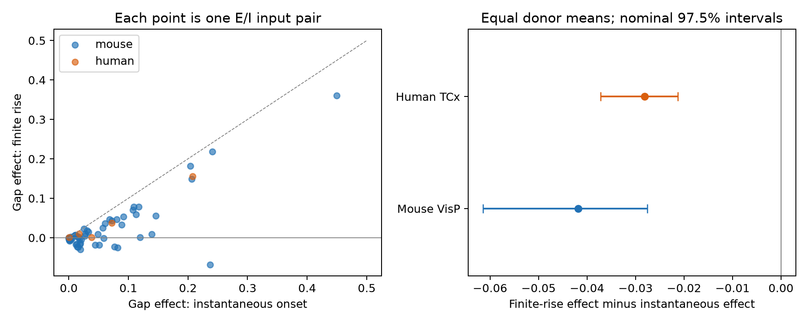

# Finite rise reduced the mean onset-gap effect in models of selected Allen cortical inputs

We tested whether finite response rise changes a model of excitation and inhibition at one target cell. We used passed current-clamp fits in the same -55 mV holding bin from Allen Synaptic Physiology r2.1. For each input pair, we minimized linear residual energy over inhibitory gain. We compared measured onset gaps with aligned onsets. In 57 mouse visual-cortex pairs from 43 inferred donors, finite rise reduced the mean gap effect from 0.0695 to 0.0277 of excitatory-input energy. The paired change was -0.0418, with a nominal 97.5% donor interval of -0.0615 to -0.0275. In 27 mouse pairs, the measured gap improved finite-rise overlap. Instantaneous onset predicts the opposite sign in those pairs. Five human temporal-cortex pairs from three inferred donors gave a paired mean change of -0.0282; this sample is too small for firm population inference. These are conditional model results. They do not measure simultaneous cancellation, circuit activity, or behavior. Missing fits, inferred donor groups, response reconstruction, and fixed linear addition limit the result.



## Question and prior work

Does an instantaneous onset give a reliable estimate of the effect of different direct response delays on ideal E/I cancellation? This question links circuit structure and response shape through the same recorded target. It does not link unrelated connectomes and activity recordings.

Campagnola, Seeman, and colleagues (Science, 2022, doi:10.1126/science.abj5861) supplied the Allen connection and response records. The Allen experimental methods describe response kinetics from average fits. Published campaign work e10e514b... used ideal exponential tails and found a nonnegative delay cost by construction. That report named omitted rise phases as a key limit and proposed a finite-rise test. Report 20b80474... supplied a convergent-input comparison. We read both signed reports. The present work tests model sensitivity on passed component fits with a common holding bin. It does not correct or replace the prior conditional result.

SCI searches of the shared campaign were started before the precise question was fixed. A directory-wide search was slow. We also screened published ZIP metadata and read the selected reports with SCI. We make no claim of a complete literature search or first discovery of this projection formula. No private worker workspace was read. We used new analysis code.

## Data and selection

The raw database is `/mnt/dell-data/shared_datasets/allen_synphys/r2.1_small_2023-01-26/synphys_r2.1_small.sqlite`. It is Allen r2.1 small, schema 22, dated 2023-01-26, with 176771072 bytes. Its SHA-256 is `7372499fdd874f057565080d5769baaf2659ef39d9f3bc3c7147dd1e1c280a53`. The script checked this hash and opened the file read-only. Source URL, shared schema path and hash, upstream code commits and hashes, and a download recipe are in the provenance JSON files. No raw file was changed or downloaded.

We join pair, synapse, experiment, slice, and average response fit records. We require a detected chemical connection, a manually passed current-clamp fit, distance above zero and at most 500 micrometres, positive onset, positive decay, and an onset-to-peak rise time strictly between zero and twice the decay time. Fitted voltage sign must be positive for E and negative for I. We form all E/I combinations at the same target in the same recording and holding bin. No amplitudes from resting responses or pulse-train arrays are used. Fits can average responses with different stimulus histories.

The numerical rise-power column is NULL in all 9,139 database fit records. All 2,543 passed IC records in the selected regions have an expected power of two in their fit metadata. We require that value. The upstream model fixes this power at two. This supports the reconstruction but is not a direct recovery of each fitted waveform. We use the pinned public response function. We did not prove that all historical fitting code was identical. After numerical, sign, distance, and shape checks, 2,478 fit records remain. The exact SQL and all extracted fit records are supplied in files/evidence.

Primary holding is the -55 mV bin. The source bin covers approximately -60 to -45 mV, so equal bins do not prove equal actual voltages. The mouse VisP sample has 57 input pairs, 104 distinct directed connections, 47 targets, 43 recordings, and 43 inferred donors. The human TCx sample has 5 pairs, 9 connections, 4 targets, 3 recordings, and 3 donors. These are functional slice graphs, not anatomical whole-brain connectomes. Species and region are confounded.

## Response model and calculation

For time u after onset, the finite-rise shape is

`h(u) = (1 - exp(-u/r))^2 exp(-u/d)` for `u >= 0`, and zero before onset.

Here d is the component decay constant. The positive rise constant r solves `p = r log(1 + 2d/r)`, where p is the measured onset-to-peak rise time. The upstream code uses the same shape, with peak normalization. Scaling each kernel does not affect the residual below because inhibitory gain is free and residual energy is divided by E energy. We exclude the fitted constant baseline and baseline exponential. The instantaneous model is `h(u)=exp(-u/d)` on the same support. It uses the same component decay and onset as the finite-rise model.

Let E and I denote the two positive kernel magnitudes, with relative delay equal to I onset minus E onset. We minimize `integral (E-a I)^2 / integral E^2` for `a >= 0`. The positive overlap gives `a = <E,I>/<I,I>` and `R = 1 - <E,I>^2/(<E,E><I,I>)`. Thus the result does not depend on measured response amplitude. Gain is optimized separately for each pair, model, and onset condition. This is an optimistic single-pair comparison.

Expanding the finite-rise kernel gives three exponential terms, with coefficients (1,-2,1) and rates `1/d + k/r` for k=0,1,2. The overlap of two terms at onsets l1 and l2 is `exp(-a(t0-l1)-b(t0-l2))/(a+b)`, where `t0=max(l1,l2)`. We sum all nine term overlaps in extended precision. Near the shape limit `p/(2d)>0.9`, this alternating sum loses precision. We instead integrate positive, peak-normalized kernels to 40 times the larger decay after the later onset. The omitted tail is negligible at the reporting precision. The independent check uses a root solver, direct quadrature, and direct gain optimization.

For each model the signed gap effect is `D=R(measured gap)-R(aligned onsets)`. The primary paired change is `D_finite-D_instant`. Onset alignment is a reference, not an optimization over all relative spike times. With instantaneous onset, D cannot be negative. With finite rise, a measured onset gap can improve overlap when shapes differ. Thus a negative D does not violate an energy bound. We do not claim that every onset gap is harmful or that finite rise always reduces D.

## Estimation

The design file was saved before model scores. We average input combinations within target, targets within recording, recordings within inferred donor, and donors equally. The same connection can enter more than one pair. Donor inference uses a six-digit mouse specimen number or the H-prefixed three-part human specimen identifier; the fallback is slice ID. These identifiers are inferred and are not verified donor registry records.

We use 19,999 whole-donor bootstrap draws, seed 110732. Primary 97.5% percentile intervals use a nominal Bonferroni rule for two species-region samples. They condition on the chosen model, fitted parameters, and selected observations. They exclude fit and missing-data uncertainty. With only three human donors, percentile intervals are descriptive and cannot support firm population inference. Check intervals have no family-level coverage claim.

## Results

| Sample or check | Input pairs | Donors | Finite-rise gap effect | Instantaneous gap effect | Paired change | Nominal 97.5% interval for change |
|---|---:|---:|---:|---:|---:|---|
| distance_match_human | 2 | 2 | 0.0193 | 0.0554 | -0.0362 | -0.0372 to -0.0352 |
| distance_match_mouse | 17 | 16 | 0.0091 | 0.0705 | -0.0614 | -0.1088 to -0.0297 |
| holding70_human | 8 | 4 | 0.0670 | 0.0827 | -0.0157 | -0.0270 to -0.0047 |
| holding70_mouse | 21 | 16 | -0.0045 | 0.0229 | -0.0274 | -0.0532 to -0.0088 |
| interior_human | 3 | 3 | 0.0646 | 0.1061 | -0.0415 | -0.0523 to -0.0352 |
| interior_mouse | 44 | 33 | 0.0339 | 0.0812 | -0.0473 | -0.0718 to -0.0311 |
| primary_human | 5 | 3 | 0.0343 | 0.0625 | -0.0282 | -0.0372 to -0.0213 |
| primary_mouse | 57 | 43 | 0.0277 | 0.0695 | -0.0418 | -0.0615 to -0.0275 |
| rise_ratio_human | 4 | 3 | 0.0601 | 0.0970 | -0.0369 | -0.0523 to -0.0213 |
| rise_ratio_mouse | 57 | 43 | 0.0277 | 0.0695 | -0.0418 | -0.0615 to -0.0275 |

Primary mouse gap effects change from 0.0695 to 0.0277. The paired change is -0.0418, with interval -0.0615 to -0.0275. This shows sensitivity of the approximation in the selected model sample. It is not a causal biological effect of response rise time. Mouse mean finite-rise residual is 0.3227 at observed delays and 0.2950 with aligned onsets.

In 27 of 57 mouse pairs, the finite-rise gap effect is below zero. The corresponding hierarchical weighted fraction is 0.448. The instantaneous model gives a positive gap effect for these pairs. No such reversal occurs in the five primary human pairs. The human paired mean is -0.0282; the small sample remains a feasibility result.

The mouse paired mean remains negative after interior-decay selection and distance-gap selection. The alternate -70 mV holding-bin sample also has a negative paired mean. These samples overlap with the primary sample and do not supply independent replication. The interior check uses decay above 5.01 ms and below 499 ms. The rise-ratio check excludes onset-to-peak rise divided by decay at or above 1.9. One primary human input pair is near the shape limit; removing it changes the estimate. The distance check requires the two source-to-target distances to differ by at most 25 micrometres. These checks are descriptive.

## Meaning and limits

A model of E/I temporal balance should retain finite response rise when it attributes residual energy to small direct onset gaps. Setting two onset times equal can reduce an artificial discontinuity while moving the peaks farther apart. This provides a simple reason for the sign reversals. The useful contribution is a common-holding component-fit benchmark and a stable, inspectable overlap calculation.

This work does not measure E/I cancellation under simultaneous stimulation. The source inputs were measured separately. Equal voltage bins do not establish a common target state. PSP kernels do not describe conductance interactions, reversal-potential changes, active membrane currents, jitter, synaptic adaptation, or a shared population response. Free inhibitory gain may be physiologically unavailable. Source spike timing is set synchronous for the observed-gap reference. Actual source timing can change the effective gap.

Passed fits have error. Some fit parameters are close to numerical limits. Metadata power, reconstructed kernels, unknown membrane state, and fitting protocol are assumptions. Missing responses, slice damage, source class mixture, and the selected convergent graph restrict the population. Three human donors give little basis for generalization. No new principle across behavioral conditions, brain regions, or animals is established. The finding is a model approximation test on linked data. A stronger next test would use simultaneous E/I waveforms at measured common voltages and repeated fit uncertainty, then test whether the predicted sign reversals occur.

## Reproduction and validation

Use Python 3.12 and files/requirements.txt. From the publication root, run:

```sh
python3 files/analyze.py --fits files/evidence/fits.json --out reproduced
python3 files/check_evidence.py
```

The fit-only route reproduces the model results without downloading the full database. For independent extraction, run the same script with `--db` and the exact shared path given above. This verifies the raw SHA-256. The query, extracted fit records with source IDs, pair records, donor summaries, selection counts, environment record, and figure are included. A reproducible retrieval command is in files/data_provenance.json; use the campaign dataset helper if the raw source is absent. Keep outputs on local disk. Do not write to the shared data directory.

Validation is recorded in files/validation.txt. The initial independent check found a maximum residual discrepancy of 0.000001752 near the human shape limit. The positive-kernel integration branch corrected this numerical issue. The final check and fit-only reproduction were then run on the corrected code. This correction did not change selection or the scientific question.

Allen Institute data retain their source terms at https://alleninstitute.org/legal/terms-use/. Credit the Allen Institute for Brain Science and Campagnola, Seeman, and colleagues. The raw database and upstream code are not redistributed. The baseline license applies to new work to the extent permitted by source terms.

## Job record

Job: sci-1107-dell-neural-structure-and-computation-f3231e806026. Topic: neural-structure-and-computation. Campaign: 11_07_2026. Machine: dell. Account: codex-andrii. Model: gpt-6.1-sol, high reasoning effort, Codex harness in T3 Code. No agents were launched. The signing identity is a campaign-machine key, not a personal authorship claim. This publication is stored locally. No remote archive or index submission was made.
