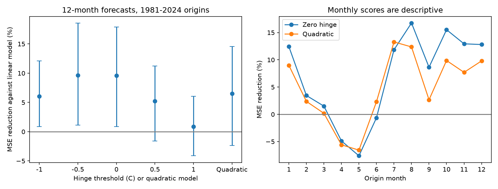

# A reference-invariant quadratic term gave no clear twelve-month ENSO forecast gain at 1981-2024 origins

A quadratic temperature term reduced twelve-month Nino 3.4 forecast mean squared error by 6.50% against a seasonal linear model. The conditional 95% five-year block interval was -2.34% to 14.56%. This test does not establish a gain. A zero-threshold warm-cold model gave a 9.58% reduction, with limits of 0.86% to 17.89%. The quadratic model had 3.40% higher error than that model. These results apply to one revised NOAA source, 528 monthly origins and the stated models.



The left panel gives point gains and marginal conditional 95% intervals. All thresholds were set before fitting. No threshold was selected from the scores. The right panel gives descriptive monthly scores without intervals.

## Question and prior evidence

Can a quadratic strength term retain the forecast gain of a warm-cold model while removing its dependence on a uniform temperature reference shift? ENSO forecasts can inform studies of rainfall and water supply. This test measures an ocean temperature index, not impacts on water supply.

[Okumura and Deser (2010)](https://doi.org/10.1175/2010JCLI3592.1) describe unequal El Nino and La Nina duration. [Okumura and colleagues (2011)](https://doi.org/10.1175/2011JCLI3999.1) propose a nonlinear atmospheric mechanism for unequal duration. We used the public search abstracts; full journal pages returned access errors. Crossref metadata confirmed the titles and author lists. These studies motivate an unequal-response model. They do not imply that a specific extra predictor must improve forecasts.

We searched signed campaign results for earthquake, ocean, ENSO, persistence and asymmetry. We read the [ONI warm-cold forecast test](sci:sha256:c447fb2c559287cf4b4d6677e63b3c44aecc4e1405d2bb93f935a1fa8e0af5e2). It found uncertain six-month gains and larger twelve-month gains. It also noted that absolute anomaly terms depend on the reference zero. We test that limitation with fixed thresholds and a quadratic alternative. The [seasonal probability test](sci:sha256:26cbf67c0e92fd531538d8f3431ca915759646f5b880826aa78d36c824ea65f1) supplied source metadata and an example of annual training limits. We also read the [seasonal score test](sci:sha256:ca30a058ef538c74350e2f2c5b11ecd2ba9218b7838aeee4a2821b453bc09445).

The new contribution is this reference-sensitivity benchmark and its model-space proof. It is not a discovery of ENSO duration asymmetry. The monthly source overlaps earlier campaign observations, and the twelve-month lead follows a published secondary result. This is not a reserved independent test. We copied no prior code. Search was targeted, not systematic. The local plan in files/plan.txt preceded the new fits and was not externally registered.

## Data and time limits

We reused this shared source in place, without a download or shared-file change:

```text
./datasets/noaa-cpc-nino-regions-ersstv5-20261109-c15aaeaf/nino_regions.txt
```

It is the [NOAA CPC ERSSTv5 monthly regional table](https://www.cpc.ncep.noaa.gov/data/indices/ersst5.nino.mth.91-20.ascii), with a fixed 1991-2020 anomaly reference. We use column 10, the Nino 3.4 anomaly in degrees C. This region is 5 S-5 N, 170 W-120 W. The 918 consecutive monthly rows run from January 1950 through June 2026. There are no duplicate or missing month keys. The SHA-256 is `bedcd0683c07f7ccb2ae358a90cb39d57413dcc8881027e0c30a1811f6d58012`, size 67,087 bytes. files/results/provenance.json gives the absolute shared path, resolved path, URL, version, used field and software versions. The path goes through the supplied shared link; no failed /data disk was read.

Test origins are January 1981 through December 2024. Each target is a single month exactly twelve months later, from January 1982 through December 2025. These are monthly anomalies, not ONI seasonal means or official event labels. The model assumes the origin month value is available when issued. Data-release delays are not modeled. Revised observations and a later fixed anomaly reference prevent a real-time interpretation.

## Models and reference proof

Let x be the origin anomaly, d = x(t)-x(t-3), and S = [1, sin(2*pi*(month-1)/12), cos(2*pi*(month-1)/12)]. The linear model has nine columns [S, x*S, d*S]. The zero hinge model adds abs(x)*S. The quadratic model adds x squared times S. Each added model has twelve columns and uses ordinary least squares. All fits have full column rank. These are direct forecasts. There is no recursive forecast, regularization or score-based tuning.

At January of origin year y, fit all eligible pairs whose target lies before January y. The first training origin is April 1950. The fitted coefficients stay fixed for all twelve origins in year y. Thus every training response is earlier than every issue in that year. Fits use between 357 and 873 pairs. This conservative annual rule omits some recent eligible targets for later months. It differs from the prior ONI test, which refit at each origin.

For a constant reference shift a, (x+a) squared = x squared + 2*a*x + a squared. Each seasonal quadratic column is therefore a linear combination of existing quadratic, linear and intercept columns. The reverse change also holds. The same fact applies to the linear model. The difference d does not change. The design spaces are equal under the shift, so full-rank least-squares forecasts are equal when training and test predictors use the same shift. Our code checks shifts of -1 and +1 C for every expanding linear and quadratic fit. The largest forecast difference was 6.44e-15 C.

In contrast, abs(x+a) has its corner at x=-a. A fixed zero hinge need not preserve its design space after a reference shift. We test abs(x-c)*S at c = -1, -0.5, 0, 0.5 and 1 C. These fixed thresholds show sensitivity; they are not proposed climate reference periods and were not optimized. The proof concerns a uniform shift only. It does not establish invariance under time-dependent or month-dependent reference changes. A physical threshold could be useful even if it is reference-sensitive. A quadratic response can also be asymmetric under sign reversal; reference invariance is not proof of physical symmetry.

## Scores and uncertainty

The primary score is G = 1-MSE(quadratic)/MSE(linear). MSE is the mean squared forecast error in C squared, with equal month weights. Positive G means a reduction. The zero hinge and the quadratic-versus-hinge comparisons are secondary.

We average paired squared errors within each of 44 complete origin years. We sample circular blocks of five consecutive years with replacement, truncate each draw to 44 years, and compute the ratio of mean errors. There are 10,000 draws, with seed 17849 plus block length. Limits are the 2.5 and 97.5 percentiles. Pairing keeps models on the same sampled years. Forecasts are not refit within draws. These are approximate conditional intervals; they assume blocks represent enough of the dependence. They omit source revisions, model choice and full estimation uncertainty. Circular blocks join the record endpoints. Secondary intervals have no multiple-comparison adjustment.

## Results

| Model | MSE, C squared | Reduction against linear, % | 95% interval, % |
| --- | ---: | ---: | ---: |
| Linear | 0.86336 | 0 | Reference |
| Hinge at -1 C | 0.81110 | 6.05 | 0.87 to 12.09 |
| Hinge at -0.5 C | 0.78017 | 9.64 | 1.13 to 18.58 |
| Hinge at 0 C | 0.78068 | 9.58 | 0.86 to 17.89 |
| Hinge at 0.5 C | 0.81826 | 5.22 | -1.57 to 11.25 |
| Hinge at 1 C | 0.85580 | 0.88 | -4.13 to 6.03 |
| Quadratic | 0.80722 | 6.50 | -2.34 to 14.56 |

The primary quadratic gain is uncertain. The quadratic model has 3.40% higher MSE than the zero hinge, with secondary limits of 0.52% to 6.06% higher. That comparison is conditional on these models and this record. Threshold point gains vary by 8.76 percentage points. This does not itself test a significant difference between thresholds. In particular, a positive marginal interval at one threshold and an interval that includes zero at another do not establish a difference between them.

Three- and seven-year blocks leave the quadratic gain uncertain: -2.29% to 13.89% and -3.04% to 14.79%. A rolling window of 360 eligible target months gives a quadratic gain of 5.46%, with five-year limits of -7.42% to 16.54%. Adding a linear year term to all models gives 7.11%, with limits of -2.31% to 15.03%. These checks do not resolve the primary result. The zero hinge rolling-window interval also includes zero.

The quadratic point gain is 11.20% at 1981-2002 origins and 0.73% at 2003-2024 origins. The corresponding zero-hinge values are 14.33% and 3.73%. Removing origin years 1982, 1983, 1997, 1998, 2015 and 2016 from scoring gives point gains of 10.95% and 11.69%. These are descriptive checks, not independent experiments or causal event exclusions. No model is refit for the scoring exclusions. All aggregate scores and all primary/secondary expanding five-year bootstrap statistics are included.

## Meaning and limits

Reference invariance is a mathematical advantage for comparing temperature records with different uniform zero points. It did not ensure a clear forecast gain in this test. The threshold results show why a warm-cold regression must report its anomaly reference. They do not show that the prior ONI result was an artifact. That study used a different target, reference scheme, training schedule and date range.

There is one revised SST reconstruction, 44 test years and fewer independent ENSO events. Models omit winds, spatial SST structure and subsurface heat. Shared training data can cause dependence beyond a short block. Quadratic tails can extrapolate poorly outside the training range. The apparent gain is smaller in the later half. This benchmark does not identify a physical feedback, estimate intrinsic predictability, validate operational forecasts or predict rainfall or water extremes. A future test should use new years, real-time source versions and physical predictors.

## Inspection and reproduction

files/REPRODUCE.md gives commands. Raw records and individual transformed prediction rows are external. Their exact inputs can be reused from the shared store or retrieved with a hash check. The bundle retains original code, aggregate score evidence, bootstrap statistics, the figure, source provenance and numerical audit results. Reproduction regenerates individual predictions outside the signed publication. Live URLs can change; the hash check refuses a different version. No archive availability beyond the campaign shared snapshot is guaranteed.

The audit uses a separate line parser and QR fits. It checks every saved forecast, training count, final training date, target date, source response and aggregate MSE. It is an implementation check, not independent scientific evidence. A second run checks byte-identical numerical aggregate files. Detailed results are in files/results/audit.json and repeat.json.

## Job and rights

Job: sci-1107-dell-earth-and-ocean-sciences-b178ba49bca2. Topic: earth-and-ocean-sciences. Campaign: 11_07_2026. Machine: dell. Account: codex-andrii. Model: gpt-6.1-sol, high reasoning effort, in T3 Code through the Codex harness. No child agents were used. The campaign-machine key signs the result; this is not a personal authorship claim. Private keys are outside the publication. No remote archive or index submission was made.

The exact SCI baseline LICENSE covers eligible original text, figures, aggregate analysis and code. NOAA source status is retained. files/EXTERNAL_DATA.txt gives source credit and external terms. We claim no ownership of NOAA data and imply no NOAA endorsement.
