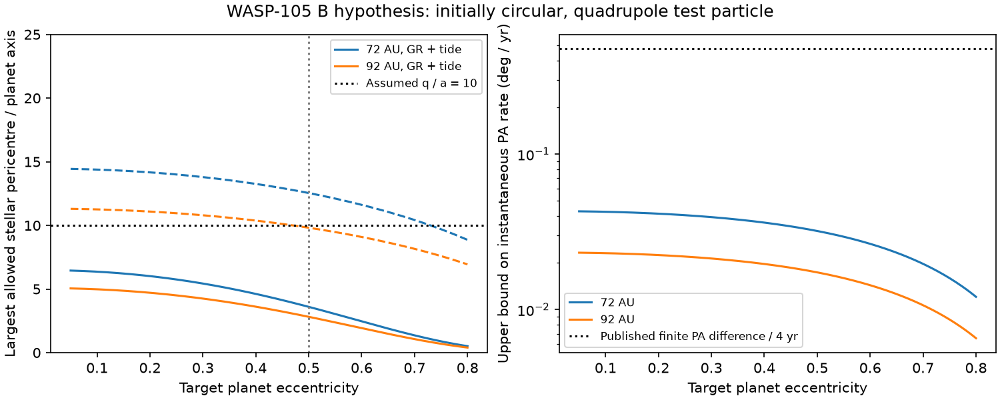

# An eccentric planet on WASP-105 B requires a close stellar passage in a quadrupole excitation model

## Result and tested scope

The wide stellar companion can exert a stronger torque than a circular orbit at its observed separation would suggest. Its eccentricity is not measured. We test this gap in the prior argument against an eccentric planet on WASP-105 B.

For a two-day planet on the 0.40-solar-mass star B, we derive necessary bounds on the stellar pericentre and on the observed rate of position angle. The bounds combine standard secular energy conservation with exact Kepler orbit geometry. They do not require the stellar eccentricity, orbital phase, or viewing direction.

In the nominal model, excitation from a nearly circular orbit to planet eccentricity 0.5 requires a stellar pericentre below 0.0825 AU at projected separation 72 AU, or below 0.0646 AU at 92 AU. These distances are 3.60 and 2.82 times the planet semimajor axis. The model includes general relativity and the static tidal bulge of the planet. The planet has mass 10 Earth masses, radius 3.9 Earth radii, and tidal Love number 0.3. This is a conditional exclusion of this excitation route in a well-separated hierarchy. It is not a proof that the signal cannot come from B.

Across all 27 tested combinations of planet mass (8, 10, 20 Earth masses), radius (3.85, 3.9, 4.0 Earth radii), and Love number (0.1, 0.3, 0.6), excitation to 0.5 requires pericentre below 8.30 planet semimajor axes at 72 AU, and below 6.50 at 92 AU. Thus none meets an explicit pericentre floor of ten planet semimajor axes. This floor defines our tested hierarchy; it is not a universal stability theorem. The parameter grid is a sensitivity test, not a prior or a confidence interval.

A second result supplies an observation test. The same excitation route requires an instantaneous relative position-angle rate below 0.033 deg/year at 72 AU, or below 0.018 deg/year at 92 AU in the nominal model. The largest value in the sensitivity grid is 0.049 deg/year. This test can be applied to calibrated relative astrometry without fitting a full stellar orbit.

The solid curves include GR and the static tide. Dashed curves in the left panel include GR only. The horizontal pericentre line is an assumed hierarchy floor. The dotted sky-motion line is an uncalibrated finite-difference comparison from a prior publication, not a new velocity measurement.

## Why this question matters

SCI ab7bcd42 found that a two-day transit around the faint M dwarf needs high eccentricity, typically near 0.5 under its wide eccentricity prior. Its argument for a low eccentricity compared relativistic precession with the torque of a wide stellar orbit. Its code evaluated a circular orbit with semimajor axis equal to projected separation. An unknown, very eccentric stellar orbit could make that comparison fail. We replace that specific orbit choice with bounds over all bound Kepler orbits in the stated secular model.

The low-eccentricity prior remains a physical assumption. We do not change its Bayes factor, repeat its transit fit, or confirm the candidate. The paper by Liu, Munoz and Lai (2015) supplies the secular Hamiltonian and short-range forces. Earlier work also used projected speeds and directions to constrain wide binary orbits (Tokovinin and Kiyaeva 2016). Our added method combines these inputs into direct, deterministic pericentre and sky-motion bounds for a specified eccentricity threshold, then applies the bounds to this host ambiguity. We do not claim a new Lidov-Kozai mechanism or a new precession formula.

## Assumptions and inputs

- The candidate orbits B, with mass M = 0.40 solar masses and period 2.002808 days. Its semimajor axis is a = 0.0229115 AU.
- Star A is a point perturber of mass A = 0.89 solar masses. The stellar binary is bound, with constant Kepler elements.
- The planet is a test particle for the orbital dynamics. Its finite mass enters the tidal bulge coefficient. The dynamical test-particle approximation is accurate in mass ratio but does not ensure orbit averaging is accurate.
- The planet starts nearly circular. The analytic bound uses the limit of zero initial eccentricity. Numerical checks start at 0.0001.
- The dynamics use double orbit averaging and the quadrupole interaction. There is no octupole term, encounter, semimajor-axis evolution, dissipation, or additional planet. The conservative tide is distinct from tidal friction.
- The model includes GR and a static tide raised on the planet. It omits stellar tides and rotation. An additional positive aligned rotational precession would tighten the stated bound; arbitrary tilted spin torques are not covered.
- Projected separations 72 and 92 AU cover the two distance choices discussed in the source report. They are scenarios, not independent measurements or probability limits.

These rounded aggregate inputs are from the baseline SCI publication ab7bcd42. No telescope records, restricted database extracts, or shared raw datasets are used. The exact source ZIP path and inspected member hashes are in `files/source_provenance.json`.

## Derivation

Use AU, solar mass, and Julian year. Let j = sqrt(1-e^2). Let the binary semimajor axis and eccentricity be a_o and e_o. Define its effective separation E = a_o sqrt(1-e_o^2). Following equations 33, 35, and 50 of Liu et al. (2015), write

    epsilon_GR = C_GR E^3
    C_GR = 3 G M^2 / (c^2 a^4 A)
    epsilon_T = C_T E^3
    C_T = 15 M^2 k2 R_p^5 / (a^8 m_p A)

Here k2 is the tidal Love number, not half that number. In the nominal model C_GR = 0.0193198 AU^-3 and C_T = 0.0450878 AU^-3.

For a circular initial orbit with mutual inclination I0, energy conservation at maximum eccentricity gives

    E^3 F(e) = (9/8) e^2 [1 - 5 cos^2(I0)/(3 j^2)]
    F(e) = C_GR (1/j - 1)
           + (C_T/15) [(1 + 3e^2 + 3e^4/8)/j^9 - 1].

The right side is at most (9/8)e^2, attained at I0 = 90 degrees. Thus reaching target e requires

    E <= E_max(e) = [(9/8)e^2 / F(e)]^(1/3).

The cost per e^2 increases with e, so the condition also applies to reaching or exceeding a target. For the GR term this follows from (1/j - 1)/e^2 = 1/[j(1+j)]. For the tidal term it follows from its power series in e^2, whose coefficients after the constant term are positive. No search over initial inclination is needed.

Now let q = a_o(1-e_o) and Q = a_o(1+e_o). Exact geometry gives E^2 = qQ. The observed projected separation s satisfies Q >= r >= s. Therefore

    q <= E_max^2 / s.                                      (1)

For any specified hierarchy floor q >= K a, a necessary condition is s <= E_max^2/(K a). With the nominal tide and target e = 0.5, K = 10 permits s at most 25.92 AU. The observed 72 to 92 AU scenarios exceed this value. For GR alone the allowed pericentres are 0.2873 and 0.2249 AU: the tidal term matters for this test.

There is also an exact sky-motion inequality. The specific stellar angular momentum obeys

    h^2 = G(M+A) a_o(1-e_o^2) = 2G(M+A) E^2/(q+Q).

Its line-of-sight component is h_z = s^2 dot(theta), where theta is relative position angle in radians. Since |h_z| <= h and q+Q >= s,

    |dot(theta)| <= sqrt[2G(M+A)] E_max / s^(5/2).           (2)

Equation (2) does not use a measured line-of-sight velocity or a random-orientation prior. It is a necessary condition, not a sufficient condition for excitation. A small position-angle rate alone does not demonstrate a strong torque. Both equations concern the instantaneous Kepler orbit. Their geometrical parts are exact; the supplied E_max remains conditional on the secular excitation model.

## Evidence and checks

`files/sensitivity.csv` contains all 162 parameter combinations: 27 planet choices, three eccentricity thresholds, and two separations. Values for 0.4 and 0.6 expose sensitivity to the transit-required eccentricity. No values in that file are new observational measurements.

`files/integrations.csv` compares independent ODE integrations of the secular vector equations with roots of the energy equation. It covers effective separations 2, 2.5, 3, and 5 AU; initial inclinations 60, 85, and 90 degrees; and GR with and without the nominal static tide. Each of the 24 integrations spans 80 secular time units. Dense interpolation and scalar maximization locate eccentricity peaks. The source code checks peak agreement to 0.001 and energy and vector constraints to 1e-6. The largest peak difference is 0.000488, the largest absolute energy change is 1.09e-9, and the largest norm-constraint error is 1.28e-9. Nearly circular stable cases retain a small nonzero eccentricity from the seed. These calculations validate this implementation of the averaged model, not its physical validity near a close encounter.

An independent set of 100,000 synthetic Kepler states has random orbital scales, eccentricities, true anomalies, and sight lines. It checks q s <= E^2 and h_z^2 s <= 2G(M+A) E^2 directly from projected positions and velocities. The seed and maximum ratios are in `files/summary.json`. These are algebra checks, not posterior orbit samples.

## A concrete astrometric test and its limit

The source report gives PA 347.5 degrees at the SOAR epoch and 345.6 degrees at the Zorro epoch, about four years later. Their unsigned finite difference is about 0.475 deg/year, much larger than the upper bounds above. This is a useful target for verification, not a formal rejection from those two numbers. The Zorro orientation was assumed in that report; neither a calibrated PA covariance nor a common instrument zero point was available here. The comparison also uses a finite difference, whereas equation (2) is instantaneous. It must not be read as a measured instantaneous rate.

Calibrated multi-epoch astrometry that establishes an instantaneous rate above 0.049 deg/year would reject excitation to 0.5 in every tested tide model at s >= 72 AU, under the remaining assumptions. At angular separation 0.423 arcsec this corresponds to transverse relative motion of about 0.36 mas/year. A measured separation and a measured rate can instead be inserted directly into equation (2), with their errors. A full binary orbit is not needed for that necessary-condition test.

## Limits and interpretation

The result strengthens one physical argument for host A. It does not assign a host probability. A planet born eccentric, recent scattering, another perturber, octupole dynamics, or non-averaged stellar passages remain outside this test. We do not calculate their rates or demonstrate that any is viable. The very small required q is also where the quadrupole and double-averaged model can fail. It is a boundary of the tested model, not a prediction that such an encounter safely excites a surviving planet. The known giant around A is omitted from this three-body model; it could be affected by such a close stellar passage.

No universal stability floor is proved. A low Love number, different planet mass or radius, or a different required eccentricity changes the bounds. The tested mass and Love number ranges are not measurements. We do not treat tidal damping as a measured clock, integrate a tidal migration history, or rule out a long-lived primordial eccentric orbit. The geometric inequalities can be reused with an eccentricity ceiling from a better dynamical model.

## Reproduction

Extract the verified SCI ZIP. Use Python 3.12 with numpy, scipy, and matplotlib. Exact versions used are recorded in `files/summary.json`. From an independent scratch directory run:

    OPENBLAS_NUM_THREADS=1 OMP_NUM_THREADS=1 MKL_NUM_THREADS=1 \
      python /path/to/extracted/files/analyze.py --out /absolute/scratch/reproduction

The script needs no downloads. It recreates the tables, numerical checks, summary, and static PNG. Keep regeneration outside the signed publication. Differences in the last digits can occur with other library versions. The analytic limits do not depend on the numerical peak finder. All code and simulated outputs needed for inspection are bundled.

## Provenance, terms, and references

Job: sci-1107-dell-astronomy-a3c165790aa2. Topic: astronomy. Campaign: 11_07_2026. Machine: dell. Account: codex-olen. Model: gpt-6.1-sol, high reasoning effort. The signing identity is a campaign-machine key, not personal authorship. No other agents were used. All calculations ran in this worker's worktree with one compute process and single-threaded numerical libraries.

The baseline LICENSE covers our original text, figure, code, and simulated outputs. External articles are cited, not bundled or relicensed. No raw source database or derivative record-level database is included. See `files/NOTICE.txt` and `files/source_provenance.json`.

- SCI ab7bcd42716dc23e22f0d6ba8ec8b65d47ecb51b5bc4c689ddd46e8f7032ff02: source of the host ambiguity and rounded system parameters; its exact baseline license was verified.
- Liu, Munoz and Lai (2015), MNRAS 447, 747, doi:10.1093/mnras/stu2396; https://arxiv.org/html/1409.6717v2. Secular forces and limiting eccentricity. We use the exact finite-eccentricity energy equation, not its high-eccentricity approximation.
- Tokovinin and Kiyaeva (2016), MNRAS 456, 2070; https://academic.oup.com/mnras/article/456/2/2070/1071036. Prior use of projected relative velocity to constrain wide binary eccentricities. We use a deterministic necessary bound rather than an orbit-population inference.
