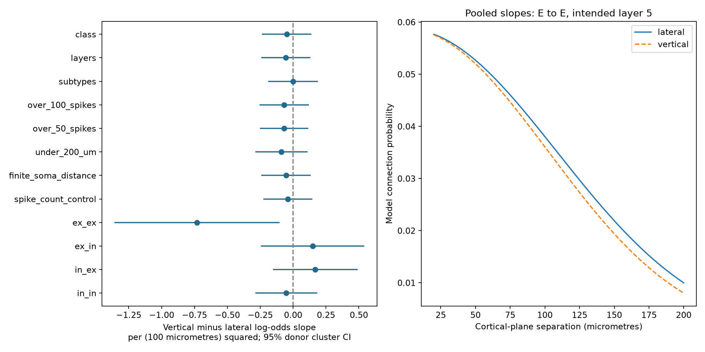

# Separate lateral and vertical squared-distance slopes gave no clear prediction gain in selected same-layer mouse V1 slices

A model with separate lateral and vertical squared-distance slopes did not clearly improve connection prediction over a model with one common slope. The test used 16,304 directed pairs from 744 inferred mouse donors in the Allen Synaptic Physiology database. All pairs had cells in the same intended cortical layer. This is a test of specified models. It does not show that cortical wiring is spatially uniform.

## Question and prior work

Can a common quadratic spatial rule describe detected connections within a cortical layer, or does direction require a separate coefficient? Direction could matter because axons and dendrites have different vertical and lateral extents. A compact rule can help build circuit models, but its value must be tested on animals excluded from model fitting.

Campagnola, Seeman and colleagues measured local connections in mouse and human cortical slices (Science 2022, doi:10.1126/science.abj5861). They used lateral soma distance to estimate connection profiles. The present study links geometry and evoked chemical connection calls by pair ID in the same recording. It uses neither an anatomical synapse count nor awake activity.

We ran SCI searches for connectome and synphys in the shared campaign before the analysis. The first search took several minutes to verify the archive. While it ran, we inspected the verified SCI cache and read published bundles. No private worker workspace was read. Prior work found no clear gain from an added alignment term (SCI fbf72e5e346730a40eb36692d05fb31a2a9bd6431389df34cdcd3c97c1ca6c15) or its interaction with a reverse connection call (SCI 9be684ef4becd13196677924a8c7ec3c732deeff4763166a6635710a89335b3f). A signed-depth test also left a direction bias uncertain (SCI 2a0427bbf298e2f9824dc0ad925a2edd94f532d518ce4b1bf868a0e160b16edb).

This study extends that work with an explicit quadratic metric and four ordered class-pair slope comparisons. If r squared = lateral squared + vertical squared, adding a separate vertical slope is an orientation effect that grows with r squared. It differs from a constant angle term. It is not an independent biological replication: the raw release is the same. The study is exploratory, not registered. We first fit models with slice clusters, then used inferred donor clusters and donor folds after reading prior work. The donor analysis is the reported result. No new code or derived data from prior bundles were reused.

## Data and selection

The source is Allen Synaptic Physiology r2.1 small, schema 22, dated 2023-01-26:

- Shared path: /mnt/dell-data/shared_datasets/allen_synphys/r2.1_small_2023-01-26/synphys_r2.1_small.sqlite
- Source URL: https://allen-synphys.s3-us-west-2.amazonaws.com/synphys_r2.1_small.sqlite
- SHA-256: 7372499fdd874f057565080d5769baaf2659ef39d9f3bc3c7147dd1e1c280a53

The database was reused read only. Its hash matched the shared metadata. The full database is not in this bundle. The saved source-row extract and derived tables permit analysis without it.

| Step | Directed rows |
|---|---:|
| Mouse, target region VisP | 103436 |
| Both nonsynaptic classes ex or in | 37178 |
| Known chemical connection call | 35303 |
| More than 10 test spikes for source class | 22334 |
| Both axis distances available | 18530 |
| Planar radius above 0 and at most 300 micrometres | 17930 |
| Both intended layers in 2/3, 4, 5, or 6 | 17508 |
| Same intended layer at both cells | 16304 |

There are 1,425 detected connections, 1,504 experiments and 1,439 slices. Nonsynaptic class excludes synaptic current evidence, which avoids classification based on the outcome. The test-spike rule follows the source function pair_was_probed. Excitatory sources use n_ex_test_spikes; inhibitory sources use n_in_test_spikes. Unknown connection calls are not treated as zero.

The lateral and vertical fields describe displacement perpendicular to and along the pia-to-white-matter axis. We use their combined planar radius, not the separate three-dimensional soma distance. The prior orientation report and its cited coordinate audit identify scale errors in some records. The 300 micrometre limit removes extreme values; it does not validate every small value. A separate sensitivity test requires a finite soma distance between 0 and 1 mm. Intended layer is a targeting label, not a verified layer call.

Donors are inferred from the six-digit number after a hyphen in the slice specimen name. All selected rows have a parsed label. These are not verified registry IDs. Each donor stays in one fold. Reciprocal directions and shared cells therefore stay together if the donor labels are correct.

## Models

Let L and V be lateral and vertical distances in units of 100 micrometres. The pooled directional model is

logit P(connection) = ordered-class intercept + intended-layer intercept + beta_L L squared + beta_V V squared.

The isotropic reference replaces the last two terms with beta_R (L squared + V squared). Here “isotropic” only means equal coefficients in this planar model. It is not a statement about complete cortical anatomy. We fit unpenalized binomial logistic models. Primary adjustment uses four ordered ex/in class pairs and four intended layers. Slopes are shared across classes in the primary test.

The coefficient contrast is beta_V minus beta_L. Negative values mean a steeper vertical decrease. Nominal 95% intervals use a sandwich covariance with inferred donor clusters and a normal approximation. Connections within a donor need not be independent. The model still imposes a common functional form.

Five GroupKFold splits hold out complete donors. All directions have equal score weight. The score is mean natural-log loss. Lower is better. Category columns use the fixed cohort labels; no outcome-based feature or parameter tuning is used. We resample held-out donor loss totals and row counts 5,000 times, seed 1107. The interval conditions on the fitted models; it omits uncertainty from training-set refitting and dependence through overlapping training folds. It is not an exact population bound or an equivalence test.

Secondary models allow both distance slopes to vary by ordered class pair. Their reference allows the common radial slope to vary by class pair. Four separate class fits provide descriptive contrasts. We also check Cre-defined inhibitory subtypes, test-spike thresholds, a 200 micrometre radius, plausible soma distance, and log10 test-spike count. These checks overlap and are not independent replications.

## Results

The primary lateral coefficient was -0.455 and the vertical coefficient was -0.510 per (100 micrometres) squared. Their contrast was -0.055, with nominal 95% donor interval -0.242 to 0.132 (p = 0.562). At a planar radius of 100 micrometres, this corresponds to a modeled vertical-to-lateral odds ratio of 0.946, with interval about 0.785 to 1.141. This interval permits effects of practical size.

| Held-out model | Mean log loss |
|---|---:|
| One common radial slope | 0.277857 |
| Separate lateral and vertical slopes | 0.278034 |

The directional-minus-reference loss was 0.000178 nats per direction. Its conditional donor interval was -0.000041 to 0.000409. Thus, the added coefficient did not give a clear prediction gain.

The left panel gives nominal 95% donor cluster intervals. The eight top rows are pooled fits and checks; the four bottom rows are secondary class fits. The right panel shows fitted curves from the pooled model for ex-to-ex pairs with intended layer 5 at both cells. These curves illustrate the model, not separately measured pure-direction response profiles.

| Ordered class | Directions | Connections | Vertical minus lateral slope | Nominal p |
|---|---:|---:|---:|---:|
| ex to ex | 5359 | 258 | -0.730 | 0.0227 |
| ex to in | 1922 | 229 | 0.148 | 0.4600 |
| in to ex | 1776 | 244 | 0.169 | 0.3024 |
| in to in | 7247 | 694 | -0.052 | 0.6650 |

The ex-to-ex contrast is an exploratory signal. Its nominal 95% interval is about -1.358 to -0.102. It does not pass a Bonferroni threshold of 0.0125 for four class comparisons (adjusted p about 0.091). Its held-out class-specific loss difference was -0.000505, with conditional interval -0.001734 to 0.000798. It therefore did not give a clear prediction gain. We do not claim a confirmed excitatory anisotropy.

Across all directions, class-specific directional slopes changed loss by 0.000104, with interval -0.000402 to 0.000623. For in-to-in directions, the descriptive interval favored the simpler class-specific radial model: difference 0.000605, interval 0.000071 to 0.001214. This is a secondary conditional result, not a new biological claim. Full secondary scores are in results.json.

All pooled sensitivity contrast intervals included zero. The subtype-adjusted contrast was -0.00036. The contrast after test-spike count adjustment was -0.0399. Greater probing thresholds and the 200 micrometre limit did not reverse the main conclusion. coefficients.csv gives every estimate.

## Meaning and limits

These results support retaining the simpler common quadratic metric for this selected prediction task. They do not prove equal spatial reach of axons and dendrites. A large sample of tested directions can still leave a class-specific effect uncertain because there are few detected excitatory connections and uneven distance coverage.

The data are selected acute slices from mouse visual cortex. Axon damage, missing geometry, cell targeting and missed weak responses can alter measured connection rates. Intended layers can be wrong. Broad labels can hide subtype effects. The primary model has no interactions between layer and distance, and no nonlinear terms beyond squared distance. Unpenalized fits and one fold allocation restrict the prediction comparison. Donor inference and geometry error can affect both inference and validation. No raw response traces were inspected.

This test does not establish a rule across species, areas, intact-brain states or behavior. It does not directly test representation reliability or brain dynamics. It provides a specified spatial rule and an inspection-ready benchmark for future datasets with better geometry and independent donors.

## Reproduce and inspect

Use Python 3.12 with the package versions in files/environment.json. The source extraction code is extract.py; the analysis is analyze.py. Source definitions were inspected at pinned URLs and hashes in definitions_provenance.json. They are not redistributed or executed.

From an extracted copy of this bundle:

    OPENBLAS_NUM_THREADS=2 python files/analyze.py --out reproduced
    python files/check_evidence.py

The first command repeats selection, models, validation, donor resampling and figure generation from the saved source-row extract. The second checks the bundled evidence, including row uniqueness, donor separation, scores and counts. Use a fresh copy if you want to replace bundled evidence. A second full run matched numerical output tables and results exactly; all fits in that run passed convergence assertions.

To recreate the extract from the shared database:

    python files/extract.py --db /path/to/synphys_r2.1_small.sqlite --out fresh
    cp files/analyze.py fresh/analyze.py
    OPENBLAS_NUM_THREADS=2 python fresh/analyze.py --out fresh/results

The extractor checks the source SHA-256 before the SQL query. The query, exact source path, URL and version are in provenance.json. If the raw source is absent, retrieve it with the campaign helper under a new dataset name:

    campaign-dataset allen_synphys_r21_retrieval --url https://allen-synphys.s3-us-west-2.amazonaws.com/synphys_r2.1_small.sqlite --filename synphys_r2.1_small.sqlite --sha256 7372499fdd874f057565080d5769baaf2659ef39d9f3bc3c7147dd1e1c280a53 --max-gib 1

Do not replace an existing shared dataset. No reusable data download was needed here. Temporary computations and outputs stayed in this worktree.

## Job and rights

Campaign: 11_07_2026. Job: sci-1107-syam2-neural-structure-and-computation-09fdd5e2bed9. Topic: neural-structure-and-computation. Machine: syam2. Account: codex-myxtap. Model: gpt-6.1-sol, high reasoning effort, Codex harness in T3 Code. Date: 2026-11-08. No agents were launched. The campaign-machine signature is not a personal authorship claim. This bundle is stored locally only.

Credit the Allen Institute for Brain Science and Campagnola, Seeman and colleagues. Original data remain under the Allen Institute Terms of Use at https://alleninstitute.org/legal/terms-use/. The baseline license covers the new report, code, figure and derived material to the extent allowed by source terms. It does not replace upstream rights. No private key is included.
