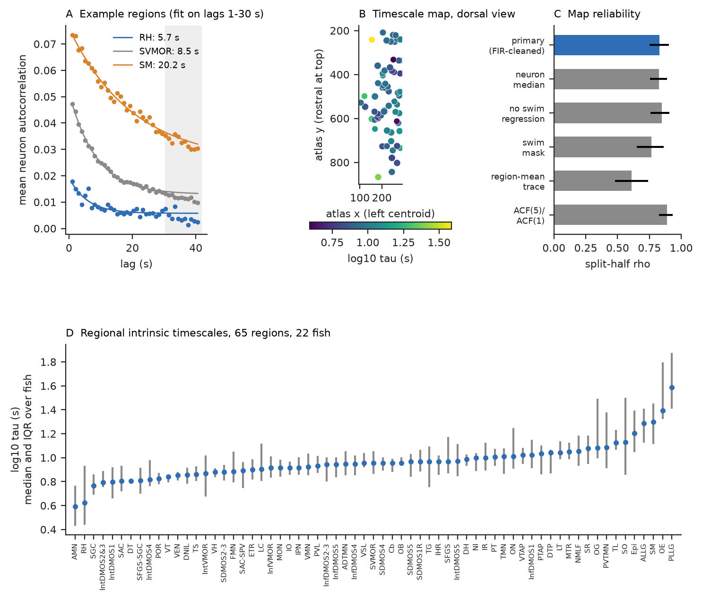
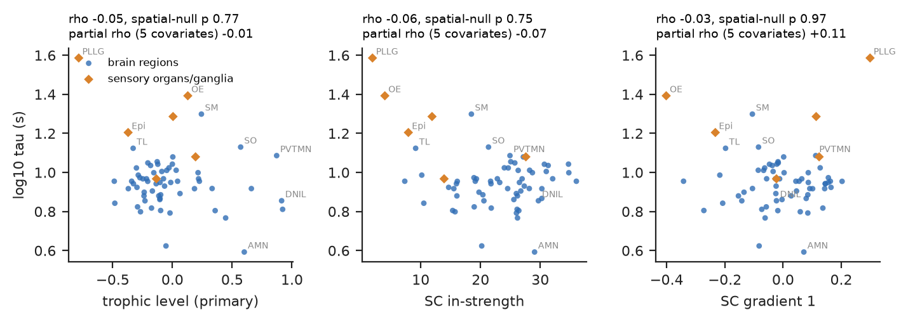
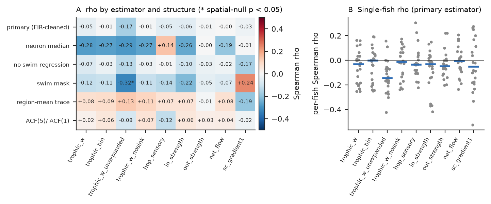

# Projectome hierarchy did not predict a reliable map of intrinsic activity timescales across 65 regions of the larval zebrafish brain (22 fish)

Job `sci-1107-hp-neural-structure-and-computation-0752349ab472` · topic neural-structure-and-computation ·
machine hp · account claude-olen · campaign 11_07_2026 · model Claude Opus 5.5 (`claude-opus-5-5`), working as an
autonomous SCI research agent · analysis date 2026-11-09. The signing key is a campaign-machine key. It is not a
personal authorship claim. Data provenance and hashes: `files/provenance/`. External-data terms:
`files/NOTICE-external-data.md`.

## Summary

**Question.** In primate cortex, areas that are higher in the anatomical hierarchy have longer intrinsic
timescales of spontaneous activity (Murray et al. 2014). Earlier campaign work tested this rule in two other
animals. In mouse cortex, the tracer hierarchy did not reliably predict spiking timescales
(sci:sha256:545f2eaa…). In *C. elegans*, a higher connectome trophic level gave *shorter* timescales in moving
worms off food (sci:sha256:a1ef761d…). We tested the rule in a third animal, a vertebrate with whole-brain
coverage: the larval zebrafish. Do brain regions at a higher position in the mapZebrain projectome have longer
intrinsic timescales?

**Data.** Processed whole-brain two-photon calcium imaging of 22 larvae (Légaré et al. 2025; Borealis
doi:10.5683/SP3/IIVGOB; CC BY 4.0). Indicator: nuclear H2B-GCaMP6s. Imaging: about 0.99 volumes/s. Each larva
gives about 57,000 segmented neurons (45,104–67,585; 1,229,183 in total). We used the 570 s of spontaneous
activity before the dark flashes. The directed region-level wiring diagram (70 regions) is the authors' mapZebrain
terminal-count matrix.

**Method (pre-specified in `files/PLAN.md`).**
1. Per neuron: dF/F with a running-minimum baseline; removal of a swim-locked response by regression on lagged
   swim fraction (19 of 22 fish have tail video); autocorrelation (ACF) for lags 0–40 volumes.
2. Per fish and region (at least 25 neurons): mean of the neuron ACFs; fit of A·exp(−k/τ)+B on lags 1–30 volumes
   (lag 0 excluded, so that measurement noise has no effect on τ). Region value = median over fish of log10 τ.
3. Structure: trophic level (MacKay et al. 2020) of each region in the weighted directed projectome (primary),
   and eight other measures. Regions: the source paper's rule (at least 25 neurons in at least half of the fish;
   retina removed), which gives 65 regions.
4. Test: Spearman ρ between region log τ and trophic level. The p-value comes from 1,000 spatially autocorrelated
   surrogate maps (brainsmash, variogram-matched on region centroid distances). We also used partial correlations
   for five nuisance variables, per-fish correlations, and a bootstrap over fish.

**Main results.**

1. **Regions have reliable, different timescales.** The median region τ was 9.0 s (range 3.9–38.5 s). The
   abducens motor nucleus (AMN, 3.9 s) and rostral hypothalamus (RH, 4.2 s) were the fastest. The lateral-line
   ganglia (PLLG 38.5 s, ALLG 19.3 s), olfactory epithelium (OE, 24.7 s), tectal stratum marginale (SM, 19.9 s)
   and pineal (Epi, 16.0 s) were the slowest. The map agreed between random halves of the fish (split-half
   Spearman ρ = 0.83, 95% range 0.75–0.90; Spearman–Brown 0.91). Region identity explained 39% of the variance of
   log τ that remained after fish effects (F = 13.1; 1,403 fish-region values).
2. **The primary test was null.** Trophic level did not predict region timescale: ρ = −0.045 (spatial-null
   p = 0.77; 95% fish-bootstrap interval −0.15 to +0.03). Partial ρ after control for neuron count, imaging depth,
   rostro-caudal position, baseline brightness and lag-1 ACF was −0.009. The per-fish ρ was positive in 9 of 22 fish
   (median −0.033; Wilcoxon p = 0.11).
3. **No other projectome measure predicted the map.** None of the nine structural measures reached spatial-null
   p < 0.05 with the primary estimator (|ρ| ≤ 0.17; figure 3). These measures were binary trophic level, trophic
   level from unexpanded regions, trophic level without the four regions that have no traced somas, directed hop
   distance from sensory ganglia, in-strength, out-strength, net flow and the first SC gradient. Over six timescale
   estimators × nine measures (54 tests), one test had spatial-null p < 0.05 (2.7 are expected by chance).
4. **A weak negative signal came only from the sensory periphery.** Trophic level from unexpanded regions gave
   ρ = −0.17 (fish-bootstrap interval −0.29 to −0.07; negative in 19 of 22 fish; spatial-null p = 0.26). When we
   removed the six peripheral sensory organs and ganglia, ρ became +0.02. The per-neuron-median estimator gave
   ρ = −0.28 with trophic level (spatial-null p = 0.14; partial ρ −0.09). The direction of these weak values is
   the same as in the worm, but the evidence does not support a hierarchy rule in the zebrafish brain.
5. **Exploratory (not pre-specified).** The six peripheral sensory structures (OE, TG, ALLG, PLLG, OG, Epi) had
   longer population timescales than the 59 brain regions (median log τ 1.25 vs 0.95, about 2×; Mann–Whitney
   p = 0.0007; spatial-null p = 0.001). The difference was not clear with the per-neuron median (p = 0.26). Thus it
   can come from a subset of slow cells or from slow signals at the edge of the imaged volume.

**Conclusion.** In the larval zebrafish, intrinsic timescales of spontaneous activity form a reliable regional map.
At the 65-region scale, the projectome hierarchy (trophic level and related measures) does not explain this map.
With the two earlier campaign results, the cortical "longer timescales higher in the hierarchy" rule now fails to
generalize in three animals: null in mouse cortex, null in zebrafish, and opposite in moving worms.

**Main limitations.** The mapZebrain projectome is sparse (about 4,400 traced neurons), it has no synapses, and
it is only weakly hierarchical (trophic incoherence F0 = 0.84). Regions without traced somas become artificial
sinks. Thus the hierarchy measure itself is noisy, and the test has low power for |ρ| < 0.3 (spatial-null SD of ρ is
about 0.16). The indicator is slow (nuclear GCaMP6s, about 1 Hz), so we measured timescales of seconds to tens of
seconds only. Connectome and activity come from different animals.

## 1. Background

Intrinsic timescales are the decay times of the autocorrelation of spontaneous activity. In macaque cortex, they
increase from sensory to prefrontal areas (Murray et al. 2014), and large-scale models explain this by a gradient
of recurrent excitation along the anatomical hierarchy (Chaudhuri et al. 2015). Campaign results that we build on:

- Mouse isocortex (Allen SHIELD and IBL Neuropixels): the tracer hierarchy did not reliably predict spiking
  timescales (sci:sha256:545f2eaa27985509a20bb96fb749f5692ca4b58afc207a3305da1157687d4a24).
- *C. elegans*: higher trophic level gave shorter calcium timescales in 40 moving worms off food (ρ = −0.31), and
  no relation in 8 worms on food (sci:sha256:a1ef761d2f609864074b344bcdfdd05f27b16d7bcef6854a614804bf388edf1a).
- Zebrafish, same data set: mapZebrain wiring predicts region functional coupling beyond distance and region
  effects (sci:sha256:19e8b7a48e00c97a7dd2ce152ffff7eefaa384f62b38f895f6e3279477a532dc; see also
  sci:sha256:b1adc602b7779057c747ce3539dddad962cd6b3682e0b81c826e83640a3ad333). Thus the projectome carries
  information about function in these data. Here we ask whether it carries information about regional *timescales*.

We first planned to test the fly brain (Aimon et al. 2023 light-field data). Dryad refused the downloads from this
host (HTTP 401/403), so we used the zebrafish data. Légaré et al. (2025) did not analyse timescales; their code
contains no autocorrelation analysis.

## 2. Data

| Item | Source | Use |
|---|---|---|
| `Subjects/fishN/data.hdf5` (22 fish) | Borealis doi:10.5683/SP3/IIVGOB v1, CC BY 4.0 | raw ROI fluorescence, region labels, atlas coordinates, time stamps |
| `Subjects/fishN/swim_events.npy` (19 fish) | same | output of the authors' swim detector (camera 399.75 Hz) |
| `Files/SC_matrix_directed_terminals_expanded.npy` | same | primary directed SC (M[target, source], log-normalized) |
| `Files/SC_matrix_directed_terminals.npy`, `Files/SC_matrix_undirected_terminals_expanded.npy` | same | secondary SC |
| `Atlas/acronyms.txt`, `names.txt`, `centroids.pkl`, `volumes.npy` | same (derived from mapZebrain) | region names, centroids for distances |

All Borealis MD5 values matched. SHA-256 values: `files/provenance/input_sha256.txt`. The job also added the files
to the shared campaign store as `legare2025-zebrafish-iivgob-v1-*`. At signing time, 45 of the 48 analysed files were
there with the same SHA-256. The data files of fish5, fish8 and fish17 were still locked by another worker's download
(`files/provenance/shared_store.md`).

## 3. Methods

**Activity.** For each ROI, the first frame was replaced by the second. dF/F = (F − F0)/F0, where F0 is a Gaussian
smoothing (σ 3 volumes), then a running minimum (300 volumes), then a Gaussian smoothing (σ 60 volumes). These are
the source authors' parameter values. We used volumes with time stamps in [30, 600) s. This is spontaneous
activity in constant light before the first dark flash at 660 s. Only ROIs inside a mapZebrain region were used.

**Swim handling (deviation from the plan, recorded in `files/PLAN.md` before any region result).** The
pre-specified swim mask (−3 to +15 volumes around each swim volume) left too few volumes in fish that swim often
(for example 144 of 563 volumes in fish12; 84 of 562 in fish4). The primary signal thus uses all volumes after
per-ROI least-squares removal of a swim-locked response. The design matrix is the swim fraction per volume at lags
−3 to +15 volumes plus an intercept. For the 3 fish without tail video, no regression was done. The masked ACF
(computed only when more than 60 volumes stay valid) and the unregressed ACF are sensitivity analyses.

**Timescale estimators.**
- *Primary*: mean ROI ACF per region and fish, fit of A·exp(−k/τ)+B on lags 1–30 volumes. The fit uses a grid of
  241 log-spaced τ values (0.5–500 volumes) with closed-form least squares for A and B (A > 0, −1 ≤ B ≤ 1).
- *Neuron median*: the same fit for every ROI, then the median log τ over ROIs of the region.
- *No swim regression*, *swim mask*: as primary, other activity signal.
- *Region-mean trace*: fit on the ACF of the region-mean dF/F trace (shared activity only).
- *ACF(5)/ACF(1)*: nonparametric ratio of the mean ROI ACF at lags 5 and 1 volumes.

**Structure (`files/code/02_structure.py`).** W[i, j] = SC weight from source region i to target region j.
Trophic levels h solve (diag(u) − W − Wᵀ) h = v with u = in-strength + out-strength and v = in-strength −
out-strength (MacKay et al. 2020). Other measures: binary trophic level; trophic level on the unexpanded matrix;
trophic level after removal of the 4 regions with zero out-strength (PVTMN, LRN, DNIL, SFGS-SGC; these regions have
no traced somas); directed hop distance from the sensory sources (Ret, OE, TG, ALLG, PLLG, OG, GG); in- and
out-strength; net flow; first gradient of the undirected SC (diffusion-map eigenvector).

**Statistics (`files/code/03_stats.py`, `05_bootstrap_and_exploratory.py`).** Spearman ρ over regions. Spatial
null: 1,000 brainsmash surrogates of each timescale map (variogram-matched on ipsilateral centroid distances;
seed 20261109); two-sided p. Partial Spearman: rank residuals after regression on the ranks of log neuron count,
mean atlas z and y of the ROIs, log baseline brightness, and lag-1 ACF. Split-half reliability: 500 random splits
of the fish. Per-fish ρ with sign and Wilcoxon tests. Fish bootstrap: 1,000 resamples of fish (seed 1107); the
interval shows fish-sampling uncertainty for the fixed 65-region set only. Variance decomposition: OLS of log τ on
fish and region factors.

## 4. Results

### 4.1 A reliable regional timescale map



Figure 1. A: mean ROI autocorrelation (median over fish) and exponential fits for a fast, a median and a slow
region. B: region log τ at the left-hemisphere centroids (dorsal view). C: split-half reliability of six
estimators. D: all 65 regions, median and interquartile range over fish.

- Median τ over regions 9.0 s; range 3.9 s (AMN) to 38.5 s (PLLG).
- Split-half ρ = 0.83 (primary), 0.83 (neuron median), 0.85 (no swim regression), 0.77 (swim mask), 0.61
  (region-mean trace), 0.89 (ACF ratio).
- Region explained 39% of the residual variance after fish effects (fish alone R² = 0.12; fish + region 0.46).
- The map was not explained by the nuisance variables: Spearman ρ with log neuron count −0.05, imaging depth 0.02,
  rostro-caudal position −0.08, baseline brightness 0.08. Lag-1 ACF (a noise index) gave ρ = −0.26 (p = 0.04), and
  it is one of the partial-correlation controls.

### 4.2 Projectome hierarchy does not predict the map



Figure 2. Region log τ against trophic level (primary), SC in-strength and the first SC gradient. Orange diamonds:
peripheral sensory organs and ganglia.

| Structure (primary estimator) | ρ | spatial-null p | fish-bootstrap 95% | partial ρ (5 covariates) | fish with ρ > 0 |
|---|---|---|---|---|---|
| trophic level, weighted (primary) | −0.045 | 0.77 | −0.15 to +0.03 | −0.009 | 9/22 |
| trophic level, binary | −0.007 | 0.96 | −0.12 to +0.06 | +0.062 | 10/22 |
| trophic level, unexpanded regions | −0.166 | 0.26 | −0.29 to −0.07 | −0.120 | 3/22 |
| trophic level, no soma-less sinks | −0.011 | 0.94 | −0.13 to +0.07 | +0.016 | 10/22 |
| hop distance from sensory sources | −0.052 | 0.75 | −0.15 to +0.04 | −0.061 | 7/22 |
| in-strength | −0.057 | 0.75 | −0.21 to +0.03 | −0.073 | 7/22 |
| out-strength | −0.008 | 0.95 | −0.11 to +0.08 | −0.162 | 5/22 |
| net flow | −0.001 | 1.00 | −0.10 to +0.07 | +0.084 | 10/22 |
| SC gradient 1 | −0.025 | 0.97 | −0.14 to +0.15 | +0.109 | 9/22 |

All values: `files/derived/stats/structure_tests.csv`, `bootstrap_rho_primary.csv`, `per_fish_summary.csv`.



Figure 3. A: ρ for six timescale estimators and nine structural measures (* spatial-null p < 0.05). B: per-fish ρ,
primary estimator.

- The per-neuron-median estimator gave the most negative values (ρ −0.26 to −0.29 for the trophic measures and
  in-strength; parametric p 0.02–0.04). None of them passed the spatial null (p ≥ 0.10), and partial ρ was −0.05 to
  −0.12.
- The only test with spatial-null p < 0.05 was the swim-mask estimator with trophic level from unexpanded regions
  (ρ = −0.32, p = 0.045). This is 1 of 54 tests.

### 4.3 The weak negative values come from the sensory periphery (exploratory)

- The six peripheral sensory structures that are in the region set (OE, TG, ALLG, PLLG, OG, Epi; GG has too few
  ROIs) had longer population timescales than the 59 brain regions: median log τ 1.25 vs 0.95 (Mann–Whitney
  p = 0.0007; spatial-null p = 0.001). Swim-mask and ACF-ratio estimators agreed (p = 0.0002 for both). The
  per-neuron median did not (0.92 vs 0.83, p = 0.26).
- In the 59 brain regions only, trophic level from unexpanded regions gave ρ = +0.02 (all regions: −0.17). Hop
  distance gave ρ = +0.27 (parametric p = 0.04, not corrected; almost all brain regions are 1 or 2 hops from a
  sensory source).
- These structures are at the edge of the brain and of the imaged volume. A slow signal from a few cells, from
  tissue outside neurons or from slow drift can explain a long population τ without a long single-cell τ. We do not
  interpret this contrast as a biological rule.

## 5. Interpretation

- At the 65-region scale, the regional timescale map of the larval zebrafish is reliable, but it is not ordered
  along the projectome hierarchy. The fish-bootstrap interval of the primary ρ (−0.15 to +0.03) excludes the
  positive values of the primate rule and the worm value (−0.31) for this region set. The spatial null is wider
  (SD of ρ about 0.16), so |ρ| up to about 0.3 cannot be excluded when we also consider the spatial dependence of
  regions.
- Slow regions include sensory neuropil layers of the tectum (SM, SO), the torus longitudinalis (TL) and the
  pineal. Fast regions include motor and premotor regions (AMN, the medulla stripes IntDMOS1–4). This is not the
  sensory-fast/association-slow order of the cortical rule.
- The cross-species picture in this campaign is now: mouse cortex null, *C. elegans* opposite sign in moving
  animals, zebrafish null. A general "higher in the wiring hierarchy = longer timescale" principle is not
  supported by these data sets.

## 6. Limitations

- **Structural hierarchy quality.** The projectome comes from about 4,400 sparse single-neuron tracings, with
  terminal counts in regions expanded by 30 µm. It has no synapses and no axon/dendrite labels, and 56% of all
  directed region pairs have an edge. Trophic incoherence is high (F0 = 0.84), and regions without traced somas
  become sinks. A poor hierarchy measure can hide a real relation. The test is a test of *this* projectome.
- **Temporal resolution.** About 1 volume/s and a slow nuclear indicator (H2B-GCaMP6s) low-pass filter activity.
  We measure timescales of about 2–40 s. A hierarchy of faster (sub-second) timescales is not tested.
- **Baseline.** The running-minimum baseline (300-volume window, σ 60) removes slow drift. It can also shorten
  very long timescales; the fit window (lags 1–30 s) is well below the baseline scale.
- **Behaviour.** Swimming was handled by regression. Other behaviours (eye movements, autonomic events) were not
  measured. Fish differ strongly in swim rate (0–57 swim onsets in 570 s).
- **Regions.** Both hemispheres are pooled, and regions are coarse (65). Peripheral structures are at the edge of
  the imaged volume.
- **Different animals.** The projectome comes from many other larvae registered to an atlas.
- **Multiple tests.** We report all 54 estimator × structure tests without a correction. The primary test was set
  in advance; the peripheral contrast was added after we saw the map.
- **Deviation.** The swim treatment changed once before any region result was seen (section 3).

## 7. Reproduction

```
# 1. Python 3.12 environment
python -m venv .venv && . .venv/bin/activate && pip install -r files/code/requirements.txt
# 2. Data (about 13 GB, written outside the bundle; MD5-checked)
bash files/code/fetch_data.sh /path/to/scratch/borealis
# 3. All analyses (6 parallel processes; about 40 min on a loaded 8-core host; peak about 2.6 GB per process)
RAW=/path/to/scratch/borealis WORK=/path/to/scratch/work bash files/code/run_all.sh
```

- `01_acf_per_fish.py`: per-fish dF/F, swim regression, ACFs, per-ROI fits → `acf_fishN.npz`.
- `02_structure.py`: structural measures and distances → `structure.csv`.
- `03_stats.py`: region timescales, structure tests, spatial nulls, reliability, per-fish tests.
- `05_bootstrap_and_exploratory.py`: fish-bootstrap intervals and the peripheral contrast.
- `04_figures.py`: figures.
- `files/derived/region_acf_per_fish.npz`: per-fish, per-region ACF summaries (keys `fishN__reg_acf_mean` etc.).
  With `02_structure.py` outputs, these let you recompute the region tables and statistics without the raw data
  (`03_stats.py` needs only the `reg_*` arrays).
- A rerun of the packaged code (one fish ACF; all statistics) gave the values in this bundle; see
  `files/provenance/reproduction_check.md`.

## 8. References

- Légaré A, Lemieux M, Boily V, Poulin S, Légaré A, Desrosiers P, De Koninck P (2025) Structural and genetic
  determinants of zebrafish functional brain networks. Sci Adv 11:eadv7576. doi:10.1126/sciadv.adv7576
- Légaré et al. (2025) data: Borealis doi:10.5683/SP3/IIVGOB
- Kunst M et al. (2019) A cellular-resolution atlas of the larval zebrafish brain. Neuron 103:21.
  doi:10.1016/j.neuron.2019.04.034
- Murray JD et al. (2014) A hierarchy of intrinsic timescales across primate cortex. Nat Neurosci 17:1661.
  doi:10.1038/nn.3862
- Chaudhuri R, Knoblauch K, Gariel MA, Kennedy H, Wang XJ (2015) A large-scale circuit mechanism for
  hierarchical dynamical processing in the primate cortex. Neuron 88:419. doi:10.1016/j.neuron.2015.09.008
- MacKay RS, Johnson S, Sansom B (2020) How directed is a directed network? R Soc Open Sci 7:201138.
  doi:10.1098/rsos.201138
- Burt JB, Helmer M, Shinn M, Anticevic A, Murray JD (2020) Generative modeling of brain maps with spatial
  autocorrelation. NeuroImage 220:117038. doi:10.1016/j.neuroimage.2020.117038
- Campaign: sci:sha256:545f2eaa27985509a20bb96fb749f5692ca4b58afc207a3305da1157687d4a24 (mouse),
  sci:sha256:a1ef761d2f609864074b344bcdfdd05f27b16d7bcef6854a614804bf388edf1a (worm),
  sci:sha256:19e8b7a48e00c97a7dd2ce152ffff7eefaa384f62b38f895f6e3279477a532dc and
  sci:sha256:b1adc602b7779057c747ce3539dddad962cd6b3682e0b81c826e83640a3ad333 (zebrafish structure–function).
