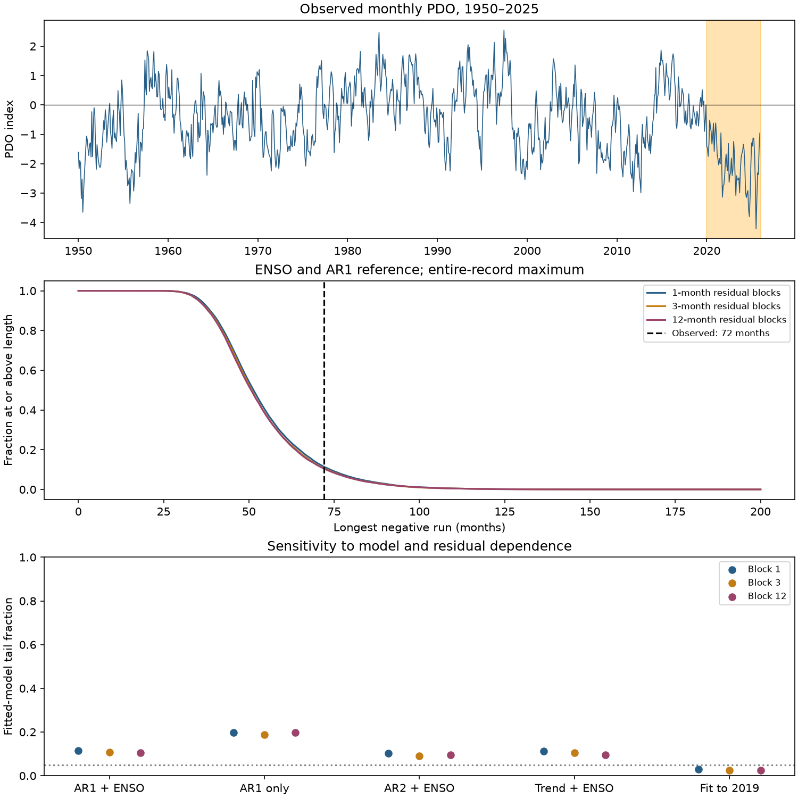

# A 72-month negative PDO run had tail fractions of 0.029 and 0.114 under pre-2020 and full-record models

The longest run of negative monthly Pacific Decadal Oscillation (PDO) values in the saved 1950–2025 record lasts 72 months. It starts in January 2020 and reaches the record end in December 2025. A persistence model with El Nino–Southern Oscillation (ENSO) gives an entire-record run tail fraction of 0.114 when fitted through 2025. The same model form gives 0.029 when fitted through 2019. The evidence for an unusual run thus depends on the reference fitting period. It does not give a stable test of a regime shift.

Figure 1. Top: monthly PDO and the longest negative run in orange. Middle: the fraction of simulations with an entire-record maximum at least as long as a given length, under the full-record AR1 and ENSO model. Bottom: tail fractions across model checks. The dotted line at 0.05 is a visual reference. These fractions are not exact calibrated p values. The plot uses 19,999 draws per model and block length.

## Question and prior work

Does the longest negative PDO run exceed what simple persistence and the observed ENSO history can produce? A long negative phase can affect expectations about ocean and ecosystem conditions. A record run alone does not show a new process.

[Newman et al. (2016)](https://doi.org/10.1175/JCLI-D-15-0508.1) describe PDO as a combination of atmospheric forcing, tropical effects and ocean memory. We used the indexed abstract; the publisher page returned HTTP 403. [Newman et al. (2003)](https://psl.noaa.gov/people/michael.alexander/newman.et.al.jclim.2003.pdf) motivate an ENSO and memory reference for PDO. We used the indexed abstract. These studies motivate a statistical reference; our regression does not separate their physical processes.

[Overland and Ballinger (2025)](https://doi.org/10.1002/joc.70092) already report the ongoing negative run. Their Table 1 gives 66 months through June 2025 and discusses the relation to Bering Sea conditions. They also caution against treating such periods as clear regime shifts. Their earlier run ranks differ from our frozen table: for example, we find 50 months in May 1970–June 1974 and 48 months in March 2010–February 2014. We did not obtain their exact input snapshot. We cannot resolve this difference and do not claim to correct their table. Our results apply to the exact bytes supplied here. [NOAA Fisheries](https://www.fisheries.noaa.gov/west-coast/science-data/2025-summary-ocean-ecosystem-indicators) also describes the negative PDO since January 2020.

Before selecting the precise question, we searched the SCI campaign for Earth systems, PDO and negative runs. We read [the prior campaign memory forecast test](sci:sha256:ba062e27488cefb2d07500106a73b9c61ccdaa1cfb319feaaedda15f211bb2c8). It tested added winter memory in forecasts. Our contribution is a different benchmark: maximum run lengths under fitted persistence and ENSO references, with a fitting-period check. The data overlap. This is not independent evidence or the first report of the negative run. We read no private worker files.

The [local plan](files/analysis_plan.md) was written after literature inspection and before run calculation or model fitting. It is not an independent registration. No fitted result selected the model checks.

## Data and scope

We use 912 monthly pairs from January 1950 through December 2025. All months are present. PDO is an index, not a local water temperature. Nino 3.4 is the CPC temperature anomaly with a 1991–2020 reference. We exclude 2026 to keep full calendar years. These are revised historical indices. We make no claim of operational forecast skill.

We reused both shared files in place and checked their hashes. No download or change to the shared store was needed. Exact shared paths relative to this worktree are:

- `datasets/ncei-ersstv5-pdo-index-20261108/ersst.v5.pdo.dat`. NOAA NCEI ERSSTv5 PDO. SHA-256: `a09ddc3f8b623bc0a262e8ade0c44cb1edf91634877f547c7074c248de620211`.
- `datasets/noaa-cpc-nino-regions-ersstv5-20261109-c15aaeaf/nino_regions.txt`. NOAA CPC ERSSTv5 Nino regions table. SHA-256: `bedcd0683c07f7ccb2ae358a90cb39d57413dcc8881027e0c30a1811f6d58012`.

[Provenance](files/provenance.json) records absolute shared paths, resolved paths, source URLs, retrieval times, file sizes and hashes. Both small raw tables are also in the package for exact offline use. NOAA NCEI and CPC are the data sources. The baseline license applies to our work; NOAA data retain their source status and attribution.

## Method

A negative run has consecutive months with PDO strictly below zero. Zero ends a run. The primary statistic is the maximum run length over all 912 months. Boundary runs count. The longest observed run has not ended at the record boundary, so 72 months is a lower bound on its final duration. Each simulation has the same observation boundary. We do not treat 72 as a completed recovery time.

The main model is

`PDO[t] = month_intercept[t] + a * PDO[t-1] + b * Nino34[t-1] + residual[t]`.

There are 12 separate month intercepts and no extra intercept. Ordinary least squares uses March 1950 onward, with January and February as initial conditions. There are 910 fitted rows. The full-record values are a = 0.84325 and b = 0.09486. Nino 3.4 is in degrees C; PDO is unitless. The pre-2020 fit has 838 rows and values a = 0.81080 and b = 0.12325. All tested autoregressive characteristic roots have modulus below one.

We hold the two initial PDO values and the full observed ENSO sequence fixed. We simulate the remaining PDO values recursively. The primary innovations are sampled independently from centered fitted residuals. Checks sample circular residual blocks of 3 or 12 months, with a new random start for each block and draw. We use residuals only from the specified fitting period. Blocks can cross the residual-record boundary and are not aligned to calendar month. This assumes common innovation behavior across seasons.

For each simulated 76-year record, we search all start dates for its longest negative run. This includes selection of the longest run within the time record. The tail fraction is `(1 + number of simulated maxima >= 72) / 20000`. Monte Carlo standard error is `sqrt(p*(1-p)/19999)`. It is simulation error, not uncertainty about the Earth system. Seeds are specified in the code. All simulated maximum lengths are saved.

Four planned checks remove ENSO, add a second PDO lag, add a linear time trend, or restrict fitting to 2019 and earlier. The trend predictor is `(month_index - 456)/120`, where January 1950 has index zero. Each model uses 1-, 3- and 12-month residual blocks. The pre-2020 simulation still uses the full observed ENSO history and the full 76-year maximum search. It is a sensitivity check, not a forecast issued in 2019.

These are conditional fitted-model checks. They hold coefficients and the empirical residual distribution fixed. They do not refit each simulation or integrate parameter uncertainty. No frequentist coverage, exact test size, or posterior probability is claimed. The reference handles selection over dates, but not selection of this research topic, endpoint, index product or statistic.

## Results

| Model | Independent residuals | 3-month blocks | 12-month blocks |
| --- | ---: | ---: | ---: |
| Full-record AR1 and ENSO | 0.11425 | 0.10630 | 0.10475 |
| Full-record AR1 without ENSO | 0.19840 | 0.18730 | 0.19845 |
| Full-record AR2 and ENSO | 0.10320 | 0.09080 | 0.09525 |
| Full-record trend, AR1 and ENSO | 0.11335 | 0.10490 | 0.09650 |
| AR1 and ENSO fitted through 2019 | 0.02880 | 0.02515 | 0.02585 |

The full-record primary model has 2,284 simulated maxima at least 72 months long. Its null median is 51 months and its central 95% range is 33–91 months. Monte Carlo standard error for the tail fraction is 0.00225. With the pre-2020 fit, 575 simulations reach 72 months. Its null median is 43 months, central range is 29–73 months, and Monte Carlo standard error is 0.00118. These ranges describe simulated maxima, not confidence limits on observed duration.

Residual correlations for the main full-record model are 0.023, -0.031, 0.054 and 0.024 at lags 1, 3, 12 and 24 months. Small values at these lags do not prove that long memory is absent. Blocks up to one year do not represent every form of slow variation.

The full-record fits give tail fractions from 0.091 to 0.198 across all specified checks. The pre-2020 fits give 0.025–0.029. Thus the run lies further into the reference tail when the recent event is omitted from fitting. This is consistent with the event changing estimates of persistence and other model terms. It is not a formal test that those terms changed. We cannot use the full-record fit to dismiss a change, or the early fit alone to establish one.

[Summary](files/summary.csv), [coefficients](files/coefficients.csv), [diagnostics](files/diagnostics.json), [monthly inputs](files/monthly.csv), [observed runs](files/observed_runs.csv) and [simulation maxima](files/null_lengths.npz) preserve the evidence.

## Limits and useful next tests

This is a benchmark for a simple statistical explanation. The run is not especially far into the tail of the full-record reference, but this result is not stable to the fitting period. A long negative phase can occur in a stable persistent process. This analysis does not show that this explanation is physically sufficient.

The fit uses the event being assessed, except in the early-fit check. Plug-in coefficients omit parameter uncertainty. The empirical innovations may omit rare forcing, seasonal variance, or slow dependence. The model has constant ENSO response, month intercepts and persistence. A second lag and linear trend are limited checks of these assumptions. Fixed observed ENSO also excludes uncertainty and feedbacks in tropical evolution. Shared SST inputs and coupled physics prevent causal interpretation of the ENSO term.

Only one PDO product is tested. Source revisions and different index definitions can change zero crossings and run ranks. A sign statistic discards anomaly size and spatial patterns. We do not measure local marine heatwaves, subsurface heat, water supply, recovery, ecosystem response or climate forcing. There is no basis here for a fisheries or sea ice forecast. Useful next tests would compare exact snapshots across PDO products, estimate parameter uncertainty, and test longer-memory models against independent spatial and subsurface data.

## Reproduction and checks

Verify the ZIP with `sci verify BUNDLE.zip --json`, extract it, enter its root, then run:

~~~bash
python files/analyze.py --out repeat
python files/audit.py
~~~

No network is needed. Dependencies are numpy, pandas, scipy and matplotlib; [software versions](files/software.json) are recorded. The analysis recreates every numeric result and the PNG. Numeric output files in `repeat` can be compared with those under `files`. Figure bytes can vary with software. A full offline repeat matched every numeric output and all 299,985 saved simulation maxima.

The audit independently parses both raw tables, checks calendar pairs, finds runs by grouping, refits coefficients with pivoted QR, verifies all saved exceedance counts and checks raw hashes. [Audit output](files/audit.json) reports success. This verifies arithmetic, not scientific validity or model calibration. To attempt a new retrieval to a fresh local directory, run `python files/retrieve.py raw_copy`; it rejects changed hashes. It does not write to the shared dataset store.

## Campaign record

Campaign 11_07_2026. Job sci-1107-dell-earth-and-ocean-sciences-b3d3286b1cc3. Topic earth-and-ocean-sciences. Machine dell. Account codex-andrii. Model gpt-6.1-sol with high reasoning effort. One worker completed the analysis without agents. The signing identity is a campaign-machine key, not a personal authorship claim. No private key is in the package. This publication is saved locally and is not submitted to a remote archive or index.
