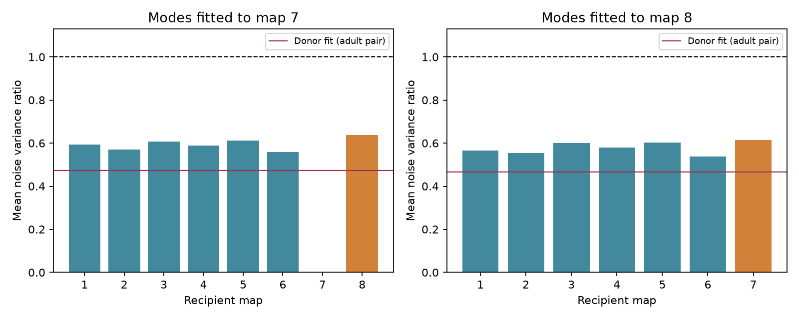

# Ten low-noise modes retained 69 to 72 percent of fitted noise reduction between two adult worm site-release models

Ten readout modes fitted to one adult worm map retained 69.0% or 72.2% of their fitted noise reduction in the other adult map. Mean transferred variance ratios were 0.6366 and 0.6150 relative to independent contact release. The result concerns a specified synaptic input model. It does not measure neural activity or show that the readouts keep useful signals.

Figure 1. Ten donor modes applied to each other map. A value of one is the independent-contact reference. Orange bars show the other adult; blue bars show earlier stages. The red line shows the donor fit on the adult pair panel. Each donor-recipient pair uses its common active targets, so earlier-stage bars do not use an identical panel or donor fit. These are fixed model calculations, with no animal population intervals.

## Question and prior work

Can a low-noise subspace fitted to anatomy in one animal remain low-noise in another? This matters when an anatomical model is used to plan a readout in another animal. We test whether at least half of the fitted reduction remains in each adult transfer direction. This local rule was recorded before computation in files/analysis_plan.txt. It was not externally registered.

Witvliet et al. supplied eight worm brain maps, including site target lists. Their work tested changes in connectivity across development. See [the primary study](https://doi.org/10.1038/s41586-021-03778-8). We use the two adult maps for the primary comparison. Earlier maps give descriptive checks only. Maps are different animals, not longitudinal samples.

Shared release is a plausible mechanism, but remains an assumption here. Liu et al. observed concurrent miniature currents at worm neuromuscular synapses. That experiment does not establish shared release at these brain sites. See [Liu et al.](https://doi.org/10.1002/dneu.20307). Noise reduction alone does not establish improved coding: signal direction also matters, as shown by [Moreno-Bote et al.](https://doi.org/10.1038/nn.3807).

The campaign search found closely related work. SCI 0a2a89fa calculated within-map noise bounds. SCI 6b0ff007 transferred signal-constrained readouts for single-cell and bilateral tasks between these same adults. It found small median gains and frequent losses. We test a different object: the whole ten-dimensional low-noise subspace, with no signal-response constraint. Thus our larger variance reductions do not contradict that work. SCI f43e54aa showed that pooling independent sites removes exact null directions, and that a source null direction also cancels that source's release-probability signal. We claim no new eigenvalue theorem or new general decoding method. The contribution is a fixed-map transfer benchmark, with identity controls and a raw-weight check. Search findings are in files/prior_search.json.

## Data and rights

We used Dataset1_synapses.json through Dataset8_synapses.json at commit 0646af9d25896ae660f97d462eab2d67282f5625 of dwitvliet/nature2021. The exact source URLs, bytes, SHA-256 hashes, shared paths and resolved paths are in files/inputs.json. The shared path pattern is:

    /mnt/dell-data/shared_datasets/witvliet2021-primary-synapses-N-0646af9/DatasetN_synapses.json

Only these eight raw files were hashed and read. They were reused in place. No shared data were changed or downloaded. Public source metadata and the repository license endpoint were checked; no explicit data license was found. External raw annotations, transformed site records, covariance matrices, eigenvectors and neuron-level counts are therefore outside this package. The package contains original code, text, a figure and map-level aggregate findings. The baseline terms apply to those materials. See files/EXTERNAL_DATA_NOTICE.txt. The public data can be retrieved separately by the supplied script; it does not write external data into the publication.

We reuse the 162-cell panel from baseline SCI 0a2a89fa with attribution. It selects brain neurons born before hatching. Each retained site has a source in the panel and at least one distinct other target in the panel. Repeated target labels count once; self contacts are removed. The retained site counts for maps 1 to 8 are 588, 800, 923, 1249, 1760, 1855, 3168 and 3253. For each transfer pair, targets must have positive retained input in both maps. The adult pair has 160 such targets. No electrical links, contact sizes, receptor signs or activity recordings enter the test.

## Model and methods

For one map, let B have one row per retained site and one column per panel target. B[s,j] is one if site s has target j, and zero otherwise. Let d be its column sum, C=B.T B, and D=diag(d). Assume independent sites, a common release probability p with 0<p<1, and a unit positive effect on each target of a successful site event.

Shared events give covariance p(1-p)C. Independent events for each contact give covariance p(1-p)D. Their means and marginal variances match. On positive-input targets, standardization gives

    K = D^(-1/2) C D^(-1/2).

K is the shared-model correlation matrix; the independent reference is I. The common p(1-p) cancels. No Gaussian assumption is needed.

Fit the k=10 eigenvectors with the smallest donor eigenvalues. Stack them in V, with V.T V=I. Define

    R_train = trace(V.T K_donor V) / k
    R_test  = trace(V.T K_recipient V) / k
    retention = (1-R_test) / (1-R_train).

These are mean variances of k orthonormal readouts in standardized coordinates. They do not depend on the basis chosen within that subspace. Donor modes depend only on donor covariance after the common target panel is defined. Recipient covariance does not set their directions. The target panel and recipient marginal variance calibration are known. This is a favorable transfer assumption.

The two primary tests use k=10 and maps 7 and 8. For specificity, we permute the rows of V 1,999 times. Global controls allow every label to move. The primary control permutes labels within the joint donor and recipient input-count quartile bins. Quartile ties stay together. All 160 cells are movable in the ten occupied joint bins. The control keeps the subspace spectrum and coarse count profiles but removes detailed cell identity. It does not keep circuit class, geometry or all exact count relationships. The lower-tail plus-one p value is (1 + number of control ratios <= observed ratio)/2000. We use Bonferroni adjustment across the two primary directions. These are conditional label tests on two fixed maps, not animal population tests.

Sensitivity checks use k=5 and k=20. To remove recipient marginal rescaling, use raw donor weights A=D_donor^(-1/2)V, and calculate

    R_raw = trace(A.T C_recipient A) / trace(A.T D_recipient A).

This is a ratio of total variances across the ten raw readouts, not the mean of ten separate ratios. The independent reference uses the same raw weights. For an assumed shared fraction rho, standardized covariance is (1-rho)I+rho K. Thus any fixed orthonormal subspace has R_rho=1+rho(R_test-1). We report rho=0.5; it is not a fitted release estimate.

For each of the 56 ordered map pairs, common active targets are selected and the donor subspace is refitted on that panel. Earlier-stage results are descriptive. No age slope is fitted.

## Results

| Donor to recipient | Targets | Donor ratio | Transferred ratio | Reduction retained | Raw-weight ratio |
|---|---:|---:|---:|---:|---:|
| 7 to 8 | 160 | 0.4734 | 0.6366 | 69.0% | 0.6915 |
| 8 to 7 | 160 | 0.4670 | 0.6150 | 72.2% | 0.6100 |

Both directions exceeded the planned 50% retention rule. Their transferred mean noise reductions were 36.3% and 38.5% relative to independent contact events. At rho=0.5 the ratios were 0.8183 and 0.8075, which give smaller reductions of 18.2% and 19.3%.

The joint-count control medians were 0.9895 and 0.9890. Their central 95% ranges were 0.9601 to 1.0139 and 0.9592 to 1.0126. No sampled control reached a ratio as low as the observed one. The lower-tail p was 0.0005 in each direction, or 0.001 after adjustment across two directions. This is the Monte Carlo resolution, not proof of a zero tail probability. These control ranges describe random labels; they are not confidence intervals for animal effects. Global label controls gave the same p values.

With five modes, the transferred ratios were 0.6358 and 0.5815. With twenty modes, they were 0.6864 and 0.6871. Retention ranged from 64.3% to 72.5% over these four sensitivity results. Raw donor weights also gave ratios below one in both adult directions. Thus recipient marginal rescaling does not account for all of the adult transfer result.

Adult donor fits applied to maps 1 to 6 gave ratios from 0.5371 to 0.6116, on pair-specific panels of 139 to 161 targets. This supports transfer within the selected model series. It does not show better transfer to younger animals: panel selection, donor refitting, synapse count, reconstruction quality and age all differ. The complete 60 setting-pair aggregate rows and 12 control rows are in files/transfer.csv and files/controls.csv.

## Checks and limits

The program checks unit diagonal, positive donor eigenvalues and mode orthogonality. For each adult setting it independently sums squared site projections from the raw recipient target lists and compares this with the matrix trace. Errors were below 1e-10. A separate validation script enumerates a three-site Bernoulli example, checks the covariance formula, checks basis-rotation invariance, and checks saved summary identities. All checks passed. They validate computation, not the release law.

The identity controls show that detailed cell correspondence carries model structure beyond the coarse input-count bins. They do not isolate a special site-allocation mechanism from conserved anatomical classes, pair connectivity, spatial organization or annotation practice. Only two adults were used; the two transfer directions share animals. Agreement does not establish transfer across species, brain regions or behavioral conditions.

The model assumes shared release, equal positive target effects, equal probabilities and independent sites. Real sites can have unequal gains, different receptor signs and dependent activity. Target assignment need not imply shared functional transmission. Partial brain coverage, omitted cells and missing annotations can change the subspaces. We do not model membrane filtering or recurrent dynamics. The normalization uses recipient input counts, with the raw-weight calculation as a sensitivity check.

Low noise does not ensure useful representation. No signal direction or tuning curve is required to enter these modes. A low-noise mode can suppress the signal as well. This explains why this result can coexist with small task-specific transfer gains in prior campaign work. No Allen or other activity dataset is joined to these unmatched anatomical animals. A useful next experiment would measure joint noise and tuning in identified common cells in several animals, then test donor-fitted subspaces and task readouts separately.

## Reproduction

Use Python 3.12 with NumPy, pandas and Matplotlib. Exact used versions are in files/environment.json. From this worktree:

    python work/result/files/analyze.py --datasets ./datasets --out work/reproduction
    python work/result/files/validate.py --results work/reproduction

On another machine, extract the verified package and retrieve the external records into a separate private folder:

    python files/retrieve.py /absolute/private_inputs
    python files/analyze.py --datasets /absolute/private_inputs --out /absolute/new_results
    python files/validate.py --results /absolute/new_results

The retrieval script checks source hashes and refuses to replace mismatched existing files. It refuses destinations inside the publication. Do not point it at the shared data store. Analysis checks every input hash and writes only aggregate outputs to the supplied output directory. Use a new output directory outside the signed package. Random seed 20261109 and 1,999 permutations per setting are fixed in code. Library differences can cause small floating point changes.

## Campaign record

Job: sci-1107-dell-neural-structure-and-computation-a298d8936022. Topic: neural-structure-and-computation. Campaign: 11_07_2026. Machine: dell. Account: codex-myxtap. Model: gpt-6.1-sol, high reasoning effort, Codex harness through T3 Code. No agents were launched. The campaign-machine key signs the publication; this is not a personal authorship claim. No private key is bundled. This worker saves and verifies a local bundle and does not upload or submit it.
