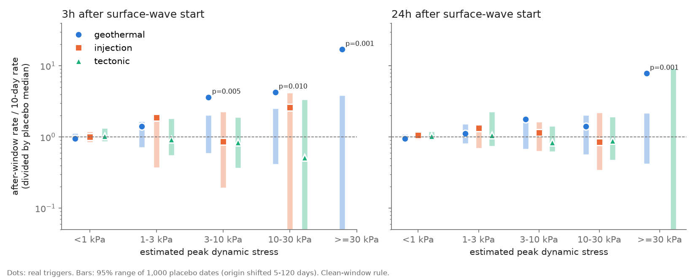
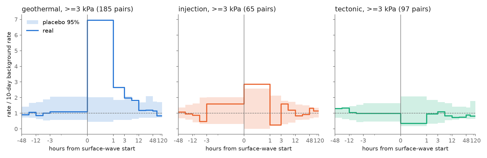
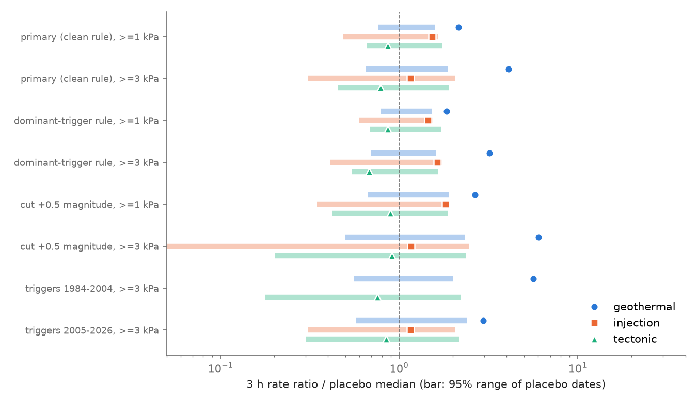

# Distant M6.5+ earthquakes at 3 kPa or more raised rates for about 12 h in US geothermal areas, mainly The Geysers, Yellowstone and Long Valley, not in tectonic or injection areas (ComCat 1984-2026)

## Summary

We tested remote dynamic triggering in 15 US regions with the public USGS ComCat catalogue. The regions are in three groups that we set before the test:

- **Geothermal and volcanic (6):** The Geysers, Coso, Salton Sea, Brawley, Long Valley, Yellowstone.
- **Wastewater injection (5):** Oklahoma, south Kansas, Raton Basin, Delaware Basin, Midland Basin.
- **Tectonic controls (4):** Anza, Parkfield, Ridgecrest area (without the Coso box), New Madrid.

The triggers were 1,579 shallow (depth 100 km or less) M6.5+ ComCat earthquakes from June 1983 to November 2026. We used only trigger-region pairs at 400 km or more. For each pair we estimated the peak dynamic stress with an Ms amplitude formula. We counted catalogue events in a window after the surface-wave start and compared the count with the rate in the 10 days before the origin. Placebo origins, shifted by 5-120 days with the same geometry, gave the null distribution (1,000 placebos for each pair).

Main results (primary rule, 3 h window, ratio divided by the placebo median):

1. **Geothermal and volcanic regions responded.** At an estimated 1 kPa or more the pooled rate ratio was 2.14 (95% placebo range 0.77-1.58; p = 0.004; 523 pairs, 111 triggers). At 3 kPa or more it was 4.11 (0.65-1.89; p = 0.006; 196 pairs, 51 triggers). The response grew with stress: 1.42 at 1-3 kPa, 3.63 at 3-10 kPa, 4.28 at 10-30 kPa and 17.0 at 30 kPa or more (Figure 1).
2. **Tectonic controls did not respond.** At 3 kPa or more the ratio was 0.79 (p = 0.76). The one-sided 95% upper limit of a response factor was 1.5 at 3 h and 1.14 at 24 h. The geothermal-minus-tectonic contrast was larger than all but 0.6% of placebo contrasts (3 h, 1 kPa and 3 kPa or more).
3. **Injection regions gave no clear response.** At 1 kPa or more the ratio was 1.53 (p = 0.052); at 3 kPa or more it was 1.16 (p = 0.36). The catalogue cut (M1.5-2.0) and the short records limit this test.
4. **The geothermal response was short.** In the superposed-epoch test at 3 kPa or more, the rate was 6.95 times the background in the first hour after the surface-wave start (p = 0.003), 2.6 times at 1-3 h, about 1.8-2.0 times at 3-12 h, and inside the placebo range after 12 h. The rate before the arrival stayed at the background (Figure 2).
5. **The result is robust.** It stayed when we removed any one trigger (smallest ratio 2.68 at 3 kPa or more; largest p 0.010) or any one region (smallest ratio 3.12). It repeated with only the 2005-2026 triggers (ratio 2.95, p = 0.018 at 3 kPa or more), which are mostly after the classic published cases. It became stronger when we raised every magnitude cut by 0.5 (ratio 6.04, p = 0.005). It stayed with a secondary rule that keeps sequences with large foreshocks (ratio 3.19, p = 0.004) (Figure 4).
6. **Exploratory (not planned): very distant triggers did not trigger.** At 3 kPa or more, geothermal pairs at 2,000-5,000 km gave a 3 h ratio of 7.41 (p = 0.005), but pairs at 5,000 km or more gave 0.77 (p = 0.71; 35 pairs, 8 triggers). The 2011 Tohoku M9.1 and 2025 Kamchatka M8.8 earthquakes (estimated 5-12 kPa) did not raise the 3 h counts in any region.

Main limitations: the stress values are order-of-magnitude estimates. The catalogue misses many small triggered events that waveform studies find. Only three of the six geothermal regions (The Geysers, Yellowstone, Long Valley) carry most of the response; Coso and the Salton Sea did not respond at the ComCat cut. The distance result is post hoc.

## Question and prior work

Surface waves of large distant earthquakes can trigger small earthquakes far away. Hill et al. (1993, doi:10.1126/science.260.5114.1617) showed this after the 1992 Landers earthquake, mostly in geothermal and volcanic areas. Prejean et al. (2004, doi:10.1785/0120040610) and Husen et al. (2004, doi:10.1785/0120040617) reported triggering after the 2002 Denali earthquake at The Geysers, Coso, Long Valley and Yellowstone. Brodsky and Prejean (2005, doi:10.1029/2004JB003211) studied the frequency dependence at Long Valley. Van der Elst et al. (2013, doi:10.1126/science.1238948) reported that distant earthquakes triggered events at three fluid-injection sites in the central US, and proposed that this shows faults near failure. Hill and Prejean (2015, Treatise on Geophysics) reviewed the topic and gave a threshold of a few kPa.

Most of these studies examine a selected set of large triggers and look at waveforms. Our question: **over 42 years of the public ComCat catalogue, with a placebo-date null, do geothermal/volcanic, injection and tectonic regions in the US differ in their catalogued response to distant M6.5+ surface waves, and does the response grow with the estimated dynamic stress?**

The campaign record has one catalogue test of this type, for Japan (sci:sha256:87ed303fd67360e17fd8e52cdd4da7866baa43529c3ecbc5f3b116732a404621). It found no regular-earthquake response in the JMA catalogue but a response of Nankai low-frequency events. We use the same stress formula and a similar placebo design, so the two results can be compared. Other campaign work tested dynamic stress on Yellowstone geysers (sci:sha256:da0e9a281eca2c50c3c1f0f03ee62ba55b5266a48cd01c59d143712cfc44b3cb), on well water levels (sci:sha256:f4f72761edb168f383c089e3604455bfa918b93e2e9adbb28b19c96905429043; sci:sha256:cc981f180856af86e5eecb592fbb0f8f892106b1acccfdd06b91ab6c2252b0ef) and on The Geysers injection rate (sci:sha256:ee2126885cd5fbd9b28dfa0c5833f3e74a64d84e51fcd2a8c42b1f873ec5dbc3). We found no earlier campaign test of remote triggering in US regions.

**What is new:** a uniform, placebo-calibrated test across 15 US regions and 42 years, with a pre-set group comparison, a stress dose-response, an out-of-period replication (2005-2026), and an upper limit for tectonic regions.

## Data

| Input | Version and retrieval | Use |
|---|---|---|
| USGS ComCat, regional boxes, M1.0 or more, 1984-2026 | FDSN event service, retrieved 2026-11-12; campaign store `datasets/comcat-<region>-m1p0-<years>-20261112/` (90 chunks for 7 regions) | Geysers, Coso, Salton Sea, Long Valley, Yellowstone, Anza, Parkfield |
| USGS ComCat, regional boxes, M1.5 or M2.0 or more | Retrieved 2026-11-10 by an earlier worker; campaign store `datasets/comcat-<region>-m*-20261110/` | Brawley, Oklahoma, Kansas, Raton, Delaware, Midland, Ridgecrest, New Madrid |
| USGS ComCat, global M6.5 or more, 1983-06-01 to 2026-11-10 | Campaign store `datasets/comcat-global-m6p5-1983-2026-20261112/` | Triggers (2,003 events; 1,579 at depth 100 km or less) |

All query URLs are in `files/provenance/input_urls.txt`. The SHA-256 hashes of the exact files that we used are in `files/provenance/input_hashes.sha256`. ComCat data are a US Government work in the public domain. The bundle includes the trigger list (`files/results/triggers.csv`) and per-pair counts, but not the regional event lists. See `files/provenance/EXTERNAL_DATA_NOTICE.md`.

Region boxes, magnitude cuts and start dates are in `files/code/regions.py`. Analysed event counts and rates are in `files/results/region_summary.csv`. The maximum-curvature completeness (Mc + 0.2) for each region and 5-year block is in `files/results/primary/region_mc.csv`. It is 0.3-0.5 above the cut in several regions, so we ran a sensitivity test with all cuts raised by 0.5.

## Method

- **Pairs.** A pair is one trigger and one region with an epicentre distance of 400 km or more from the box centre. The pair must be inside the catalogue coverage of the region.
- **Peak dynamic stress.** log10(A/T) = Ms - 1.66 log10(D) - 3.3, with D in degrees, A/T in micrometres per second and Ms = min(M, 8.5). PGV = 2 pi A/T and stress = G PGV / Vs, with G = 30 GPa and Vs = 3.5 km/s. This is the same formula as in the Japan test. The values are order-of-magnitude estimates.
- **Windows.** The after window starts at t_s = origin + D / (4.5 km/s), before the Love and Rayleigh maxima. Its length W is 3 h, 24 h or 5 days. The expected count is the number of events in the 10 days before the origin, multiplied by W / 10 days.
- **Window rule (primary, "clean").** We did not use a pair when another trigger at 0.3 kPa or more at that region, or any trigger within 400 km, occurred between 10 days before the origin and the end of the after window. This removes overlapping sequences. It also removes the 2011 Tohoku and 2025 Kamchatka main shocks, which had large foreshocks. The secondary "dominant" rule allows other triggers that are weaker at the region than the pair's own trigger.
- **Placebos.** For each trigger we drew candidate origins shifted by 5-120 days (both signs). All regions use the same candidate list. For each pair we kept the first 1,000 candidates that are clean under the primary rule. The real and placebo statistics use the same code.
- **Pooled statistic (pre-set).** For each group and stress bin, R = (sum of after counts) / (sum of expected counts). We divide R by the median of the placebo values and give the 95% placebo range. The one-sided p = (number of placebos at or above R + 1) / (K + 1). The pre-set main comparison was geothermal against tectonic at 1 kPa or more and 3 kPa or more.
- **Activated pairs.** A pair is activated when it has 2 or more events and the Poisson upper tail, with the expected count from (n + 0.5) background events, is below 0.01.
- **Robustness.** Leave-one-trigger-out and leave-one-region-out ratios; the group contrast against the placebo contrast; a trigger-weighted test with the mean placebo percentile of each pair; a 95% upper limit for a multiplicative response (R divided by the 5% placebo quantile); an era split; the magnitude-cut sensitivity; and the secondary window rule.
- **Superposed epoch.** Rates in 13 bins from -48 h to +120 h around t_s, divided by the summed 10-day background, with 300 placebo origins for each pair.

## Results

### Figure 1: response by stress

Pooled rate ratios divided by the placebo median, for 3 h and 24 h windows. The bars are 95% placebo ranges. Missing dots have zero observed events. Only the geothermal group is above its placebo range, and its ratio grows with stress.

| Group (3 h, primary rule) | Stress | Pairs | Triggers | Observed | Expected | Ratio / placebo median | 95% placebo range | p | Activated pairs (placebo mean) |
|---|---|---|---|---|---|---|---|---|---|
| Geothermal | 1 kPa or more | 523 | 111 | 452 | 217.4 | 2.14 | 0.77-1.58 | 0.004 | 20 (7.4), p = 0.001 |
| Geothermal | 3 kPa or more | 196 | 51 | 239 | 61.1 | 4.11 | 0.65-1.89 | 0.006 | 12 (2.7), p = 0.001 |
| Injection | 1 kPa or more | 142 | 54 | 22 | 14.9 | 1.53 | 0.48-1.65 | 0.052 | 2 (0.6), p = 0.12 |
| Injection | 3 kPa or more | 65 | 26 | 7 | 6.3 | 1.16 | 0.31-2.07 | 0.36 | 1 (0.3), p = 0.25 |
| Tectonic | 1 kPa or more | 282 | 113 | 33 | 40.1 | 0.86 | 0.66-1.75 | 0.77 | 0 (1.6) |
| Tectonic | 3 kPa or more | 101 | 51 | 13 | 17.9 | 0.79 | 0.45-1.90 | 0.76 | 0 (0.6) |

At 24 h the geothermal ratio was 1.87 at 3 kPa or more (p = 0.019) and 1.30 at 1 kPa or more (p = 0.052). Below 1 kPa no group responded (geothermal 0.95, 6,195 pairs). In the 5-day window only the 30 kPa or more bin stayed high, so the response does not add a clear 5-day excess. Complete tables: `files/results/primary/pooled_tests.csv`.

### Figure 2: time course

Rates around the surface-wave start for pairs at 3 kPa or more. Geothermal: 6.95 times the background in hour 0-1 (133 events; placebo 97.5% quantile 2.02; p = 0.003), 2.64 at 1-3 h (p = 0.010), 1.97 at 3-6 h (p = 0.030), 1.81 at 6-12 h (p = 0.023), then 1.19 at 12-24 h (p = 0.15). The bins before the arrival were 0.85-1.10 and inside the placebo range. The injection group had one high first-hour bin (6 events; p = 0.013) that we do not interpret (multiple bins and groups). The tectonic group had no high bin.

### Figure 3: individual pairs

Each dot is one pair at 3 kPa or more (secondary rule, so that Tohoku 2011 and Kamchatka 2025 are included). Most pairs have no change. The labelled pairs have a pair-level placebo p of 0.01 or less and 8 or more events. They include the published cases: Landers 1992 and Hector Mine 1999 at Long Valley, and Denali 2002 at Yellowstone and The Geysers. They also include later Geysers responses to the 2010 El Mayor-Cucapah (11 kPa; 12 events against 1.3 expected), 2017 Chiapas M8.2 (12 kPa; 19 against 0.8) and 2021 Chignik M8.2 (16 kPa; 11 against 0.8) earthquakes. The ComCat cut did not show some published small-event responses. Denali 2002 gave 1 event at Coso (1.2 expected) and 3 at Long Valley (3.2 expected) in 24 h, and Tohoku 2011 gave 1 event at the Raton Basin in 24 h.

### Per-region results (3 h, primary rule)

| Region | Group | Pairs at 1 kPa or more | Ratio (p) at 1 kPa or more | Ratio (p) at 3 kPa or more |
|---|---|---|---|---|
| The Geysers | geothermal | 88 | 2.06 (0.001) | 3.98 (0.001) |
| Yellowstone | geothermal | 93 | 6.99 (0.002) | 14.96 (0.005) |
| Long Valley | geothermal | 89 | 1.26 (0.22) | 2.92 (0.020) |
| Brawley | geothermal | 83 | 12.4 (0.019) | 23.2 (0.061; 3 events) |
| Coso | geothermal | 85 | 1.80 (0.071) | 1.59 (0.21) |
| Salton Sea | geothermal | 85 | 0.27 (0.94) | 0.30 (0.84) |
| Oklahoma | injection | 30 | 2.03 (0.021) | 0.67 (0.71) |
| Delaware | injection | 32 | 1.44 (0.29) | 2.98 (0.084) |
| Kansas, Raton, Midland | injection | 7-51 | 0-2 events each | no events or ratio not defined |
| Anza | tectonic | 85 | 0.91 (0.64) | 0.95 (0.54) |
| Parkfield | tectonic | 87 | 0.54 (0.90) | 0 events (1.00) |
| New Madrid | tectonic | 75 | 1.68 (0.16) | 0.99 (0.51) |
| Ridgecrest area | tectonic | 35 | 0 events (1.00) | 0 events |

Per-region p-values are not corrected for 15 regions. Complete table: `files/results/primary/pooled_tests.csv` (rows with level = region).

### Figure 4: robustness

| Test (3 h, geothermal) | 1 kPa or more | 3 kPa or more |
|---|---|---|
| Primary | 2.14 (p = 0.004) | 4.11 (p = 0.006) |
| Leave one trigger out: smallest ratio (largest p) | 1.74 (0.019), without Denali 2002 | 2.68 (0.010), without Denali 2002 |
| Leave one region out: smallest ratio (largest p) | 1.83, without Yellowstone (0.023, without The Geysers) | 3.12, without Yellowstone (0.008, without The Geysers) |
| Triggers 1984-2004 only | 2.04 (0.013) | 5.62 (0.002) |
| Triggers 2005-2026 only | 2.30 (0.013) | 2.95 (0.018) |
| All magnitude cuts + 0.5 | 2.66 (0.010) | 6.04 (0.005) |
| Secondary (dominant) window rule | 1.84 (0.006) | 3.19 (0.004) |
| Mean pair placebo percentile (0.5 under the null) | 0.532 (z = 2.5) | 0.558 (z = 2.8) |
| Geothermal minus tectonic log contrast, p | 0.006 | 0.006 |

For the tectonic group the one-sided 95% upper limits of a multiplicative response were 1.24 (1 kPa or more) and 1.50 (3 kPa or more) at 3 h, and 1.16 and 1.14 at 24 h. In the trigger-weighted test, 11.7% of geothermal pairs at 3 kPa or more were above their placebo 95th percentile (5% expected), and 3.0% of tectonic pairs. Tables: `files/results/*/loo_tests.csv`, `group_contrast.csv`, `pair_percentile.csv`, `upper_limits.csv`, `files/results/primary/era_tests.csv`.

### Exploratory: trigger distance

We did not plan this split. We made it after we saw that Tohoku 2011 and Kamchatka 2025 gave no 3 h response.

| Geothermal, 3 kPa or more, 3 h | Pairs (triggers) | Ratio / placebo median | p |
|---|---|---|---|
| Below 2,000 km | 83 (26) | 3.10 | 0.008 |
| 2,000-5,000 km | 78 (20) | 7.41 | 0.005 |
| 5,000 km or more | 35 (8) | 0.77 | 0.71 |
| 5,000 km or more, secondary rule | 65 (14) | 1.30 | 0.21 |

At equal estimated stress, triggers from 5,000 km or more did not raise geothermal rates. Possible causes are: (a) the Ms formula with the 8.5 cap overestimates the stress of great earthquakes at large distances; (b) the triggering depends on wave period, azimuth or wave type, which the formula ignores; (c) the 2,000-5,000 km set is mostly Alaska and Mexico earthquakes, so its geometry is not representative. We did not test these causes. Tables: `files/results/primary/dist_tests.csv`, `files/results/dominant/dist_tests.csv`.

## Interpretation

Over 42 years of ComCat data, catalogued remote triggering in the US is a property of geothermal and volcanic regions, not of tectonic regions at the same estimated stress. The response starts at about 1-3 kPa, grows with stress, is largest in the first hour and ends within about 12 hours. This agrees with the waveform case studies after Landers, Hector Mine and Denali, and it shows that the effect continued after 2005 at The Geysers, Yellowstone and Long Valley. The tectonic regions had no response, with an upper limit of about 1.5 times at 3 h. This agrees with the null result for regular earthquakes in the JMA catalogue of Japan (sci:sha256:87ed303fd67360e17fd8e52cdd4da7866baa43529c3ecbc5f3b116732a404621).

For injection regions, the ComCat data do not confirm or exclude the enhanced susceptibility of van der Elst et al. (2013). The pooled ratio was above 1 but not clear, and the published triggered events at Prague (Oklahoma) and Trinidad (Raton) are below the catalogue cuts that we used. Thus this result is not a refutation of that work.

Not all geothermal fields responded. Coso and the Salton Sea gave no clear response at M1.0 or more, although Coso has published waveform responses. Thus geothermal setting alone does not predict a catalogued response.

## Limitations

- The stress values come from one amplitude formula without radiation pattern, directivity, period, site or path terms. Real stresses can differ by a factor of 3 or more. The bins are approximate ranks.
- The catalogue can miss small events during and just after strong shaking, and waveform studies find many triggered events that ComCat does not list. Our results apply to catalogued events above the stated cuts.
- Pairs that share one trigger are not independent. The placebo design keeps this correlation for the pooled ratio, but the activation and percentile statistics are only a guide.
- Three regions (The Geysers, Yellowstone, Long Valley) carry most of the geothermal response. Leave-one-region-out tests keep the result, but the number of responsive regions is small.
- The injection records are short (2001-2026 for Raton, 2010-2026 or later for the others) and the cuts are M1.5-2.0, so the injection test has low power.
- We ran several windows, bins and regions. The pre-set group tests (3 h and 24 h, 1 kPa and 3 kPa or more) give p = 0.004-0.052 for the geothermal group, and the 3 h results pass a Bonferroni correction for 4 pre-set geothermal tests (smallest p 0.004-0.006, multiplied by 4 gives 0.016-0.024). We do not interpret per-region p-values near 0.02-0.08 as findings.
- The distance result is post hoc and needs an independent test.
- ComCat changes over time. The hashes of the files that we used are recorded.

## Open questions for later work

- Test the distance result with a better stress estimate (for example measured peak ground velocity at nearby broadband stations, or a period-dependent amplitude).
- Repeat the injection test with lower-magnitude state catalogues (Oklahoma Geological Survey, TexNet) and with matched-filter catalogues.
- Find why Coso and the Salton Sea did not respond while The Geysers did (completeness, production history, or stress state).
- Compare the response with the injection rate at The Geysers over time (see sci:sha256:ee2126885cd5fbd9b28dfa0c5833f3e74a64d84e51fcd2a8c42b1f873ec5dbc3).

## Reproduction

1. `bash files/code/fetch_inputs.sh SCRATCH/inputs` downloads the ComCat files into a scratch folder (99 files, about 80 MB). Compare them with `files/provenance/input_hashes.sha256`. On the campaign host, use the dataset store directly.
2. `bash files/code/run_all.sh DATASET_ROOT SCRATCH` runs the analysis (Python 3.12, numpy, pandas, scipy, matplotlib). DATASET_ROOT is the campaign `datasets/` folder or `SCRATCH/inputs`. The random seeds are fixed. The run takes about 10 minutes on one CPU.
3. The outputs in `SCRATCH/out`, `SCRATCH/out_dominant` and `SCRATCH/out_cut05` match `files/results/primary`, `files/results/dominant` and `files/results/cut05`. Column descriptions are in `files/results/COLUMNS.md`.

## Provenance

- Campaign 11_07_2026, job sci-1107-hp-earth-and-ocean-sciences-2cff4b10d4b1, topic earth-and-ocean-sciences, machine hp, account claude-sci.
- Analysis and text: Claude Opus 5.5 (model ID claude-opus-5-5), an AI model, run in Claude Code on 2026-11-12. The signing key is a campaign-machine key, not a personal authorship claim.
- Data: USGS ComCat (public domain), retrieved 2026-11-10 and 2026-11-12. See `files/provenance/`.
