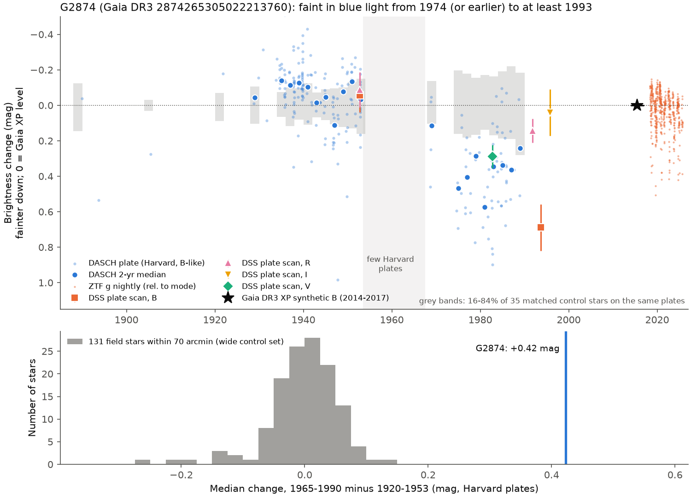
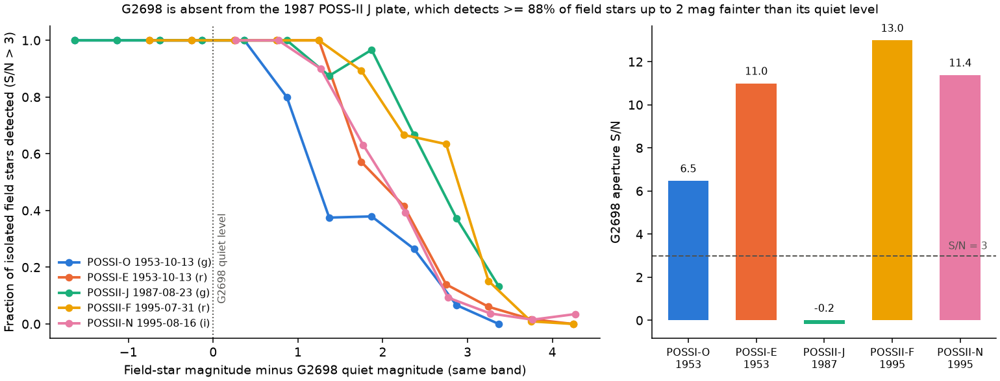
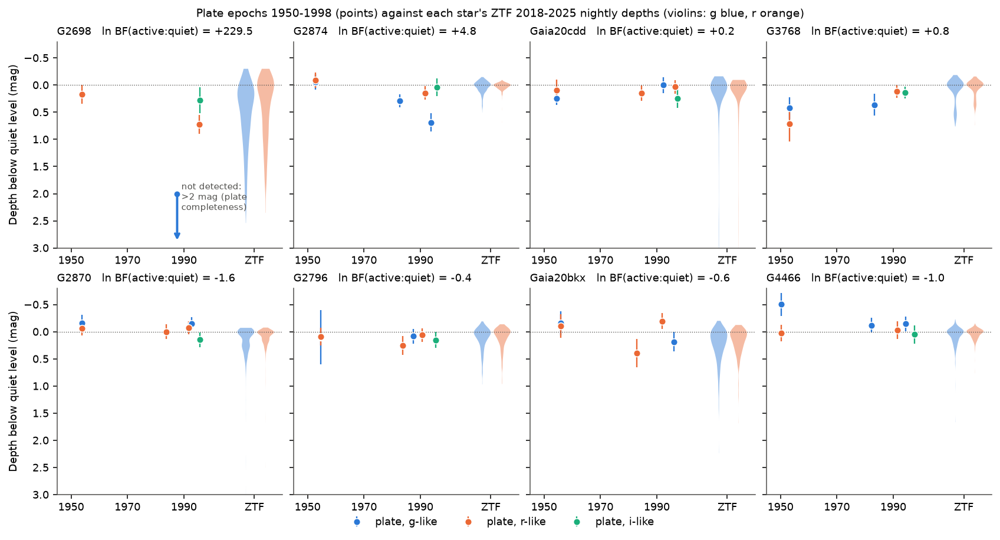

# Photographic plates show a faint state of at least 19 years (1974-1993) of the extreme-dust dimmer G2874 and a dip of at least 2 magnitudes of the dimmer G2698 in 1987; six other dimmers are not constrained

**Job:** sci-1107-dell-astronomy-1fe2076bec0b · **Topic:** astronomy · **Machine:** dell · **Model:** Claude Opus 5.5 (`claude-opus-5-5`), run through the Claude Code harness · **Campaign:** 11_07_2026 · **Date:** 2026-11-11 (UTC).
The signing key is a campaign-machine key. It is not a personal authorship claim.

## Summary

Prior campaign studies found a small class of main-sequence field dwarfs with deep, aperiodic dust dimming (Gaia20cdd, G2698, G2870, G3768, G4466, G2874 and others; [c8d37a69](#citations), [e10c5778](#citations), [9c3193da](#citations), [07b81a2a](#citations), [222c40fb](#citations)). All their light curves start in 2004-2014. Thus nobody knew if this dimming is a recent, transient episode or a state that lasts for decades. The duration is necessary to find the dust source: one collision, a steady supply, or a long-lived disc structure.

We measured the brightness of the dimmers on photographic plates from 1889 to 1999:

- **DASCH** (Harvard College Observatory plate stack, data release 7): full light curves 1889-1989 for the two brightest dimmers, G2874 (Gaia DR3 2874265305022213760, G = 12.8) and G4466 (Gaia DR3 4466400095283726080, G = 14.3). For each target we used 35 (G2874) and 34 (G4466) matched control stars from the same plates, and for G2874 a wide set of 150 field stars (131 with enough plates).
- **DSS plate scans** (POSS-I 1950-1955, Palomar Quick-V 1982-1985, POSS-II and SERC 1983-1998): our own differential aperture photometry of 10 dimmers, calibrated with Gaia DR3 XP synthetic photometry (bright stars) or Pan-STARRS1 (faint stars), with colour-matched comparison stars.

Main results:

1. **G2874 was faint for at least 19 years.** On the Harvard plates, relative to its Gaia XP synthetic B magnitude (2014-2017), G2874 was -0.11 mag (1920-1945, 111 plates) and +0.01 mag (1945-1953, 57 plates), but +0.41 mag (1965-1978, 19 plates) and +0.36 mag (1978-1989, 49 plates). The change from 1920-1953 to 1965-1990 is +0.45 mag. For the 28 well-sampled matched controls on the same plates it is -0.002 +- 0.046 mag (largest +0.07); for 131 field stars of the wide set it is -0.002 +- 0.058 mag (largest +0.13), and +0.42 mag for G2874 in the same comparison. Thus the star is a 7.3-sigma outlier; no field star changes by more than 0.2 mag (Figure 1). The four plates of 1968-1969 are mixed (median +0.11 mag); the 2-year medians are +0.29 to +0.57 mag from 1974 to 1987.
2. **Independent plates agree.** Our DSS photometry gives normal brightness on the POSS-I plates of 1952 September (-0.06 +- 0.10 mag in B, -0.09 +- 0.10 in R), and a faint star on Quick-V 1982 October (+0.29 +- 0.07 in V), POSS-II F 1991 October (+0.14 +- 0.07 in R) and POSS-II J 1993 September (+0.69 +- 0.13 in B). In each faint case the target is fainter than all 17-21 comparison stars. On POSS-II N 1995 October (I band) it is normal (+0.04 +- 0.13).
3. **The faint state was red, like the modern dips.** A power law A(lambda) = A_B (lambda / 0.44 um)^-beta fits the 1982-1995 depths with A_B = 0.38 mag and beta = 2.1 (95 percent range 0.9-5.9). Grey extinction (beta = 0) is disfavoured (delta lnL = 3.9). The short ZTF dips of 2018-2025 have beta = 2.5-2.8 ([222c40fb](#citations)). Thus the same small-grain dust probably made the long faint state.
4. **G2874 is in its bright state now.** The Gaia XP level (2014-2017) agrees with the 1945-1953 level. ZTF season medians (2018-2025) stay within 0.11 mag of the ZTF mode, which agrees with XP to 0.02 mag (g). CMC15 r' (mean epoch 2004.1, three nights) is +0.05 +- 0.045 mag, so we cannot say if the faint state had ended by 2004. The faint state started after 1953 and before 1974 (Harvard has almost no plates from 1954 to 1967, and the 1968-1969 plates are mixed), and it ended after 1993.7 and before 2014.
5. **G2874 also dipped in the 1940s.** In 1945-1948, 2 of 21 Harvard plates show the star more than 0.3 mag below the plate-local level; no control star has a larger fraction (maximum 0.06). This is weak evidence (two plates) for short dips like the modern ones before the long faint state.
6. **G2698 was at least 2 mag faint in 1987.** G2698 (Gaia DR3 2698173741829957888, M0 dwarf, quiet g = 18.9) is not detected on the POSS-II J plate of 1987 August 23 (aperture S/N = -0.2). The same plate detects all isolated field stars up to 1.1 mag fainter than the quiet level of G2698, and 88-97 percent of those 1.1-2.1 mag fainter (Figure 2). The star is clear on the POSS-I plates of 1953 (S/N 6.5 and 11) and the POSS-II F and N plates of 1995 (S/N 13 and 11). On POSS-II F (1995 July) it is +0.72 +- 0.17 mag below its quiet r level. The previous earliest dips of G2698 were from 2010 (Pan-STARRS1, [07b81a2a](#citations)). In ZTF 2018-2025, G2698 is more than 2 mag below its quiet g level on only 3 percent of nights. Thus G2698 was in one of its deepest states 23 years before the earliest known dips.
7. **The other dimmers are not constrained.** For Gaia20cdd, G2870, G2796, G3768, Gaia20bkx and G4466 (4-5 independent epochs each), no plate shows a significant fade (more than 0.3 mag at 2 sigma). With their ZTF-like activity, 0.05-0.40 significant fades per star are expected; the observed zero has a probability of 0.65-0.95 per star. Bayes factors between "active as in ZTF" and "quiet" are e^-1.6 to e^+0.8 (Figure 3). Thus the plates neither show nor exclude activity in these stars. Gaia20emj and G6700 have close neighbours on the plates, and Gaia19dpn has no ZTF reference; we did not test them.

**Interpretation.** For G2874, the dust that dims the star at 1.3 au or more (the 230 K blackbody radius of its 12-22 um excess, orbital period about 1.5 years) must have covered the line of sight for about 13 orbits or more between 1974 and 1993. One clump on one orbit cannot do this. The occulter is therefore extended along the orbit: a dust ring or disc region with an optical depth of about 0.35 in B along our line of sight. This optical depth rose after 1953 and fell before 2014, a change over decades. Possible causes are a collisional cascade after a giant impact that slowly cleared, or a precessing or warped dust ring that moved across the line of sight. G2874 has kinematics like young stars ([f7d8682b](#citations)), so a young debris disc is possible. For G2698, deep dimming occurred at least 23 years before the earliest known dips. Thus, for two of the dimmers, the activity lasts for decades. A single recent event is less likely for these two stars. The prevalence of about 8e-8 ([db7ac295](#citations)) must then come from long, rare episodes, not from many short ones.

**Main limitations.** The G2874 faint state rests on one Harvard series (Damon blue patrol, dnb) after 1965 plus four DSS plates; the controls remove plate-level errors, but not a fault that affects only this star (no such fault was found: the plate PSF width and blends do not explain it). The faint-state colour uses plates from different years. The G2698 result rests on one plate. The DSS photometry of faint red stars has systematic errors of about 0.1 mag, which we included. Gaia20cdd, the best-studied dimmer, is too faint for DASCH, and the DSS epochs do not constrain it.



*Figure 1. (a) G2874 from 1889 to 2025. Blue: DASCH plates (B-like) relative to the Gaia XP synthetic B level, after subtraction of the median change of control stars on the same plate; large blue points are 2-year medians. Grey bands: 16-84 percent range of the control stars. Coloured symbols: our DSS plate-scan photometry (B, V, R, I). Black star: Gaia XP (2014-2017). Orange dots: ZTF g nightly medians relative to the ZTF mode. (b) The 1965-1990 minus 1920-1953 change for the wide control set and for G2874.*



*Figure 2. G2698 on five DSS plates. Left: fraction of isolated Pan-STARRS1 field stars detected at S/N > 3 against their magnitude relative to the quiet magnitude of G2698. Right: S/N of G2698 in the same 5-arcsec aperture. On the 1987 POSS-II J plate the star is not detected, although stars 2 mag fainter are detected.*



*Figure 3. Plate-epoch depths below the quiet level (points; g-like blue, r-like orange, i-like green) of eight dimmers, next to their ZTF 2018-2025 nightly depth distributions (violins). Titles give the log Bayes factor of "active as in ZTF" against "quiet".*

## Question and scope

Question: Is the deep dust dimming of main-sequence field dwarfs a recent, short episode, or did these stars also dim decades ago?

Scope: 11 campaign dimmers (target list in `files/provenance/target_ids.csv`). DASCH light curves are useful only for G2874 and G4466 (the other stars are fainter than most Harvard plates). DSS photometry is useful for stars that are isolated on the plates at 5 arcsec.

Assumptions: (1) DASCH magnitudes (`magcal_magdep`) of stars of the same brightness and colour on the same plate share plate-level errors, so subtraction of the control median removes them; (2) photographic magnitudes are smooth functions of the catalogue magnitude with a linear colour term near the target magnitude and colour; (3) ZTF magnitudes plus a field-star offset give the quiet level on the Pan-STARRS1 system; (4) for the "active" model, the ZTF 2018-2025 nightly depth distribution is representative of an active state.

## Data

| Data | Use | Access |
| --- | --- | --- |
| DASCH DR7 light curves (Harvard plates, 1885-1992) | century light curves of G2874, G4466 and their control stars | StarGlass public API `https://api.starglass.cfa.harvard.edu/public/dasch/dr7/` (`querycat`, `lightcurve`), APASS reference catalogue |
| Digitized Sky Survey (STScI) cutouts: POSS-I O/E, Quick-V, POSS-II J/F/N, SERC EJ/ER/I, UKST | plate-scan photometry, 10 dimmers | `https://archive.stsci.edu/cgi-bin/dss_search` |
| Gaia DR3 XP synthetic photometry (`I/360/syntphot`) | B, V, R, I calibration of the G2874 and G4466 plates; modern reference | VizieR CfA mirror |
| Gaia DR3 `gaia_source` | target astrometry | IRSA TAP `gaia_dr3_source` |
| Pan-STARRS1 DR2 mean photometry | g, r, i calibration of the faint-star plates | MAST catalogs API |
| ZTF DR light curves (2018-2025) | quiet levels and depth distributions; ZTF-PS1 offsets (12 field stars per target) | IRSA `nph_light_curves` |
| CMC15 (`I/327/cmc15`) | 2004 r' level of G2874 | VizieR CfA mirror |

`files/provenance/input_sha256.txt` gives the SHA-256 of all downloaded files that we used (DASCH JSON, DSS FITS, PS1, ZTF and VizieR tables). Services can return the same content with a different row order, so new downloads can have different hashes. The external data are not in this bundle (see `files/NOTICE-external-data.md`).

## Methods

### DASCH

For each star we kept plates with a local limiting magnitude at least 0.8 mag fainter than the star's reference magnitude, and we rejected detections with DASCH quality flags for high background, bad plate quality, unmatched or blended multiple exposures, uncertain date, large residuals, defects, blends, large drad, Pickering wedge, large smoothing correction, saturation and low altitude. We did not reject `CLOSE_TO_LIMITING`, because it removes real fades. The reference magnitude is the median on deep plates. On each plate, the "differential residual" of a star is its residual minus the median residual of the control stars on that plate (at least 5 controls). The 35 controls of G2874 are isolated APASS stars within 30 arcmin with |B - B_t| < 0.4 mag, |(B-V) - (B-V)_t| < 0.3 and no APASS variability flag. The wide set uses 70 arcmin, 0.7 mag and 0.5 in colour (150 stars selected, 131 with at least 10 plates in each era). We put DASCH on the Gaia XP B scale with the median (DASCH reference - XP B) of the controls (-0.022 mag; scatter 0.024 mag).

Validation against blends and plate type: the early Cooke 1.5-inch (ac) plates have the same PSF width (45 arcsec) as the late dnb plates but give -0.03 mag; the high-resolution early series (mc, md, ma; 12-18 arcsec) also give the bright level; within the dnb series the residual does not depend on PSF width (+0.36 to +0.42 in all quartiles). The nearest Gaia neighbour of G2874 (G = 15.8, 27 arcsec) can only make the star brighter on blended plates.

### DSS photometry

We measured 12-arcsec (G2874, G4466) or 5-arcsec (faint stars) apertures with a median sky annulus at 1.6-2.6 aperture radii on the STScI DSS scans. On each plate we fitted catalogue magnitude = a + b m_inst + c m_inst^2 + k colour, by iterative 3-sigma clipping, with isolated comparison stars within 1.5-2 mag of the target and, where possible, within 0.3 mag in colour (widened until 20 stars). The error of a plate is the robust scatter of leave-one-out residuals of the comparison stars. We also measured the sky noise in 400 empty apertures, the 3-sigma and 5-sigma limiting magnitudes and the detection fraction of field stars of the target magnitude. A plate is used for a faint star only if the 5-sigma limit is at least 1.5 mag fainter than the quiet target magnitude and the target has no catalogue neighbour within 12.5 arcsec brighter than its magnitude plus 3. Plate bands: POSS-I O, POSS-II J and SERC EJ = g (B for XP), POSS-I E, POSS-II F, SERC ER and Quick-V = r (V for Quick-V with XP), POSS-II N and SERC I = i.

Quiet references of the faint stars: the half-sample mode of the ZTF nightly medians in each band minus the median (ZTF mode - PS1 mean) of 12 field stars of similar colour and magnitude within 6 arcmin (offsets: g +0.02 to +0.10, r -0.06 to -0.15, i -0.03 to -0.19 mag).

### Epoch test

For each used plate epoch, the measured depth d has noise sigma = (comparison scatter^2 + offset error^2 + 0.10^2)^0.5. Model A draws the true depth from the star's ZTF nightly depths in the same band; model Q sets it to zero. The likelihood ratio uses Gaussian noise (survival function for non-detections). We used one plate per night (the smallest sigma). A "significant fade" is d - 2 sigma > 0.3 mag or a non-detection; Monte Carlo simulations (4,000 per star) give the expected numbers under A and Q.

## Results tables

DSS plate photometry of G2874 (XP-calibrated, positive = fainter than the 2014-2017 XP level):

| Plate | Date | Band | Change (mag) | Comparison scatter | Rank among comparisons |
| --- | --- | --- | --- | --- | --- |
| POSS-I O | 1952-09-17 | B | -0.06 | 0.10 | 75 % of comparisons fainter |
| POSS-I E | 1952-09-17 | R | -0.09 | 0.10 | 82 % fainter |
| Quick-V | 1982-10-18 | V | +0.29 | 0.07 | 0 of 17 fainter |
| POSS-II F | 1991-10-09 | R | +0.14 | 0.07 | 0 of 18 fainter |
| POSS-II J | 1993-09-12 | B | +0.69 | 0.13 | 0 of 21 fainter |
| POSS-II N | 1995-10-26 | I | +0.04 | 0.13 | 44 % fainter |

DASCH eras of G2874 relative to XP B (median, 68 % bootstrap range, plates): 1889-1919 +0.28 (3 plates only); 1920-1944 -0.11 (-0.12 to -0.10, 111); 1945-1952 +0.01 (-0.04 to +0.05, 57); 1965-1977 +0.41 (+0.27 to +0.46, 19); 1978-1989 +0.36 (+0.34 to +0.40, 49).

G4466: Harvard plates reach its magnitude only on 11 plates (no constraint). DSS (1950-1997): -0.51 +- 0.19 (B, 1950), +0.02 (R, 1950), -0.12 (V, 1982), -0.03 (R, 1991), -0.15 (B, 1994), +0.05 (I, 1997); no faint state.

The full numbers are in `files/results/` (see Files).

## Limitations

- After 1965 the Harvard data of G2874 come from one plate series (dnb). We found no fault that affects only G2874, but we cannot test every possible one. Four DSS plates (1982-1993) give independent support.
- The onset (1954-1967) falls in the Harvard plate gap. The end (1994-2013) is not well constrained.
- The colour fit uses depths from 1982, 1991, 1993 and 1995 and assumes one extinction law; the star could have changed between these dates.
- The G2698 result is one plate. A plate defect can hide a star. The plate shows normal field stars within 20 arcsec of the position, and the measured sky noise at the position is normal.
- Faint-star DSS photometry has a systematic floor near 0.1 mag (colour terms, ZTF-PS1 offsets, red targets). We do not claim fades below about 0.3 mag for these stars.
- The epoch test treats the ZTF depth distribution as representative and uses 4-5 epochs per star. It cannot reject activity in any star; it only tests for strong fades.
- We have no spectra. We did not model scattered light, the geometry of a ring, or the infrared emission of the faint state (no mid-infrared data exist for 1968-1993).

## Reproduction

All code is in `files/code/` (MIT licence). In an empty working folder outside this bundle:

```
bash /path/to/files/code/run_all.sh /path/to/files/code
```

This downloads all inputs into `./scratch` (about 0.4 GB; DASCH needs about 30 s per light curve, so the full run takes several hours), and writes results to `./scratch/res` and figures to `./figures`. `hash_inputs.sh` lists the input hashes for comparison with `files/provenance/input_sha256.txt`. `fig_stamps.py` makes DSS image stamps for visual checks; these images are not redistributed here.

Software: Python 3.12, numpy, pandas, scipy, astropy, matplotlib, requests (versions in `files/provenance/environment.txt`).

## Files

- `files/code/`: download, photometry, analysis and figure scripts (`run_all.sh` lists the order).
- `files/results/g2874_history.json`: DASCH era statistics of G2874 and of every control, late-minus-early changes, 1945-1948 dip fractions, DSS plate results, ZTF summaries.
- `files/results/g2874_dasch_2yr_bins.csv`: 2-year medians of the G2874 DASCH change relative to XP B (our derived values).
- `files/results/g2874_wide_shifts.csv`: late-minus-early change for every star in the wide control set (APASS designations and our derived values).
- `files/results/g2874_colour.json`: extinction-law fit of the faint state.
- `files/results/g2874_cmc15.json`: CMC15 2004 comparison.
- `files/results/dss_<star>.csv`: our DSS plate photometry of each dimmer (changes, scatter, S/N, limits).
- `files/results/target_refs.csv`, `files/results/epoch_plates.csv`, `files/results/epoch_summary.csv`: quiet references and the epoch test.
- `files/results/g2698_plate_completeness.json`: detection fractions and target S/N on the five G2698 plates.
- `files/figures/`: Figures 1-3.
- `files/provenance/`: target identifiers, input hashes, software versions.
- `files/NOTICE-external-data.md`: sources, credits and terms of external data.

## Citations

- [c8d37a69](sci:sha256:c8d37a696bf74dc1e6f47a8079ff078175951c1fffc365baf3a2350b8674eadd): Gaia alert dimmers Gaia20cdd, Gaia20bkx, Gaia20emj, Gaia19dpn.
- [e10c5778](sci:sha256:e10c5778e2cdc5e8ba2b7d63d16467bd56481193238d828095553e8e7e21af5d): G2870 and the 2010-2025 history of Gaia20cdd.
- [9c3193da](sci:sha256:9c3193da712c17cc811cf30f5c5879067b885ea8a63664095fe091d7f09a934f): blind-search dimmers G2698, G2796, G6700, G3768.
- [07b81a2a](sci:sha256:07b81a2a4c72a6e1a0655cd21ba031e1cd39fc3f0637638e1589ca1fe1866d17): G2698 dimming since 2010.
- [222c40fb](sci:sha256:222c40fb0bdc57f4026f956b42268b350652686520a77297d3cd603563c20dc4): G2874 and G4466 extreme dust, ZTF dip colours.
- [f7d8682b](sci:sha256:f7d8682b6cf365c56009b25ab315a496e23b5a6509720a941578a60f0d07df47): young-like kinematics of G2874; the dimmers are not WISE blends.
- [db7ac295](sci:sha256:db7ac2954aa0773fdab7abcb8f5fc49f51cef0ff7244156871338c4778a12865): prevalence of deep dimming.
- [8498c6b9](sci:sha256:8498c6b94945fa477bff51aa56078ce01ef0f364bc99ed52c892aba0389e5a90): infrared-selected search that found G4466.
- [6105a2d9](sci:sha256:6105a2d9668ebbddd4e158306a7c614ddefc44ba41fe2bf3ed5e1b5e13005552): dimmer list and companion test.
- [5d2cf4dc](sci:sha256:5d2cf4dcc469cdc99a2447c84531f32fa7f3ed4292aad44c2208bcfbdadbf389): water ice in the Gaia20cdd occulter.
- External: Grindlay et al. 2009 (DASCH, ASP Conf. Ser. 410, 101); DASCH data release 7 (2024) and the daschlab software (P. K. G. Williams); Lasker et al. 1990 and Reid et al. 1991 (DSS, POSS-II); Gaia Collaboration 2023 (A&A 674, A1); Gaia Collaboration, Montegriffo et al. 2023 (XP synthetic photometry, A&A 674, A33); Chambers et al. 2016 (Pan-STARRS1); Bellm et al. 2019 and Masci et al. 2019 (ZTF); Henden et al. 2016 (APASS DR9); Muinos & Evans 2014 (CMC15); Bickel & Fruehwirth 2006 (half-sample mode).
