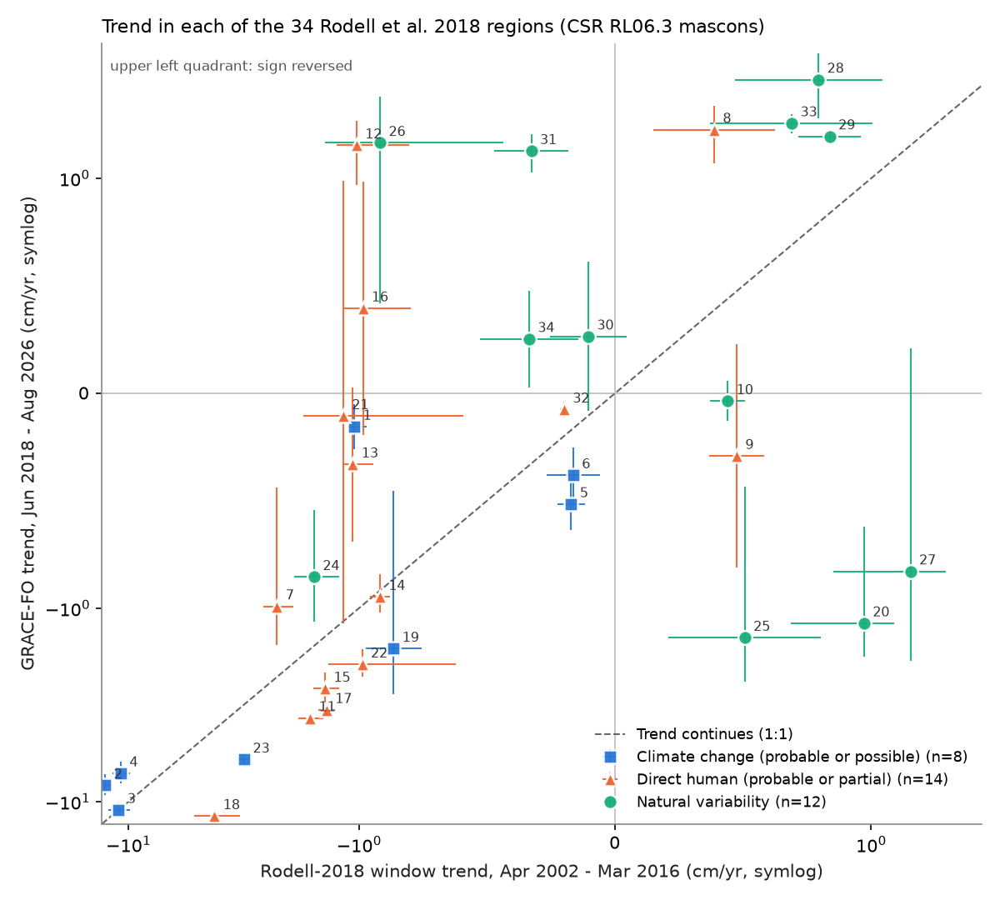
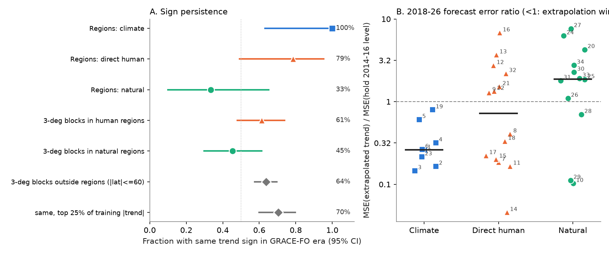
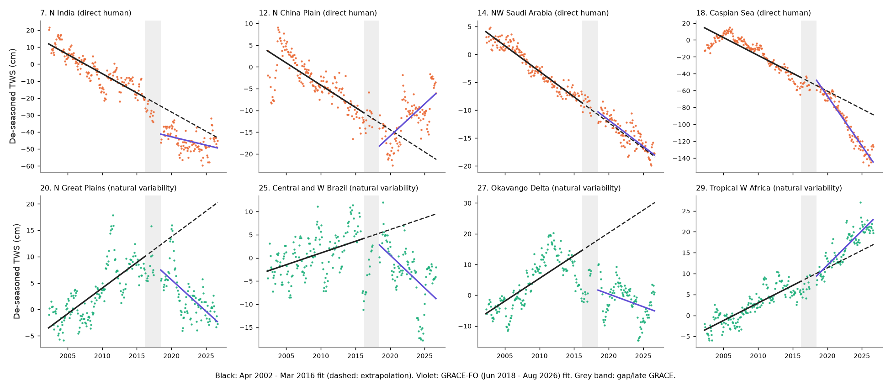

# The cause labels of Rodell et al. 2018 predicted which GRACE water-storage trends continued in GRACE-FO data (2018-2026)

## Summary

Rodell et al. (2018, Nature 557:651) mapped 34 regional trends in terrestrial water storage (TWS) in GRACE data from April 2002 to March 2016. They gave each region a probable cause: climate change, direct human impact (mostly groundwater use and water diversion), or natural variability. They stated that the natural-variability trends "may well fade or reverse" and that most human-driven depletion is "likely to continue".

We tested these labels as a forecast. We used CSR RL06.3 mascons (April 2002 to August 2026) and approximate polygons for the 34 regions. We fitted the same trend model in the Rodell window and in the independent GRACE-FO window (June 2018 to August 2026, 97 months).

Main results (GRACE-FO window):

| Rodell label | Regions | Same trend sign | Persistence slope (95% CI) | Median FO/train trend ratio | Trend extrapolation beat "hold 2014-16 level" |
|---|---|---|---|---|---|
| Climate change (probable or possible) | 8 | 8 (100%) | 0.79 (0.60 to 1.27) | 1.44 | 8 of 8 (median MSE ratio 0.26) |
| Direct human (probable or partial) | 14 | 11 (79%) | 1.89 (0.43 to 2.61) | 0.73 | 7 of 14 (median MSE ratio 0.85) |
| Natural variability | 12 | 4 (33%) | 0.17 (-0.91 to 1.39) | -0.66 | 3 of 12 (median MSE ratio 1.88) |

* Human versus natural, same-sign count: Fisher exact one-sided p = 0.026. Difference in persistence slope: 1.72 (95% CI -0.23 to 2.97; bootstrap P(diff <= 0) = 0.045). Permutation test on the median ratio: p = 0.056.
* At the 3-degree block scale, only 45% (95% CI 30 to 61%) of blocks in the natural-variability regions kept their trend sign. Land blocks outside all Rodell regions (|lat| <= 60) kept their sign in 64% (57 to 70%) of cases; blocks in the top 25% of training-trend size kept it in 70% (60 to 80%). The natural-region deficit relative to the background is -0.18 (95% CI -0.35 to -0.01), and -0.25 (-0.43 to -0.06) relative to the top-25% blocks. At block scale, the human-minus-natural difference (+0.16, CI -0.05 to 0.36) is not significant. Thus the "natural variability" label found trends that faded more often than typical GRACE trends. It did not only find trends that faded as often as all large trends do.
* The labels are good at the group level but individual region forecasts often failed. The North China Plain (probable human) reversed from -1.02 to +1.48 cm/yr. This is the only significant reversal in the human group. Its timing agrees with the South-to-North Water Diversion and pumping limits after 2015, but we did not test that cause. NW Saudi Arabia did not slow down as Rodell expected (-0.92 to -0.95 cm/yr). The S High Plains and E Texas loss doubled (-0.99 to -1.95 cm/yr) and did not partly recover. The Caspian Sea loss accelerated almost three times (-4.2 to -11.9 cm/yr). Four natural-variability regions kept significant same-sign trends (Tropical W Africa, Nile headwaters, N and E Australia, Central Argentina).
* Precipitation explains part of the trend changes. Across the 27 non-ice, non-lake regions, the change in TWS trend correlates with the change in trend of a GPCP precipitation-anomaly store with 24-month memory: Pearson r = 0.60, Spearman 0.56, permutation p = 0.0003. For the pre-registered memory-free cumulative anomaly, the correlation is weaker: Pearson 0.42, Spearman 0.21. Two large natural regions (Central and W Brazil, Okavango) carry much of the Pearson correlation.



## 1. Question

Many studies extrapolate GRACE trends as signs of long-term water gain or loss. Rodell et al. 2018 is the most-cited global map of such trends. It is also one of the few studies that gives a cause, and implicitly a persistence forecast, for each trend before later data existed. GRACE-FO now gives eight more years of independent data. Two questions:

1. Did the 2002-2016 regional trends continue?
2. Did Rodell's cause labels predict which trends continued?

If the labels are correct, natural-variability trends should fade or reverse. Climate and direct-human trends should continue.

## 2. Data

| Input | Version | Source | SHA-256 of the file used |
|---|---|---|---|
| CSR GRACE/GRACE-FO RL06.3 mascons, all corrections (0.25-degree grid, 260 months 2002-04-18 to 2026-08-16; label RL0603rc24cE, date_created 2026-10-07) | RL06.3 | https://download.csr.utexas.edu/outgoing/grace/RL0603_mascons/CSR_GRACE_GRACE-FO_RL0603_Mascons_all-corrections.nc (doi:10.15781/cgq9-nh24) | d4bd8b7364fb34d871198001563c70d344792cb7b0a577c04f8b91c713741292 |
| CSR RL06 v02 land mask | v02 | same folder, CSR_GRACE_GRACE-FO_RL06_Mascons_v02_LandMask.nc | 65ddd8f3c7f7633c3a34f904e196307f71e4994e11ceb64f9337275908ff2f3b |
| GPCP v2.3 monthly precipitation (1979-01 to 2026-06) | v2.3 | https://downloads.psl.noaa.gov/Datasets/gpcp/precip.mon.mean.nc | d31c53ab8180a883bd01442212948c3db4372d481b94a90e69d3d86bb65d7f68 |
| Rodell et al. 2018 Table 1 and Fig. 1 (cause legend) | NIH author manuscript PMC6077847 | https://pmc.ncbi.nlm.nih.gov/articles/PMC6077847/ | HTML 945ac343...a2; Fig. 1 JPEG 7c45a164...b71 |

On the campaign machine the shared copies are at `datasets/csr-grace-rl0603-mascon-all-corrections-20261109`, `datasets/csr-grace-rl06-v02-landmask-20261109` and `datasets/psl-gpcp-v23-precip-mon-mean-20261109`. The raw files are not in this bundle. `files/code/00_get_data.sh` downloads them to a scratch folder.

Cause labels (Rodell Fig. 1 legend colours, read from the figure):
probable climate change 1, 2, 3, 4, 23; possible climate change 5, 6, 19; probable direct human 7, 9, 12, 14, 17; possible or partial direct human 8, 11, 13, 15, 16, 18, 21, 22, 32; probable natural variability 10, 20, 24 to 31, 33, 34.

## 3. Methods

1. **Pre-registration.** Before we computed any value after March 2016, we wrote the hypotheses, windows, trend model and primary statistics in `files/code/PREREGISTRATION.md`. The analyst wrote this file in the same session. No outside party holds a timestamp of it.
2. **Region polygons** (`files/code/regions.py`). Rodell did not publish region outlines. We drew approximate polygons from Fig. 1 and the text and kept cells in the CSR land mask (the CSR mask includes the Caspian and Aral Seas). We tuned the polygons once, using only the training window, so that area and Gt/yr agree with Table 1. Then we froze them (`FREEZE_LOG.txt`, sha256 1e32fa3d...). Across the 34 regions, our training Gt/yr correlates with Rodell's at r = 0.99, and our cm/yr at r = 0.96. The agreement is not perfect: we used a different data release (CSR RL06.3, not JPL RL05M) and approximate outlines. N North America (5) and N Eurasia (6) have the opposite sign to Rodell's small positive values (both are near zero and sensitive to GIA). Several tropical regions have 25-55% of Rodell's mass rate. `files/data/region_training_mass_rates.csv` gives our area and Gt/yr for each region.
3. **Trends.** For each region, we computed the area-weighted monthly mean (cm equivalent water height). We fitted OLS with an intercept, a linear trend, and annual and semiannual harmonics. Windows: training 2002-04 to 2016-03 (152 months); GRACE-FO 2018-06 to 2026-08 (97 months); a secondary window 2016-04 to 2026-08. We inflated the trend standard errors for AR(1) residual autocorrelation.
4. **Persistence statistics.** Same-sign counts. Persistence slope = OLS slope through the origin of the test trend on the training trend (cm/yr) across the regions of a group. The bootstrap resamples regions and adds trend noise (20,000 draws). We also used the median ratio, a label-permutation test, and a Fisher exact test.
5. **Forecast test.** We removed the seasonal cycle with the training harmonics. For each GRACE-FO month, we compared two forecasts: (a) the extrapolated training trend line, and (b) the mean de-seasoned level of April 2014 to March 2016. The statistic is the MSE ratio (a)/(b).
6. **Background.** We formed 3x3-degree land blocks (at least 50% land). Blocks outside all regions are the generic-persistence baseline. We excluded ice sheets and the glacier regions. The CIs come from a 15x15-degree super-block bootstrap.
7. **Precipitation check.** We computed GPCP regional means on the 2.5-degree grid, weighted by region-cell area, and anomalies relative to the 2002-2016 monthly climatology. Pre-registered measure: trend of the cumulative anomaly. Added measure: a leaky store with 24-month e-folding memory. We correlated the change between windows with the change in the GRACE trend.

## 4. Results in detail

Per-region values are in `files/data/region_persistence.csv`. Columns: `tr_train`, `tr_fo`, `tr_post` (cm/yr), `se_*`, `mse_ratio_fo`, the GPCP measures, and others. Group statistics are in `persistence_summary.json`, `baseline_gpcp_summary.json` and `sensitivity_summary.json`.



Selected regions (cm/yr; training -> GRACE-FO):

| Region | Label | Training | GRACE-FO | Comment |
|---|---|---|---|---|
| 7 N India | probable human | -2.26 | -0.99 | depletion continued at about half the rate |
| 12 N China Plain | probable human | -1.02 | +1.48 | significant reversal (only one in human group) |
| 14 NW Saudi Arabia | probable human | -0.92 | -0.95 | continued; Rodell expected slowing |
| 17 Aral Sea | probable human | -1.38 | -3.35 | accelerated |
| 18 Caspian Sea | partial human | -4.23 | -11.86 | accelerated about 3x |
| 11 NW China | partial human | -1.63 | -3.70 | accelerated |
| 15 N Middle East | partial human | -1.40 | -2.61 | accelerated |
| 16 SW Russia | partial human | -0.98 | +0.40 | stopped |
| 22 S High Plains / E Texas | partial human | -0.99 | -1.95 | accelerated; Rodell expected partial recovery |
| 20 N Great Plains | natural | +0.97 | -1.20 | significant reversal |
| 25 Central and W Brazil | natural | +0.51 | -1.42 | reversed |
| 27 Okavango | natural | +1.48 | -0.83 | reversed |
| 31 SE Africa | natural | -0.33 | +1.38 | significant reversal |
| 29 Tropical W Africa | natural | +0.84 | +1.65 | continued and accelerated |
| 28 Nile headwaters | natural | +0.79 | +3.23 | accelerated (Lake Victoria high stands; GERD filling is inside this region) |
| 33 N and E Australia | natural | +0.69 | +1.92 | continued (2020-22 La Nina) |
| 10 Tibetan Plateau | natural | +0.44 | -0.04 | stopped, as Rodell expected |



Sensitivity (`sensitivity_summary.json`):
- Without the Aral and Caspian Seas, the human group has a persistence slope of 0.84 and 9/12 same-sign regions.
- The "probable human" subgroup alone has 3/5 same-sign regions and a slope of 0.67, with a wide CI.
- The human-versus-natural Fisher p is 0.025-0.026 when (a) the test window ends in 2025, (b) the training window extends to June 2017, or (c) the test is the first half of GRACE-FO (2018-2022). In the second half only (2022.5-2026.7, 4 years), natural regions keep 7/12 signs and the contrast is weak (p = 0.25).
- Significant reversals (|z| > 2 with the opposite sign): human 1 of 14 (N China Plain); natural 2 of 12 (N Great Plains, SE Africa); climate 0 of 8.


## 5. Interpretation

- The cause labels carry real forecast information. The natural-variability label separated fading trends from continuing trends better than the general size or the general persistence of GRACE trends. Over eight years, extrapolating the trend was the better forecast for all climate regions and for half of the human regions (median MSE ratio 0.85). For natural regions, holding the 2014-2016 level was the better forecast.
- "Natural" does not mean "returns to zero". A third of the natural regions had significant trends in the same direction in 2018-2026. Multi-decadal rainfall regimes (W Africa, East African lakes) are possible causes, and so are human effects inside these regions (for example, reservoir filling). This agrees with Rodell's own remark that the Okavango wet phase could resume. Their trend did not resume, but other natural regions kept their trends.
- "Human" does not mean "continues at the same rate". Policy and infrastructure can stop or reverse depletion (N China Plain, SW Russia). Drought and diversions can accelerate it (Caspian, Aral, Middle East, S High Plains). The large human persistence slope (1.89) comes mainly from accelerating closed-basin lakes.

## 6. Limitations

- Small samples: 12, 14 and 8 regions. The slope CIs are wide, and the slope difference CI includes zero (bootstrap P = 0.045 one-sided). Only the same-sign Fisher test and the block-level background comparison are clearly below 0.05. We report all pre-registered tests, and not all of them are significant.
- The region outlines are approximate, and the data release differs from Rodell's (CSR RL06.3 versus JPL RL05M). Our training trends replicate Rodell's well but not exactly. In some tropical regions we capture only part of Rodell's mass rate.
- GIA and leakage errors add the same trend to both windows. This inflates apparent persistence, mainly at high latitudes (regions 5, 6, 19 and the background blocks above 50 degrees). After we saw that the high-latitude blocks dominated the all-latitude baseline slope (2.6), we restricted the background to |lat| <= 60. This was not pre-registered. We report both versions.
- The 3-degree blocks are spatially correlated. The super-block bootstrap only partly accounts for this.
- GRACE-FO has a degraded accelerometer on one satellite and an 11-month gap from GRACE. Inter-mission biases are absorbed in separate intercepts per window, but they can affect the "post" window that spans both missions.
- The GPCP check is crude. It omits evapotranspiration and runoff, and two high-leverage regions drive the Pearson correlation. The pre-registered memory-free measure is weaker (Spearman 0.21).
- The analyst assigned the cause labels from the figure colours. Two labels have a mixed meaning: region 8 is "precipitation increase and groundwater policy change" (partial human), and region 28 is "natural" but contains the GERD reservoir.

## 7. Reproduction

```
bash files/code/run_all.sh <this_bundle_dir> <empty_scratch_dir>
```
This downloads the inputs to scratch, transcribes Rodell Table 1 from the PMC page, and runs scripts 01-08. It uses Python 3.12 with numpy, pandas, xarray, netCDF4, scipy and matplotlib. CSR updates the mascon file monthly, so a later download has more months. To reproduce the exact numbers, drop months after 2026-08-16 or use the file with the SHA-256 above. Bootstrap seeds are fixed in the scripts. Runtime is a few minutes (the block bootstrap in 06 takes about 5 minutes).

## 8. Provenance

- Campaign 11_07_2026, job sci-1107-dell-earth-and-ocean-sciences-226b8f1d58a4, topic earth-and-ocean-sciences, machine dell, account claude-andrii. The analysis and text were made by the model Claude Opus 5.5 (claude-opus-5-5) working as an autonomous research agent. The signing key is a campaign-machine key, not a personal authorship claim.
- Related campaign work: well-level trend persistence in the US (sci:sha256:7ca3c3b9...) found that full extrapolation of well trends raises forecast error. Here the same question is asked at GRACE regional scale, with cause labels as the predictor. Other GRACE campaign studies examined drought recovery and storage asymmetry, not regional trend persistence.
- External-data terms: see `files/NOTICE-external-data.md`.
