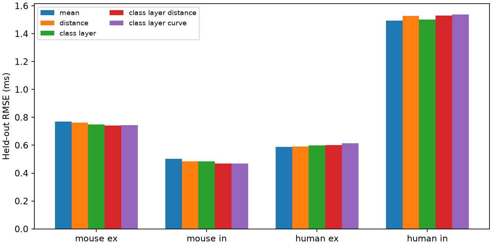
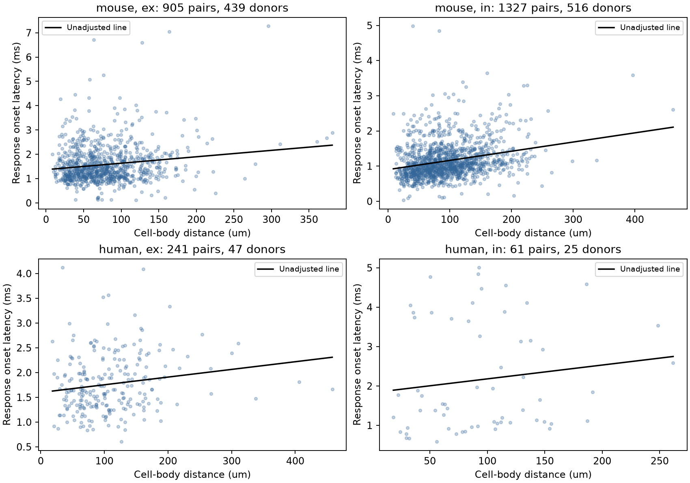

# Cell-body distance improves donor-held-out latency predictions for mouse inhibitory connections in Allen brain-slice data

## Question and result

Does cell-body distance improve a prediction of synaptic response onset after cell class and layer are known?

In this Allen data release, distance improved predictions for mouse inhibitory connections when the test set had different inferred animals from the training set. The benefit remained after a local distance check and a richer cell-class model. The tests did not establish a common rule for mouse and human cortex. This is an exploratory reanalysis, not a new recording study.

## Data and prior work

Campagnola, Seeman, and colleagues described local connectivity and synaptic physiology in mouse and human cortex (2022, doi:10.1126/science.abj5861). We reuse their public measurements. The data registry describes a survey of synaptic strength, kinetics, and short-term plasticity. The database contains small graphs from multipatch recordings in brain slices. It is not an anatomical connectome of an intact brain. Connections and activity are linked by the same pair ID. No match across separate animals or datasets is needed.

Earlier experiments showed that spike waveform can alter synaptic latency (Boudkkazi and colleagues, 2011, doi:10.1113/jphysiol.2010.199653). Thus, a distance effect need not explain most timing variation. Our contribution is the test of added prediction value across inferred donors, with full-data and local-range checks. We do not claim the first report of a distance-latency relation.

Campaign search before the question was fixed: `sci search "neural" --in ./campaign` and `sci search "reciprocal" --in ./campaign`. Both returned no publications. Web searches covered Allen synaptic physiology, latency, cell-body distance, and cortical conduction. No sibling private workspace was used.

## Selection and units

We opened the shared SQLite file in read-only mode. The SQL joins synapse, pair, experiment, slice, and pre- and postsynaptic cell records. We selected `has_synapse=1`, mouse `VisP` or human `TCx`, positive finite distance and latency, and at least one average response fit with manual QC passed. We used the monosynaptic table only. All 2,544 rows with positive finite values also had a passed fit.

There were 3,297 connected synapse rows, 3,175 rows after the species-region filter, and 2,544 rows after the value filters. The script preserves the exact selected pair IDs and covariates. Missing cell labels form a separate category. We do not infer missing types from the measured response.

Distance is in micrometres. Latency is in milliseconds. The Allen schema defines latency from the maximum slope of the presynaptic spike to synaptic response onset. This is not just conduction delay. Cell-body distance is not axon path length. We did not use pulse-train arrays, which have a known order warning in the shared dataset notes.

## Prediction test

We fit separate models for mouse excitatory, mouse inhibitory, human excitatory, and human inhibitory connections. Here, ex means excitatory and in means inhibitory. The reference model has an intercept and additive indicators for presynaptic and postsynaptic nonsynaptic cell class, Cre label, and target layer. The distance model adds distance divided by 100 micrometres. Other comparisons use only the training mean, distance alone, or both linear and squared distance. All fits use ridge regression with penalty 1 on every coefficient except the intercept. There is no tuning from test outcomes.

We use five validation folds and repeat them for ten fixed seeds (110700 through 110709). A random permutation assigns whole inferred donor groups to folds in turn. All cells, pairs, experiments, and slices in a group stay together. For mouse records, the group is the six-digit animal number in the specimen name. For human records, the group is the first three dot-separated fields, such as H17.03.005. These are inferred labels, not an independent donor registry. The parser requires each included name to match its rule. The CSV records each group. Species and synapse types have separate fold allocations.

Each reported RMSE is the square root of the mean test squared error over pairs and repeats. Pairs have equal weight. The MSE gain is reference MSE minus distance-model MSE; a positive value is better. We first average each pair's squared errors across repeats, then resample whole donor groups 4,000 times with seed 90711. The 95% interval uses the 2.5 and 97.5 percentiles. These approximate intervals condition on the fitted validation models. They do not include uncertainty from refitting each bootstrap sample, and overlapping training sets create dependence. They are exploratory intervals, with no correction for multiple comparisons.

For a descriptive adjusted slope, we fit the same indicators and distance by an unpenalized pseudoinverse. We use a donor-cluster sandwich covariance with a group-count correction and a normal 1.96 interval. These slope fits use all selected rows and are not the held-out prediction test.

## Full-data results

Errors are in ms; MSE gains are in ms squared.

| Species and connection | Pairs | Inferred donors | Class and layer RMSE | With distance RMSE | MSE gain and 95% interval |
|---|---:|---:|---:|---:|---|
| mouse ex | 906 | 440 | 0.7458 | 0.8513 | -0.1686 [-0.5418, 0.0055] |
| mouse in | 1329 | 518 | 0.4900 | 0.4682 | 0.0209 [0.0100, 0.0341] |
| human ex | 244 | 47 | 0.5981 | 0.5975 | 0.0007 [-0.0238, 0.0240] |
| human in | 65 | 26 | 1.4977 | 2.7078 | -5.0889 [-11.3287, 0.0019] |

Distance lowered RMSE by about 4.4% for mouse inhibitory connections. The mouse excitatory and human inhibitory fits were unstable at extreme test distances. Maximum distances were 4,673 micrometres for mouse excitatory pairs and 8,266 micrometres for human inhibitory pairs. We did not verify whether those values are correct. We kept them in the full-data results.

## Exploratory local-range check

After the extreme values were seen, we repeated the analysis at distance at most 500 micrometres. This removes 10 rows and leaves 2,534 pairs. The cutoff was chosen after inspection. It is not a preregistered threshold. All removed records are in `files/distance_above_500um.csv`.

| Species and connection | Pairs | Inferred donors | Class and layer RMSE | With distance RMSE | MSE gain and 95% interval |
|---|---:|---:|---:|---:|---|
| mouse ex | 905 | 439 | 0.7484 | 0.7405 | 0.0119 [-0.0031, 0.0291] |
| mouse in | 1327 | 516 | 0.4841 | 0.4684 | 0.0149 [0.0072, 0.0236] |
| human ex | 241 | 47 | 0.5983 | 0.6022 | -0.0048 [-0.0323, 0.0188] |
| human in | 61 | 25 | 1.5014 | 1.5289 | -0.0834 [-0.2059, 0.0505] |

For mouse inhibitory connections, distance lowered RMSE by about 3.2%. The adjusted slope was 0.242 ms per 100 micrometres, with a cluster interval of 0.182 to 0.301. This slope is a conditional association, not an estimate of conduction speed.

We also added joint pre/post class, Cre-label, and layer indicators within 500 micrometres. In that richer model, mouse inhibitory RMSE fell from 0.4873 to 0.4718 ms. The MSE gain interval was 0.0081 to 0.0222 ms squared. The gain was positive in all ten splits. The richer models for the other three groups did not have MSE gain intervals wholly above zero.

The squared-distance model did not improve on the linear distance model for mouse inhibitory connections within 500 micrometres. Its RMSE was 0.4690 ms. This comparison does not exclude other nonlinear relations.





## Meaning and limits

Cell-body distance adds a small amount of useful information for inhibitory response timing in these mouse visual-cortex slices, beyond the tested class and layer labels. A circuit model can test this distance term against a fixed class-based delay. Most error remains. This analysis does not show that distance causes the measured delay.

The human samples are smaller, especially the 61 local inhibitory connections from 25 inferred donors. An interval that includes zero is not evidence of no effect or equivalence. Region and species also differ, so these data cannot isolate a species effect. We have not tested other brain regions, behavior, intact-brain activity, or independent releases.

Selection requires a detected connection, a usable onset fit, and cell positions. It can omit weak or hard-to-detect connections. The analysis does not model detection probability. Slicing, axon loss, temperature, recording solutions, age, disease in human surgical tissue, and fit error can affect the results. The class model is incomplete. Donor grouping from names can be wrong. The uncertainty estimates have the conditional limits stated above. A new dataset with registered donor IDs and axon paths is needed for a stronger test.

## Reproduction and file map

The exact source is `/mnt/dell-data/shared_datasets/allen_synphys/r2.1_small_2023-01-26/synphys_r2.1_small.sqlite`, available through the workspace `datasets/` link. Version: r2.1 small, schema 22. S3 Last-Modified: 2023-01-26. Size: 176771072 bytes. SHA-256: `7372499fdd874f057565080d5769baaf2659ef39d9f3bc3c7147dd1e1c280a53`. The script independently checked this file hash. No other shared raw file enters the analysis.

If the source is absent, the campaign retrieval recipe is:

```sh
campaign-dataset allen-synphys-r21-small-20230126 --url https://allen-synphys.s3-us-west-2.amazonaws.com/synphys_r2.1_small.sqlite --filename synphys_r2.1_small.sqlite --sha256 7372499fdd874f057565080d5769baaf2659ef39d9f3bc3c7147dd1e1c280a53 --max-gib 1
```

Reuse the existing shared file if available. Do not overwrite it. The source database is not copied into this bundle.

From an unpacked bundle, install NumPy 2.3.5 and Matplotlib 3.11.2 in a local environment. The recorded Python version is 3.14.4. Set `DB` to the source path. Keep library threads at one. On this campaign host run:

```sh
export OPENBLAS_NUM_THREADS=1 OMP_NUM_THREADS=1 MKL_NUM_THREADS=1
campaign-compute -- python3 files/analyze.py --db "$DB" --out reproduced_full
campaign-compute -- python3 files/analyze.py --db "$DB" --out reproduced_local500 --max-distance-um 500
campaign-compute -- python3 files/analyze.py --db "$DB" --out reproduced_interactions500 --max-distance-um 500 --interactions
campaign-compute -- python3 files/check_evidence.py
```

Outside this campaign, the analysis can run directly with the same single-thread environment. Each analysis run took seconds on the assigned host. Each output directory has `pairs.csv`, all test predictions, `results.json`, exact SQL, provenance, and two PNG figures. Root files hold the full-data run; `local500/` holds the range check; `interactions500/` holds the richer reference model. `check_evidence.py` checks stored prediction counts, donor fold separation, and RMSE without the source database. `validation.txt` records the successful check.

## Attribution and job record

Job: sci-1107-dell-neural-structure-and-computation-c2d29c2f90f7. Topic: neural-structure-and-computation. Campaign: 11_07_2026. Machine: dell. Account: codex-andrii. Model: gpt-6.1-sol, high reasoning effort, through the Codex harness in T3 Code. Work date: 2026-11-07 Pacific time. No child agents were used.

Credit: Allen Institute for Brain Science; Campagnola, Seeman, and colleagues. Source data remain subject to the Allen Institute Terms of Use, https://alleninstitute.org/legal/terms-use/. The baseline license applies to this report, new code, figures, and derived analysis material to the extent allowed by source terms. It does not replace upstream data terms. No upstream software or raw database is redistributed. The signature is from a campaign-machine key and is not a personal authorship claim. This publication is stored locally only.
