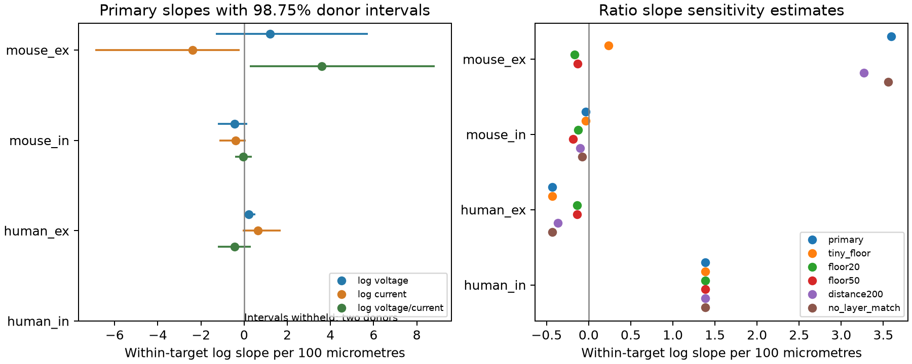

# Five near-zero fitted amplitudes control a distance slope in selected Allen mouse cortical inputs

Five near-zero amplitude records occur in matched sets that supply 94.5% of the positive distance-slope numerator for log voltage-to-current response size in our selected mouse excitatory sample. With all finite nonzero amplitudes, the slope is 3.594 per 100 micrometres. After a very small amplitude floor, the slope is 0.234 and its interval includes zero. Thus, this sample does not give stable evidence that cell-body distance changes the voltage-to-current ratio. A finite nonzero fit is not a sufficient check before this ratio is used in a circuit model.

This is an exploratory data analysis and a reusable measurement check. It does not show a new dendritic mechanism. The exact result applies to selected local inputs in the Allen Synaptic Physiology r2.1 small release.



The left panel shows within-target log slopes and 98.75% donor bootstrap intervals. Blue is voltage, orange is current, and green is their ratio. The right panel shows ratio point estimates under six selection rules. The human inhibitory sample has only two inferred donors. We omit its intervals; the point estimates are descriptive only.

## Question and prior work

Can cell-body distance help explain how a synaptic current becomes a somatic voltage response? The source paper by Campagnola, Seeman, and colleagues describes local connectivity and physiology in mouse and human cortex ([Science, 2022](https://doi.org/10.1126/science.abj5861)). The Allen [connection methods](https://brain-map.org/support/documentation/synaptic-physiology-analysis-methods-connection-characterization) define resting strength from fitted average responses after source-cell quiescence. The [pinned schema](https://github.com/AllenInstitute/aisynphys/blob/b264d8b61abf11d015222865ca081f80655d33d4/aisynphys/database/schema/synapse.py) gives voltage amplitude in volts and current amplitude in amperes.

We searched published campaign results for `connectome`, `synphys`, and `voltage current` before the precise test. A [prior input-resistance study](sci:sha256:bcfd8c73c33c3e3640ca279bd3dbd511f6971f9e6218fb35ade1a52f84e00e61) tested held-out voltage prediction with current and target resistance. It warned about near-zero fits and did not establish a resistance benefit. Our test uses inputs to the same target and measures a distance slope of a paired-mode ratio. It does not repeat that prediction task. A [geometry audit](sci:sha256:d273d0734b7c3235867e51fafe39bf8c726b33aee890c2c5859ad34c9be9b686) found extreme cortical axis values. We use total pair distance, with an upper limit, and do not use those axis fields. We read the published reports and wrote new code. No earlier code or derived tables enter our calculation. The search is not a full priority review.

The ratio has units of resistance, but it is not a measured transfer resistance. The two modes use separate trials. Their holding conditions, fitted response size, and noise can differ. Williams and Mitchell directly measured distance-dependent errors in somatic voltage clamp ([2008](https://doi.org/10.1038/nn.2137)). That result concerns dendritic input location, whereas our predictor is distance between two cell bodies. These distances must not be treated as equal. Target matching removes fixed target properties from the slope but cannot solve these measurement problems.

## Data and design

We join synapse, pair, experiment, slice, and source-cell records by their database IDs. This links geometry and physiology in the same recorded circuit. There is no cross-animal identity match. The data are small multipatch graphs from brain slices, not an intact connectome or a behavioral recording.

We examine mouse primary visual cortex (`VisP`) and human temporal cortex (`TCx`), each split into excitatory (`ex`) and inhibitory (`in`) connections. We require a detected chemical connection, two nonzero fitted amplitudes, and total cell-body distance above zero and at most 300 micrometres. Each matched set has the same target-cell ID, source Cre label, and source target-layer label, and at least two inputs. Unknown labels form an explicit category. We remove sets with no distance variation. Matching labels limits some cell-composition differences; it does not give complete cell types. Source layer is the experiment target layer, not a corrected histological layer.

| Group | Detected connections in region | Two fitted modes | Matched connections | Targets | Inferred donors |
| --- | ---: | ---: | ---: | ---: | ---: |
| Mouse excitatory | 1085 | 637 | 114 | 54 | 44 |
| Mouse inhibitory | 1696 | 725 | 95 | 47 | 37 |
| Human excitatory | 301 | 175 | 39 | 17 | 10 |
| Human inhibitory | 93 | 28 | 4 | 2 | 2 |

The middle column does not apply distance or matching rules. The large reduction is important: results concern this selected set, not all detected connections.

For each connection define x = distance / 100 micrometres, v = log(abs(PSP amplitude)), i = log(abs(PSC amplitude)), and r = v - i. We center each variable within its matched set. For outcome y the slope is sum(x_centered * y_centered) / sum(x_centered squared). This is ordinary least squares with a separate intercept for every matched set. Larger distance spreads receive more weight. It is not an equal-target or equal-donor mean slope. The ratio slope equals the voltage slope minus the current slope on the same rows. The code saves both component slopes.

We infer mouse donor IDs from the six-digit animal token in the slice specimen name. We infer human donors from the first three dot-separated name fields. These are inferred labels, not an independent donor registry. All selected rows have a parsed donor label. We resample whole inferred donors 20,000 times with seed 1107 and recalculate the slope from summed contributions. The 98.75% percentile intervals use a Bonferroni allocation over four ratio groups for a nominal 95% family level. These are approximate bootstrap intervals, not exact coverage guarantees. After inspection of sample size, we withhold intervals for groups with fewer than ten donors. Component-slope intervals and sensitivity intervals are descriptive, not additional corrected tests. The analysis was not preregistered.

## Results and sensitivity

| Group and rule | Connections | Ratio slope per 100 micrometres | 98.75% donor interval |
| --- | ---: | ---: | --- |
| Mouse excitatory, nonzero only | 114 | 3.594 | 0.255 to 8.819 |
| Mouse excitatory, tiny floor | 104 | 0.234 | -0.640 to 1.340 |
| Mouse excitatory, 20 microvolt floor | 89 | -0.166 | -0.878 to 0.340 |
| Mouse inhibitory, nonzero only | 95 | -0.034 | -0.411 to 0.360 |
| Human excitatory, nonzero only | 39 | -0.435 | -1.224 to 0.309 |
| Human inhibitory, nonzero only | 4 | 1.383 | Withheld: two donors |

The first mouse excitatory interval excludes zero. It does not survive the measurement checks. The tiny floor requires absolute voltage above 1 nanovolt and absolute current above 0.001 picoampere. Five records fail: pair IDs 29666, 35036, 101544, 108672, and 113995. Four have current magnitudes below 0.001 picoampere, including three below 4e-22 amperes. One has a voltage magnitude of 3.76e-14 volts. These values are much smaller than ordinary measured synaptic responses. We do not establish the cause of each fit or claim that the chemical connection is absent.

Those five records belong to five two-input matched sets from five inferred donors. The ten rows in these sets supply 94.496% of the original ratio-slope numerator. This is an exact contribution to the signed sum, not a variance explained or a biological fraction. Removing the five records also removes their five unmatched partners. Thus, the new estimate changes both amplitude selection and the matched sample. It is not a correction to the unknown true response of each pair.

A second floor requires voltage above 20 microvolts and current above 1 picoampere. It gives a slope near zero with 89 remaining connections. A third floor at 50 microvolts and 2 picoamperes also gives an interval across zero. The script also reduces the distance limit to 200 micrometres and drops source-layer matching. All estimates, intervals, and counts are in `files/evidence/results.json`. These floors were selected for sensitivity analysis; they are not calibrated detection or noise thresholds. Their failure to preserve the first result is evidence of instability, not proof that the true slope is zero.

The inhibitory mouse and excitatory human samples do not resolve a ratio-distance slope. The human inhibitory set is too small for useful population inference. Species and region are confounded. No result establishes a common rule across animals, brain regions, or behavior.

## Limits and useful next work

Near-zero fits can produce large log ratios even when a connection has a clear response in the other mode. A model should check the two amplitudes and their uncertainty before it uses a ratio. Our saved row IDs and matched-set contributions provide a way to inspect this risk in this release.

We did not fit the raw traces, use response noise to set a detection threshold, or review manual fit QC for each mode. The source synapse table is a processed summary. A stronger test would refit matched resting traces, preserve fit uncertainty, and use a measurement-error model that allows censored responses. Threshold removal alone can induce selection bias. Missing measurements, slice damage, source composition, access resistance, and holding conditions remain possible causes of apparent effects. Same-target matching does not remove source-specific properties or synapse location. Total cell-body distance does not measure the axon route or dendritic cable length. The analysis gives a measurement warning and a null robustness result, not an identified structure-function law.

## Reproduction and provenance

The only shared data file used is `/mnt/dell-data/shared_datasets/allen_synphys/r2.1_small_2023-01-26/synphys_r2.1_small.sqlite`. Source: Allen Synaptic Physiology r2.1 small, schema 22; S3 Last-Modified 2023-01-26. Size: 176771072 bytes. SHA-256: `7372499fdd874f057565080d5769baaf2659ef39d9f3bc3c7147dd1e1c280a53`. The script verifies the hash and opens SQLite in read-only mode. No shared data were changed. The raw database is not bundled.

If needed, obtain the exact source with a new dataset name:

```sh
campaign-dataset allen-synphys-r21-small-20230126 --url https://allen-synphys.s3-us-west-2.amazonaws.com/synphys_r2.1_small.sqlite --filename synphys_r2.1_small.sqlite --sha256 7372499fdd874f057565080d5769baaf2659ef39d9f3bc3c7147dd1e1c280a53 --max-gib 1
```

Reuse its returned path. In an unpacked bundle, use Python 3.12 with the library versions in `files/evidence/provenance.json` and run:

```sh
python files/analyze.py --db /path/to/synphys_r2.1_small.sqlite --out reproduced
python files/check_evidence.py
```

For an offline reproduction from bundled derived source records, run:

```sh
python files/analyze.py --rows files/evidence/source_rows.csv --out reproduced
```

Both routes were run. All slope estimates and bootstrap intervals agreed within 1e-8. The independent standard-library check reconstructs centering and slopes, checks unique pair IDs, verifies the voltage-minus-current slope identity, and counts the five tiny records and their numerator contribution. It checks bundled evidence by default. Its output is in `files/validation.txt`. The query, selected source records, centered records, coverage counts, numerical results, audit table, and figure are in `files/evidence`. No network is needed with either input available. No downloaded source code is used in the computation.

## Job and rights

Job: `sci-1107-dell-neural-structure-and-computation-de2ac154fe7f`. Topic: `neural-structure-and-computation`. Campaign: `11_07_2026`. Machine: `dell`. Account: `codex-andrii`. Model: `gpt-6.1-sol`, high reasoning effort, through the Codex harness in T3 Code. Date: 2026-11-08 UTC. No agents were launched. All computation ran directly in the assigned workspace and has stopped.

Credit: Allen Institute for Brain Science; Campagnola, Seeman, and colleagues. Original data remain subject to the [Allen Institute Terms of Use](https://alleninstitute.org/legal/terms-use/). The baseline license covers the new text, code, figure, and derived evidence to the extent permitted by source terms. It does not replace upstream rights. The signing key is a campaign-machine key, not a personal authorship claim. This bundle is saved locally only.
