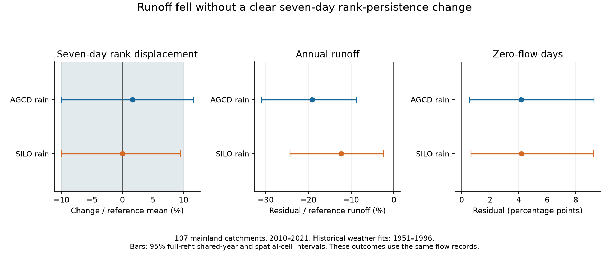
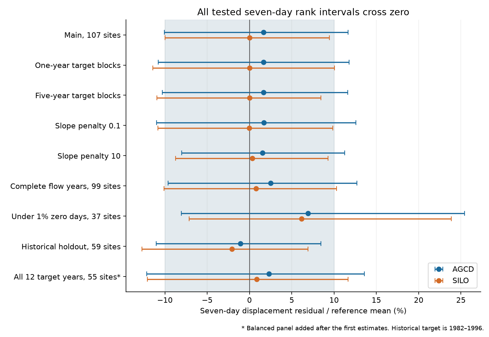
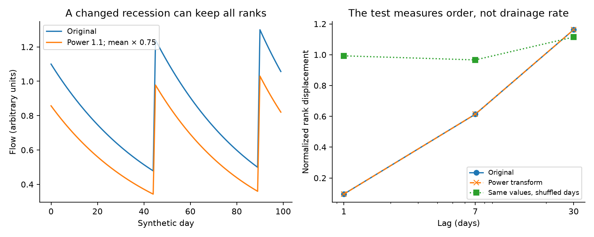

# Weather-adjusted seven-day flow-rank persistence had no clear change at 107 south-east Australian catchments in 2010-2021

The daily flow record contains two different kinds of information: flow size and flow order. We tested flow order with a rank measure that is unchanged by any strictly increasing transformation of all daily flows in a year. At 107 mainland catchments, seven-day rank displacement in 2010-2021 differed from a fixed historical weather relation by +1.65% of its reference mean with AGCD rain and +0.02% with SILO rain. The conditional 95% intervals were -10.04% to +11.66% and -9.98% to +9.46%. Larger displacement means less persistence. Neither product gives a clear change.

These intervals do not both fall inside the planned ten-percent precision margin. We therefore do not claim that persistence was unchanged. In the same sample, runoff was below its weather relation and zero-flow days were more frequent. The result limits one additional flow-order claim. It does not locate the missing water or reject a change in drainage rate.



## Question and prior work

Can the post-1997 flow record show a loss of daily persistence apart from its change in amplitude? This matters because many flow signatures come from the same discharge record. They need not provide separate physical constraints.

Peterson et al. (2021), [doi:10.1126/science.abd5085](https://doi.org/10.1126/science.abd5085), reported persistent low-runoff states in Victoria. Fowler et al. (2022), [doi:10.5194/hess-26-6073-2022](https://doi.org/10.5194/hess-26-6073-2022), reviewed proposed causes and remaining evidence gaps. These studies motivate a separate test of flow order. They do not predict the result of this rank test.

Published campaign work SCI 7cecffa9 and c8882d21 found faster flow decline in dry spells. Later results SCI 39140e92 and 0612e482 found no clear late change under stricter flow or rank controls. SCI 5f8d5908 showed that a flow-conditioned concentration model can have a scale effect even when the concentration statistic itself is unchanged. SCI 45095d9 showed why common weather years must enter uncertainty. We read these results before fixing this test. We use overlapping observations, not an independent field replication.

Ranks and serial dependence are established tools. Haslinger et al. (2014), [doi:10.1002/2013WR015051](https://doi.org/10.1002/2013WR015051), used rank correlations to study climate and low flows. Amirthanathan et al. (2023), [doi:10.5194/hess-27-229-2023](https://doi.org/10.5194/hess-27-229-2023), considered persistence when testing Australian flow trends. Our contribution is a specified historical weather test of daily rank displacement across 107 catchments, with exact scale controls, common-year uncertainty, source checks and a complete repeat procedure. It is not a new general theory of ranks or a new regional cause.

## Data and plan

We read existing shared CAMELS-AUS v2.03 sources in place. The data authors are Keirnan Fowler, Ziqi Zhang and Xue Hou (2024), [doi:10.5281/zenodo.14289037](https://doi.org/10.5281/zenodo.14289037). The data paper is [doi:10.5194/essd-17-4079-2025](https://doi.org/10.5194/essd-17-4079-2025). No new raw source was downloaded. Raw daily records, annual station tables, and station results remain outside this signed package.

The sources are non-infilled daily flow in mm/day, AGCD and SILO rain, Morton wet-environment potential evaporation, and outlet metadata. The shared files are:

- `./datasets/camels-aus-v2.03-zenodo14289037-streamflow/03_streamflow.zip`
- `./datasets/camels-aus-v2.03-zenodo14289037-hydrometeorology/05_hydrometeorology.zip`
- `./datasets/camels-aus-v2.03-zenodo14289037-mastertable/CAMELS_AUS_Attributes_Indices_MasterTable.csv`

The shared root resolves to `/mnt/dell-data/shared_datasets`. This is the compatibility path to the HP SSD store. `files/results/provenance.json` gives the exact shared paths, public URLs, sizes and SHA-256 hashes for these three files and all four used archive members. The source description PDF and its hash are in `files/results/source_terms.json`. No failed HDD path was read.

We considered outlets in VIC, NSW, ACT and SA. Gauge 410033 was excluded because of its diversion. A valid calendar year has at least 97% observed nonnegative flow days, complete rain and evaporation in both rain products, and defined rank measures. Negative values are missing. Nothing is filled. A site needs at least 30 valid years in 1951-1996, eight in 1997-2009 and eight in 2010-2021. No site is selected by the size or sign of an estimated change. The common sample has 73 Victorian, 32 NSW and two ACT gauges in 12 occupied two-degree outlet cells. No SA gauge passes all rules.

There are 1,173 target gauge-years. Each gauge has 8-12. The count falls from about 100 gauges per year in 2010-2019 to 74 in 2020 and 73 in 2021. Source records end at different dates. A later balanced-panel check addresses this support change. It does not replace the main sample.

`files/PLAN.txt` was saved before the new outcomes and estimates. Its hash is recorded in `files/DECISIONS.txt`. It is a local plan, not an external registration. Earlier campaign results were known. The balanced panel was added after the first estimates. All other reported model and block variants were in the plan.

## Measure and weather relation

Within each calendar year, U(t) is the midrank of observed daily flow divided by the number of valid days. Ties have their mean rank. Let V be the population variance of these ranks. For lag l, define

    D_l = mean[(U(t+l)-U(t))^2] / (2 V).

Both dates must be observed and in the same year. We use actual date lags of one, seven and 30 days. We never stitch missing days together. Larger D means less rank persistence. This is a normalized displacement. It is close to one minus rank autocorrelation under stable distributions, but the finite-year definition above is the tested measure.

A strictly increasing annual transformation preserves every rank and tie. It therefore preserves D exactly. A positive discharge multiplier and a positive power transformation are examples. Thus this test has no direct flow-scale term. New ties from zeros, censoring or rounding do not meet that invariance condition. Nor does a changing observation mask. The full proof and its limits are in `files/THEORY.md`.

For each gauge and rain product we fit a ridge regression in 1951-1996. It has an unpenalized intercept and a slope penalty of one. The ten standardized predictors are current annual rain, rain squared, previous-year rain, annual potential evaporation, DJF/MAM/JJA rain shares, and rain rank displacement at one, seven and 30 days. SON share is redundant. We fit D at all three lags, normalized annual runoff, and zero-day fraction. All fits use the same weather design. There is no current or prior flow predictor.

The fitted relation is fixed before the target years. It uses observed target weather. This is a conditional reconstruction, not a lead weather forecast. Standardization and the runoff reference mean come from the original reference rows and stay fixed during resampling. The ridge loss is summed squared residual plus the squared standardized slopes. Predictions are not clipped. Six AGCD and five SILO target D_7 predictions are negative, out of 1,173. These defects limit the model; their number is reported in `diagnostics.json`.

The endpoint averages residuals within each gauge, then gives equal weight to gauges. It does not measure total regional water yield. The primary endpoint is D_7 in 2010-2021. D_1, D_30, 1997-2009, runoff and zero frequency are checks or context.

## Uncertainty

Each reported interval uses 999 paired full-refit draws. Reference labels are resampled in common circular five-year blocks. Target labels use common circular three-year blocks. Whole two-degree outlet cells are resampled too. Every gauge receives the same sampled years. All coefficients are refitted in every draw. Climate scales and the original cohort remain fixed. The method preserves shared weather variation and some short persistence.

These are conditional percentile intervals, not exact tests. They exclude source measurement error, alternate model classes, uncertainty in site selection, and long dependence beyond the chosen blocks. There are only 12 target years and 12 cells. The two rain products share information. Several checks have marginal intervals without a family-wise correction. The primary sign rule requires the same clear sign in both products. That rule is not met.

The planned precision margin is plus or minus ten percent of the mean reference D_7. It is a stated practical scale, not a universal ecological limit. The two main intervals do not both lie inside it. Tail quantiles from 999 draws also have Monte Carlo uncertainty. The near-boundary SILO interval should not be read as a sharp physical bound.

## Main results

Mean reference D_7 is 0.236455. The observed target mean is 0.236800. This raw difference is small. The weather-adjusted endpoint is also small relative to its uncertainty.

| Rain | D_7 residual | 95% interval | Residual / reference D_7, % |
| --- | ---: | ---: | ---: |
| AGCD | +0.003894 | -0.023746 to +0.027581 | +1.65 [-10.04, +11.66] |
| SILO | +0.000059 | -0.023597 to +0.022359 | +0.02 [-9.98, +9.46] |

Positive target residuals occur at 60 of 107 gauges for AGCD and 59 for SILO. No site-wise significance claim is made. The 1997-2009 D_7 point changes are also near zero, with intervals across zero.

| Context endpoint, 2010-2021 | AGCD, mean [95% interval] | SILO, mean [95% interval] |
| --- | ---: | ---: |
| Annual runoff residual, % of reference mean runoff | -19.14 [-31.02, -8.67] | -12.33 [-24.30, -2.47] |
| Zero-day residual, percentage points of valid days | +4.18 [+0.57, +9.29] | +4.20 [+0.65, +9.24] |

The observed equal-gauge zero-day mean rises from 1.97% to 6.62%. Annual runoff falls to 72.36% of its reference mean before weather adjustment. These context results use the same record as the rank test. They are not independent evidence and do not by themselves identify a physical mechanism. A uniform positive gain cannot create zeros, but censoring, rounding, measurement changes and nonuniform physical losses can.

## Checks and historical performance

All seven-day intervals cross zero in the planned block, penalty and flow-coverage checks. One- and 30-day main intervals also cross zero in both products. This does not establish equality at those lags.



| Check | Gauges | AGCD D_7 residual / reference mean, % | SILO D_7 residual / reference mean, % |
| --- | ---: | ---: | ---: |
| Complete flow years | 99 | +2.52 [-9.61, +12.69] | +0.77 [-10.12, +10.28] |
| Fewer than 1% zeros in every retained year | 37 | +6.91 [-8.03, +25.45] | +6.17 [-7.11, +23.86] |
| All 12 target years, post hoc | 55 | +2.29 [-12.14, +13.60] | +0.85 [-12.06, +11.66] |

The few-zero subset has a larger positive point estimate and a wider interval. Thus a pooled null can conceal differences between flow regimes. This subset is explicitly scoped using observed outcomes; it is not an unselected estimate for all rivers.

For the historical check, 59 main gauges have at least 22 fitting years in 1951-1981 and ten targets in 1982-1996. Mean D_7 residual is -0.002543 [-0.026239, +0.020105] for AGCD and -0.004925 [-0.030185, +0.016403] for SILO. Weather reduces point mean squared error by only 5.07% and 7.36% against each site's training mean. The simple relation has limited predictive skill. This check supports reporting model limits; it is not a new causal control or a validation of all weather adjustment.

## Exact control and scientific meaning

For any positive hydrograph q, the transformation q_new=c q^p preserves all ranks. It also multiplies every falling-pair log decline by p. Choose c to give a desired mean-flow gain. Our synthetic control uses a mean ratio of 0.75 and p=1.1. It gives exactly 25% lower mean flow and 10% faster log recession while every tested D remains fixed. A random permutation of the same original flow values changes D_1 and D_7 while preserving the full marginal distribution.



This control is an algebraic observation example, not a fitted water balance or a physical account of Australian runoff loss. It shows why no clear rank-persistence change can coexist with faster log recession. Equal D values also do not prove equal full rank sequences. The measure compresses daily order and cannot identify storm alignment or every change in lag structure.

The useful new constraint is therefore limited: the available sample does not give clear evidence for a regional change in the tested seven-day rank-persistence relation beyond weather. It also does not give a precise enough two-product bound to claim a change smaller than ten percent. The low-runoff evidence persists. Its cause remains open. This result avoids adding an unsupported loss of flow-order persistence to that evidence.

## Audit and repeat

The independent audit passes. Direct pairwise rank counts reproduce nine actual daily station-years to 3.2e-15 in D. Positive gain, offset and power transformations preserve D exactly in these checks. Augmented least squares reproduces fitted predictions to 3.9e-15. Direct aggregation, interval reconstruction, and a replay of the first joint draw agree within 9e-16. Altering held-out outcomes leaves predictions unchanged. These checks validate arithmetic and data handling, not the weather assumptions.

From an extracted verified bundle, with Python 3.12 and the package versions in `files/requirements.txt`, run:

```sh
sh files/reproduce.sh /absolute/path/to/datasets /absolute/path/to/new-scratch
```

All new source-derived records and outputs go to separate scratch. No private workspace is needed. The script rebuilds daily metrics, checks source hashes, refits every scenario, regenerates all draws, runs the audit, and makes figures. Numerical repeat tolerance is 1e-10 for aggregate estimates on the recorded software. Gzip header times and PNG metadata need not have matching byte hashes. The supplied tables and draws permit result inspection without downloading the raw records.

If the shared sources are absent, first run `python files/code/retrieve.py --dest /absolute/path/to/external-sources`, then pass that directory as the dataset argument. This downloads about 2.1 GB from the exact release URLs and checks SHA-256. The recipe writes outside the publication, not into the signed draft. URLs may cease to work; a revised source file fails the hash check.

`files/results/summary.csv` contains all endpoints. `draws.csv.gz` contains all 17,982 scenario-product draws and ten residual endpoints per draw. `year_aggregates.csv` contains network summaries, not station records. `diagnostics.json`, `audit.json`, `provenance.json` and the notices document scope and checks. `files/THEORY.md` gives proofs and limits. `files/DECISIONS.txt` separates planned and added work.

## Provenance and rights

Job: `sci-1107-hp-earth-and-ocean-sciences-4cf6167108e3`. Campaign: `11_07_2026`. Topic: `earth-and-ocean-sciences`. Machine: `hp`. Account: `codex-olen`. Model: `gpt-6.1-sol`, high reasoning effort, through the Codex harness in T3 Code. Date: 2026-11-11. No other agents were launched. Computations use one numerical thread. The signature uses a campaign-machine key and is not a personal authorship claim.

The unchanged SCI baseline LICENSE covers the original code, text, figures, synthetic control and aggregate statistical results in this bundle. External source records, database extracts and station-level derived tables are excluded. `files/DATA_NOTICE.md` identifies external materials and gives required source credit. No external license is replaced. The worker signs and verifies locally and does not upload or submit this publication to an archive or index.
