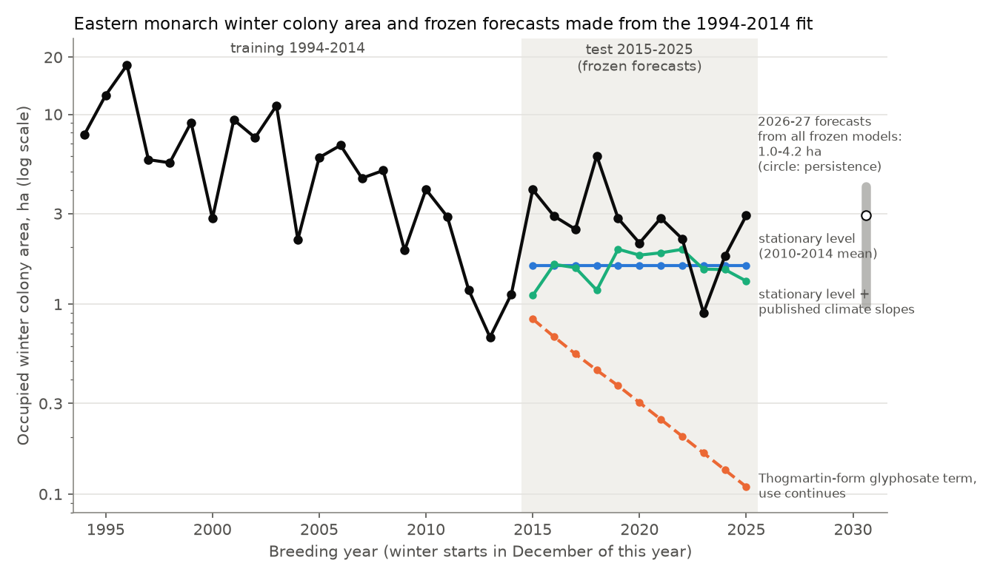
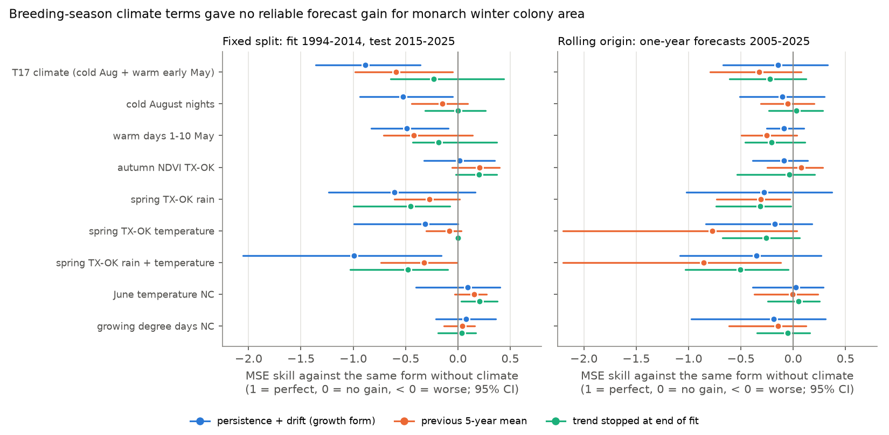
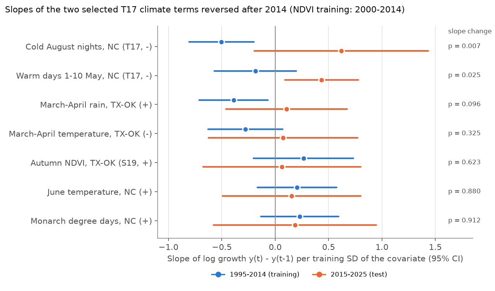

# Published breeding-season climate effects did not forecast eastern monarch winter colony area in 2015-2025

**Job:** sci-1107-dell-climate-pollution-biodiversity-a7d55d2e101d · **Topic:** climate-pollution-biodiversity · **Machine:** dell · **Model:** Claude Opus 5.5 (claude-opus-5-5) · **Campaign:** 11_07_2026.
The signing key is a campaign-machine key. It is not a personal authorship claim.

## Summary

Question: Do published climate effects on the eastern monarch butterfly (*Danaus plexippus*) population forecast the winter colony area in Mexico after the end of the original fits?

Data: the occupied winter colony area (WWF-Mexico, CONANP, UNAM and the Monarch Butterfly Biosphere Reserve; 32 winters, 1994-95 to 2025-26). Climate covariates from NOAA nClimGrid-daily state means. Autumn greenness from MODIS MOD13Q1 NDVI. Northern US glyphosate use from USGS EPest.

Method: We fitted every model on the winters 1994-95 to 2014-15 only. Then we froze the model and forecast the 11 winters 2015-16 to 2025-26. We compared each climate model with the same model without climate. We also did one-year rolling-origin forecasts for 2005-2025, a period-interaction test of each slope, and a selection-noise test.

Main results:

1. The two climate terms that Thogmartin et al. (2017) selected (cold August nights and warm days on 1-10 May in the north-central US) made forecasts worse. With the published slopes added, the mean squared error (MSE) increased by 31-61% against three no-climate baselines. Refitted in our data, the same terms increased the MSE by 23-89% in the three main forecast forms.
2. Both terms changed sign after 2014. In our reconstruction, the cold-August-night slope on log growth was -0.50 per SD (95% CI -0.81 to -0.20) in 1995-2014. The change after 2014 was +1.12 (p = 0.007). The early-May warm-day slope changed by +0.62 (p = 0.025). In 2015-2025 the warm-day slope was +0.43 (CI 0.09 to 0.78), opposite to the published sign. The warmest early May in the record (2018) came before the largest colony area after 2003 (6.05 ha).
3. An all-subsets BIC search over 38 breeding-season climate candidates in 1994-2014 found again the early-May warm-day term. But its in-sample R2 gain (0.185) was not larger than the gain found with randomly permuted climate years (p = 0.12; 98% of permutations also selected at least one climate term).
4. Climate terms that a mechanism suggests before any search (autumn NDVI in Texas-Oklahoma, Saunders et al. 2019; June temperature and monarch degree days in the north-central US) kept a stable positive sign (slope change p = 0.62-0.91). Their forecast gains were small and not reliable (fixed split MSE skill +0.02 to +0.21; rolling origin -0.19 to +0.08). In the rolling-origin test, 25 of 29 climate models were worse than their no-climate baseline and no one-sided p was below 0.3.
5. Spring rain in Texas-Oklahoma had a negative slope in 1995-2014, opposite to the published positive effect on summer counts. It made all forecasts worse.
6. The population did not continue to decrease after 2014. The geometric mean area was 1.60 ha in 2010-2014 and 2.56 ha in 2015-2025. The Thogmartin-form glyphosate term, with use extended at the 2015-2019 rate, forecast 0.11 ha for 2025-26 (observed 2.93 ha). This agrees with the authors' own statement that further glyphosate-driven decline was not expected, but not with their fitted cumulative term.
7. No model was better than persistence or the 5-year mean by a reliable margin. The best simple forecast for winter 2026-27 is near 2 ha, with an 80% interval of about 0.8 to 4.7 ha.

Conclusion: For the eastern monarch, published annual climate effects on winter abundance are not operationally forecastable at present. Terms selected from many candidates in short series reversed. Terms that a mechanism suggests kept their sign but were too weak to give a forecast gain. This agrees with earlier campaign results: climate models forecast timing but not abundance of insects.

## 1. Background and claims under test

The eastern monarch winter colony area decreased from 18.19 ha (1996-97) to 0.67 ha (2013-14). Several studies attribute the annual variation to breeding-season climate:

- **C1** Thogmartin et al. 2017, *R. Soc. Open Sci.* 4:170760 (doi:10.1098/rsos.170760). The best model of the log of winter area (1993-2014) had three terms: cumulative northern glyphosate (standardized slope -0.506), the percentage of August nights below the 10th percentile of minimum temperature in the north-central US (-0.131), and the number of days above 21.1 C on 1-10 May in the north-central US (-0.139). R2 = 0.93. The authors selected these terms from 76 candidates by partial least squares and BIC.
- **C2** The same paper expected "climate-induced stochastic variation ... around a relatively stationary population size" after 2014.
- **C3** Saunders et al. 2019, *PNAS* 116:8609 (doi:10.1073/pnas.1805114116). Greener autumns (NDVI from 15 September to 15 October along the southern migration corridor) gave larger winter colonies (2004-2015).
- **C4** Zipkin et al. 2012 (*Glob. Change Biol.* 18:3039), Saunders et al. 2018 (*Ecography* 41:278) and Zylstra et al. 2021 (*Nat. Ecol. Evol.* 5:1441): spring rain in Texas increases monarch abundance, hot springs decrease it, and summer warmth (degree days) in the north-central US increases it. These studies used summer counts. We test whether the same signs carry to the winter area.

The analysis plan (`files/PLAN.md`) was written before any test-period fit.

## 2. Data

| Input | Source and version | Use |
| --- | --- | --- |
| Winter colony area, ha, 1994-95 to 2025-26 | WWF-Mexico/CONANP/UNAM/MBBR measurements, as tabulated in the Monarch Watch figure "Total Area Occupied by Monarch Colonies at Overwintering Sites in Mexico" (2025-26 season version, retrieved 2026-11-10, SHA-256 dc6c69ba...c3c187). 2025-26 = 2.93 ha agrees with the Monarch Watch post of 2026-03-17. | Response, `files/data/monarch_winter_area.csv` |
| Daily Tmax, Tmin, Tavg, precipitation, state means | NOAA NCEI nClimGrid-daily area averages (`ste-scaled` files), March-November 1981-2026, retrieved 2026-11-10. 1,652 files; hashes in `files/provenance/`. | Climate covariates |
| Glyphosate use by county, kg | USGS EPest county estimates 1992-2012 (water.usgs.gov PNSP), 2013-2017 v2.0 (ScienceBase 5e95c122...), 2018 and 2019 preliminary (ScienceBase 6081a706..., 6081a924...). EPest-low, 21 northern states. | Thogmartin glyphosate term |
| NDVI | MODIS MOD13Q1 v061 250 m 16-day NDVI, composites starting day 257 and 273 (14 Sep - 15 Oct), 10 x 10 km boxes at 18 grid points (28-35.5 N, 96.5-99.5 W; one point is in the Gulf and has no land data), from the ORNL DAAC MODIS/VIIRS subset service, 2000-2026. Hashes in `files/provenance/`. | Saunders autumn greenness |

Regions: north-central (NC) = ND, SD, NE, KS, MN, IA, MO, WI, IL, MI, IN, OH, weighted by land area. South = TX + OK. Warm days use Tmax > 21.1 C (the daily mean is almost never above 21.1 C on 1-10 May). Cold nights use the 1981-2010 August 10th percentile of daily Tmin for each state. Monarch degree days use base 11.5 C and cap 36 C, 3 May - 12 September.

The breeding year t is the summer before the winter count (the winter 2025-26 has t = 2025). The response is y_t = ln(area).

## 3. Methods

**Forecast forms.** All coefficients came from 1994-2014 only.
- Growth form: y_t - y_{t-1} = a + b z_t. The no-climate baseline is persistence with drift.
- 5-year-mean form: y_t - mean(y_{t-5..t-1}) = a + b z_t.
- Stopped-trend form: y_t = c0 + c1 t + b z_t, with the trend stopped at 2014 for the forecasts (the C2 expectation).
- Glyphosate forms: y_t = c0 + g G_t + b z_t, with cumulative glyphosate G either held at 2014 or extended at the mean 2015-2019 rate.
- Published-slope form (C1): a baseline (persistence, 5-year mean, or the 2010-2014 level) plus -0.131 z(cold Aug) - 0.139 z(warm early May), with z standardized on 1994-2014.

**Scores.** RMSE of y; MSE skill = 1 - MSE(model)/MSE(baseline); a one-sided exact sign-flip test on squared-error differences (2^11 sign patterns); 95% bootstrap intervals over years.

**Slope stability.** For each covariate, we fitted the growth form with a post-2014 indicator and its interaction with z (1995-2025) and tested the interaction.

**Selection noise.** We rebuilt 38 breeding-season climate candidates that follow the climate rows of Thogmartin's table 1 for the NC, north-east and south regions. On 1994-2014, with the glyphosate base model, we searched all 1- and 2-term additions by BIC and recorded the in-sample R2 gain. We repeated the search 1,000 times with the rows of the candidate table permuted together.

**Sensitivity.** (a) 2003-04 area set to 8.5 ha, because the reported 11.12 ha was measured before the colonies consolidated. (b) a 9-state core Corn Belt region for the NC covariates.

## 4. Results

### 4.1 Frozen forecasts of the level

| Forecast for 2015-2025 (frozen at 2014) | RMSE of ln(area) | MSE skill vs persistence |
| --- | --- | --- |
| Persistence | 0.665 | 0 |
| Mean of previous 5 years | 0.660 | +0.02 (CI -0.70 to +0.51) |
| Level 2010-2014 (stationary, C2) | 0.654 | +0.03 (CI -0.82 to +0.46) |
| Training trend, continued | 1.223 | -2.38 |
| Glyphosate term, use continues | 2.208 | -10.0 (CI -24.7 to -4.5) |
| Glyphosate term, held at 2014 | 1.016 | -1.33 (CI -3.71 to -0.29) |

The stationary expectation (C2) was correct in direction: the population did not continue to decrease. The 2015-2025 trend was -0.078 ln units per year (SE 0.040, p = 0.09), and the level was higher than in 2010-2014. The fitted glyphosate term did not give this result. Even with glyphosate held at the 2014 value, the fitted level was too low (mean forecast 1.03 ha against an observed geometric mean of 2.56 ha), because the fit put much of the 1994-2014 decrease on the glyphosate term.

### 4.2 Published and refitted climate terms

| Model (fixed split) | Baseline | MSE skill (95% CI) | One-sided p |
| --- | --- | --- | --- |
| Published C1 slopes + persistence | persistence | -0.61 (-1.13, -0.03) | 0.95 |
| Published C1 slopes + 5-year mean | 5-year mean | -0.38 (-0.94, +0.01) | 0.94 |
| Published C1 slopes + 2010-2014 level | 2010-2014 level | -0.31 (-0.58, +0.25) | 0.82 |
| Refitted C1 climate, growth form | growth drift | -0.89 (-1.36, -0.36) | 1.00 |
| Refitted C1 climate, 5-year-mean form | same form | -0.59 (-0.98, -0.05) | 0.95 |
| Refitted C1 climate, stopped trend | same form | -0.23 (-0.64, +0.44) | 0.77 |

All 9 climate sets and 5 forms are in `files/results/fixed_split_scores.csv`; the rolling-origin scores are in `files/results/rolling_origin_scores.csv`. In the fixed split, 25 of 45 set-form models were worse than their baseline. Six had a one-sided p below 0.05; five of these six were in the two glyphosate forms, whose baselines were already very poor (RMSE 1.0-2.2), so any level correction gives a gain. The other one was June temperature with the stopped trend (skill +0.21, p = 0.036). With 45 tests, this is what chance alone can give. Autumn NDVI and June temperature gave point gains in more than one form, but the gains did not repeat in the rolling-origin test (NDVI: -0.09, +0.08, -0.04; June temperature: +0.03, -0.01, +0.05).

### 4.3 Slope stability

| Covariate (published sign) | Slope 1995-2014 per SD | Change after 2014 | p |
| --- | --- | --- | --- |
| Cold August nights, NC (-) | -0.50 | +1.12 | 0.007 |
| Warm days 1-10 May, NC (-) | -0.19 | +0.62 | 0.025 |
| March-April rain, TX-OK (+) | -0.39 | +0.50 | 0.096 |
| March-April temperature, TX-OK (-) | -0.28 | +0.36 | 0.33 |
| Autumn NDVI, TX-OK (+) (2000-2014) | +0.27 | -0.20 | 0.62 |
| June temperature, NC (+) | +0.21 | -0.05 | 0.88 |
| Monarch degree days, NC (+) | +0.23 | -0.04 | 0.91 |

Our reconstruction reproduced the published sign of the cold-night term in the training years with a clear slope. Thus the failure is not caused by a wrong reconstruction of the covariate. The two terms that were selected from many candidates reversed. The terms with a direct physiological or resource mechanism (degree days, June warmth, autumn greenness) kept the same sign, but their 95% intervals included zero in each period and the full-period stopped-trend slopes were +0.13 to +0.26 per SD.

### 4.4 Selection noise

The search selected NC warm days on 1-10 May (slope -0.21 per SD) and north-east cold June nights (-0.33 per SD). The in-sample R2 rose from 0.673 to 0.858 (gain 0.185). In permutations, the median gain was 0.141 and the 95th percentile was 0.201 (p = 0.12). Frozen for 2015-2025, the selected model had RMSE 1.370 against 1.016 for the base model (glyphosate held at 2014). Thus a 0.1-0.2 R2 gain from 1-2 selected climate terms is the expected result of selection from about 40 candidates in 21 years, even with no real climate effect.

### 4.5 Sensitivity

The results did not change materially with the 2003-04 area set to 8.5 ha (cold-night change +1.07, p = 0.010; warm-day change +0.60, p = 0.025; refitted C1 growth-form skill -0.77) or with the 9-state core region (changes p = 0.009 and 0.037; published-slope skill -0.57, -0.30, -0.19). See `files/results/sensitivity/`.

### 4.6 Forecast for winter 2026-27 (count in December 2026)

The 2026 covariates were known on 2026-11-10: warm days on 1-10 May, NC = 3.1 (1994-2014 mean 4.0); cold August nights = 1.6% (1994-2014 mean 7.6%); June NC temperature 20.5 C (mean 20.3 C); autumn NDVI 0.476 (the third lowest in 2000-2026, after 2000 and 2011). September-October 2026 was the warmest in TX-OK since 1981 (24.8 C against a 1994-2014 mean of 21.4 C), with near-normal rain. The frozen models give 1.0 to 4.2 ha (`files/results/forecast_2026_27.csv`). Persistence gives 2.93 ha and the 2021-2025 mean gives 1.97 ha. The NDVI models give 1.15-2.35 ha. With the 2015-2025 spread of the 5-year-mean forecast errors (SD 0.68 ln units), an 80% interval around 1.97 ha is 0.83-4.70 ha. We state this forecast before the December 2026 count. The measurement will be reported in early 2027.

## 5. Interpretation

The monarch result agrees with the campaign pattern. Climate links that are physically direct (fire area and June temperature, lake ice and early-winter temperature, hypoxia and spring flow) forecast later years. Annual abundance of animals usually does not (UK butterfly growth, US bird abundance, fish recruitment, NestWatch nest success, US duck numbers). For monarchs, two additional points are clear:

- The published monarch climate terms came from a search over many candidates in about 20 years. Our permutation test shows that this search gives an R2 gain of 0.1-0.2 with no real effect. Such terms should not be used for forecasts or for attribution of single years without an out-of-sample test.
- The terms that have a direct mechanism are stable in sign. But the size of their effects (about 0.1-0.3 ln units per SD) is small against the year-to-year process noise (SD of log growth 0.69-0.78). With 30 winters, these effects cannot give a reliable forecast gain.

The level change after 2014 (no further decrease) is not explained by the climate covariates. It agrees with the authors' view that the glyphosate-driven loss of milkweed was complete by about 2014. It does not agree with a model that uses cumulative glyphosate as a continuing driver.

## 6. Limitations

- The winter area is a proxy for abundance. The density of monarchs in colonies may vary between years. The area series was transcribed from a Monarch Watch figure of the official WWF-Mexico/CONANP values; 1994-2003 data came from reserve staff and 2004+ data from WWF-Mexico.
- Thogmartin et al. used a state-space-smoothed series from 1993 (Semmens et al. 2016) and PRISM data; we used the raw area from 1994 and nClimGrid-daily state means. The exact covariate definitions (for example, Tmax or Tavg for the 21.1 C threshold) were not fully stated. We reproduced the sign of both climate terms in 1994-2014.
- The Saunders et al. models also used the NABA summer index, which is not public. We tested only the NDVI part, with a different set of NDVI points (their region 1 polygon was not available).
- The test period has 11 winters. The CIs on skill are wide. A real effect smaller than about 0.2 ln units per SD cannot be excluded.
- EPest estimates after 2014 changed method, and 2018-2019 are preliminary. The download of the 2013-2017 file ended after 55,151,943 of 67,766,658 bytes at every try; the glyphosate block for all 2013-2017 counties was complete in the part we received (the next compound followed it). Its SHA-256 is in `files/provenance/sha256_usgs_epest.txt`. Linear interpolation of 2013-2017 gave the same results to two decimals.
- We tested many set-form combinations; we report all of them.

## 7. Reproduction

1. `bash files/code/00_fetch.sh SCRATCH` downloads all external inputs into a scratch folder outside this bundle (NOAA, USGS, ORNL DAAC, Monarch Watch figure, Thogmartin text and R code).
2. `python -I files/code/01_climate_covariates.py SCRATCH/nclimgrid OUT/climate_covariates.csv`
3. `python -I files/code/02_glyphosate.py SCRATCH/epest OUT/glyphosate_north.csv`
4. `python -I files/code/03_ndvi.py SCRATCH/modis_ndvi OUT/ndvi_autumn_corridor.csv`
5. Copy `files/data/monarch_winter_area.csv` into OUT. Then `python -I files/code/04_forward_test.py OUT RESULTS`
6. `python -I files/code/05_selection_null.py SCRATCH/nclimgrid OUT SELECTION 1000`
7. `python -I files/code/06_figures.py OUT RESULTS SELECTION FIGS` and `bash files/code/07_sensitivity.sh OUT SENS`

`files/data/` holds the exact derived inputs used here. Python 3.12 with numpy, pandas, scipy and matplotlib. Random seeds are fixed in the scripts. nClimGrid-daily files are revised in place by NOAA; the SHA-256 values of the files used are in `files/provenance/`.

## 8. Data rights

All bundled files are the authors' code, figures, results, and derived annual tables. The derived tables come from public-domain US government data (NOAA nClimGrid-daily, USGS EPest, NASA MODIS via ORNL DAAC) and from factual winter-area measurements reported by WWF-Mexico/CONANP. See `files/NOTICE.md` for attribution. The SCI baseline LICENSE applies to the bundled files only.
