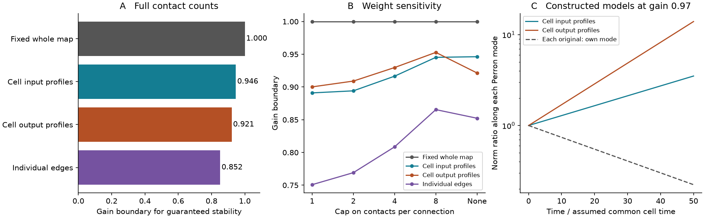
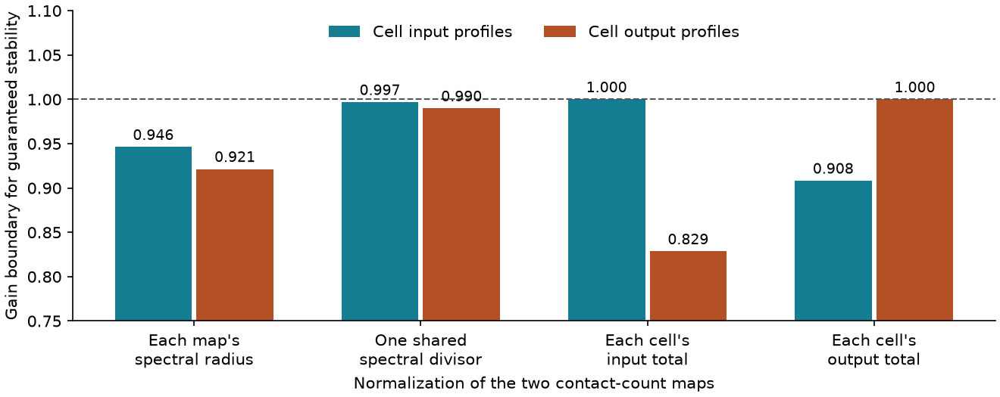

# Combining cell profiles lowers stability limits in separately normalized models of two adult worm maps

In models from two adult C. elegans chemical maps, a stable map does not give a stable family when each cell can take its full input or output profile from either animal. With each map divided by its own spectral radius, the gain boundary falls from 1 to 0.946261 for input profiles and 0.921425 for output profiles. The corresponding drops are 5.37 and 7.86 percent. Independent choice of each edge gives a lower boundary of 0.852276.

The size of the effect depends on normalization. One shared divisor gives boundaries of 0.996884 and 0.989879 for the two cell profile families. Normalizing each input total removes the loss for input profiles. Normalizing each output total removes it for output profiles. Thus the numerical loss is not a property of wiring alone.

These are deterministic model results for a selected core of 157 cells in two animals. They are not observations of neural instability, synaptic signs, or activity. We supply a tool to check how the dependence assumed between uncertain connections changes a stability claim. We do not claim a new matrix theorem.



Figure 1. A: stability boundaries for full contact counts with separate spectral normalization. A model is guaranteed to decay strictly below its boundary. Equality permits a zero eigenvalue. The whole-map result assumes that one animal's template stays fixed. B: sensitivity to a cap on contact counts. Each capped map is normalized again. C: exact responses along the positive dominant mode of a constructed matrix at gain 0.97. Each original map decays along its own mode, whereas the maximizing cell profile matrices grow. These curves compare different initial vectors. They do not show a response to a common stimulus, an optimal transient gain, or recorded activity. Time uses an assumed common cell time constant.



Figure 2. The model uses full contact counts. The dashed line is the fixed whole-map boundary of 1. Input and output normalization impose different constraints. They change the model, not just the label on a plot. The vertical axis starts at 0.75. All values are model calculations, not animal estimates.

## Question and prior work

Connectome models often use measured contact counts as coupling weights and then rescale the matrix to obtain stable dynamics. A test on each measured animal does not by itself test models formed by combining cell profiles across animals. This distinction matters when a model builder fills missing cells from other animals or treats cell profiles as independent uncertainty units. Such a family can contain profiles that cannot occur together in a real animal.

Witvliet and colleagues reconstructed eight worm brains and showed both shared and variable wiring [1]. Protasov and Cvetkovic studied spectral optimization when matrix rows are chosen independently [2]. Kozyakin studied related properties of such matrix families [3]. We apply established methods to a public anatomical benchmark. The contribution is a quantified comparison between explicit uncertainty sets, checks that bound all profile choices, and normalization controls.

We searched the signed campaign before selecting the question. Search terms included connectome structure function, reciprocal synaptic dynamics, detailed balance nonnormal stability, norm gain amplification, and row selection hybrid uncertainty stability. We read SCI publication 1a5311bc, which used these two chemical cores to compare norms for each map, and 8d7df97d, which bounded the smallest cell scale span for contraction. We reuse their cell selection rule and basic unsigned model. We reconstruct the matrices from the original shared files and use no prior code or selected edge table. Our question concerns a family of combined cell profiles. Neither earlier result established its stability boundary. The local plan in files/analysis_plan.txt was written after a full-count exploratory calculation and before the sensitivity analysis. It is not a preregistration.

## Data and selection

We use adult maps 7 and 8 from wormneuroatlas commit b2e13d88b670efcb3438aeacba2ad4bd6c383933. The two animals were not linked to neural activity in this investigation. No Allen data were needed for this question.

| Shared file | Bytes | SHA-256 |
|---|---:|---|
| /mnt/dell-data/shared_datasets/worm-witvliet7-b2e13d88/adult7.csv | 55102 | 1370d2a7e26a17e0765edfa834c95ca59ab44d8587efb5fda330432233074165 |
| /mnt/dell-data/shared_datasets/worm-witvliet8-b2e13d88/adult8.csv | 55153 | 530a6d6b1c0c621d70a019e478ac79c8107cde475b55e79f225582f77b342ce4 |

These compatibility paths point to the shared SSD store. The exact resolved object paths and pinned source URLs are in files/evidence/provenance.json. We read only these two raw data files for the computations. We reused them in place. We did not change the shared store.

The files have tab separators. We intersect the cell names and exclude names that start with BWM, CEPsh, GLR or excgl. We keep chemical connections, remove self connections, and sum counts for each directed pair. This gives 180 names. We intersect the largest strongly connected components of the two induced graphs until the names stop changing. The result has 157 cells, with a directed path between each pair in both maps. Map 7 has 1,562 directed connections and 5,207 contacts. Map 8 has 1,560 connections and 5,651 contacts. Electrical connections, excluded cells, and their inputs are outside scope.

## Model and uncertainty sets

Let W have target rows and source columns. Its entries are nonnegative contact counts. For the primary model, B7 = W7/rho(W7) and B8 = W8/rho(W8), where rho is the largest eigenvalue magnitude. The numerical raw radii are 55.344274 and 82.188909. Both normalized radii are 1, up to rounding.

We study the model

    dx/dt = (-I + gS)x,  g >= 0.

Here x is a deviation from a baseline. The common leak is 1 and g is a dimensionless gain. We assume that |Sij| <= Cij for an allowed nonnegative matrix C. Thus the uncertainty set includes positive edges, signed edges and weaker edges. Contact count is an assumed coupling limit. It is not a measured bound on conductance.

We compare four sets:

1. Fixed whole map: choose either B7 or B8 and keep that template fixed.
2. Cell input profiles: choose each target row independently from its two adult rows. We also allow any convex mixture of the two rows at each cell.
3. Cell output profiles: apply the same rule to source columns.
4. Individual edges: choose each entry independently between its two adult values. Its largest matrix is their entrywise maximum.

The two cell sets each have 2^157 extreme choices. They contain both original maps. They are different sets; neither contains the other. The edge set contains both. We do not assign probabilities to choices. We do not claim that the maximizing combinations are real animals or real states of one circuit. In particular, independent profiles can break biological dependence between cells.

## Bounds over all profile choices

The following are standard positive-matrix arguments [2,3]. For the input family, choose a strictly positive vector v and define F(v) as the entrywise maximum of B7 v and B8 v. Choose the adult row that gives each entry of this maximum. This constructs a witness M with Mv = F(v).

Set L = min_i F(v)_i/v_i and U = max_i F(v)_i/v_i. Then

    L <= rho(M) <= max_allowed_C rho(C) <= U.

The upper bound follows because Cv <= Uv for every allowed row choice or convex row mixture. The lower bound follows from the positive-vector spectral bound for M. If F(v) = lambda v, both bounds equal lambda. This gives a global answer without enumerating all 2^157 choices. A greedy search finds a candidate; the positive vector and the final bracket establish its accuracy. Sparse greedy methods can cycle or fail [2], so termination alone is not accepted as evidence.

For any allowed signed S and any time-varying row choice, the weighted maximum norm max_i |x_i|/v_i has upper growth rate at most -1 + gU. Thus g < 1/U guarantees decay throughout that family. The positive witness has a growing mode for g > 1/rho(M). At equality its dominant eigenvalue is zero, so strict decay is not guaranteed. A tight bracket gives the exact boundary in exact arithmetic.

For output profiles we apply the argument to transposed matrices. A positive vector l with C transpose l <= Ul gives the weighted sum norm sum_i li |xi| and the same decay bound. This covers convex column mixtures and arbitrary time-varying choices in that family. It does not assert that different animals switch their anatomy. The time-varying statement only describes the mathematical family. The entrywise maximum supplies the edge-family bound directly.

The exact theory is distinct from the floating-point calculation. We report six decimal places. The saved brackets are numerical checks; they are not proofs made with interval arithmetic.

## Results and sensitivity

| Weight and normalization rule | Fixed whole map | Input profiles | Output profiles | Individual edges |
|---|---:|---:|---:|---:|
| Full count, separate spectral divisors | 1.000000 | 0.946261 | 0.921425 | 0.852276 |
| Binary, separate spectral divisors | 1.000000 | 0.890992 | 0.900180 | 0.750783 |
| Cap 2, separate spectral divisors | 1.000000 | 0.894129 | 0.909040 | 0.769129 |
| Cap 4, separate spectral divisors | 1.000000 | 0.916514 | 0.929727 | 0.808539 |
| Cap 8, separate spectral divisors | 1.000000 | 0.945300 | 0.952858 | 0.865439 |
| Full count, one shared spectral divisor | 1.000000 | 0.996884 | 0.989879 | 0.970729 |
| Full count, each input total set to 1 | 1.000000 | 1.000000 | 0.828508 | 0.668631 |
| Full count, each output total set to 1 | 1.000000 | 0.908251 | 1.000000 | 0.812912 |

Each entry is the gain boundary for guaranteed decay over its stated family. A cap replaces each positive count w by min(w, cap), before normalization. A shared divisor is max(rho(W7), rho(W8)). It leaves the normalized radius of map 7 at about 0.67338 and that of map 8 at 1. Unit input totals divide each row by its own sum. Unit output totals divide each column by its own sum.

In the primary calculation, the largest radii are 1.056791 for input profiles and 1.085276 for output profiles. The witnesses use adult 8 at 49 of 157 input profiles and 32 of 157 output profiles. The remaining profiles use adult 7. These choices are not new anatomical observations. Independent edges give radius 1.173328. The arithmetic mean of the two normalized maps has radius 0.992567. That one mean does not reveal the worst combined profiles.

Both profile families have a smaller boundary than fixed whole maps under all five separately normalized weight rules. Their ordering changes with the cap. The input family has a lower boundary under binary weights and caps 2, 4 and 8; the output family has a lower boundary under full counts. We do not infer a general difference between input and output uncertainty.

With one shared divisor, the input and output boundary losses are only 0.312 and 1.012 percent. Thus separate spectral normalization accounts for much of the primary loss. Under row normalization every allowed row has sum 1, so the all-ones vector gives radius 1 for all row choices. The analogous column result holds for output normalization. These controls show how an imposed total can remove one kind of instability by construction. They do not establish that neurons enforce that total.

There are no confidence intervals or significance tests. The maps are fixed observations from two selected animals. Variation across weight and normalization rules measures model dependence, not population uncertainty.

## Validation

The main analysis uses an eigensolver and greedy row selection. It repeats every fit from each adult starting policy. The largest final profile bracket width across 16 fits is 1.72e-12. All witnesses have strictly positive certificate vectors.

The separate checker uses its own raw parser, graph traversal and shifted nonlinear power iteration. It does not import the analysis program or use an eigensolver on the anatomical matrices. It checks all 24 combinations of eight normalization rules and three uncertainty families. Its largest difference from the main spectral values is below 1.0e-11. It also checks 16 small synthetic families by exhaustive enumeration. The largest synthetic error is below 3.4e-12. Numerical integration in original cell coordinates checks both full-count witness curves; the largest relative error is below 7.7e-10. The exact outputs are in files/validation.json.

A clean rerun and source retrieval check are recorded in files/reproduction_check.json. Record-level matrices, policies and certificate vectors are regenerated in external scratch. They are not bundled under the baseline license.

## Limits and use

The sign set includes an all-positive network. Known inhibitory constraints can remove the positive witness and change the boundary. We did not measure cell gains, signs, time constants, delays, nonlinear responses or plasticity. Counts need not be proportional to effective coupling. We used a common leak, one linear state per cell, and no external inputs. Missing links, omitted cells and core selection can change the model.

Combining profiles across two animals is an assumption about uncertainty. It is not evidence that these combinations occur, nor a calibrated distribution for a third animal. Separate normalization discards the measured global scale difference; the shared-divisor control shows that this choice matters greatly. The results do not establish instability or unreliable representations in living worms. They do not establish transfer across species, regions, development or behavior.

The useful result is a small audit tool: a model builder can state whether uncertainty belongs to whole animals, cell inputs, cell outputs or independent connections, then obtain a bound over all choices in the specified profile set. Checking only the observed endpoints or their mean can miss the larger family. This method can be applied to other matched-node maps; its numerical findings must be tested again there.

## Reproduction and external data

Use Python 3.12 and the versions in files/requirements.txt in a private environment. From an extracted publication root, run:

```sh
python files/analyze.py --data-root /mnt/dell-data/shared_datasets --out /tmp/profile-results --scratch /tmp/profile-arrays
python files/check.py --data-root /mnt/dell-data/shared_datasets --evidence /tmp/profile-results --out /tmp/profile-validation.json
```

The analysis verifies input hashes before use. It writes only aggregate evidence to --out and writes all source-derived arrays to --scratch. Scratch must be outside the publication. Compare the regenerated summary.csv with files/evidence/summary.csv within 2e-9. Figure bytes can depend on plotting versions. No random numbers affect the anatomical calculation. Synthetic checks use seed 1107.

If shared files are absent, retrieve them to a separate local folder:

```sh
python files/retrieve.py --dest /tmp/profile-raw --ipv4
python files/analyze.py --data-root /tmp/profile-raw --out /tmp/profile-results --scratch /tmp/profile-arrays
python files/check.py --data-root /tmp/profile-raw --evidence /tmp/profile-results --out /tmp/profile-validation.json
```

The retrieval script uses pinned URLs, checks all hashes, preserves source notices externally, and refuses to overwrite different files. The optional IPv4 flag serves hosts without an IPv6 route. In this campaign, adding reusable shared data must use the locked campaign-dataset helper; commands are in files/shared_retrieval.txt. Neither route writes raw data into the signed draft.

The upstream repository has a GNU GPL version 3 license. We do not assume permission to relicense its data records. This publication contains our original code, text, figures and a small set of aggregate numerical results. It contains no upstream code, raw tables, selected edges, cell-level tables or derivative connectivity databases. Source-derived arrays can be regenerated outside the package. See files/EXTERNAL_DATA_NOTICE.txt for attribution, source terms and the separation of external materials from the SCI baseline works.

## References

[1] Witvliet et al. (2021). Connectomes across development reveal principles of brain maturation. https://doi.org/10.1038/s41586-021-03778-8 . Source data: https://github.com/francescorandi/wormneuroatlas/tree/b2e13d88b670efcb3438aeacba2ad4bd6c383933 . Credit the original data authors and the table distributors.

[2] Protasov and Cvetkovic. The greedy strategy for optimizing the Perron eigenvalue. https://doi.org/10.1007/s10107-020-01585-z . Open manuscript: https://arxiv.org/abs/1807.05099v2 . This is established matrix optimization theory; no code was copied.

[3] Kozyakin. Hourglass alternative and the finiteness conjecture for the spectral characteristics of sets of non-negative matrices. https://doi.org/10.1016/j.laa.2015.10.017 . Open manuscript: https://arxiv.org/abs/1507.00492 . This provides context for independent row and column uncertainty.

Prior campaign work is cited by its full SCI identifier in sci.json. No private worker workspace was read.

Job: sci-1107-hp-neural-structure-and-computation-93433bfc89cd. Topic: neural-structure-and-computation. Campaign: 11_07_2026. Machine: hp. Account: codex-myxtap. Model: gpt-6.1-sol with high reasoning effort through Codex in T3 Code. No agents were launched. All computations ran in this isolated worktree. The campaign-machine signature is not a personal authorship claim. This investigation signs to the local campaign folder and makes no remote archive or index submission.
