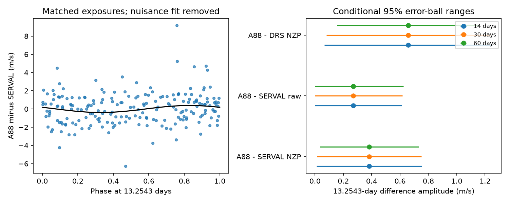

# A fixed-period fit gives a 0.38 m/s difference between two GJ 3293 velocity reductions

A fit to 204 matched HARPS exposures gives a 0.383 m/s sine-wave amplitude in A88 minus corrected SERVAL velocities at 13.2543 days. The main conditional null test gives a tail fraction of 0.0975. Other fit choices give different support. Thus, these data do not give stable evidence for a coherent difference at this period. This test does not confirm or reject the known planet.

## Question and prior work

Can a difference in velocity extraction explain why two reductions give different forecast scores for the known 13.25-day signal of GJ 3293?

Astudillo-Defru et al. (2017, A&A 602 A88) report four planets in this system. Their periods define our fixed test model. Trifonov et al. (2020, A&A 636 A74) describe SERVAL velocities and corrections for small nightly offsets. HARPS RVBank provides version 02 of these products.

We searched the local SCI campaign for astronomy, GJ 3293, and GJ 3293 differential before this test. The search is bounded and does not prove novelty. We read SCI eff3cf95cafffdc4fe8a5c36d4de5bf0d6dff1a102ca9d5d5de8e292283fb0a0. That study found positive late forecast gain in A88 and negative gain in corrected SERVAL at the known period. It also found a large offset for eight G2-mask DRS rows. Our test adds direct paired velocity differences and fixed-period uncertainty tests. We use no code or derived samples from that study.

## Data and selection

We read only these two raw data files. We did not change them.

- Shared path: ./datasets/gj3293-harps-2017-a88-b724a25e/gj3293_harps.tsv. This is VizieR J/A+A/602/A88/tablea5, published in 2017. SHA-256: 9004abd2a161357a6f97013a72a6e44fb6085332254a7458971dbed7722d0738.
- Shared path: ./datasets/gj3293-harps-rvbank-v02-b724a25e/gj3293_rvbank_v02.csv. This is HARPS RVBank version 02. SHA-256: b1bca0e649bfe9748b5753b4460075c92d6f4096be37f31f9c17ffe4925c524e.

These paths start at the assigned worktree. The dataset link points to /mnt/dell-data/shared_datasets. The exact paths, URLs, file sizes, and source retrieval records are in files/provenance.json. We made no new download. The selected evidence is in files/pairs.csv.

A88 has 207 rows. Convert its velocities from km/s to m/s and add 2400000 to its dates. RVBank has 215 rows with f_RV = 0. For each A88 row, select the nearest accepted RVBank date within 0.001 day. There are 204 matches. No RVBank row is used twice. The largest date difference is 0.000127900 day, or 11.05 seconds. All matched RVBank rows use mask M2. Thus the known G2-mask offset does not enter this test. We apply no velocity clipping.

The dates span BJD 2454805.684241 to 2457116.504730. Corrected SERVAL uses RV_mlc_nzp. The raw SERVAL control uses RV_mlc. The DRS control uses RV_drs_nzp. All values are in m/s. The products share exposures and are not independent observations.

## Physical test

A common velocity from orbital motion should cancel in a difference of velocities from the same exposure. A circular wave with amplitude 2 m/s and period 13.2543 days changes by at most 0.000122 m/s over the largest date mismatch. This is much smaller than the fitted difference.

A residual difference can come from extraction, calibration, or a different response to stellar line changes. It need not be a detector fault. A common error can cancel along with a real orbit. Thus this test measures a difference in product response. It cannot establish which product is correct or whether the shared signal is a planet.

## Model

Subtract the median difference for numerical precision. Fit a constant, a linear time term, and sine and cosine terms for the first two harmonics of each stronger published period: 30.5987, 48.1345, and 122.6196 days. Add sine and cosine terms at 13.2543 days. The nuisance harmonics allow differences in the extraction of stronger signals. They are not exact eccentric orbit fits.

Set u = BJD - 2456000 days. The target terms are a sin(2 pi u/P) + b cos(2 pi u/P). The amplitude is sqrt(a squared + b squared). The main fit uses weight 1/(SERVAL error squared + 1), with errors in m/s. This is a common fit weight, not a model for the variance of the difference. Shared photon errors can have unknown covariance. We do not add two formal variances as if the products were independent.

Sensitivity fits use equal weights, one nuisance harmonic, and no linear trend, in all eight combinations. Periods remain fixed. The experiment is conditional on published periods and the selected target. It is not a blind search.

## Uncertainty tests

Use 3999 block sign draws with seed 24693. Multiply all residuals in each occupied time block by the same random sign. Refit all linear terms. This preserves unequal residual sizes and dependence within each block. It assumes that block errors are independent and symmetric about zero. Those assumptions are not proved.

For the null test, fit only nuisance terms. Divide each weighted residual by sqrt(1 - leverage). Generate null samples from this fit and its sign-flipped residuals. Use the reduction in weighted squared error as the statistic. The reported tail fraction is (1 + number at least as large as observed)/4000. It is a conditional diagnostic, not a calibrated discovery probability.

For error ranges, use leverage-adjusted residuals from the fit with the target. Let q be the 95th percentile of the length of the two-coefficient error vector. Show the amplitude range max(0, A - q) to A + q. These nominal error-ball ranges and the null test use different residual fits and statistics. They need not give the same zero threshold. In particular, a positive lower endpoint here does not override a null tail fraction above 0.05. Neither method has a demonstrated coverage guarantee for these data.

Use 14-, 30-, and 60-day blocks. The main block origin is the first date. Extra tests shift the origin by one quarter, one half, and three quarters of a block. Blocks may remain correlated across their edges. We make no correction for testing several products or models.

## Results

The main fit uses two nuisance harmonics, a trend, common weights, and 30-day blocks.

| Difference | Fitted amplitude, m/s | Nominal error-ball range, m/s | Null tail fraction |
| --- | ---: | ---: | ---: |
| A88 minus corrected SERVAL | 0.383 | 0.015 to 0.752 | 0.0975 |
| A88 minus raw SERVAL | 0.271 | 0 to 0.617 | 0.2405 |
| A88 minus corrected DRS | 0.659 | 0.081 to 1.237 | 0.0405 |

For corrected SERVAL, a = -0.33561 and b = 0.18495 m/s. The target reduces weighted squared error by 2.82 percent. The unweighted residual RMS after the full fit is 1.722 m/s.

For the main model, 14-, 30-, and 60-day blocks give tail fractions of 0.0695, 0.0975, and 0.1075. Across all eight fit models and three block lengths, the fitted amplitude is 0.383 to 0.536 m/s. The tail fraction is 0.00675 to 0.1535. The largest nominal upper endpoint is 1.0003 m/s. These ranges show model sensitivity; they are not a universal bound on extraction error.

Shifting block origins in the main model gives tail fractions from 0.06975 to 0.1345. Removing one of six observing groups gives corrected SERVAL difference amplitudes from 0.233 to 0.481 m/s. Groups are split at gaps longer than 100 days. The last group has 60 matched exposures. Removing it lowers the fitted amplitude to 0.233 m/s. These are refits, not independent tests.

Fixed yearly aliases at 12.7902 and 13.7534 days give main-model tail fractions of 0.278 and 0.67425. The fixed 41-day rotation control gives 0.78875. Small period shifts of plus or minus 0.01 day are also in files/period_controls.csv. None of these comparisons selects a physical cause.

## Interpretation and limits

The test finds a small fitted product difference at the known weak planet period. Its statistical support depends on model and noise choices. Thus it does not give stable evidence for a coherent extraction effect. It also cannot explain the earlier forecast contrast by itself. That contrast depends on the fitted early orbit coefficients and late residuals, not just a full-series difference amplitude.

An extraction-dependent stellar activity response remains possible. A stable common orbital signal also remains possible. We supply no independent telescope observation, new planet, new signal detection, or physical noise model. The data have seasonal gaps, fixed historical periods, and shared calibration. The block tests do not model all of these limits.

The useful result is a direct paired diagnostic with measured scale and stated limits. A future test should fix an orbit and noise model before new velocities from a separate spectrograph. Shared-spectrum agreement alone cannot give independent confirmation.

## Checks and reproduction

The code checks that nearest-date pairs are unique. A separate normal-equation solution agrees with the least-squares fit. Adding a known target wave to the difference recovers its coefficient change to numerical precision. Subtracting separately fitted product coefficients agrees with the direct difference fit. A QR projection agrees with the nested-fit error statistic. A common 2 m/s wave sampled at both date columns leaves a difference below 0.000122 m/s. Exact errors are in files/checks.json.

Use Python with NumPy, pandas, and matplotlib. Package versions are in files/environment.json. No package was installed.

From a writable copy of the bundle root, run:

    OPENBLAS_NUM_THREADS=1 python files/analyze.py

This uses the included paired evidence, needs no network, and regenerates all result tables and the PNG. Two full runs gave byte-identical CSV outputs. files/reproduction_check.json records this check. Do not edit a signed bundle in place.

To rebuild pairs in the original workspace, run:

    python work/result/files/prepare.py

The script checks both raw SHA-256 hashes before reading the files. For fresh retrieval, use the two source URLs in files/provenance.json. Save each file in a private directory with the same dataset subdirectory and filename. Copy the corresponding provenance.json record beside it. Set ASTRO_DATA_ROOT to that private directory, then run prepare.py. No shared data write is needed. A new VizieR response may have a new request-date header and fail the exact hash check. Use the preserved pairs for exact offline reproduction; do not silently change the expected hashes.

## Job record

Job: sci-1107-dell-astronomy-24c9e6aca30e. Campaign: 11_07_2026. Topic: astronomy. Machine: dell. Account: codex-andrii. Model: gpt-6.1-sol with high reasoning effort, through the Codex harness in T3 Code. Work was done in the assigned isolated worktree. No agents were launched. The campaign-machine signature proves file integrity, not personal authorship. The publication stays local. No private key is included.
