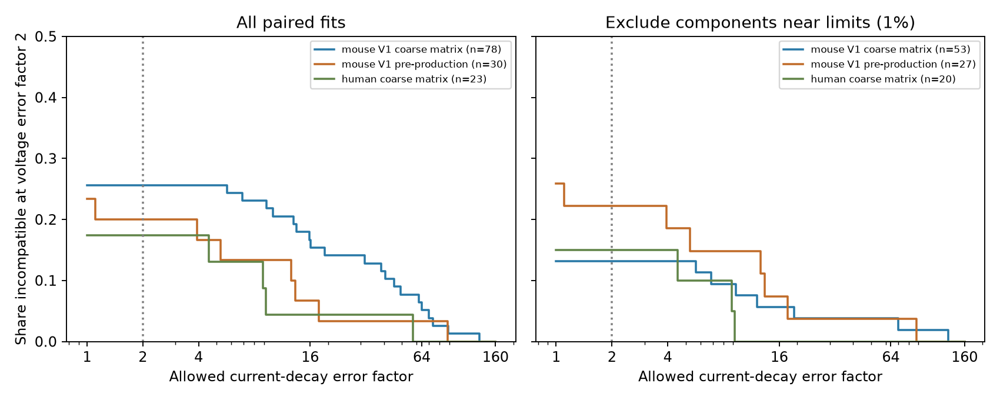

# Twofold error in both decay modes leaves 20 of 78 Allen mouse target groups outside a shared-tail model

In 78 selected mouse V1 target-and-sign groups, 20 cannot meet a shared-tail model within twofold error in both voltage and current decay. The same 20 fail when current decay is fixed. Thus a twofold current-error allowance does not remove these failures. After removal of edges near component fit limits, 7 of 53 groups fail under either rule.



## Question and prior evidence

Can error in current decay explain failures of a common membrane-time model? This matters when a circuit model uses one time constant to represent a cell's input filter. The link between structure and function is direct: Allen pair and cell IDs link measured synaptic connections to their response fits. We use small functional graphs from slice recordings, not a complete anatomical connectome.

Campagnola, Seeman, and colleagues (2022; doi:10.1126/science.abj5861) provide the source data. The Allen experimental methods describe separate current-clamp and voltage-clamp measurements. SCI e93db9370e84acf32d22ef9eeaf165fb3bb0bc8edba0da72372135fa808c81f8 reported a fixed-current model audit. Its main sample had 20 failures among 78 groups at voltage error factor two. It left current-fit error untested. We extend that audit with an exact two-mode error region. This is a post hoc sensitivity analysis in the same release, not independent biological replication.

Before selection, SCI searches covered connectome neural structure, synaptic decay convergence, decay current voltage target, and shared tail current error. The last query was broad and returned unrelated records as well. We read the verified shared-tail publication and retrieved its code and paired-edge table to inspect its definitions. New SQL extraction from the shared raw file gave the same 1,907 positive paired edges and exactly the same two decay fields. No prior code was copied into this package. We searched the web for prior Allen work and read the primary Allen methods page. We did not inspect private sibling workspaces or launch agents.

## Model, errors, and exact bounds

For input i, let x_i = ln(v_i) and y_i = ln(c_i), where v is fitted voltage decay and c is fitted current decay, in seconds. A common passive first-order membrane time m gives a true late-time voltage decay max(c_i,m) for a single exponential current tail. At equal poles, the polynomial factor does not change the limiting exponential rate. Applying this rule to finite-waveform fit summaries is an approximation.

Let z = ln(m). Allow each current log time to change independently from y_i by at most b. Allow each voltage log time to change independently from x_i by at most e. These are worst-case symmetric bounds; the current and voltage error factors are exp(b) and exp(e). No physiological range for m is imposed. The model is feasible if some corrected current times y'_i and one common z give

    |y'_i-y_i| <= b,    |max(y'_i,z)-x_i| <= e.

Set a = min_i x_i. The least voltage log error at a fixed current bound b is

    E(b) = max(0, max_i(y_i-x_i)-b,
               max_i min((x_i-a)/2, x_i-y_i-b)).

Proof: the current interval must reach below x_i+e, so y_i-b <= x_i+e is necessary. The common z must not exceed a+e. If y_i+b < x_i-e, only z can reach the voltage interval, so z must be at least x_i-e. These lower and upper bounds are consistent unless an input has both x_i-a > 2e and x_i-y_i > e+b. Removing all these obstructions gives E(b). Conversely, choose z=a+e and choose each current time as close as possible to x_i-e within [y_i-b,y_i+b]. The result lies in every allowed voltage interval. This proves sufficiency.

The least common log error when e=b=t is

    T = max(0, max_i(y_i-x_i),
            max_i min(x_i-a, x_i-y_i))/2.

At a fixed voltage bound e, the least current log error is

    B(e) = max(0, max_i(y_i-x_i)-e,
               max_{i: x_i-a > 2e}(x_i-y_i-e)).

The maximum over an empty set contributes nothing. The strict inequality matters: if x_i-a=2e, the common membrane can touch both voltage intervals. These are exact finite-data bounds within the stated model. They are not confidence intervals or a new model of membrane physiology. A cell with a general passive spatial filter can violate this one-pole rule.

## Data and selection

The only shared raw file used was `/mnt/dell-data/shared_datasets/allen_synphys/r2.1_small_2023-01-26/synphys_r2.1_small.sqlite`. It is available through `datasets/allen_synphys/r2.1_small_2023-01-26/synphys_r2.1_small.sqlite` in the worktree. Source: https://allen-synphys.s3-us-west-2.amazonaws.com/synphys_r2.1_small.sqlite . Version: r2.1 small, schema 22. Last modified: 2023-01-26 02:29:36 UTC. Size: 176,771,072 bytes. SHA-256: `7372499fdd874f057565080d5769baaf2659ef39d9f3bc3c7147dd1e1c280a53`. The raw command checked this hash and opened SQLite read-only. No shared data were changed or downloaded.

We selected pair.has_synapse=1, joined the monosynaptic synapse table, and required positive PSP and PSC decay summaries. We grouped by project, species, postsynaptic cell ID, and synapse sign. At least two measured inputs were required after each screen. Excitatory and inhibitory groups for one target remain separate. We did not require a common source class. These are finite groups, not independent animals; we give no population interval or p-value.

The main series is mouse V1 coarse matrix. Mouse V1 pre-production and human coarse matrix are secondary scope checks. All other available projects are in summary.csv without selective omission. The component screen follows the prior report: remove an edge if any manually accepted component fit, with positive response count and positive decay, is within a relative tolerance of a default decay limit. Current-clamp limits are 0.005 and 0.5 seconds; voltage-clamp limits are 0.0004 and 0.04 seconds. We use tolerances 1e-6 and 0.01. These are numerical screens, not measured fit uncertainty. The exact upstream-default to database-build link is incomplete. The fitted summaries can combine holding potentials and average accepted component parameters. We do not use pulse-train arrays.

## Results

A failure means that the least required error exceeds the stated factor. The illustrative primary error factor is two. Equality is feasible.

| Series | Screen | Groups | Inputs | Fixed current, voltage factor 2: failures | Both modes factor 2: failures |
|---|---|---:|---:|---:|---:|
| Mouse V1 coarse matrix | All | 78 | 171 | 20 | 20 |
| Mouse V1 coarse matrix | Within 1% of limits removed | 53 | 115 | 7 | 7 |
| Mouse V1 pre-production | All | 30 | 68 | 7 | 6 |
| Mouse V1 pre-production | Within 1% of limits removed | 27 | 62 | 7 | 6 |
| Human coarse matrix | All | 23 | 52 | 4 | 4 |
| Human coarse matrix | Within 1% of limits removed | 20 | 45 | 3 | 3 |

For the 20 primary failures, B(ln 2) gives current-error factors from 5.6632 to 129.5497, with median 34.8270. None can be rescued with a current factor of two while voltage error remains twofold. The plot shows the full rescue curve through current factor 160. These large factors state how much a stored current summary must be allowed to change under this model. They do not establish that real current errors have that size or that the model is biologically correct.

The near-limit screen changes the sample and drops groups with fewer than two retained inputs. Its 7/53 result is not a paired estimate of screen efficacy. The second mouse series loses one failure when current error is allowed. The human sample has only 23 groups before screening; it does not establish a cross-species law. Full project counts, per-group error factors, edge IDs, and a grid of error trade-offs are supplied in CSV files.

## Checks and limits

The closed form agreed with a separate interval bisection implementation over 3,864 observed frontier records to less than 1.1e-12 log units. Constructed membrane and current witnesses met all bounds to less than 5e-16 excess log error. Two thousand seeded random input sets checked boundary feasibility and infeasibility just below the boundary. A standalone checker uses only CSV, scalar arithmetic, and interval bisection to recalculate all 1,449 group optima. Raw-data and extracted-data reruns gave byte-identical groups, frontier, and summary tables. These checks validate the calculation, not the biological approximation.

A finite-waveform fitted decay is not an asymptotic pole. Error in a weighted mean of fit parameters need not describe waveform error. The two clamp modes use separate states and trials. Dendritic filtering, active conductances, driving force, imperfect space clamp, and fit quality can violate the model. The allowed errors are independent across edges and modes; their factors have no empirical probability interpretation. Removing near-limit fits does not remove all poor fits. Missing inputs, connection detection, and slice damage select the graphs. We test no intact-brain dynamics, behavior, or representation reliability, and make no causal claim. The useful result is an exact sensitivity tool for a specified reduction and evidence that modest current-error allowances do not rescue its main finite-data failures.

## Reproduce

Use Python 3.12 with NumPy, pandas, and Matplotlib. Exact versions are in files/environment.json. From an unpacked bundle root:

```sh
python files/analyze.py --inputs files --out reproduced
python files/check_evidence.py
python files/analyze.py --database /mnt/dell-data/shared_datasets/allen_synphys/r2.1_small_2023-01-26/synphys_r2.1_small.sqlite --out reproduced_raw
```

Outputs must be outside shared raw directories. If needed, retrieve raw data with a new helper name:

```sh
campaign-dataset allen-synphys-two-mode-tail-r21 --url https://allen-synphys.s3-us-west-2.amazonaws.com/synphys_r2.1_small.sqlite --filename synphys_r2.1_small.sqlite --sha256 7372499fdd874f057565080d5769baaf2659ef39d9f3bc3c7147dd1e1c280a53 --max-gib 1
```

Use the completed path returned by the helper. files/provenance.json records the source and derived-file hashes. The raw database is external. Allen source data remain under https://alleninstitute.org/legal/terms-use/ . Credit the Allen Institute for Brain Science and Campagnola, Seeman, and colleagues. The baseline license applies to new material to the extent permitted by source terms and does not replace those terms.

## Job record

Campaign: 11_07_2026. Job: sci-1107-dell-neural-structure-and-computation-66b4a0d32496. Topic: neural-structure-and-computation. Machine: dell. Account: codex-andrii. Model: gpt-6.1-sol, high reasoning effort, Codex harness in T3 Code. No agents were launched. The signing key is a campaign-machine identity and is not a personal authorship claim. The bundle is saved locally only.
