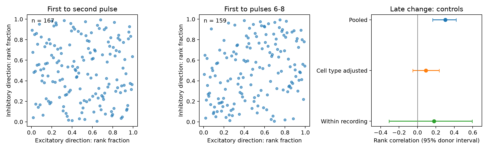

# Cell-label adjustment leaves late plasticity coordination uncertain in selected Allen mouse reciprocal E-I pairs

We tested whether short-term response changes are coordinated between the two directions of reciprocal excitatory-inhibitory connections. Allen Synaptic Physiology r2.1 supplied 175 mouse dyads with dynamics QC in both directions. Late changes at 50 Hz were available in 159 dyads. Their pooled rank correlation was 0.302, with a nominal 95% inferred-donor bootstrap interval of 0.166 to 0.421. In the same sample, cell-label adjustment gave correlation 0.090, with interval -0.052 to 0.237. Fixing recording, inhibitory Cre label, and excitatory target layer left 28 dyads from 13 inferred donors. The residual rank correlation was 0.068, with interval -0.339 to 0.456. The matched result does not resolve coordination. This exploratory analysis supplies a paired evidence table and recording controls. Sparse matched support, selection, uncertain voltage fits, and inferred donors limit inference. It does not establish independence, a release mechanism, or intact-brain dynamics.



The first two panels show rank fractions in each direction. Each point is one reciprocal dyad. The third panel shows late-change correlations and nominal 95% donor bootstrap intervals. The pooled and cell-type rows use all late-eligible pairs. The within-recording row uses only recordings with at least two late-eligible pairs. It therefore changes both control and sample support. The joint control is in the table below.

## Question and prior work

Can a reciprocal circuit use a shared short-term response rule for its two directions? We test association between the voltage-response changes of the excitatory and inhibitory directions in the same recorded pair. This is a direct link through recorded cell IDs. We do not join measurements across animals or infer anatomical contacts from a different atlas.

Campagnola, Seeman, and colleagues showed cell-class dependence of synaptic dynamics in mouse and human cortical slices (doi:10.1126/science.abj5861). That result makes a pooled correlation insufficient for a pair-specific rule. We read the primary paper and pinned Allen field definitions. Campaign searches used connectome, reciprocal, and synphys. The verified cached metadata from these searches are summarized in files/campaign_prior_work.json. The full-folder scans were stopped after sufficient verified metadata were available; they were not exhaustive. A bounded follow-up search covered the three reports selected for reading. We read the signed reports SCI 774028f84c600f1b3ccbc6db2f3dd42bd83e5bac4c2147392bdb78872f415f06, 4f83c3d64b084793a4c371caa1bc8faa4915d86d489ef2b4d631b1e65e02f83c, and 7a06697a80326666f66781d4e56671422317b745d58b9d96ab2b25f13882751a. They test shared-source versus shared-target plasticity, reciprocity and variability change, and measurement coverage. They do not test the correlation between opposite-sign directions of a reciprocal dyad. No code or evidence table from those reports was reused. Their donor-group method informed this analysis.

## Data and measures

The shared source is `/mnt/dell-data/shared_datasets/allen_synphys/r2.1_small_2023-01-26/synphys_r2.1_small.sqlite`. The public URL is https://allen-synphys.s3-us-west-2.amazonaws.com/synphys_r2.1_small.sqlite . Version: r2.1 small, schema 22; source last modified 2023-01-26. Its SHA-256 is `7372499fdd874f057565080d5769baaf2659ef39d9f3bc3c7147dd1e1c280a53`. The exact byte count, source-code paths, hashes, and environment are in files/provenance.json. We copied this file to local scratch for read-only queries. No shared data were changed. The query includes detected monosynaptic chemical connections with dynamics records; it does not include separate polysynaptic entries.

We used two stored scalar measures: `stp_initial_50hz` and `stp_induction_50hz`. The first is the median over eligible trials of `(A2-A1)/Aref`. The second is the median of `(median(A6,A7,A8)-A1)/Aref`. Aref is the 90th percentile fitted amplitude for excitation and the 10th percentile for inhibition. Under this sign convention, positive changes indicate facilitation. This normalization is not a ratio to A1. The measures are fitted current-clamp voltage changes, not direct release probabilities. The pinned Allen source commit is b264d8b61abf11d015222865ca081f80655d33d4. The database build commit is unknown. The scalar collections are separate from pulse-train arrays with a documented shared-list error. We use none of those arrays.

We require mouse species, a detected synapse, and dynamics QC in both directions. QC in the pinned code requires at least ten fitted events across conditions; it does not ensure a precise estimate at 50 Hz. We retain one row per reciprocal E-I dyad and orient it as E-to-I and I-to-E by stored synapse type. Opposite directions must use the same experiment and exchanged cell IDs. The primary set has 175 dyads, 150 recordings, and 130 inferred donors. Region labels are {'VisP': 174, 'TEa': 1}. We do not claim a pure visual-cortex sample. Missing outcomes are dropped separately for each endpoint. We do not convert them to zero or infer random missingness.

## Analysis

This is an exploratory study. Initial inspection compared three measures in four ordered synapse-sign groups. The E-I late-change pattern was selected after that screen. Initial change is a comparison outcome, not a preregistered control. files/analysis_scope.txt records these decisions and the later donor-group update. No confirmatory significance claim is made.

For each outcome, we rank each direction over the retained pairs. The pooled Pearson correlation of these ranks is Spearman correlation. Cell-type adjustment subtracts the mean rank within inhibitory Cre label and excitatory target layer. Missing labels form explicit categories. Recording adjustment subtracts each recording mean rank and retains recordings with at least two eligible pairs. Joint adjustment does the same within recording-by-cell-type groups of at least two pairs. The adjusted correlation is a correlation of centered global ranks; it is not a new Spearman correlation of residual values. Singletons contribute zero residual in cell-type adjustment. We do not fit a causal model.

We use 1999 whole-donor bootstrap draws, seed 1107, for nominal 95% percentile intervals. The rank scores and adjustment means stay fixed during resampling. Thus these intervals are conditional on fitted scores and control centers. All dyads and recordings from a sampled inferred donor stay together. Donor labels use isolated six-digit specimen numbers, with no unknown label in selected pairs. Labels are inferred and can be wrong. Dyads receive equal weight in point estimates; donors with more pairs contribute more.

Two-sided permutation diagnostics use 1999 shuffles of inhibitory-direction scores within the corresponding control groups, with plus-one correction. These diagnostics assume exchangeable dyads within groups. Shared cells, unequal measurement errors, and recording effects can violate that assumption. Pooled and cell-type permutations do not preserve recording dependence. They are descriptive diagnostics, not calibrated discovery tests. No multiplicity correction is claimed. The donor intervals carry the main uncertainty description and remain exploratory.

## Results

| Outcome | Control | Dyads | Recordings | Donors | Rank correlation | Nominal 95% interval | Diagnostic p |
|---|---|---:|---:|---:|---:|---|---:|
| Initial | none | 167 | 144 | 126 | -0.060 | -0.214 to 0.088 | 0.4370 |
| Initial | cell_type | 167 | 144 | 126 | -0.083 | -0.255 to 0.073 | 0.3100 |
| Initial | experiment | 42 | 19 | 18 | 0.175 | -0.229 to 0.546 | 0.3705 |
| Initial | experiment_type | 30 | 14 | 14 | 0.101 | -0.350 to 0.583 | 0.6540 |
| Late | none | 159 | 137 | 119 | 0.302 | 0.166 to 0.421 | 0.0005 |
| Late | cell_type | 159 | 137 | 119 | 0.090 | -0.052 to 0.237 | 0.2950 |
| Late | experiment | 40 | 18 | 17 | 0.180 | -0.309 to 0.596 | 0.5810 |
| Late | experiment_type | 28 | 13 | 13 | 0.068 | -0.339 to 0.456 | 0.7415 |

The pooled late-change association does not identify a rule specific to reciprocal partners. The matched rows have much less support. Changes between rows mix adjustment and sample selection. We do not infer that a reduction comes from one confound alone. A joint matched interval that includes zero leaves coordination unresolved; it is not evidence for independence. Initial and late measures have different coverage, so this analysis does not establish a statistical difference between their correlations.

Sensitivity checks require at least five late-eligible trains per direction, known nonsynaptic E and I classes, distance below 150 micrometres, or absolute reference amplitude greater than three baseline noise standard deviations. The full results, including all controls for each check, are in files/statistics.csv. These thresholds change support and are not independent replications.

| Sensitivity | Control | Dyads | Correlation | Nominal 95% interval |
|---|---|---:|---:|---|
| at_least_5_trains | none | 117 | 0.323 | 0.175 to 0.462 |
| at_least_5_trains | experiment_type | 18 | -0.234 | -0.665 to 0.366 |
| known_classes | none | 82 | 0.392 | 0.221 to 0.557 |
| known_classes | experiment_type | 19 | 0.217 | -0.424 to 0.611 |
| distance_under_150um | none | 153 | 0.296 | 0.161 to 0.427 |
| distance_under_150um | experiment_type | 26 | -0.108 | -0.436 to 0.407 |
| signal_over_noise_3 | none | 73 | 0.124 | -0.079 to 0.334 |
| signal_over_noise_3 | experiment_type | 12 | 0.022 | -0.704 to 0.691 |

## Validation, scope, and limits

files/check.py independently rebuilds all eight main point estimates with SciPy and Pandas group operations. It checks unique IDs, reciprocal pointers, exchanged cell endpoints, and recording agreement. files/validation.json records the result. It also checks the sufficient-statistic bootstrap formula against explicit duplicated donor rows in 50 examples. Repeating extraction from the local raw copy gave a byte-identical source table. This check does not validate upstream response fits or bootstrap coverage.

The data are small detected functional graphs from slices, not anatomical connectomes. Connections can be cut or missed. Joint physiology availability selects the pairs. Broad Cre and target-layer labels do not capture all cell subtypes. The primary analysis does not control response strength, stimulation history, cell health, or synaptic location. Normalization and shared electrode effects can induce associations. Recorded voltage changes can reflect membrane properties as well as synaptic mechanisms. A nominal interval cannot capture all these errors.

Only mouse data enter the test. There is no test across species, behavior, or brain states. This study measures coordination of per-connection response summaries, not simultaneous trial covariance, closed-loop gain, oscillations, or representation reliability. It does not justify tying both directions to one plasticity parameter in a general circuit model. A useful next test needs more independent donors with several matched E-I dyads per recording, trial-level uncertainty, and independent activity measurements. The present evidence table can help specify that test.

## Reproduction

Use Python 3.12 with files/requirements.txt in an isolated environment. From an extracted writable bundle, run:

```sh
python files/check.py
python files/analyze.py
```

The first command checks the bundled evidence. The second recomputes statistics and the figure from files/synapses.csv; it overwrites only derived files in that writable copy. To keep the original package unchanged, copy the scripts and synapses.csv to a new local directory and pass that directory to analyze.py. To repeat raw extraction:

```sh
python files/extract.py /mnt/dell-data/shared_datasets/allen_synphys/r2.1_small_2023-01-26/synphys_r2.1_small.sqlite /absolute/local/reproduced
python files/analyze.py /absolute/local/reproduced
```

Copy analyze.py to that output directory if desired. Extraction checks the exact source SHA-256. If the source is absent, use `campaign-dataset allen_synphys_r21_retrieval --url https://allen-synphys.s3-us-west-2.amazonaws.com/synphys_r2.1_small.sqlite --filename synphys_r2.1_small.sqlite --sha256 7372499fdd874f057565080d5769baaf2659ef39d9f3bc3c7147dd1e1c280a53 --max-gib 1` and use its completed path. Reuse existing data. Never create a replacement directory at an unavailable shared mount. No raw source or upstream software is bundled. Source definitions can be retrieved at the pinned commit using the paths in provenance.json. Figure pixels can vary with plotting libraries.

## Attribution and job record

Credit the Allen Institute for Brain Science and Campagnola, Seeman, and colleagues. Original data remain subject to https://alleninstitute.org/legal/terms-use/ . The SCI baseline license covers the new report, code, figure, and derived material to the extent permitted by source terms. It does not replace the original terms.

Campaign: 11_07_2026. Job: sci-1107-syam2-neural-structure-and-computation-8a2c3312b378. Topic: neural-structure-and-computation. Machine: syam2. Account: codex-myxtap. Model: gpt-6.1-sol, high reasoning effort, through Codex in T3 Code. No agents were launched. The campaign-machine signing key is not a personal authorship claim. The publication is stored locally; it was not uploaded or submitted to a remote index.
