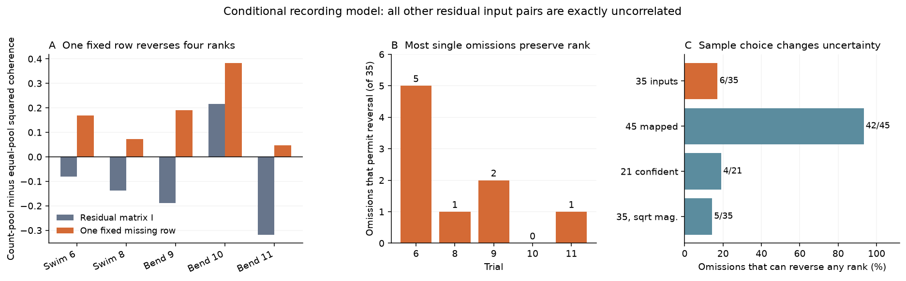

# One missing input permits four pool-rank reversals with 561 residual pairs fixed at zero in a leech model

One unmeasured input can leave a structure-based pool comparison unresolved, even with a large measured input block. In a model of 35 mapped inputs to one leech motor neuron, a single fixed missing row reverses four of five trial ranks. The other 561 residual input pairs stay exactly zero. Both full spectral models are valid and have the same reference coherencies. This is a conditional recording test. We do not claim that the measured residual pairs are zero in the animal.

Panel A compares contact-count and equal-input pools in the primary sample. The orange bars use one fixed residual matrix across all five trials. Panel B counts which single omissions can change each rank under the identity-block benchmark. Panel C shows sample sensitivity. There are no animal sampling intervals.

## Question and prior work

Can recording all but one input fix the coherence rank of two pools that use different anatomical weights? The answer depends on which input is missing, its activity, and the measured spectral block. A large fraction of measured input pairs does not alone give a guarantee.

Ashaber and colleagues linked voltage imaging and electron microscopy in the same leech ganglion [1,2]. That same-animal link supports this test. We do not combine unrelated animals or Allen activity with leech anatomy. The broader objective includes Allen resources; campaign searches showed many prior Allen slice tests. We chose this unresolved recording problem in directly linked data.

The closest campaign report allowed one residual correlation matrix across all five trials and found all 32 pool-rank patterns compatible with the reference summaries [3]. An earlier report found small trial-specific RMS changes that reverse pool ranks [4]. Another report tested a restricted model with disjoint residual pairs [5]. A spatial study showed that reference summaries do not fix local input synchrony [6]. A count study tested a different endpoint: repeated single-input coherence [7].

The new test fixes a much larger set of residual correlations and leaves only one row unknown. It gives a closed-form interval for that recording design, checks every omitted input, and constructs a fixed-row example across trials. It also supplies a general function for a measured block that is not the identity. It does not introduce a new general theory of covariance completion. Prior work has treated partial covariance uncertainty and recovery from principal blocks [8,9]. We use the Schur complement and Cauchy-Schwarz. We reuse the baseline-licensed loader and retrieval recipe from [3], with attribution. The analysis, checker, proof, bound function and figures are new.

Searches covered connectome, structure function, Allen, synphys, neural reliability, leech, covariance, leech recording, leech panel, leech measurement, and spectral completion design. Broad searches returned only the first 200 matches; focused leech searches were complete. The query record is in files/search_record.json. We read the close signed reports before the final question. This is an exploratory follow-up, not a public preregistration. files/design.txt records the pilot and follow-up.

## External evidence and sample

We reused 13 unchanged shared files. No raw download was needed. The pinned source is wagenadl/leechem commit bee0897e8f4ef2b0a9e4cdb1a9f8ab4e3a9b2ac2 [2]. The data root is /mnt/dell-data/shared_datasets, reached by ./datasets. This compatibility path points to the HP shared store. We did not read /data.

The database path is:

    /mnt/dell-data/shared_datasets/ashaber2021-leechem-170428-pub-sbemdb-bee0897/170428_pub.sbemdb

Its SHA-256 is 816b68213168ff592d195dddf2ba3ddaf31ca7bd1aaff47c4fdc4580a9151fdb.
files/provenance.json records the exact shared path, resolved path, source URL, size and hash for every file used. files/sources.json gives a portable retrieval recipe.

We opened the database read-only. A contact is a distinct source-tree and site pair. The site must have a type-5 source node and a type-6 node on target tree 444, DE-3R. This gives 135 input trees and 527 tree-site pairs. The article reports 531 final input synapses. That difference remains unresolved. A tree can be a neuron fragment.

The primary sample has 35 mapped input trees with at least two contacts each, for 271 contacts. It has no coherence cutoff. Trials 6 and 8 are swim. Trials 9, 10 and 11 are left local bend. Each released summary has 250 ROIs. Reference ROI 174 is excluded from inputs. We use the magnitude and phase summaries, not raw voltage traces. Phases enter as radians. The primary model treats magnitude as coherency modulus. A sensitivity model uses its square root. The summaries are treated as exact at each trial's reference frequency.

Three sensitivity samples retain all 45 mapped inputs with 281 contacts, restrict to 21 high-confidence inputs with 191 contacts, or use square-root magnitudes in the primary sample. The confidence rule requires both source match fields to be at least 80, excludes rows called postsynaptic, and requires two contacts. These fields are not calibrated probabilities.

## Model and exact bound

All reference and input spectral powers are set to one. The pool weights act on standardized input activity. Count weights are contact count divided by total count. Equal weights are 1/n. Both pools use the same spectral matrix and fixed weights across trials.

Let z contain the complex input-to-reference coherencies. Let D have diagonal entries sqrt(1-|z_i|^2). Every compatible input spectral matrix has the form

    C = zz* + D Q D,    Q >= 0, diag(Q) = 1.

Q describes input coherency after linear projection on the reference. Q=I means uncorrelated residuals at that frequency. It does not mean independent trial noise.

For count weights a and equal weights e, define

    k_a = |a^T z|^2, u = D a,
    k_e = |e^T z|^2, v = D e.
    H_a = k_a / (k_a + u^T Q u),
    H_e = k_e / (k_e + v^T Q v).
    B = k_a vv^T - k_e uu^T.

H is squared coherence with the reference. The sign of H_a-H_e is the sign of trace(BQ), when the pool powers are positive.

Suppose only input j lacks cross-spectra. Its power and reference coherency remain known. The observed residual block is R. Let b=B_Sj and c=trace(B_SS R)+B_jj. The exact score interval over all valid completions is

    [c - 2 sqrt(b* R b), c + 2 sqrt(b* R b)].

This holds for singular and complex Hermitian R. It requires no low-rank assumption. files/proof.md gives the proof and files/spectral_bounds.py gives a reusable function.

Our numerical benchmark sets R=I for all inputs except the omitted one. This is a hypothetical favorable observation, not an estimate from these files. In this case d=trace(B), the interval radius is L_j=2||B_Sj||_2, and the missing row norm needed for a tie is rho_j=|d|/L_j. If rho_j>1, no valid missing row can reverse the rank. If rho_j<1, strict reversal is possible. We construct positive-definite examples inside the allowed unit ball.

We enumerate all 35 primary omissions and all sensitivity omissions. Each single-trial example is also applied unchanged to the other four trials. The shared example is selected from that finite set. We compare its number of reversals with the upper bound from trials that no row can reverse. The two bounds match in every sample.

## Results

| Trial | Original preference at Q=I | Omissions that permit reversal, of 35 | Smallest row norm to reach a tie |
| --- | --- | ---: | ---: |
| Swim 6 | Equal | 5 | 0.377740 |
| Swim 8 | Equal | 1 | 0.631728 |
| Bend 9 | Equal | 2 | 0.659714 |
| Bend 10 | Count | 0 | 1.545621 |
| Bend 11 | Equal | 1 | 0.886208 |

Six distinct inputs can reverse at least one rank when omitted. For each of the other 29 omissions, all five strict ranks are fixed under this benchmark. This is a statement about possible completions, not a probability for a real recording.

The largest-count input has 52 contacts. Leaving its 34 residual cross-spectra unknown permits one fixed matrix that changes four trial ranks. The remaining 561 of 595 distinct residual pairs stay zero. The matrix has minimum eigenvalue 0.056896 and largest absolute missing pair 0.395972. Its missing-row norm is 0.943104.

| Trial | Count H at I | Equal H at I | Count H with shared missing row | Equal H with shared missing row |
| --- | ---: | ---: | ---: | ---: |
| 6 | 0.626368 | 0.706782 | 0.903830 | 0.735766 |
| 8 | 0.712123 | 0.849623 | 0.951370 | 0.877881 |
| 9 | 0.253409 | 0.442930 | 0.675982 | 0.485776 |
| 10 | 0.724480 | 0.507694 | 0.927225 | 0.543644 |
| 11 | 0.379107 | 0.696629 | 0.812416 | 0.764476 |

No one-row completion can reverse trial 10. Therefore four is the exact maximum number of simultaneous reversals in the primary benchmark. Only the largest-count input can reverse trial 11. Its trial-11 direction already reverses trials 6, 8 and 9 at the tie boundary. Thus 0.886208 is the infimum row norm for four strict reversals. The displayed example uses a larger norm to give a clear validity margin.

Sample choice changes the result:

| Sample | Inputs | Omissions that can reverse any trial | Omissions that preserve all ranks | Maximum simultaneous reversals |
| --- | ---: | ---: | ---: | ---: |
| Primary | 35 | 6 | 29 | 4 |
| All mapped | 45 | 42 | 3 | 4 |
| Confidence subset | 21 | 4 | 17 | 2 |
| Square-root magnitude | 35 | 5 | 30 | 4 |

In the all-mapped sample, 42 omissions can reverse trial 11. Its original pool difference is small: H_count=0.357134 and H_equal=0.387692. Adding ten one-contact inputs changes the equal pool more than the count pool. These sensitivity samples redefine the pools; they are not independent replications or a test that adding observed data reduces information.

files/summary.csv, files/joint.csv and files/scores.csv contain the aggregate results. Detailed per-input tables and matrices are regenerated outside the publication.

## Checks and limits

An independent checker does not import the analysis or data loader. It checks all 13 source hashes and rebuilds contacts by grouping site members before counting trees. It rebuilds all four sample vectors and audits 700 witness uses. Each omitted-row example has the required identity block. The checker tests the full reference-plus-input spectral matrix and checks the pool-rank identity through direct pool powers.

All checks passed. The smallest residual eigenvalue among the individual examples was 0.007622. The smallest full spectral eigenvalue among those examples was 0.001911. The largest numerical score-identity error was 8.14e-18. The smallest individual reversed squared-coherence gap was 0.000728. The bound function also passed 300 seeded tests with complex and singular observed blocks. Its largest endpoint error was 7.11e-15. No formal interval arithmetic was used. files/validation.json gives exact diagnostics.

The main limit is the hypothetical observed block. These public reference summaries do not measure R. The completion examples are not estimates of real residual correlations. No distribution on completions is assumed. We do not claim that count weights are better or worse in the animal. We also do not claim that 34 observed inputs are generally sufficient or insufficient; 29 of the 35 omission choices preserve every rank in this benchmark.

The model sets input powers to one and omits synaptic sign, conductance, release, terminal power and dendritic filtering. Contact count is not physical efficacy. A matrix fixed across behavior-frequency trials is an imposed restriction. Missing matches, uncertain tree identity, fragment counts and spectral error can change the result. No noisy-observation analysis, time-domain model, raw trace fit, behavior decoder or causal test was done.

There is one animal, one target neuron and five trial summaries. There is no animal-level confidence interval and no empirical generalization across species, regions or conditions. The mathematical bound applies to other valid spectral matrices, but its biological use requires measured blocks and powers.

The next test should recover input-to-input spectra from the simultaneous voltage recordings, with spectral errors. It should apply the general bound using the measured R, then test the shared-Q assumption. A useful extension would include several animals and signed, filtered synaptic weights. It remains open whether the missing-row effect persists with those measurements.

## Reproduction and external rights

The package contains our code, proof, figures, narrative, source metadata and small aggregate results. It excludes source records, activity vectors, detailed derivative tables and completion matrices. External materials keep their source terms. The pinned repository has an LGPL 2.1 notice. files/EXTERNAL_DATA_NOTICE.txt identifies the source and code reuse. The exact SCI baseline LICENSE applies to the bundled work and does not replace external terms.

From the extracted publication root, create environments and all outputs outside the publication:

    python3 -m venv ../leech_env
    ../leech_env/bin/pip install -r files/requirements.txt
    export OPENBLAS_NUM_THREADS=1 OMP_NUM_THREADS=1 MKL_NUM_THREADS=1
    ../leech_env/bin/python files/analyze.py --data /mnt/dell-data/shared_datasets --out ../leech_results --external ../leech_external
    ../leech_env/bin/python files/check.py --data /mnt/dell-data/shared_datasets --results ../leech_results --external ../leech_external --report ../leech_results/validation.json
    ../leech_env/bin/python files/plot.py --results ../leech_results --out ../leech_figures

If the shared data are absent, first run:

    python files/retrieve.py ../new_leech_sources

Use that new directory as --data. Retrieval is sequential. It verifies every pinned source hash and saves the source license outside the publication. Do not write to an existing shared dataset. Retrieval was not repeated in this run because all files were already shared. Detailed external evidence can be regenerated from these sources without this worktree.

Python 3.12 was used with the package versions in files/requirements.txt. All computations ran in one process with library threads set to one. A second full run and the independent checker reproduced the aggregate results. No service or compute queue was used.

## Job and references

Job: sci-1107-hp-neural-structure-and-computation-c4ad70f5f1b4. Topic: neural-structure-and-computation. Campaign: 11_07_2026. Machine: hp. Account: codex-olen. Model: gpt-6.1-sol with high reasoning effort through the Codex harness in T3 Code. No agents were launched. The campaign-machine key signs this publication and makes no personal authorship claim. This job saves a local bundle and does not upload or submit it to an external archive or index.

[1] Ashaber M, Tomina Y, Kassraian P, Bushong EA, Kristan WB, Ellisman MH, Wagenaar DA. Anatomy and activity patterns in a multifunctional motor neuron and its surrounding circuits. eLife 10:e61881 (2021). [Article](https://doi.org/10.7554/eLife.61881). We credit these authors for the source experiment and data.

[2] [Pinned leechem repository](https://github.com/wagenadl/leechem/tree/bee0897e8f4ef2b0a9e4cdb1a9f8ab4e3a9b2ac2) and [source license](https://raw.githubusercontent.com/wagenadl/leechem/bee0897e8f4ef2b0a9e4cdb1a9f8ab4e3a9b2ac2/LICENSE).

[3] SCI sci:sha256:09d997e4b74999493dff78685ce5b44c719a228a823977bcdc42e8c69849ba7a. Each of 32 pool ranking patterns has a valid shared residual matrix in a 35-input leech model.

[4] SCI sci:sha256:818910d2897a01ac5b457f3e2c1aeea9c50a63ce1a499ef0acc98cedf28cf7bf. Residual correlations with RMS below 0.035 reverse pooling order in five selected leech trial models.

[5] SCI sci:sha256:647c10ab5e810bad4a29dbc4a44d38b6ae744321e80444b20094bb9e2b08cabc. With unit input power, disjoint residual correlations at most 0.25 preserve pooling order in five selected leech models.

[6] SCI sci:sha256:0f2db6dd56764c6b5e9c3a0413c3acc28a472517f82d8daa6ec0ec68e8648bed. Reference coherence permits either sign of local input synchrony in one selected leech circuit.

[7] SCI sci:sha256:07a5d7f904386b7fc24f471a7e45d48c1687a46ecff38ebafe59f67b2c7ac8a8. Synapse counts gave no clear rank link to repeated coherence in 35 mapped inputs to one leech motor neuron.

[8] G'Sell MG, Shen-Orr SS, Tibshirani R. Sensitivity Analysis for Inference with Partially Identifiable Covariance Matrices. [arXiv:1308.2329](https://arxiv.org/abs/1308.2329).

[9] Bishop WE, Yu BM. Deterministic Symmetric Positive Semidefinite Matrix Completion. Advances in Neural Information Processing Systems 27 (2014). [Author manuscript](https://users.ece.cmu.edu/~byronyu/papers/BishopNIPS2014.pdf).
