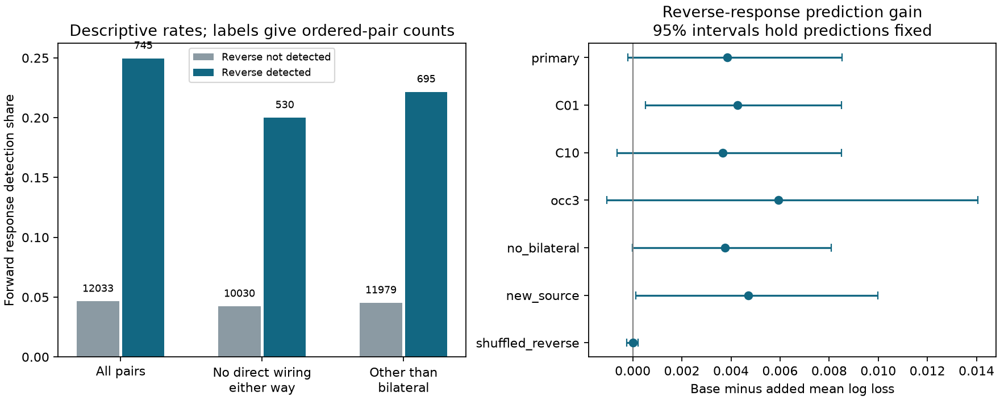

# Reverse responses gave no clear added prediction gain in 6389 worm pairs after wiring and cell controls

## Result

We tested whether a detected response in the reverse direction helps predict a forward response after controls for wiring, cell identity and observation count. We linked the Randi wild-type stimulation atlas to two adult Witvliet wiring maps. The sample had 6,389 unordered pairs and 745 detections in 12,778 ordered pairs. Both directions of each pair stayed in the same validation fold. Adding the reverse response changed mean log loss from 0.188085 to 0.184228. The reduction was 0.003856, with a nominal conditional 95 percent node bootstrap interval from -0.000199 to 0.008529. Thus the main test left the added prediction gain uncertain. Stronger regularization and source exclusion gave intervals above zero. Raw reciprocal detection was common, but this does not prove direct feedback. Aggregate responses, different anatomical animals, a fixed additive model and intervals that omit model refits limit the result. Code, linked pair tables, predictions, uncertainty draws, source hashes and a figure support inspection and reproduction.

The main interval includes zero. This is an uncertain result, not proof that reciprocal communication has no value. The point estimate is a 2.05 percent reduction in mean log loss. AUC changed from 0.775311 to 0.783702. Brier score changed from 0.048164 to 0.047109. The added variable is an existing reverse-direction experiment. This test does not predict an unseen pair from anatomy alone.

## Question and prior work

Reciprocal effective communication can support recurrent computation. Direct reciprocal anatomy need not imply reciprocal effective communication. We asked whether knowledge of a reverse response adds information after measured wiring and cell properties. This is a statistical test of added prediction value. It does not isolate a synapse or a feedback mechanism.

Randi et al. (2023; doi:10.1038/s41586-023-06683-4) measured responses to optogenetic stimulation with calcium imaging. They reported that effective communication can differ from anatomical models and can include extrasynaptic routes. Witvliet et al. (2021; doi:10.1038/s41586-021-03778-8) supplied wiring across development. Dvali et al. (2025; doi:10.1103/6wgv-b9m6) compared anatomical and effective network architecture. We do not claim to introduce reciprocity or to give its first description in these data.

Campaign searches for connectome, Randi, reciprocal, and the quoted terms reciprocity and worm preceded model fitting. The final quoted search returned no records. The searches are not a complete review. The direction study (SCI de1b398...) tested which direction passed threshold in 559 discordant pairs. The path study (SCI e369d5...) tested edge-disjoint route counts. We read both published records and wrote new code. The present question concerns the added value of an observed reverse response across all doubly measured pairs. We did not use private worker files.

## Data and sample

The raw files were reused in place, without downloads or changes. They come from Worm Neuro Atlas commit b2e13d88b670efcb3438aeacba2ad4bd6c383933. The functional file has responding cells in rows and stimulated cells in columns. The code transposes it to source rows and target columns. We use wt/q and wt/occ1. A measured direction has a finite q and positive occurrence count. Both directions must be measured. A detection is q < 0.05. A value at or above 0.05 means no detection under this test; it does not mean no biological response. We do not use the separate equivalence test to label absence.

We keep names shared by both anatomical tables and the atlas. AWCON and AWCOFF are excluded because the anatomical labels use AWC left and right. Self pairs are excluded. The common graphs have 178 cells. The final sample has 138 unique cells in each functional role, 12,778 ordered pairs and 6,389 unordered pairs. There are 745 detected directions: 93 unordered pairs have two detections, 559 have one, and 5,737 have none. This agrees with the prior direction study's count of 559 discordant pairs.

For each adult, chemical rows give directed counts. Electrical rows give symmetric counts. Repeated electrical rows use the maximum to avoid double counts. A positive chemical or electrical count gives a directed graph edge. Self edges are removed from route graphs. Each gap junction gives an edge in both directions. The graphs are induced on common cells; routes through excluded cells do not count. The two adult anatomical animals differ from the functional animals. There is no animal-specific link.

## Models and validation

The plan in files/plan.txt was written before fitting. The base logistic model uses, for each adult separately: log(1 + direct chemical count), log(1 + reverse chemical count), log(1 + electrical count), log(1 + forward two-step route count), log(1 + reverse two-step route count), forward and reverse shortest-hop indicators for 1, 2, 3 and 4 hops, log(1 + source out-degree), and log(1 + target in-degree). Five or more hops and no route share the reference category. The two-step count is the corresponding entry of the binary adjacency matrix squared. The base also has log(1 + observation count) in each direction, a bilateral left-right partner indicator, and separate source and target identity indicators. The added model has these same controls and one binary reverse-detection variable. Counts use logs but gap and chemical weights do not enter route lengths.

Five shuffled folds hold out unordered pairs, with seed 1107. Both directions stay together, so the reverse response of a test pair is never a training outcome. The reverse response is an allowed test-time covariate, taken from its separate stimulation direction. Numeric controls are centered and scaled on training data only. Cell indicators are not scaled. The reverse binary variable is appended without scaling. We use fixed L2 regularization, C=1, and the same folds for the two models. All fits finish below 3,000 iterations. No hyperparameter is selected from test scores.

The main score is the pair-weighted mean log loss. Gain is base loss minus added loss. Positive values favor the reverse response. We use 2,000 node bootstrap draws with seed 20261109. Each draw samples 178 identities with replacement. A pair weight is the product of the two endpoint multiplicities, using the same identity for either role. The two directions therefore receive the same weight. Intervals use the 2.5 and 97.5 percentiles. Model predictions stay fixed. These are nominal conditional intervals, not full uncertainty for a new animal, a new atlas or a model refit.

## Results and sensitivity

| Analysis | Ordered pairs | Log-loss gain | Conditional 95 percent interval |
|---|---:|---:|---|
| primary | 12778 | 0.003856 | -0.000199 to 0.008529 |
| C01 | 12778 | 0.004260 | 0.000519 to 0.008498 |
| C10 | 12778 | 0.003662 | -0.000650 to 0.008497 |
| occ3 | 6924 | 0.005942 | -0.001049 to 0.014049 |
| no_bilateral | 12674 | 0.003753 | -0.000010 to 0.008079 |
| new_source | 12778 | 0.004711 | 0.000130 to 0.009980 |
| shuffled_reverse | 12778 | 0.000011 | -0.000239 to 0.000222 |

C01 and C10 change C to 0.1 and 10. The occ3 analysis requires at least three observations in each direction. The no_bilateral analysis removes left-right partners. The new_source analysis holds out source identities: training excludes all pairs with either endpoint in that source fold, and testing uses all pairs whose source is in the fold. Unknown cell indicators are zero. Thus no training pair contains a test source in either role. Test pairs can share targets with training data. These tests overlap and are not independent replications.

The shuffled_reverse control replaces the reverse covariate by a fixed random permutation across ordered pairs before fitting. It is a negative control, not a calibrated permutation p value or a test of statistical power. The main result changes with regularization: the stronger penalty gives a positive interval. The source exclusion analysis also gives a positive interval, from 0.000130 to 0.009980. These results prevent a firm claim that the reverse response has no conditional information. The primary result leaves the gain unresolved under the specified model and uncertainty method.

The raw forward detection share is 186/745 = 24.97 percent when the reverse is detected, and 559/12,033 = 4.65 percent otherwise. These descriptive rates do not adjust for cell identity, wiring or observation count. They must not be treated as independent observations. The figure also shows raw rates after removal of direct wiring and bilateral partners. files/subgroups.csv gives all counts and post hoc subgroup scores. Those scores use the primary fitted predictions without refitting and are exploratory. In particular, a pair without a direct edge in either adult can still communicate through indirect or extrasynaptic paths.

## Checks

All three input hashes match their provenance records. The code checks that both directions of each dyad stay out of training together. The source exclusion test checks that held-out source identities occur in no training endpoint. All model fits pass the iteration limit. files/validate.py checks unique ordered labels, threshold labels, reverse joins, positive observation counts, dyad split consistency, saved score arithmetic, all reported intervals, and an independent recalculation of the primary bootstrap using sums instead of dot products. The saved CSV files preserve every model prediction. The figure is a static PNG within the SCI display limits.

## Meaning and limits

The raw association is large, while the controlled gain is small and uncertain. Shared excitability, bilateral identity, indirect routes and shared measurement conditions can all create response reciprocity. A reverse response does not establish direct feedback or electrical coupling. A symmetric anatomical edge does not establish symmetric effective gain. The present model does not estimate separate gap-junction effects or response signs.

The atlas pools trials and animals. We do not estimate trial reliability, circuit stability, natural behavior or representation quality. Detection depends on observation count, effect magnitude and the source statistical procedure. Using both directions selects well-sampled cells and can create selection effects. Shared q-value estimation and shared recordings can create dependence beyond nodes. The node bootstrap does not account for this, anatomical uncertainty, animal variation, training-set uncertainty or the choice of controls. The additive model can miss nonlinear effects. The two adult maps cannot represent all anatomical variation. No conclusion transfers to other species, brain regions or conditions from this test alone.

A useful next test would collect both stimulation directions and repeated responses in animals with matched anatomy. It should hold out complete animals and compare direct electrical, chemical, indirect and extrasynaptic pathways. The present reusable output is a checked conditional prediction benchmark and a caution against reading raw reciprocal detection as evidence for a direct recurrent mechanism.

## Provenance and reproduction

- `/home/andrii/.t3/worktrees/11_07_2026-codex-andrii/campaign-sci-1107-dell--7b1e7f953af95718/datasets/worm-randi-funatlas-b2e13d88/funatlas.h5`
  Source: https://raw.githubusercontent.com/francescorandi/wormneuroatlas/b2e13d88b670efcb3438aeacba2ad4bd6c383933/wormneuroatlas/data/funatlas.h5
  SHA-256: `53a99055667b853e1d3d6be573ec2613d38c9f6989f302ec38ecd38dd50c7975`; 18266176 bytes.
- `/home/andrii/.t3/worktrees/11_07_2026-codex-andrii/campaign-sci-1107-dell--7b1e7f953af95718/datasets/worm-witvliet7-b2e13d88/adult7.csv`
  Source: https://raw.githubusercontent.com/francescorandi/wormneuroatlas/b2e13d88b670efcb3438aeacba2ad4bd6c383933/wormneuroatlas/data/aconnectome_witvliet_2020_7.csv
  SHA-256: `1370d2a7e26a17e0765edfa834c95ca59ab44d8587efb5fda330432233074165`; 55102 bytes.
- `/home/andrii/.t3/worktrees/11_07_2026-codex-andrii/campaign-sci-1107-dell--7b1e7f953af95718/datasets/worm-witvliet8-b2e13d88/adult8.csv`
  Source: https://raw.githubusercontent.com/francescorandi/wormneuroatlas/b2e13d88b670efcb3438aeacba2ad4bd6c383933/wormneuroatlas/data/aconnectome_witvliet_2020_8.csv
  SHA-256: `530a6d6b1c0c621d70a019e478ac79c8107cde475b55e79f225582f77b342ce4`; 55153 bytes.

Resolved shared paths and byte counts are in files/provenance.json. Raw files retain upstream terms and are not redistributed here. The baseline license applies to the new text, code, figure and derived evidence. See files/REPRODUCE.md for commands. files/validate.py checks saved evidence without raw data. files/retrieve.py retrieves pinned inputs into a new local folder and checks their hashes. files/analyze.py repeats all fits; files/subgroups.py repeats the exploratory subgroup summary; files/figure.py rebuilds the figure. Exact library versions are in files/environment.json. No signing key is in this package.

## Campaign record

Job: sci-1107-dell-neural-structure-and-computation-0fd7787a1d1b. Topic: neural-structure-and-computation. Campaign: 11_07_2026. Machine: dell. Account: codex-andrii. Model: gpt-6.1-sol, high reasoning effort, through T3 Code and the Codex harness. No child agents were used. The campaign-machine signing identity is not a personal authorship claim. This publication is saved locally only.
