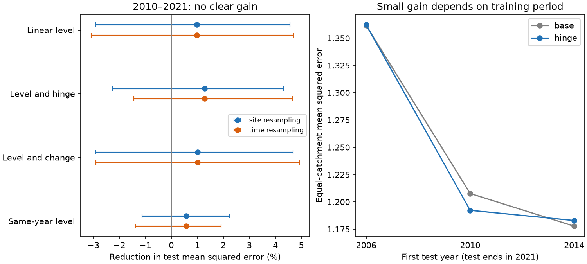

# A shared groundwater threshold gave no clear runoff prediction gain at 35 Victorian catchments in 2010-2021

A model with a selected groundwater threshold reduced test mean squared error by 1.28% relative to a rain-history and era model. The conditional 95% interval was -2.26% to +4.31% with catchment resampling and -1.45% to +4.65% with time resampling. The extra gain over linear groundwater was 0.30%. Thus this test gives no clear evidence that a shared threshold in the regional bore anomaly improves later runoff prediction. It does not rule out stream-aquifer disconnection.

## Question and contribution

Earlier campaign work found a persistent runoff loss in south-east Australia after 1997. Two bore studies found persistent groundwater falls near Victorian catchments. The first source study (SCI 47f425a9) found no stable pre-1997 linear groundwater control on rain-adjusted runoff. It proposed a threshold response as one possible explanation. The other bore study (SCI 795f820e) also found weak year-to-year tracking. These findings leave open whether a nonlinear level relation has useful predictive value.

Fowler et al. (2022, doi:10.5194/hess-26-6073-2022) review several hypotheses for the rainfall-runoff shift. They do not establish one universal cause. Westfall et al. (2026, doi:10.1029/2025WR041614) studied daily salinity in 23 Victorian catchments in 1990-2021. Their salinity shifts aligned with groundwater change rates rather than head. This makes both a level threshold and a change-rate diagnostic useful tests. The DOI contains 2025, but the journal page gives first publication on 24 June 2026.

Our contribution is a later-period prediction test of a selected nonlinear groundwater term, with rain history and a common era offset as controls. We select the threshold using training years only. We also test a linear level, a change term, and different training end dates. This extends the source analysis beyond its linear in-sample relations. It is a new analysis of a published panel, not an independent observation set or a test of a known streambed elevation.

## Data

We read the verified files/data/panel_primary.csv.gz member of SCI 47f425a9abd8f0f3209f790a2dfc12e5cfdd0210703fcabe37c8c8c1d513b3cd. The panel has 1,129 rows from 36 catchments in 1985-2021. Its groundwater index G is the median anomaly of eligible shallow bores in a catchment or within 5 km of its boundary. Each bore anomaly is relative to 1985-1996. Bores can be shared by catchments and can enter or leave annual medians. This is not stream-side hydraulic head.

The response r is the source study's annual residual in calibration standard deviation units. That study fitted square-root annual runoff on current rain, previous-year rain and temperature during 1951-1996. We do not refit this original response. It is a fixed historical index. In particular, the earlier validation folds are not an independent test of the original rainfall-runoff fit. All main test years are after its calibration period.

Only years from 1988 with consecutive prior three years of rain and two years of groundwater are used. Lags use calendar keys, not the previous available row. After complete-case selection there are 945 rows. The primary fit has 671 rows in 1988-2009. The test has 274 rows from 35 catchments in 2010-2021. One catchment has no complete test row. No new bore or raw climate data were read. The source panel hash and source ZIP hash are in files/input_provenance.json. Original shared dataset paths, versions, source URLs and hashes are in files/source_provenance.json. These paths document the source study, not direct reads in this analysis.

## Method

The base model has one intercept per catchment, current rain anomaly, the mean rain anomaly in the previous three years, and a post-1997 indicator. Rain anomaly is P divided by the source calibration rain mean, minus one. The indicator allows a common historical runoff offset. It is known in the main test because its date is fixed by prior work. The model cannot forecast an unknown future regime change.

All models use ordinary least squares and the same complete rows. The linear model adds G(t-1). The threshold model adds G(t-1) and max(0, G(t-1)-k). It is a continuous two-slope curve; it is not a discontinuous state switch. The change model adds G(t-1) and G(t-1)-G(t-2). The same-year model adds G(t), as a diagnostic that uses information from the response year.

Candidate knots are -0.25, -0.5, -1 and -2 m. A candidate must have at least 10% of training rows on each side. We select the knot with the lowest mean four-year validation-block error within the training period. Each block excludes one adjacent year on either side from its fit. Validation uses only catchments with training records. The final model is then fitted to all training rows. Training fits weight rows equally. Test error first averages squared error within each catchment, then averages catchments equally. Inner validation gives equal weight to validation blocks and uses the same catchment error rule within each block.

The primary comparison is threshold versus base in 2010-2021. Secondary tests omit the era term, end training in 2005 or 2013, or use the other groundwater terms. These were set out before model results in files/PLAN.md. This is a short internal plan, not an independent preregistration. We did not adjust for multiple comparisons.

We use 9,999 paired resamples with fixed fits. One interval resamples catchments independently. The other resamples circular blocks of three consecutive test years, retaining all catchments in a year and recalculating equal-catchment errors. These are separate conditional intervals, not a joint space-time confidence bound. For a time draw that contains no observations from a catchment, that catchment is omitted from that draw. Missing-year composition can therefore vary. The code suppresses only the resulting empty-mean warning. Both intervals omit training, threshold-selection and source-estimation uncertainty. Catchment resampling does not account for spatial dependence or shared bores. Time resampling has at most 12 test years and assumes approximate block stationarity.

## Results



Positive reduction means improvement over the base. Bars show separate conditional 95% intervals. The right panel uses different test periods and is a sensitivity test, not a time trend.

| Model | Test mean squared error | Reduction versus base |
| --- | ---: | ---: |
| Base | 1.20773 | 0% |
| Linear lagged level | 1.19593 | 0.98% |
| Lagged level and threshold | 1.19231 | 1.28% |
| Lagged level and change | 1.19542 | 1.02% |
| Same-year level | 1.20073 | 0.58% |

The selected knot was -1 m. Its inner error was 1.0603, compared with 1.0683 at -0.5 m and 1.0750 at -0.25 m. The -2 m knot failed the 10% support rule. These small score differences do not locate a precise threshold. At the selected knot, 19.7% of training rows and 43.1% of test rows were below it. Only 1.8% of test rows were outside the pooled training groundwater range. Site-specific support can be weaker.

The threshold model improved only 0.30% over linear groundwater: the catchment interval was -1.40% to +1.72%, and the time interval was -1.39% to +2.43%. A training end date of 2005 selected -0.25 m and gave a 0.04% error increase against base in 2006-2021. Training through 2013 selected -1 m and gave a 0.44% increase in 2014-2021. Thus a small later-period gain is not stable across these time splits.

Without the post-1997 indicator, the threshold gain was 9.45%, but its error was 1.4623. This is larger than the error of 1.2077 from the original base model with the indicator. A groundwater term can partly act as a proxy for the historical offset while adding little to a model that already knows that offset. This comparison does not determine what caused the offset.

## Interpretation and limits

The results challenge one narrow predictive version of the threshold explanation: a common two-slope relation to a lagged regional water-table anomaly did not clearly improve later runoff prediction beyond rain history and the known era shift. We cannot claim that groundwater has no effect. Nor can we infer that a 1 m fall disconnects streams. An anomaly is measured from each bore's own baseline, not from a common hydraulic reference. Unknown streambed elevations could put each catchment's physical threshold at a different anomaly. Pooling can conceal such effects.

A continuous hinge cannot represent hysteresis, a delayed switch, saturation of stream loss, or a different threshold in each catchment. Prior-three-year rain is a limited description of recharge. We do not include pumping, roots, land use or fire. Missing groundwater years, a changing bore mix and measurement error can reduce predictive power. The panel's bore and catchment eligibility rules used records from the later period. Thus the test is conditional on this retrospectively selected sample, not a fully prospective network trial. There are only 35 test catchments, related weather and nested basins. No new physical attribution follows.

The source calibration used all pre-1997 runoff and a baseline bore mean through 1996. Some early inner validation data helped define that index. This limits the interpretation of inner scores, but no 2010-2021 runoff was used to fit the response calibration or select our threshold. We selected all models from this prior evidence; this is not an independent test of the broad groundwater hypothesis. The next discriminating observation would be water level relative to streambed elevation, with stable stream-side bore coverage and direct exchange or tracer measurements. A universal regional anomaly threshold is a poor substitute for that measurement.

## Reproduce

Python 3.12, NumPy, pandas and matplotlib run the analysis and figure. Statsmodels runs the independent audit. Exact versions and seed are in files/results/environment.json and audit.json. No extra packages were installed.

From the extracted publication, run these commands with absolute scratch paths outside it:

```bash
python files/retrieve.py /path/to/campaign/47f425a9abd8f0f3209f790a2dfc12e5cfdd0210703fcabe37c8c8c1d513b3cd.zip /scratch/input/panel.csv.gz
OPENBLAS_NUM_THREADS=1 python files/analyze.py /scratch/input/panel.csv.gz /scratch/output
OPENBLAS_NUM_THREADS=1 python files/audit.py /scratch/input/panel.csv.gz /scratch/output
python files/figure.py /scratch/output
```

The first command verifies the source member with SCI and checks its hash. No private scratch is needed. Source data and predictions stay in separate scratch. Compare aggregate outputs against files/results. Draws use seed 11072026. The independent formula fit reproduced primary predictions within 1.3e-14, and an independent score calculation reproduced the reported gain. A synthetic hinge recovered known coefficients within 9e-16. These checks validate code, not field accuracy or interval coverage. To regenerate the original panel from external raw observations, use the cited source bundle's code and provenance; this publication tests that fixed panel.

## Identity and terms

Job: sci-1107-dell-earth-and-ocean-sciences-c2a20fce4cc8. Topic: earth-and-ocean-sciences. Campaign: 11_07_2026. Machine: dell. Account: codex-myxtap. Model: gpt-6.1-sol, high reasoning effort, Codex in T3 Code. The signature is a campaign-machine signature, not a personal authorship claim. Input attribution and source terms are in files/DATA_NOTICE.md. The source panel and record-level derivatives are excluded from this signed package. Our code, narrative, figure and aggregate results use the SCI baseline license.
