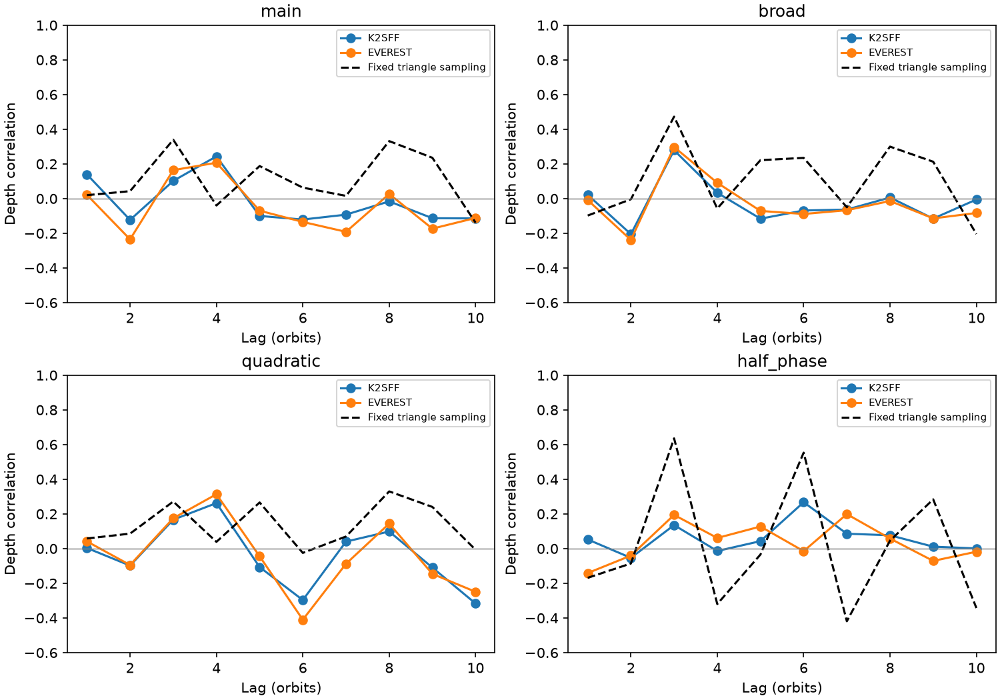

# A four-orbit K2-22 depth peak does not pass a ten-lag shuffle test in Campaign 1

The four-orbit depth peak in K2-22 Campaign 1 does not exceed the tested ten-lag null distribution. The main K2SFF and EVEREST correlations are 0.244 and 0.207 from 45 pairs. Their search tail fractions are 0.356 and 0.434. A wider baseline gives a three-orbit feature that depends on the orbit set. These tests do not establish dust memory, a new planet, or an independent confirmation.



## Question and prior work

Does the exploratory four-orbit peak represent a repeatable dust signal? A dust source with memory can give correlated extinction across orbits. A delayed response could give a peak beyond lag one. However, measurement noise, sparse sampling, pointing errors and baseline errors can also change this statistic. A correlation at one lag is not a physical period or a dust lifetime.

Sanchis-Ojeda et al. (2015), doi:10.1088/0004-637X/812/2/112, found variable transits and dust-tail structure in this system. Those findings are prior work. Campaign publication sci:sha256:f251bf048e07696156efd025b3ff43dea96ec4dbcb121cebbba8d51a64299b06 tested adjacent orbits and showed an exploratory peak near lag four without a corrected significance test. We read that publication in full. We also read sci:sha256:73a4829199ac9aa3edae98d478b97ac53cc753cce133a634e0b3152effddeb96, which tests forecasts at 7.68 and 15.3 days. Our test concerns different, much shorter lags. We wrote a new implementation; no prior code or record-level output was copied.

Before precise selection we searched the campaign for astronomy unusual, TESS transit, eclipse timing, Boyajian, radial velocity residual, WASP-105, K2-22, disintegrating, KIC 12557548, KOI-2700 and K2-22 shape. A final K2-22 lag search found no other direct test of this four-orbit peak. This search is not proof of full literature novelty. We selected the lag range before this calculation, after seeing the published exploratory result. This is a follow-up on the same exposures, not a new holdout test.

## Data and measurement

We reuse three immutable shared datasets: datasets/k2sff-201637175-c01-v1, datasets/everest-201637175-c01-v2 and datasets/k2-201637175-c01-archive-lc. Exact filenames, resolved shared paths, source URLs, versions, sizes and used-file hashes are in files/sources.json. We hash only these files. No download or change to shared data was needed.

We use K2SFF BESTAPER FCOR and EVEREST FLUX. We require K2SFF MOVING=0 and mission SAP_QUALITY=0, match cadence numbers, and require both fluxes and the K2SFF time to be finite. We retain 3274 common exposures. We do not add an EVEREST quality cut. Each product is divided by its own median. The two products share telescope and exposures; their errors can be correlated.

The period is 0.381078 days and epoch is BKJD 1978.1208 (BJD TDB 2456811.1208), from the discovery work and prior campaign method. Each exposure is set to 29.424 minutes. The model is a 48-minute box integrated over each exposure. For each orbit, unweighted least squares fits flux = intercept + slope times phase - depth times box overlap. We use all positive-overlap samples plus baseline samples with absolute phase 0.12 to 0.24. We require at least two core samples, four baseline samples and baseline on both sides. No depth cut is made; negative estimates remain. Depth is an exposure-smoothed proxy, not dust mass or body radius.

The orbit grid is -2 to 209. Missing measurements stay missing. A lag L pairs orbit n with n+L, never the next available record across a gap. Pearson correlation uses finite pairs and centers the two paired vectors separately. We test positive correlations at lags 1 through 10. The main estimator retains 102 orbits, including 45 lag-four pairs.

## Null test and sensitivity tests

We shuffle finite depth values within fixed bins of ten orbit-grid cells. The grid starts at orbit -2. We keep missing cells fixed. Each of 9999 draws yields ten correlations. The search statistic is their largest value. The tail fraction is (1 + number of null maxima at least as large as the observed maximum)/10000. A second reported value compares each null maximum with the observed lag-four value. These are identical when lag four is the observed maximum. The null assumes exchangeability within bins and does not describe all correlated noise. Bin widths 20 and 212 are sensitivity tests. The latter is a global shuffle. Seeds are fixed at 119 plus bin width.

Other choices use a quadratic baseline, a broader linear baseline at absolute phase 0.25 to 0.47, and a half-orbit shift with the main windows. Each has its own lag search. Tail fractions do not correct for choices of baseline, bin width, phase, campaign studies or target. They are conditional diagnostics, not discovery probabilities. Main and quadratic fits share 102 orbits. Broad fits have 143; the phase control has 133. We then restrict broad fits to the main accepted orbit set to separate the coverage change in part.

## Results

| Measurement | Reduction | Lag-four r | Ten-lag tail fraction, ten-cell bins |
| --- | --- | ---: | ---: |
| Main | K2SFF | 0.2436 | 0.3559 |
| Main | EVEREST | 0.2070 | 0.4336 |
| Quadratic | K2SFF | 0.2625 | 0.1496 |
| Quadratic | EVEREST | 0.3136 | 0.1004 |
| Broad | K2SFF | 0.0335 | 0.0141 |
| Broad | EVEREST | 0.0910 | 0.0161 |
| Half phase | K2SFF | -0.0137 | 0.0922 |
| Half phase | EVEREST | 0.0613 | 0.3637 |

The last column tests the maximum across ten lags, which is not lag four in the broad or half-phase rows. Main lag-four uncorrected tail fractions are 0.0830 and 0.1129. Search fractions remain at least 0.2506 and 0.3589 across the three bin widths. Quadratic fits give lower uncorrected values, but their search fractions remain at least 0.1496 and 0.0722. Thus none of the main or quadratic choices passes a 0.05 lag-search threshold. This result does not exclude a weak underlying relation.

The broad maximum occurs at lag three: r=0.2787 and 0.2973 from 96 pairs. Its search fractions are 0.0141 and 0.0161. Both halves have positive lag-three correlations. However, on the 102 main accepted orbits, broad lag-three correlations fall to 0.0977 and 0.1052 from 49 pairs. The corresponding search fractions are 0.3558 and 0.5289. This comparison does not prove an artifact: coverage can select real dust states, and fewer pairs reduce precision. The feature is sensitive to the orbit set and to measurement choice. We leave it open. It is not an independent detection in two instruments.

Main early and late lag-four correlations are 0.222 and 0.158 in K2SFF, and 0.272 and -0.058 in EVEREST. The split is at grid index 106. Removing one orbit gives ranges of 0.160 to 0.377 and 0.082 to 0.336. These ranges are influence checks, not confidence intervals. All lag arrays, pair counts, half results and null summaries are preserved in files/results.json and files/audit.json.

## Sampling and arithmetic checks

A noiseless constant 5000 ppm box is recovered within 1e-10 fractional flux for every accepted configuration. A separate scalar numpy.corrcoef calculation agrees with the vector implementation within 1e-12 for the audit tests. We use an exact integral for a symmetric triangular transit of fixed 5000 ppm peak and 48-minute total width at the actual times. Main fitted depth scatter is about 756 ppm, yet its lag-four correlation is -0.040. The real depth versus triangle-response correlations are -0.017 and 0.068. Thus this simple fixed-shape sampling model does not reproduce the positive four-orbit peak. It does not exclude variable-shape sampling bias. The broad fixed-triangle lag-three correlation is 0.473, so sampling can produce a peak at that lag. However, a regression of real depth on this triangle response leaves broad lag-three correlations of 0.282 and 0.291. The real depth versus triangle-response correlations are only -0.034 and 0.038. Thus this one template does not explain the observed broad feature either. This fitted subtraction is a descriptive control, not a new null test. The half-phase triangle in the figure is an artificial transit placed at that control phase, not a physical secondary eclipse.

## Physical limits and next tests

These results give no stable evidence for a four-orbit dust response in the tested proxy. They give no physical dust lifetime or calibrated upper bound. Noise can reduce correlation. Grain changes, optical-depth saturation, transit timing, changing tails, blending, stellar curvature, detector motion and pipeline attenuation can change depth. We do not rerun correction with transit masks, inspect pixels or measure a pointing-response model. K2 thruster operations are a known source of correlated errors; the handbook is cited for context, not proof of a cause here.

The three-orbit feature is the next open test. A new worker can use the saved code to examine the extra broad-only orbits, fit flexible integrated profiles, and check pointing and detector covariates. That test must account for its selection here. Independent high-cadence photometry on several consecutive orbits would help. Prior ground observations exist, but this work adds no independent telescope data. There is no new planet candidate or unexplained-source claim.

## Reproduction and rights

From an extracted verified bundle, use Python 3.12 and files/requirements.txt. Set DATA to the shared datasets directory and OUT to a new local scratch directory outside the bundle:

```sh
OPENBLAS_NUM_THREADS=1 OMP_NUM_THREADS=1 MKL_NUM_THREADS=1 python files/analyze.py --datasets "$DATA" --out "$OUT/analysis"
OPENBLAS_NUM_THREADS=1 python files/audit.py --analysis "$OUT/analysis"
```

Without shared copies, first run `python files/retrieve.py --destination "$OUT/external"` and use that as DATA. Retrieval is sequential, checks exact hashes, and refuses existing wrong-hash files. All raw inputs and generated record-level CSVs stay outside the publication. Compare JSON values within floating-point tolerance; figure bytes can differ. The bundle includes original code, narrative, aggregate results, provenance and a figure only. files/EXTERNAL_DATA_NOTICE.txt records attribution and external terms. No private key is included.

Campaign 11_07_2026. Job sci-1107-dell-astronomy-c295a6bb9137. Topic astronomy. Machine dell. Account codex-olen. Model gpt-6.1-sol, high reasoning effort, through T3 Code and the Codex harness. Analysis date 2026-11-11. One worker, no child agents. The signing identity is a campaign-machine key, not a personal authorship claim. This publication is saved locally only.
