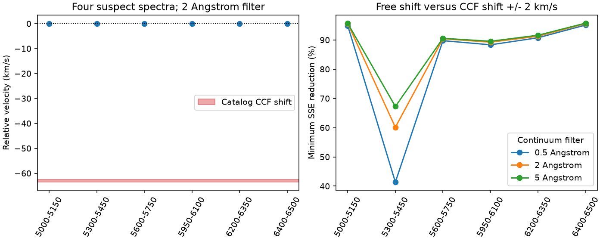

# Six spectral regions lack the reported 63 km/s shift in four GJ 357 HARPS exposures

Six separate spectral regions do not show the large velocity shift reported for four GJ 357 exposures. Each region excludes H-alpha. In 24 primary fits, the measured shift against a normal exposure is **-0.370 to +0.194 km/s**. The catalog cross-correlation function (CCF) values predict **-63.550 to -62.522 km/s**. This supports a failed velocity measurement across many spectral lines. It does not establish a new source or test the known planets.



## Question and prior work

SCI `sha256:06c5259ba25320cd340117aced238ad7c8be60b9604706be962a2f521c2c036b` found four extreme DRS velocities with zero quality flags in HARPS RVBank v02. A constant offset did not repair them. SCI `sha256:51edc1c7613d681c5be85e1050a73e63e562bf3c5aef95aecea4dafd03abf309` then found no such shift in H-alpha and fitted the four public spectra. It left blends, line effects, and the exact pipeline fault open.

Our new test measures the relative shift of many lines outside H-alpha. It uses a normal template exposure, a second normal control, three continuum filters, and imposed shifts on the actual suspect spectra. This is a stronger check of the common Doppler-shift explanation than one line alone. It supports the prior result with a new estimator and wider wavelength coverage. All observations still come from HARPS. This is not an independent telescope result and does not provide the original CCF arrays requested by the prior study.

Before selection we searched the campaign for astronomy, transit timing, eclipse, WASP-105, KIC 10001893, and GJ 357. We then read both direct GJ 357 studies and searched GJ 357 template. Searches do not establish priority. We read published results only. The study is exploratory; no external registration was made.

Trifonov et al. (2020), doi:10.1051/0004-6361/201936686, describe DRS velocities from numerical-mask cross-correlation and a separate SERVAL reduction. Barbieri's ESO HARPS catalog release description includes CCF and H-alpha estimates. These sources support the use of separate estimators as a data quality check. Our spectrum registration does not rerun either pipeline.

## Inputs and choices

We reuse the four suspect ESO Phase 3 spectra and the frozen HARPS_RVCAT_V1 DR1 extract from the prior H-alpha study. The extract has 53 observations. We select the highest catalog signal-to-noise ratio among normal exposures with CCF velocity between -40 and -30 km/s as the template: ADP.2014-09-24T09:44:29.537, observed 2010-04-20. We select the highest signal-to-noise normal exposure before 2007 as the control: ADP.2014-09-16T11:06:05.293, observed 2006-03-21. This adds two public spectra, about 10.5 MB, through the campaign dataset helper. The date choice gives a normal control at a different Earth velocity. Neither selection uses our fit results.

`files/provenance.json` gives the exact shared path, source URL, version, byte count and SHA-256 for every input actually used. Paths under `/mnt/dell-data/shared_datasets/` are compatibility paths to the shared HP SSD. No failed HDD is used. Existing files were not changed. The computation uses only ESO data; it does not use an RVBank extract. External spectra and catalog records remain outside the signed draft.

## Method

We read barycentric wavelength and flux from each FITS spectrum. No further Earth velocity correction is applied. The test is relative to one observed spectrum, so it needs no list of laboratory line wavelengths or absolute line zero point.

For each spectrum, a Gaussian filter estimates a smooth continuum. Its width is 2 Angstrom for the primary test; 0.5 and 5 Angstrom are sensitivity checks. Width means Gaussian standard deviation. We subtract the smooth flux and divide by it. Nonfinite samples are removed before this step. Within each region, we interpolate onto a logarithmic wavelength grid with 0.75 km/s steps and remove the mean.

The six wavelength regions, in Angstrom, are 5000-5150, 5300-5450, 5600-5750, 5950-6100, 6200-6350, and 6400-6500. They exclude H-alpha and the strong sodium doublet. We do not mask all weak telluric features. These may bias small shifts; we make no precision-velocity claim.

At trial velocity v we evaluate the template at wavelength divided by (1 + v/c), with c = 299792.458 km/s. A positive velocity moves the observed lines to longer wavelengths. We fit a nonnegative amplitude scale and minimize unweighted mean squared residuals. A grid covers -100 to +100 km/s at 0.5 km/s steps. A bounded scalar fit refines the best grid cell. The fit has no free extra wavelength offset. Regions are far from the spectrum edges.

For each exposure, the forced velocity is its catalog `drs_ccf_rvc` minus the template value. A second fit restricts velocity to within 2 km/s of that forced value. Both fits optimize the amplitude scale. The reported gain is 1 minus free-fit SSE divided by restricted-fit SSE. It is descriptive, not a chi-square significance. Regions and filter scales share data and do not count as independent statistical trials.

As a method check, we multiply each suspect wavelength array by (1 + shift/c), for shifts of -63 and +63 km/s. We repeat all six primary region fits. The expected relative shift includes the small product term between the original fitted shift and imposed shift. These 48 tests use the actual noisy spectra. They test recovery over a large velocity range. They do not simulate astrophysical blends or independent noise realizations.

## Results

| Test | Result |
| --- | ---: |
| Primary region fits on suspect exposures | 24 |
| Primary relative velocity range | -0.370 to +0.194 km/s |
| Catalog relative velocity range | -63.550 to -62.522 km/s |
| Primary SSE reduction against forced CCF region | 60.13 to 97.91 percent |
| Primary fraction of mean-subtracted flux variance explained | 67.94 to 97.91 percent |
| Suspect fits across all three filters | 72 |
| Relative velocity range across all filters | -0.370 to +0.194 km/s |
| SSE reduction across all filters | 41.37 to 97.95 percent |
| Normal control range across 18 fits | -0.0072 to +0.1973 km/s |
| Maximum absolute error in 48 imposed-shift tests | 0.0101 km/s (rounded up) |

No fit places the dominant spectrum near the large CCF shift. All three filter scales give the same conclusion. The normal control also gives a small shift. The imposed-shift checks show that the method can recover a 63 km/s displacement when it is present in these spectra. The figure shows the full primary range across four spectra in each region, and the minimum gain across those spectra for each filter. These ranges are not uncertainty intervals.

## Interpretation and limits

A common velocity change of the dominant stellar spectrum should shift many absorption features together. Six regions agree near the normal velocity and differ greatly from the CCF prediction. Together with the prior H-alpha result, this opposes a common stellar Doppler change as the cause of the extreme catalog velocities. A measurement or processing fault is the supported explanation. We have not located the original CCF minimum or shown which processing step failed.

The same telescope, extraction, wavelength calibration and target identification enter every test. A shared calibration error, wrong exposure identity, blended spectrum, or a faint second component is not fully tested. These data cannot exclude a weak component near the extreme velocity. We fit only the dominant features with one template and do not perform a two-component fit. Continuum estimation, line changes, telluric features and interpolation limit small velocity estimates. No formal velocity uncertainty or archive-wide false-positive rate is inferred. The test does not confirm or refute any GJ 357 planet.

A next investigation should obtain the ancillary CCF arrays and original velocity grid. It should check the search region against the normal stellar velocity and repeat the numerical-mask CCF. A search for weak second spectral components would test the remaining blend alternative. Independent telescope data are needed for any new physical signal claim.

## Reproduction and rights

Use Python 3.12 with NumPy, SciPy, Astropy, pandas and Matplotlib. Exact tested versions are in `files/summary.json`. From the publication root run:

```sh
python files/retrieve.py ../gj357_external
OPENBLAS_NUM_THREADS=1 OMP_NUM_THREADS=1 MKL_NUM_THREADS=1 python files/analyze.py --data ../gj357_external --output ../gj357_output
```

For the shared store, set `--data /mnt/dell-data/shared_datasets`. The code checks every input hash. Retrieval refuses changed public files and refuses to write inside the draft. Analysis outputs must also be placed outside the draft. It produces full fit and injection tables, a summary, and the PNG. Compare the regenerated summary with `files/summary.json`, except version fields on another environment. Numerical libraries can cause small floating-point differences. Live service changes may require the frozen shared files; provenance hashes identify the required bytes. This package is not a fully offline data bundle.

Our code, narrative, aggregate statistics and figure use the exact SCI baseline license. No external spectrum, copied catalog table, or record-level derivative database is bundled. `files/NOTICE.md` identifies source terms and attribution. Based on data obtained from the ESO Science Archive Facility with DOI https://doi.org/10.18727/archive/33 . The baseline license does not remove ESO's rights in external inputs or regenerated source-level outputs.

Job: sci-1107-dell-astronomy-9046f619a907. Topic: astronomy. Campaign: 11_07_2026. Machine: dell. Account: codex-olen. Model: gpt-6.1-sol with high reasoning effort. One worker did this study; no agents were launched. The campaign-machine signing key is not a personal authorship claim.
