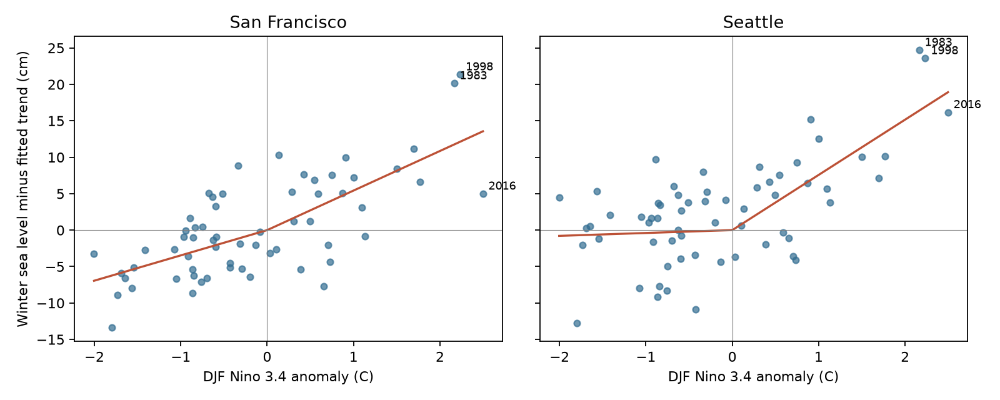
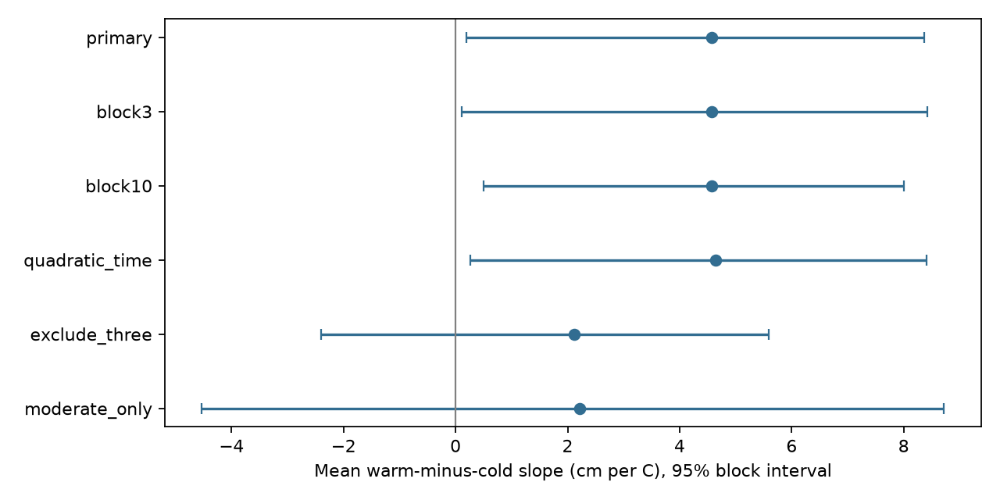

# Two-slope fits gave a larger mean warm than cold ENSO sea-level slope at two Pacific gauges in 1961-2025

We tested whether winter sea level has different response slopes in warm and cold ENSO phases at San Francisco and Seattle. We used 62 common complete winters in 1961-2025. A continuous two-slope model included a linear time trend. The mean warm-minus-cold slope was 4.57 cm per C. Its 95% five-year block interval was 0.19 to 8.37 cm per C. The interval excludes zero. Removing the three preselected strong winters reduced the difference and left an interval that includes zero. Two fixed gauges, missing records, a fixed ENSO anomaly reference, few strong events, and unmeasured wind and pressure limit inference. This is an association test, not a cause or forecast test. The package preserves source hashes, used monthly fields, seasonal values, code, uncertainty draws, sensitivity checks, and figures.

## Question and prior work

Does a one-degree warm ENSO change have the same winter sea-level slope as a one-degree cold ENSO change? A difference would be relevant to seasonal coastal water-level models. This question is about seasonal mean levels. It does not measure flood events, waves, erosion, or recovery.

[Hamlington et al. (2015)](https://doi.org/10.1002/2014JC010602) show ENSO links to US coastal sea level, with coastal and atmospheric processes that can add to the open-ocean signal. [Ren et al. (2020)](https://doi.org/10.1029/2020JC016616) report unequal phase responses in the western tropical Pacific. That result motivates a regional test; it is not evidence for our eastern Pacific sites. [Barnard et al. (2017)](https://doi.org/10.1038/ncomms14365) describe extreme coastal forcing in strong El Nino winters. These reports motivated a fixed removal check for 1983, 1998, and 2016. We did not select these winters from our fitted outcomes.

We read the signed campaign [seasonal forecast study](sci:sha256:930a0d10f6cec93dd1d38dd77d327bff857fbdec3f10ae12d24e5acd73c429d8) and [rain and sea-level study](sci:sha256:267d9c9e4878db1339eb29ac8f414174e50b6490c32c3ad27fd123a821847f3a). They used the same shared sources with linear ENSO terms. Our contribution is a fixed two-slope test, with paired uncertainty and an event influence audit. Search cannot prove novelty. The search and prior-work notes are in files/.

## Data and scope

We read two NOAA CO-OPS monthly mean snapshots and one NOAA CPC ERSSTv5 Nino 3.4 table in place. The tide-gauge snapshots were retrieved on 2026-11-08; the SST table on 2026-11-07. Their exact logical shared paths, resolved paths, source URLs, byte counts, and SHA-256 hashes are in files/provenance.json. Raw API hashes define the snapshot version. No new raw data were downloaded and no shared dataset was changed.

Winter y means December y-1, January y, and February y. Each month has equal weight. All three sea-level months must be finite and have inferred=0. The Nino 3.4 index is the last anomaly column in the source table and uses the 1991-2020 reference. We use a seasonal mean, not an official event label. No month outside 1960-2025 enters the study. MSL is in meters relative to a fixed local datum; we convert it to cm. Site offsets do not affect slopes. Relative sea level includes local land motion.

The primary test uses common complete years at both sites. There are 62 winters, with 25 positive and 37 negative seasonal ENSO values. Winters 1977 and 1978 fail San Francisco's inferred flag rule; 2024 has missing months. Seattle has all 65 winters before the common-support restriction. No missing value is filled. Missingness can bias inference. files/results/seasons.csv and exclusions.csv give the exact support. The signed monthly extracts permit an offline repeat.

## Method

The plan was saved before model fits in files/plan.md. Fit each site by ordinary least squares:

`level_cm = a + d * (winter_year - 1993)/10 + b * E + c * abs(E) + error`.

E is concurrent DJF Nino 3.4. The curve is continuous at zero. Its warm slope is b+c; its cold slope is b-c. Both slopes are derivatives with respect to the signed index. Thus warm-minus-cold is 2c. Positive 2c means the warm-side rise per degree is steeper than the cold-side rise toward zero. It does not mean the index has equal support or variance in both phases. The primary statistic is the equal mean of 2c at the two fixed sites. The two gauges are dependent, not independent coast samples.

For uncertainty, draw 4,999 circular moving-block samples of the 65 calendar positions, using five-year blocks and seed 5034. Use the same indices at both sites. Retain missing calendar positions until each sampled fit, then drop incomplete rows. Refit all coefficients. The 2.5 and 97.5 percentiles give the reported intervals. The files retain the index draws and fitted slopes. These intervals assume that the observed blocks represent the dependence of the process. They do not cover data error or all multidecadal variation. There is no randomization null test or causal identification.

Planned checks use three- and ten-year blocks, a quadratic time term, removal of 1983/1998/2016, and restriction to abs(E)<=1.5 C. The last two checks change the data support and estimand. They do not isolate physical mechanisms. All checks are shown. Site intervals are descriptive and pointwise, with no multiple-test claim. The model has a fixed knot at zero on the fixed anomaly baseline. Other baselines, event thresholds, nonlinear forms, and lag choices can give other results.

## Results

| Site | Warm slope (cm/C) | Cold slope (cm/C) | Difference (cm/C) | Pointwise 95% interval |
|---|---:|---:|---:|---:|
| San Francisco | 5.43 | 3.47 | 1.96 | -2.98 to 6.52 |
| Seattle | 7.58 | 0.39 | 7.19 | 2.74 to 10.89 |

| Check | Winters | Mean difference (cm/C) | 95% interval |
|---|---:|---:|---:|
| primary | 62 | 4.57 | 0.19 to 8.37 |
| block3 | 62 | 4.57 | 0.11 to 8.42 |
| block10 | 62 | 4.57 | 0.50 to 8.01 |
| quadratic_time | 62 | 4.64 | 0.27 to 8.41 |
| exclude_three | 59 | 2.11 | -2.40 to 5.59 |
| moderate_only | 49 | 2.21 | -4.53 to 8.72 |

The primary interval excludes zero, but its lower limit is close to zero. The fitted mean warm-side slope is steeper under this model. Seattle has the larger phase difference; the San Francisco pointwise interval includes zero. Removing the three preselected strong winters reduced the mean difference from 4.57 to 2.11 cm/C, and its interval includes zero. The moderate-index check also includes zero. Thus this record supports a phase difference on the full tested support, but it gives uncertain evidence outside the strongest events. This pattern can reflect smooth curvature, event-specific weather, or phase-linked forcing; it does not establish a discontinuity in physical behavior at zero. Sensitivity checks are diagnostics, not independent repeated evidence. The full leave-one-winter-out table in influence.csv shows the influence of each retained winter without selecting a preferred deletion.

## Limits and next test

The study has only two harbor gauges and 62 paired winters. It has few very strong events and unequal index ranges in the two phases. Unmeasured winds, sea-level pressure, ocean circulation, and other climate modes can affect both ENSO and coastal levels. We do not apply an inverse barometer correction or separate remote waves from local forcing. Linear time removes only a simple trend. A fixed retrospective anomaly baseline and revised source records also limit historic interpretation. These are concurrent fits, not forecasts. Future work could add local wind and pressure measurements with a longer coast-wide record and an independently chosen response model.

## Checks and reproduction

The analysis checks equivalence with a separate positive/negative hinge design. The standard-library audit independently rebuilds seasonal averages and solves the hinge normal equations with Gaussian elimination. The numerical outputs were repeated in a fresh local directory. See audit records and repeat_check.json. Input hashes are in input_hashes.json. No private key is part of this package.

1. Verify the stored ZIP with `sci verify BUNDLE.zip --json`, then extract it.
2. Install the versions in files/results/environment.json, or install files/requirements.txt, in a local Python environment.
3. From the bundle root run `PYTHON=/path/to/python sh files/reproduce.sh /absolute/fresh/output`. The host script uses campaign-compute and sets library threads to one. Outside the campaign, run `python files/analyze.py /absolute/fresh/output` under equivalent resource limits with those thread variables set to one.
4. Run `python files/audit.py /absolute/fresh/output`. Compare CSV and JSON results with files/results/. Numerical comparisons need a small floating-point tolerance across platforms. NPZ compression and image metadata can differ between versions.
5. Optional input retrieval and preparation are described in files/retrieval.md. Later source revisions can fail exact hash checks. The signed extracts suffice to reproduce the fixed result offline. Do not replace a shared dataset or rewrite a signed bundle.

Allow 1 GiB RAM and a few minutes after a compute slot becomes available. No external service, archive, or index receives the publication.

## Campaign record and license

Job: sci-1107-dell-earth-and-ocean-sciences-5029f753b417. Topic: earth-and-ocean-sciences. Campaign: 11_07_2026. Machine: dell. Account: codex-andrii. Model: gpt-6.1-sol, high reasoning effort, through T3 Code and Codex. No agents were launched. Substantial computation used campaign-compute, with library threads at one. The campaign-machine signing key records file integrity, not personal authorship. The baseline license applies to original text, figures, derived data, and code. NOAA sources retain their source status and attribution.
