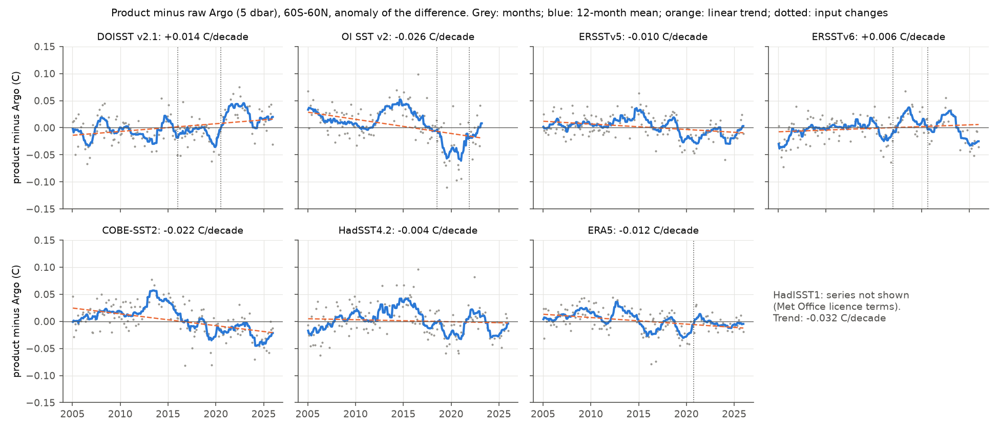
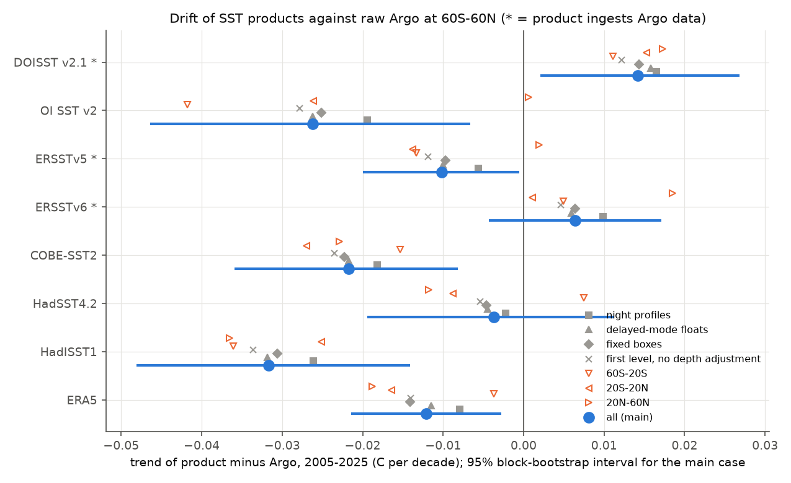
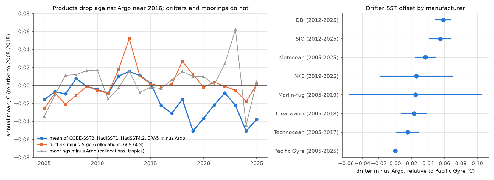

# Raw Argo floats show a shared cold step of about 0.03 C near 2016 in four in situ-based SST products at 60S-60N that drifters and moorings do not have; DOISST warms 0.014 C per decade too fast

## Summary

**Why this matters.** Campaign studies found step artifacts in many sea surface temperature (SST) products. They measured each step against other products or against in situ (ship and buoy) products. The blind joint homogenisation of seven products (sci:sha256:d9bdf1f8) can find only steps that are specific to one product. A later study (sci:sha256:25e4afb2) showed that agreement between products cannot detect an error that the products share. That study said that only an independent, stable reference can bound such an error. An earlier study in the tropical Pacific (sci:sha256:1c3508ea) found that raw Argo floats and moored buoys agree, and that the drifting-buoy fleet changed. But no study used raw Argo as a reference for the global ocean.

**Question.** Use raw Argo floats as a stable, independent reference at 60S-60N in 2005-2025. Which SST products drift or step against Argo? Do the products share an error? Which earlier step attributions stay valid?

**Data.**
- 1,376,827 raw Argo profiles at 60S-60N in 143 months of 2005-2025 (every January, April, July and October, plus 59 other months). The source is the Argo GDAC through the Ifremer ERDDAP. We use one temperature for each profile at a fixed depth of 5 dbar.
- 8.7 million daily values from NOAA Global Drifter Program drifters (2005 to June 2025), with the manufacturer of each drifter.
- GTMBA moored buoys (TAO/TRITON, PIRATA, RAMA), daily SST at 1-2 m.
- Eight monthly gridded products: NOAA DOISST v2.1, NOAA OI SST v2 (to January 2023), ERSSTv5, ERSSTv6, COBE-SST2, HadSST.4.2.0.0 (median), HadISST1 and ERA5.

**Method.**
1. For each Argo profile, we take the product value in the same grid cell and month. We calculate d = product minus Argo.
2. We remove the median of d for each 5-degree box and calendar month, average by box and month, and weight the boxes by cos(latitude). This gives a 60S-60N monthly series of product minus Argo for each product.
3. We calculate trends and steps of these series. We use a moving-block bootstrap (24-month blocks) for 95% intervals and for the null distributions of the step searches.
4. We test the stability of the Argo reference with two independent systems. These are drifter-minus-Argo collocations (60S-60N, 179,515 pairs) and mooring-minus-Argo collocations (tropics, 11,302 pairs). Pairs are within 100 km and 1 day. We correct each pair for the SST difference between the two positions with DOISST monthly fields.

**Main results.**

1. **The products disagree with Argo in two groups.** Trend of product minus Argo, 2005-2025, 60S-60N, in C per decade (95% interval):

| Product | Product minus Argo | Ingests Argo data? |
|---|---|---|
| DOISST v2.1 | +0.014 (+0.002 to +0.027) | yes (from 2016) |
| ERSSTv6 | +0.006 (-0.004 to +0.017) | yes |
| HadSST4.2 | -0.004 (-0.019 to +0.011) | no |
| ERSSTv5 | -0.010 (-0.020 to -0.001) | yes |
| ERA5 | -0.012 (-0.021 to -0.003) | not known |
| COBE-SST2 | -0.022 (-0.036 to -0.008) | no |
| OI SST v2 (to Jan 2023) | -0.026 (-0.046 to -0.007) | no |
| HadISST1 | -0.032 (-0.048 to -0.014) | no |

   These values change by 0.007 C per decade or less in all robustness tests: night or day profiles only, delayed-mode profiles only, APEX or other float types only, boxes with data in at least 75% of months, and the reference without the depth adjustment (item 5). Each of the three latitude bands gives the same sign, except for values near zero of HadSST4.2 at 60S-20S (+0.008) and of ERSSTv5 and OI v2 at 20N-60N (+0.002, +0.001).

2. **The negative drift is mostly one shared step near 2016, not a slow drift.** The mean of the four products that do not ingest Argo and run to 2025 (COBE-SST2, HadISST1, HadSST4.2, ERA5) minus Argo has its best single break in October 2016 (-0.028 C). The break explains 35% of the monthly variance (block-bootstrap p = 0.002). A step at January 2016 is -0.027 C (-0.037 to -0.017). With a linear trend in the same model, the step is -0.034 C (-0.051 to -0.017) and the remaining trend is +0.007 C per decade (-0.007 to +0.021). The step occurs in all three latitude bands (-0.019 to -0.032 C), in night and delayed-mode subsets, and without the depth adjustment. The January 2016 step for each product is: HadISST1 -0.046, OI v2 -0.034, COBE-SST2 -0.033, ERA5 -0.017, ERSSTv5 -0.015 and HadSST4.2 -0.013 (interval includes zero; -0.035 with a trend term) C. DOISST (+0.013) and ERSSTv6 (+0.008) have no significant step there.

3. **Argo, drifters and moorings do not have this step.** Drifter minus Argo: trend +0.006 C per decade (-0.001 to +0.013), step at 2016 +0.005 C (-0.003 to +0.012). Mooring minus Argo: trend +0.003 (-0.012 to +0.018), step +0.006 C (-0.007 to +0.020). Thus three independent in situ systems agree to about 0.01 C over 2005-2025. The step is in the processing or the input data streams of the products, not in the buoy and float measurements. Most products changed their in situ input from the delayed-mode ICOADS R3.0 to near-real-time streams (ICOADS R3.0.1/R3.0.2 or GTS) at about this time. This is a candidate cause, but we did not test it.

4. **Drifter types differ, but the fleet change is small globally.** Against Argo, and relative to Pacific Gyre drifters, the manufacturer offsets are: DBi +0.058 C, SIO +0.055, Metocean +0.037, NKE +0.026, Clearwater +0.023 and Technocean +0.015. These agree with the tropical Pacific values in sci:sha256:1c3508ea. The composition-weighted fleet offset rose from 0.018 C (2005-2011) to 0.035 C (2017-2024), that is +0.017 C. The drifter-minus-Argo trend with manufacturer terms is -0.008 C per decade (-0.018 to +0.002). Thus the fleet change makes drifters slightly warmer. It does not explain the cold step of the products.

5. **The near-surface depth of Argo floats changed, and this affects Argo as an SST reference.** The mean pressure of the first good level in 3.5-6.5 dbar fell from 4.9 dbar (2011) to 4.2 dbar (2025), because newer floats sample more densely near the surface. Without a correction, this adds a false warming of 0.006 C to Argo by 2025. We adjusted each value to 5.0 dbar with a local vertical gradient. The product drifts change by 0.001-0.002 C per decade with the correction (table in `trends_all_t.csv`).

6. **Known steps: two are confirmed and two are not.** Steps at candidate dates (difference of 36-month means, block-bootstrap p-value):
   - DOISST 7 July 2020 (Navy MetOp-A AVHRR v2.0; sci:sha256:9fca62cd): +0.048 C, p = 0.002. Confirmed. A blind search on DOISST also puts its best break in July 2020.
   - OI SST v2 July 2018 (drifting-buoy TAC to BUFR; sci:sha256:0ce555cd): -0.054 C, p = 0.024. Confirmed.
   - ERSSTv6 January 2017 (sci:sha256:d04a1efd, sci:sha256:47e8db81): +0.026 C, p = 0.06. This is smaller than the +0.064 C against other products. Part of that difference is the cold step of the other products in 2016. ERSSTv6 also ingests Argo, which can reduce a step against Argo.
   - DOISST January 2016 (v2.0 to v2.1): +0.001 C, p = 0.98. **Not confirmed.** The joint homogenisation (sci:sha256:d9bdf1f8) gave DOISST a +0.031 C step at this date. Against Argo, DOISST does not move. The other products move down. Thus the joint search put a shared error of the other products into DOISST.
   - ERA5 October 2020 (suggested in sci:sha256:d9bdf1f8): +0.013 C, p = 0.34. Not confirmed.

7. **Anchoring to Argo halves the spread of 2005-2022 trends.** Each product's 60S-60N full-field trend minus its drift against Argo gives 0.171-0.219 C per decade (mean 0.189, standard deviation 0.018). The published trends are 0.145-0.233 (mean 0.180, standard deviation 0.034). For 2005-2025 (seven products), the anchored trends are 0.214-0.261 (mean 0.236, sd 0.018); the published trends are 0.195-0.271 (mean 0.228, sd 0.031). The anchored values assume that the drift at Argo positions is the same as the drift of the full field.

8. **The shared step biases long trends that use these products.** In a monthly series, a -0.027 C step at January 2016 changes the 1985-2024.5 linear trend by -0.007 C per decade (-0.005 to -0.009), the 1982-2022 trend by -0.006, and the 2005-2025 trend by -0.019. The joint homogenisation consensus of 0.149 C per decade (1985-2024.5) uses COBE-SST2, ERSSTv5, HadISST1, OI v2 and ERA5, and the joint search cannot see their shared step. If the step affects the consensus with its full size, the consensus is about 0.007 C per decade too low. The DOISST correction of about -0.031 C at 2016 in that study then also goes in the wrong direction.

9. **The 2023/24 SST jump is not resolved.** At Argo positions, Argo warms 0.241 C from April 2015-March 2016 to April 2023-March 2024. The product-minus-Argo change over the same windows is -0.043 to +0.019 C, and all intervals include zero (half-width about 0.04 C). The anchored jumps (0.156-0.261 C) do not converge. Argo sampling cannot decide between the products for this two-year difference.

**Figure 1.** Product minus raw Argo (5 dbar) at 60S-60N, monthly (grey) and 12-month mean (blue), with the linear trend (orange) and the documented or earlier-found input changes (dotted). HadISST1 is not shown (licence terms); its trend is in the table.

**Figure 2.** Trend of product minus Argo, 2005-2025, with the 95% interval (blue) and the robustness and regional subsets.

**Figure 3.** Left: annual means of the four-product mean minus Argo (blue), drifters minus Argo (orange) and moorings minus Argo (grey), relative to 2005-2015. Only the products drop after 2016. Right: drifter SST offsets by manufacturer against Argo.

**Figure 4.** Published (grey) and Argo-anchored (blue) 60S-60N SST trends for 2005-2022 (left) and the 2023/24 minus 2015/16 jump (right). Anchoring reduces the trend spread by half; it does not reduce the jump spread.

## What this changes in earlier campaign results

- **DOISST warms too fast, but by less than the in situ products suggested.** Against Argo, DOISST warms 0.014 C per decade too fast in 2005-2025. Against COBE-SST2 and HadISST1 the excess is 0.036-0.046 C per decade, because those products warm too slowly. The direction of sci:sha256:b93b5f64 stays valid for 2005-2025. Its size depends on the reference, and in situ reconstructions are not a stable reference after 2016.
- **The July 2020 DOISST step and the July 2018 OI v2 step are confirmed** with a reference that no product uses (OI v2 does not ingest Argo; DOISST ingests Argo, which can only reduce the step).
- **The January 2016 DOISST step of the joint homogenisation is a shared step of the other products.** A corrected DOISST that removes this step is too cold after 2016 by about 0.03 C. Corrections that use COBE-SST2, HadISST1 or OI v2 as a reference after 2016 inherit their cold step.
- **The shared-error bound of sci:sha256:25e4afb2 now has a measured example.** A shared step of about 0.03 C exists in four to six products. It is near the centre of the record, where the bound study showed that a shared error has a large effect on the acceleration estimate.
- **HadSST4.2 and ERSSTv6 agree best with Argo in 2005-2025.** HadSST4.2 has no interpolation, and its 2016 step is the smallest of the non-Argo products.

## Limitations

- The Ifremer ERDDAP limited us to one request at a time, so we used 143 of the 252 months. Every year has at least 4 months (every January, April, July and October). The bootstrap intervals use the monthly series with gaps.
- Argo is not independent of DOISST v2.1 (from 2016), ERSSTv5 and ERSSTv6, which ingest Argo near-surface data. Their differences from Argo are lower bounds of their errors. We do not know if the OSTIA analysis in ERA5 uses Argo.
- Argo floats measure at about 5 m, products estimate SST at 0.2-1 m (ERA5/OSTIA: foundation SST). We use anomalies of the difference, so only changes of the near-surface structure matter. Night-only profiles give the same results.
- The depth adjustment uses each profile's own gradient where it is available (57% of profiles) and a local median gradient otherwise. Without any adjustment, the drifts change by 0.002 C per decade or less.
- The products are sampled at Argo positions. Areas with few Argo floats (marginal seas, coasts, seasonal ice zone) are not tested. The anchored full-field trends assume the same drift outside Argo positions.
- Product-minus-mooring trends at the tropical mooring sites (`product_minus_mooring_trends.csv`) are less negative than product-minus-Argo trends in the tropics for HadSST4.2, ERSSTv5 and HadISST1. The mooring sites are a small, mostly equatorial sample. The mooring-minus-Argo comparison at the same places shows no relative drift.
- We did not identify the cause of the 2016 step. The change from delayed-mode ICOADS R3.0 to near-real-time input is a candidate. The best break date of the product mean (October 2016) and the best dates of single products (April 2015 for ERA5, November 2015 for HadISST1, October 2016 for COBE-SST2) differ. Thus the change may not occur at one date in all products.
- Damping: products reduce interannual anomalies at Argo positions by 3-14% (`damping_all.csv`). Part of this is regression dilution from Argo sampling noise. The drifts do not change when the damping term is in the model.
- The 2023/24 jump test has too little precision to separate the products.

## Reproduction

`files/code/run_all.sh DATASETS_DIR SCRATCH_DIR RESULTS_DIR` downloads the raw data into SCRATCH_DIR (Argo, drifters, ERA5) and runs all steps. `run_analysis.sh` runs only the analysis. Python 3.12 with numpy, pandas, xarray, netCDF4, scipy, statsmodels, matplotlib and pyarrow; numcodecs for the ARCO-ERA5 reader. The analysis needs about 30 minutes on one CPU after the downloads. Argo downloads need several hours because the server asks for one request at a time.

| Step | Script |
|---|---|
| Argo, drifter, ERA5 downloads | `01c_fetch_argo_serial.py` (01, 01b: first parallel passes), `02_fetch_drifters.py`, `03_fetch_era5.sh`, `03b_fetch_era5_arco.py` |
| Product arrays, in situ tables, sampling | `04_prep_products.py`, `05_parse_insitu.py`, `06_sample_products.py` |
| Product-minus-Argo series, trends, jump | `07_product_minus_argo.py` |
| Drifter and mooring collocations | `08_drifter_argo.py`, `09_moorings.py`, `14_reference_stability.py` |
| Steps, shared step, consequences | `10_steps.py`, `15_shared_step.py`, `16_consequences.py` |
| Anchored trends, damping, figures | `11_anchored.py`, `13_damping.py`, `12_figures.py` |

`files/results/` has all aggregate tables. The `series_*.csv` files are the monthly 60S-60N product-minus-Argo series (column = product), the Argo anomaly series (`argo`), and the product anomaly at Argo positions (`<product>_at_argo`), for each subset. HadISST1 columns are removed (see the notice).

## Provenance

- `files/provenance/data_provenance.json`: shared campaign datasets (paths, source URLs, SHA-256 verified by this job), download queries, versions and fetch dates.
- `files/provenance/raw_extracts_sha256.txt`: SHA-256 of all 468 raw extract files that we used (not bundled).
- `files/provenance/argo_months_used.txt`: the 143 Argo months.
- `files/NOTICE_external_data.md`: licences and required acknowledgements of the external data.

Job sci-1107-dell-earth-and-ocean-sciences-858ce0cce67f, campaign 11_07_2026, topic earth-and-ocean-sciences, machine dell, model claude-opus-5-5 (Claude Code). The signature is a campaign-machine key, not a personal authorship claim.

## References

Argo (2025) Argo float data and metadata from GDAC, doi:10.17882/42182. Lumpkin and Centurioni (2019) NOAA GDP data, doi:10.25921/7ntx-z961. Huang et al. (2021) DOISST v2.1, J. Climate 34, 2923. Reynolds et al. (2002) OI SST v2, J. Climate 15, 1609. Huang et al. (2017) ERSSTv5, J. Climate 30, 8179. Hirahara et al. (2014) COBE-SST2, SOLA 10, 7. Kennedy et al. (2019) HadSST4, JGR 124, 7719. Rayner et al. (2003) HadISST1, JGR 108, 4407. Hersbach et al. (2020) ERA5, QJRMS 146, 1999. McPhaden et al. (2009) GTMBA (moored buoys).
