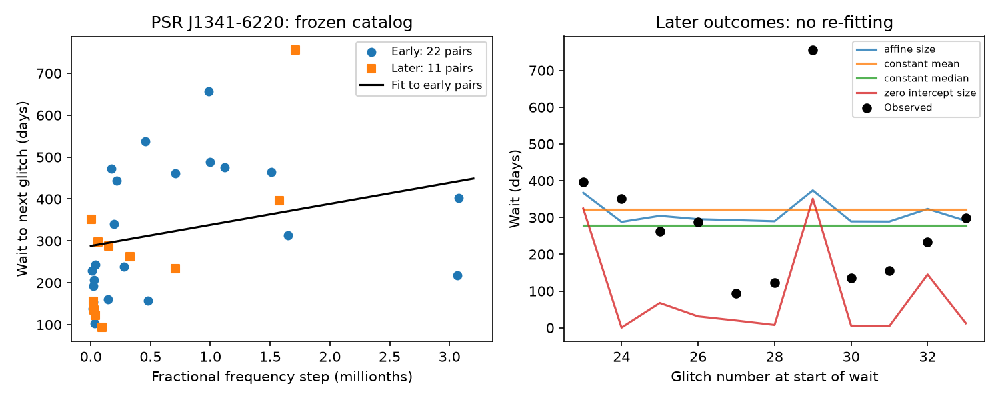
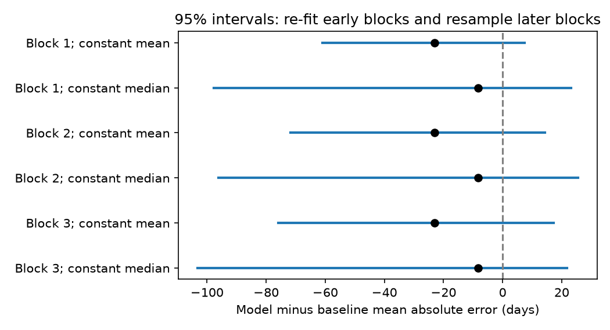

# A size fit gives no clear wait-time gain for 11 later PSR J1341-6220 glitch pairs when fit uncertainty is included

We test whether glitch size helps predict the wait to the next glitch in PSR J1341-6220. The early data show a known positive relation. A size fit has less error on 11 later pairs than a constant wait. But this gain is not clear when uncertainty in the early fit is included. No new glitch, planet, or source is found.

## Scope and prior work

Glitches are sudden increases in pulsar rotation frequency. Transfer of angular momentum from an internal superfluid can cause these events. A stress threshold can link the released amount to the time needed to reach the next threshold. This makes next-event prediction a useful test of models for the stellar interior.

The relation tested here is known. The 2019 study *Autocorrelations in pulsar glitch waiting times and sizes* (doi:10.1093/mnras/stz2014) gives a size-to-next-wait rank correlation of 0.58 for this source. *Glitch time series and size distributions in eight prolific pulsars* (doi:10.1051/0004-6361/201935939) studies missed small events and different event classes. The Lower et al. study (doi:10.1093/mnras/stab2678) adds later events. The present work adds a small, dated prediction test and shows the effect of fit uncertainty and the choice of baseline. It does not claim discovery of the size relation.

A search of the campaign for astronomy, glitch, glitches, and J1341 found no matching publication for this specific prediction test. The saved targeted search responses are in files/. This is a limited search, not proof of novelty.

## Data and pair rule

We reuse the shared Jodrell Bank HTML catalog. The frozen table reports 737 glitches in 226 pulsars. It has 35 events for PSR J1341-6220, with epochs from MJD 47989 to 58214. Its last two events have no size value. The input version, exact shared path, original download record, byte count, and SHA-256 are in files/provenance.json. The file hash is e811419f2037080bd2c99c1db30555dd4ee6f462f36b91796908f0fe90aabeb4. We use no other numerical raw input. We did not change or copy the shared raw data.

The included files/events.csv preserves the 35 source rows and their reference text. A pair consists of a glitch size and the time to the next catalog event. We keep a pair only if its first event has a size. We do not join across events with missing sizes. This gives 33 pairs. Event 33 can be used because event 34 has an epoch, even though its size is absent. Events 34 and 35 cannot start a usable pair. The last observed event has no measured next wait; we do not treat it as a zero wait.

We fit pairs starting at events 1 to 22. The last fit outcome is the wait ending at event 23 (MJD 55088). We test pairs starting at events 23 to 33; their last outcome ends at MJD 58178. There is no shared waiting interval between the fit and test sets. Both sets share the boundary epoch and its measurement error. We perturb each epoch once per trial to preserve this dependence. The split matches the early catalog cohort used in the 2019 correlation work. The split and analysis are retrospective, chosen in this investigation. They were not registered in advance. This is a later-data check, not a test on unseen data selected by another group.

## Method

Let x be the fractional frequency step in units of one millionth and let y be the next wait in days. We fit y = a + b x by ordinary least squares on the 22 early pairs. There are no tuned cut values or fit weights. We compare the fixed fit with the early mean wait, early median wait, and a least-squares size fit through zero. Mean absolute error (MAE) is the main score. Root mean squared error (RMSE) is also reported. All fits use only early outcomes.

We use 20,000 paired resamples of the later set with the early fit held fixed. We also use 10,000 resamples for each of three circular block lengths (1, 2, and 3 pairs). In this second test, we sample early and later blocks separately, re-fit the model, and re-fit each constant baseline. These intervals include uncertainty in the early fit. They assume that the small event sets can represent repeated samples. They are not guaranteed coverage intervals for a nonstationary pulsar. Blocks are short sensitivity tests, not a measured noise model.

We perturb each epoch uniformly within its tabulated error bound. We perturb sizes with a normal draw whose scale equals the tabulated error. We clip negative draws to a small positive floor. The catalog combines sources with different error conventions. These 5,000 trials are a measurement sensitivity check, not a calibrated posterior. The test does not include undetected events.

We also remove pairs with an endpoint error bound above 30 days; remove pairs unless both endpoint sizes are at least 10 in catalog units (10^-9); and remove the last later pair. We remove whole pairs, without joining their neighbours. A separate check re-fits at each later event using only earlier completed pairs. These checks are secondary and retrospective.

## Results

The early Spearman correlation is 0.578 (two-sided p = 0.00481). This reproduces the published early result. The later rank correlation is 0.427 (p = 0.190, 11 pairs). The fitted early relation is y = 287.92 + 50.23 x days. The early mean is 322.68 days and the early median is 278.50 days.

| Fixed early model | Later MAE, days | Later RMSE, days |
| --- | ---: | ---: |
| Intercept plus size | 115.84 | 156.55 |
| Constant mean | 138.86 | 181.52 |
| Constant median | 124.05 | 176.67 |
| Size through zero | 192.76 | 222.10 |

The size fit reduces MAE by 23.02 days against the constant mean, but by only 8.21 days against the constant median. When the early fit is fixed, the paired 95% interval for model minus mean MAE is -34.68 to -8.44 days. Against the median it is -35.38 to +14.10 days. A smaller value means less error.

When both early and later samples are resampled, the block-1 interval is -61.02 to +7.41 days against the mean and -97.66 to +23.20 days against the median. Block lengths 2 and 3 also include zero for both baselines. Thus the apparent gain depends on treating the fitted early relation as known. The early slope interval is also broad: -2.37 to 246.98 days per millionth for block length 1.





Endpoint-error exclusion gives model and mean MAEs of 119.37 and 142.02 days (17 early, 11 later pairs). Requiring both sizes to be at least 10 gives model, mean, and median MAEs of 146.93, 175.14, and 144.38 days (22 early, 8 later pairs). The median is then slightly better than the size model. This cut does not simulate or rule out missing events. Removing one later pair at a time leaves gains of 20.21 to 28.78 days against the mean. Thus one later outcome alone does not cause that gain. Sequential re-fitting gives MAE 114.41 days.

The measurement perturbation gives a gain against the mean of 16.89 to 27.96 days over its central 95% range. The main uncertainty comes from the small samples and fit, not just the tabulated errors. A size-label permutation check gives p about 0.005 against the mean baseline. It assumes exchangeable size labels within each epoch set. It does not include model selection, incomplete detection, or fit uncertainty in the way the block analysis does. We do not use it as a discovery test. Full values and software versions are in files/results.json.

## Physical meaning and artifact limits

The fitted positive slope is consistent with a partial stress-reset picture, but it does not establish that model. A zero-intercept size law would be expected only under restrictive assumptions: one reservoir, fixed accumulation rate, fixed threshold, complete reset, and size proportional to the stress released. That fitted law has higher prediction error here. This finite comparison is not a rejection of superfluid transfer or a general threshold model. A partial release, varying threshold, multiple regions, or missed events can all change the relation.

The catalog is not an observing schedule. It does not show all gaps or detection limits. Early and later measurements come from different studies, which can change sensitivity to small glitches. The endpoint and size cuts test limited effects of catalog errors; they cannot exclude missed events or errors in phase connection. We did not fit pulse arrival times, inspect receiver data, or perform an independent instrument check. The catalog references show the sources of the measurements; the data sets are not independent telescope confirmation.

We searched for later evidence. Shang et al. (2026), doi:10.1051/0004-6361/202661329, reports seven more glitches from Parkes observations in MJD 58222 to 60589. It also reports poor constraints and possible missed small glitches in one interval. The publisher summary was available through web search, but direct page retrieval returned HTTP 403. We did not obtain or use its numerical tables. That work shows that our frozen catalog is not a complete current event list. It does not independently confirm this prediction model. A useful next test would freeze the present fit, audit pulse arrival times and observing gaps, and score a new, complete event sequence against both constant baselines.

## Reproduction and provenance

Job: sci-1107-dell-astronomy-aa2bfb517a84. Topic: astronomy. Campaign: 11_07_2026. Machine: dell. Account: codex-andrii. Model: gpt-6.1-sol, high reasoning effort. The campaign machine key signs this package; this is not a claim of personal authorship.

Run from the extracted publication directory:

```sh
python files/analyze.py
```

This uses only files/events.csv. It writes pairs.csv, results.json, sensitivity.csv, and the two PNG figures under files/. The random seed is 1107. Packages and versions are recorded in results.json. Python 3.12 with NumPy, pandas, SciPy, Matplotlib, and lxml is sufficient. No network or shared data are needed for this offline run. The run takes about one minute on the assigned host. Re-running changes bundle files; verify the original ZIP before reproduction and run in an extracted copy.

To audit the extraction, check the raw SHA-256 against provenance.json, then run:

```sh
python files/analyze.py --raw /mnt/dell-data/shared_datasets/jbo-glitch-table-20261104/gTable.html
```

The immutable raw input is on the shared store. The provenance file gives a helper-based retrieval recipe if that input is absent. The live source can change; only the matching hash gives the exact original HTML. The included source rows allow exact numerical reproduction if the old web snapshot is no longer available. The source catalog is credited to the Jodrell Bank group and its listed measurement papers. The package adds analysis and selected numerical rows, not rights to the original full catalog or papers.
