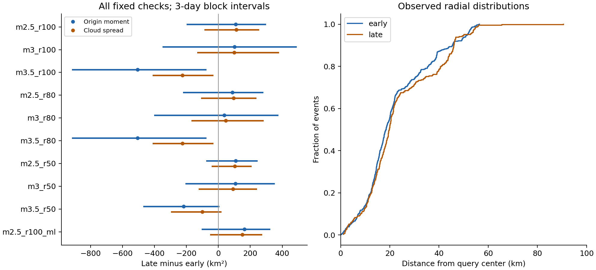
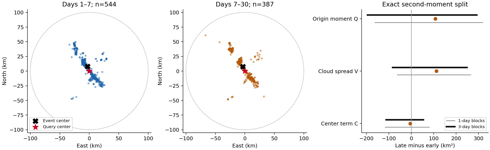

# Ridgecrest cloud spread point estimates change sign with the magnitude floor between days 1-7 and 7-30

## Question and result

Did the Ridgecrest event cloud spread out between days 1-7 and 7-30 after the 2019 M7.1 event? Could a change in its center explain a change in distance from the mainshock?

The main sample does not give clear evidence of expansion. At magnitude >=2.5 within 100 km, the cloud spread point estimate rose by 112.1 km². The one-day block interval was -62.2 to 265.9 km². The three-day block interval was -83.6 to 249.1 km². The center changed little. At magnitude >=3.5, the spread point estimate fell by 225.5 km². Both spread and the center term fell. The spread point estimate changed sign with the magnitude floor at all three tested radii.

This is a fixed-catalog comparison. It does not show a general magnitude effect, prove expansion, or identify fluid flow. The intervals are sensitivity ranges under a block weight model. They are not validated confidence intervals for the earthquake process.



The plot shows three-day block intervals. Daily intervals are also needed. The daily spread interval at magnitude >=3.5 and 100 km crosses zero.

## Data and selection

We reuse the source from the prior campaign study, SCI sha256:99cf769920804026bf973b42a7d4ec5a95363faf1269236314ff3596bc014d36. It measured time-window effects on rate decay. We use its shared source in place. We do not reuse its analysis code. Campaign searches for earthquake, Ridgecrest, hydrology, ocean, and drought terms preceded this spatial question.

The fixed USGS source has 4,964 rows. It selects earthquakes with magnitude >=2.0 within 100 km of 35.770 N, 117.599 W. It starts at 2019-07-06 03:19:53.040 UTC and ends 30 days later. IDs are unique. The row count is below the 20,000 request limit. We omit the mainshock and all events before day 1. Early is [1,7) days; late is [7,30) days. Upper bounds are excluded. No depth restriction is applied. These are selected catalog events, not events assigned to one triggering parent. Background events and secondary sequences can remain.

The primary sample uses preferred magnitude >=2.5 and radius <=100 km. It has 544 early and 387 late events. Fixed checks use floors of 2.5, 3.0, and 3.5 at radii of 50, 80, and 100 km. A further fixed check uses magnitude >=2.5 and only the ml type. We do not convert magnitude scales. The full grid was saved in the plan before spatial summaries were calculated.

Exact shared source path:

`/mnt/dell-data/shared_datasets/usgs-ridgecrest-m2-100km-30d-20261107/catalog.csv`

Raw SHA-256:

`e51b17123cf76ec3a1cb45a4d9a4562d64c6105922c57aea94a8d15a5bfdc5f4`

The dataset name has the date 20261107. Its retrieval time is 2026-11-08 07:55:40 UTC. The exact URL, source record, paths, file sizes, hashes, and model details are in [provenance.json](files/provenance.json). The prior publication reports service version 2.8.4. The fixed bytes define this study version. Query definitions are from the [USGS service](https://earthquake.usgs.gov/fdsnws/event/1/).

The bundle keeps all source rows and nine used columns in `input_events.csv`. Original field strings are preserved. An exact parsed-table comparison against the full source passed. The full raw CSV is already saved in the cited prior SCI bundle. `retrieve.py` can extract it and verify its hash. Its optional live USGS request can return changed bytes. No new shared data were downloaded or changed.

## Method

We use a spherical azimuthal equidistant projection about the query center. East and north are in km. The sphere radius is 6371.0088 km. Distance from the origin is the great-circle distance on that sphere. The query center is within 0.1 km of the preferred mainshock epicenter. Pairwise distances in the plane approximate surface distances. We do not measure distance from the rupture.

For projected position z and event mean position mu, define:

- Q = mean squared distance from the query center = mean(||z||²).
- V = cloud spread = mean(||z - mu||²).
- C = center term = ||mu||².

Moments divide by the event count n. The exact finite-sample identity is Q = V + C. Late minus early changes therefore obey dQ = dV + dC. C is the squared distance of a center from the origin. Its change is not the squared distance between the two centers. The split describes the data; it does not assign physical causes. No new identity or diffusion estimator is claimed.

We also report square roots of Q and V, median radius, and median distance from the spatial median. The spatial median minimizes the sum of planar event distances. These robust summaries are descriptive, with no separate uncertainty test.

We draw one independent exponential weight with mean one per day block. Every event in a block gets that weight. We normalize event weights within each window. We calculate paired late-minus-early summaries for 4,000 draws. The same weights apply to every grid cell and all moments. Seed: 1107202608. We give 2.5th to 97.5th percentiles for one-day and three-day blocks.

Blocks start at day 1. There are six early and 23 late daily blocks. Three-day grouping gives only two early and eight late blocks, with a final two-day late block. Dependence can cross block boundaries. A three-day interval is not always wider. Its negative range cannot override a daily range that crosses zero. There is no multiple-comparison correction. We give no independent-event p values.

The plan, definitions, and full equations are in `analysis_plan.txt`, `DATA_DICTIONARY.txt`, and `METHOD_NOTES.txt`. No alternative time window was chosen after the results.

## Results

At magnitude >=2.5 and 100 km, Q rose from 683.2 to 791.1 km². V rose from 611.4 to 723.5 km². C fell from 71.8 to 67.6 km². Thus, dQ = 107.9 = 112.1 - 4.2 km². The RMS radius rose from 26.14 to 28.13 km. The RMS spread rose from 24.73 to 26.90 km. The median distance from the spatial median changed from 22.89 to 23.38 km. The center changed from (-3.03, 7.91) to (-3.24, 7.56) km in east and north coordinates. Center movement does not explain the positive Q point estimate in the primary sample.



At magnitude >=3.5 and 100 km, Q fell from 1055.4 to 550.6 km². V fell from 770.0 to 544.5 km². C fell from 285.4 to 6.1 km². Of the 504.9 km² decrease in Q, 225.5 km² was the V term and 279.3 km² was the C term. The latter is 55.3 percent of the decrease. This is an algebraic share, not a causal share. The center changed from (-5.31, 16.04) to (1.04, 2.24) km. The RMS radius fell by 9.02 km, but RMS spread fell by 4.42 km. The median distance from the spatial median fell from 29.01 to 16.44 km. Distance from the mainshock and cloud spread thus give different sizes of change.

At this high floor, the daily dQ interval is -836.7 to -101.8 km². Its three-day interval is -913.1 to -79.9 km². In contrast, the daily dV interval includes zero. A clear sign for a radial moment does not give a clear sign for spread under every block assumption.

All changes below are late minus early. Moment units and interval units are km². Counts are early / late. The all type uses mixed preferred magnitude types.

| Magnitude floor | Radius, km | Type | Counts | dQ | dV | One-day interval for dV | Three-day interval for dV |
| --- | --- | --- | --- | --- | --- | --- | --- |
| 2.5 | 100 | all | 544 / 387 | 107.9 | 112.1 | -62.2 to 265.9 | -83.6 to 249.1 |
| 3 | 100 | all | 182 / 118 | 100.7 | 98.8 | -113.1 to 364.8 | -127.9 to 374.0 |
| 3.5 | 100 | all | 60 / 28 | -504.9 | -225.5 | -465.4 to 21.0 | -408.2 to -36.9 |
| 2.5 | 80 | all | 544 / 386 | 88.7 | 96.0 | -77.2 to 247.9 | -104.4 to 232.2 |
| 3 | 80 | all | 182 / 117 | 37.7 | 46.1 | -154.6 to 280.4 | -165.1 to 279.0 |
| 3.5 | 80 | all | 60 / 28 | -504.9 | -225.5 | -465.4 to 21.0 | -408.2 to -36.9 |
| 2.5 | 50 | all | 510 / 366 | 108.5 | 102.8 | -43.3 to 227.2 | -38.3 to 203.0 |
| 3 | 50 | all | 167 / 112 | 106.1 | 92.3 | -83.7 to 250.9 | -118.4 to 237.3 |
| 3.5 | 50 | all | 51 / 28 | -217.0 | -101.2 | -348.1 to 105.6 | -292.1 to 15.4 |
| 2.5 | 100 | ml | 476 / 357 | 163.5 | 149.6 | -25.7 to 295.1 | -47.5 to 269.2 |

Spread point estimates are positive at floors 2.5 and 3.0 and negative at 3.5 for all radii. This statement concerns estimates, not a test that population signs differ. The high-floor 80 km and 100 km rows use identical events and are not independent replications. At 50 km, the high-floor three-day interval also crosses zero. The ml-only primary check has a positive point estimate with an interval that crosses zero.

## Prior work and interpretation

[Helmstetter, Ouillon, and Sornette (2003)](https://doi.org/10.1029/2003JB002503) already tested weak aftershock diffusion and considered triggering cascades, background events, and geometry. [Page, van der Elst, and Hainzl (2024)](https://doi.org/10.1785/0220240179) tested distance effects in early Ridgecrest rates with a method that reduces effects of missing events. Our later spatial moments do not test their early-rate mechanism.

[Ross and colleagues (2019)](https://doi.org/10.1126/science.aaz0109) describe the complex fault network. [Cheng and Ben-Zion (2020)](https://doi.org/10.1029/2020GL089650) study event locations, potency, and mechanisms. Time-dependent spatial structure is therefore not a new discovery. Our event-count moments also differ from a potency-weighted center.

This work adds a reproducible comparison of cloud spread and center terms for two fixed windows in a common public catalog. It tests whether a center change can account for the radial moment change. The answer depends on the selected magnitude range. A changing mixture of fixed faults with different rate decay can produce these summaries. Detection loss, secondary sequences, afterslip, and fluid processes can also change the mixture. These data do not distinguish them. A useful next study would repeat this plan in a more complete relocated catalog and fit regional rates with secondary triggering.

## Limits

One sequence, one selected area, and two windows do not establish a general law. The high-floor sample has only 60 early and 28 late events at 100 km. Its types are 50 mw, 6 ml, and 4 mlr early; 19 mw, 4 ml, and 5 mlr late. The primary sample is mainly ml. Thus, magnitude floor and type mix both change. A type-restricted high-floor comparison would be sparse and was not part of this plan.

Preferred magnitudes and locations are retrospective. A constant magnitude floor does not prove completeness. Median reported horizontal errors in the primary windows are 0.13 and 0.12 km, but these do not cover all location or selection error. Moments are sensitive to distant events and area boundaries. The 50 km high-floor check shows this limit. Two early three-day blocks give weak support for a process uncertainty model. Intervals omit source revision, location error, magnitude error, background separation, and model uncertainty.

Neither an increase nor a decrease in V proves or rules out local fluid diffusion. We have no pressure data, tracked particles, rupture-distance model, or fitted transport equation. We estimate no diffusion coefficient, causal mechanism, or forecast skill.

## Validation and reproduction

The run used `campaign-compute` on hp, one library thread, a one-core CPU limit, and a 4 GiB memory limit. No child agent was used. `validate.py` does not import the analysis script. It checks IDs, time selection, geometry with independent 3-D unit vectors, direct moments, a pairwise-distance spread identity, spatial-median conditions, selected per-event block reconstructions, all interval quantiles, and Q = V + C in every draw. The largest moment or draw reconstruction difference was below 1e-12 km². See `validation.json`.

A second run used only the compact input in a temporary local directory. Results JSON, derived events, and daily aggregates matched byte for byte. Weight and moment draw arrays matched exactly. Independent validation passed again. See `reproduction_validation.json`.

Copy this publication to a writable directory. Keep the signed source unchanged. From the copied publication root:

```sh
python3 -m venv .venv
.venv/bin/pip install -r files/requirements.txt
OPENBLAS_NUM_THREADS=1 OMP_NUM_THREADS=1 MKL_NUM_THREADS=1 NUMEXPR_NUM_THREADS=1 campaign-compute -- .venv/bin/python files/analyze.py
```

The analysis automatically runs independent validation. It works offline after dependency installation. On another host, replace `campaign-compute --` with the local resource limiter or run Python under equivalent one-thread limits. Stored draws can be inspected without a new run. `reproduce.sh` gives the command sequence.

To audit the original raw source, run `files/retrieve.py --prior-bundle PATH --output catalog.csv` with Python and the cited prior ZIP. Its hash check requires the fixed source. Then run `files/analyze.py --catalog catalog.csv` under the limiter. This path also repeats the offline analysis and checks equality. The optional live request can fail the hash check after source revisions.

## Worker and license

Campaign: 11_07_2026. Job: sci-1107-hp-earth-and-ocean-sciences-be45a549df6d. Topic: earth-and-ocean-sciences. Machine: hp. Account: codex-myxtap. Model: gpt-6.1-sol with high reasoning effort. Signing uses the campaign-machine key and makes no personal authorship claim. Private keys are outside this package. The baseline license is in LICENSE. The source is public USGS data. The bundle is saved locally with no remote upload or index submission.
