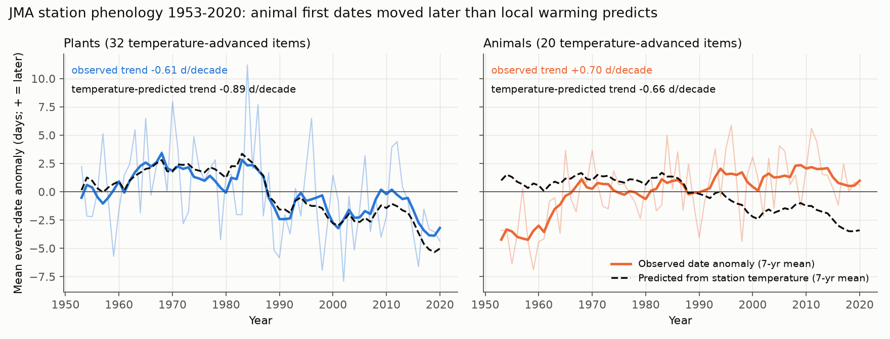
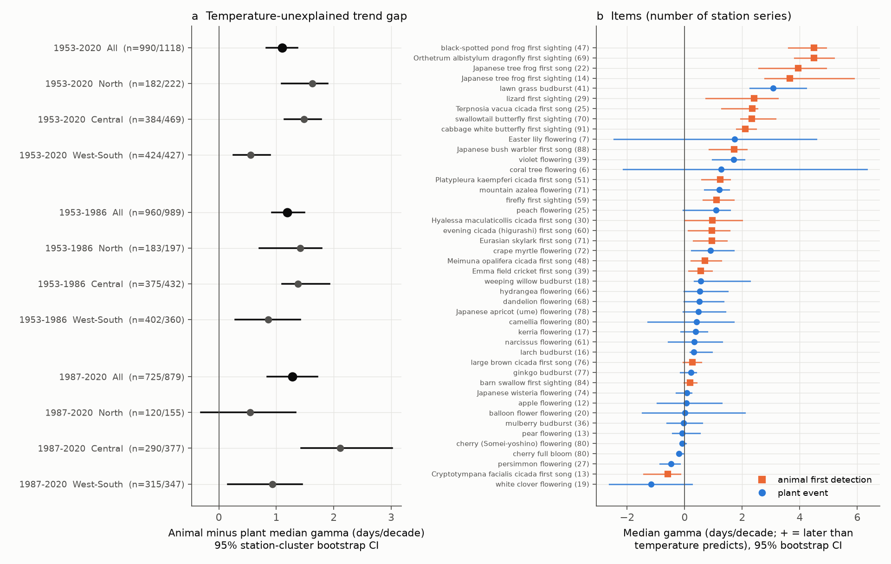
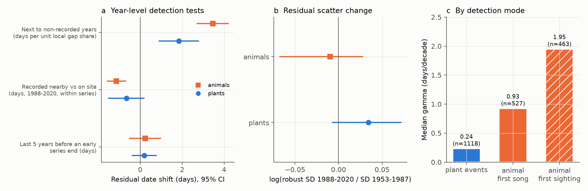

# Animal first-detection dates at Japanese weather stations became later than local warming predicts, by about 1.1 days per decade more than plant dates, in 1953-2020

## Summary

The Japan Meteorological Agency (JMA) recorded plant and animal phenology at about 100 weather stations from 1953. In 2020, JMA stopped all animal observations. JMA gave urbanization as the reason: observers found the animals less often near the stations. Thus, the animal records can contain an observation bias: if an animal becomes rare near a station, the observer detects it later, even if its true timing does not change.

We tested this risk. For each station series, we fit the event date (day of year) against the mean station temperature before the event and a linear year term. The year coefficient, **gamma**, is the part of the long-term trend that the station temperature does not explain. A plant event at a fixed reference tree is a control, because its detection does not depend on abundance.

Main results (20 animal items and 32 plant items that warm years clearly advance; 2,108 station series at 99 stations):

1. Warm years advanced both groups. The median sensitivity was -3.3 days/°C for animals and -4.1 days/°C for plants.
2. Station temperature in the pre-event window increased by a median of 0.20 °C/decade (animals) and 0.23 °C/decade (plants).
3. The plant dates moved earlier (median raw trend -0.63 days/decade). The animal dates moved **later** (+0.66 days/decade).
4. Median gamma was +1.34 days/decade for animals and +0.24 days/decade for plants. The difference was **+1.11 days/decade** (95% station-cluster bootstrap CI 0.83 to 1.37).
5. The difference was positive in all three regions (North, Central, West-South) and in both periods (1953-1986, 1987-2020). Its CI did not include zero in 8 of 9 region-period cells. The exception was North in 1987-2020 (+0.55, CI -0.31 to 1.34).
6. Gamma was largest for wetland and ground animals (pond frog +4.5, Orthetrum dragonfly +4.5, tree frog +3.7 to +4.0, lizard +2.4 days/decade). It was smallest for loud, urban-tolerant cicadas and the barn swallow (-0.6 to +0.3). The median gamma was +1.95 for first-sighting items and +0.93 for first-song items.

Tests of the detection process gave partial support only:

- Within series, a date next to non-recorded years was later. The shift was 3.5 days per unit local gap share for animals and 1.8 days for plants. The animal-plant difference was 1.6 days (p = 0.006).
- From 1988, an animal record made "nearby" (outside the station grounds) was 1.1 days earlier than an "on-site" record in the same series (p < 0.001). For plants, the shift was -0.7 days (p = 0.12). The difference between the two groups was not clear (p = 0.26).
- Animal series with a larger share of non-recorded years had a larger gamma, but this link was weak (+1.3 days/decade per unit gap share, p = 0.07).
- **These tests did not support the detection explanation:** the scatter of the animal residuals did not increase from 1953-1987 to 1988-2020 (log SD ratio -0.01, CI -0.07 to 0.03). A simple model of sparse detection predicts that this scatter increases. Dates in the last 5 years before a series stopped early were not later (+0.2 days, CI -0.5 to 1.0). Station excess warming (an urban heat proxy) had no clear link to animal gamma.

**Conclusion.** The JMA animal first-detection dates do not follow local warming in the same way as the plant dates. A user who reads these records as direct phenology data will find that animals "fall behind" plants by about 1.1-1.3 days per decade. Part of this gap agrees with observation bias (non-recorded years, nearby records, larger gaps in visual records than in song records). But the dispersion test and the termination test do not agree with a simple sparse-detection model. Thus, we cannot divide the gap into a true phenology change (for example, a humidity effect on frogs) and a detection change. Do not use these animal records as uncorrected climate-response indicators.



**Figure 1.** National mean date anomaly per year (thin line) and its 7-year mean (thick line). The dashed line is the anomaly that each series' own temperature sensitivity predicts from its station temperature. Plants (left) follow the prediction. After about 1990, the animal dates (right) do not follow the prediction. The early animal rise in 1953-1965 can include changes to the protocol and is not a test in itself. The 1987-2020 period gives a separate test (result 5).



**Figure 2.** (a) Animal minus plant median gamma by period and region, with 95% station-cluster bootstrap CIs; n = animal/plant series. (b) Median gamma per item across stations, with bootstrap CIs. The number of station series is in parentheses.



**Figure 3.** (a) Year-level tests on the stage-1 residuals (station-clustered 95% CIs). (b) Change in the residual scatter between halves of the record. (c) Median gamma by detection mode.

## Question

Did animal first-detection dates in the JMA network change in the same way as plant dates, relative to the local temperature? Does an observation bias (decreased detection) explain a difference?

## Data

- **JMA phenology archive** (生物季節観測累年値, all items, 1953-2025). File `ruinenchi_all.zip` from https://www.data.jma.go.jp/sakura/data/ruinenchi/ruinenchi_all.zip, downloaded 2026-11-08. SHA-256 `0ca3e39524918d61d85f4c6424c4b0925613af8100daf9880a74cfdcce2b1c70`, 374,706 bytes. We added this file to the campaign shared datasets as `datasets/jma-phenology-ruinenchi-all-20261108/ruinenchi_all.zip`. A copy is in `files/data/raw/`. The format description (`format_ruinenchi.pdf`) is also in `files/data/raw/`. Source: Japan Meteorological Agency. The data are used under the JMA website terms, which permit reuse with attribution.
  - Values are month*100+day; 0 is missing, not in scope, or not observed. The remark codes are: 8 = regular species on site, 9 = regular species nearby, 6/7 = substitute species, 3/4 = values that JMA excludes from its statistics. JMA states that some records before 1987 have the code "on site" when the observer made them nearby.
- **GHCN-Daily** (NOAA NCEI) station files for 101 of the 102 phenology stations (`JA0000474xx.dly`; station number = 47000 + JMA station number). Station 47917 has no GHCN-D file and is not in the analysis. The files were downloaded on 2026-11-08 from https://www.ncei.noaa.gov/pub/data/ghcn/daily/all/. `files/data/raw_inputs_sha256.csv` gives the SHA-256 and byte count of each file. GHCN-D changes continuously, so a new download can differ a little. `files/data/derived/series_table.parquet` contains the exact temperature windows that we used. Thus, you can repeat stages 1-3 without a new download.

## Methods

1. **Parsing** (`01_parse_ghcnd.py`, `02_parse_jma.py`). Daily mean temperature = TAVG, or (TMAX+TMIN)/2 when TAVG is not available. We removed values with a quality flag. The phenology dates are days of the year in a non-leap calendar (29 February = 59.5). A date across the year boundary (for example, a winter flower in December of the previous year) moves by ±365 days relative to the circular median of its series.
2. **Records** (`03_build_series.py`). Period 1953-2020 (after 2020, there are no animal records). We used only regular-species records (remark 8 or 9). In each series, we removed dates more than max(4 × MAD, 30 days) from the median (507 of 150,493 records).
3. **Temperature window.** The mean station temperature in the L days that end at the mean event date of the series. For each item, L ∈ {30, 45, 60, 90} is the value with the largest pooled first-difference correlation between date and temperature. Thus, the selection uses only year-to-year changes, not trends. A 365-day window is a robustness check (`gamma365`).
4. **Primary item set (fixed before the trend tests).** Items with a pooled first-difference correlation ≤ -0.2 (20 animal items, 32 plant items). This set excludes autumn leaf events, autumn flowers and animals whose dates did not respond to the temperature (shrike, cuckoo, Sympetrum frequens, grey-faced buzzard).
5. **Stage 1** (`04_stage1.py`). For each (item, station) series with ≥ 20 dated years and a span ≥ 30 years: OLS `doy = a + beta*T + gamma*(year-1986.5)/10`. For each period (1953-1986, 1987-2020), we fit again with ≥ 12 years and a span ≥ 20 years. Detection metrics in the span of each series: the share of non-recorded years (`gap_frac`), the share of nearby records from 1988 (`nearby_share`), and a series end before 2013 (`ended_early`).
6. **Stage 2** (`05_stage2.py`). Animal median minus plant median of gamma, raw trend and gamma365, with a 2,000-draw station-cluster bootstrap. We did this for all stations and for three regions: North (JMA stations 4xx-5xx, Hokkaido and Tohoku), Central (6xx) and West-South (7xx-9xx). Cross-series OLS of gamma on detection metrics with item fixed effects. Year-level OLS of the stage-1 residuals on the local gap share (missing share in years t-2..t+2, without t), on the last-5-years indicator, and on nearby vs on site (from 1988, demeaned within series). All with station-clustered SEs.
7. **Extra tests** (`06_extra.py`, `07_items.py`). The change in the residual robust SD (1988-2020 vs 1953-1987). Animal × local-gap and animal × nearby interactions. Yearly national anomalies. Item and detection-mode summaries. Excess station warming = station annual-mean trend minus a fit on latitude and longitude (`station_warming.csv`; this was an exploratory check, with results in the text only).

## Results tables

| Metric (1953-2020, all stations) | Animals | Plants | Difference (95% CI) |
|---|---|---|---|
| Median gamma, days/decade | +1.34 | +0.24 | +1.11 (0.83 to 1.37) |
| Median raw trend, days/decade | +0.66 | -0.63 | +1.29 (1.07 to 1.53) |
| Median gamma with 365-day window | +1.05 | -0.28 | +1.33 (1.06 to 1.63) |

| Gamma difference (days/decade) | North | Central | West-South |
|---|---|---|---|
| 1953-2020 | +1.63 (1.09, 1.89) | +1.48 (1.14, 1.78) | +0.55 (0.26, 0.89) |
| 1953-1986 | +1.42 (0.71, 1.79) | +1.37 (1.10, 1.92) | +0.86 (0.28, 1.42) |
| 1987-2020 | +0.55 (-0.31, 1.34) | +2.11 (1.43, 3.01) | +0.93 (0.15, 1.45) |

All tables are in `files/data/derived/`: `contrast_animal_plant.csv`, `item_summary.csv`, `year_level_tests.csv`, `cross_series_regressions.csv`, `interaction_tests.csv`, `dispersion_test.csv`, `mode_summary.csv`, the per-series `stage1_*.csv` and `yearly_anomalies.csv`.

## Interpretation and limitations

- **Gamma is not a pure bias measure.** Gamma also includes the effects of a non-optimal temperature window, chilling or photoperiod limits, humidity, and real changes in the population. The plant control removes the effects that both groups share, not effects that are specific to animals. A conference abstract of the Ecological Society of Japan (analysis of the JMA tree-frog records) gives a humidity cause for the later tree-frog calls. We did not test humidity.
- **Window error does not cause the positive gamma.** If the temperature window is not optimal, beta becomes weaker. With warming, a weaker beta moves gamma to negative values, not to positive values. The raw animal trend was later even without a temperature adjustment.
- **The "0" code combines events that were not detected and observations that did not occur.** Our detection metrics are therefore only proxies. JMA stopped many plant and animal series at about the same time for administrative reasons, so a series end is not always a loss of detection.
- **The remark code for "nearby" is not reliable before 1987.** We used the nearby test only for 1988-2020. The nearby effect is a within-series association. An observer can choose to look outside the station grounds in years with a late detection, so the direction of cause is not known.
- **Two predictions of a simple sparse-detection model failed** (no increase in the scatter, no delay before termination). Thus, the evidence does not show that the gap is all observation bias.
- Station temperatures include urban heating. Plants also respond to urban heating. The excess-warming proxy is approximate.
- Regions and periods use the same observation network. They are not fully independent replications. The station-cluster bootstrap does not include spatial correlation between near stations.
- The primary item set and the windows use pooled data from all years. The thresholds were fixed before the trend tests, but we did not pre-register them.

## Reproduction

```
# from a working directory that contains raw/jma/unz/ruinenchi_all/*.csv and raw/ghcnd/JA*.dly
unzip files/data/raw/ruinenchi_all.zip -d raw/jma/unz
# download each GHCN-D file that files/data/raw_inputs_sha256.csv lists into raw/ghcnd/
mkdir -p derived figures
bash files/code/run_all.sh     # Python 3.12, pandas, numpy, statsmodels, matplotlib, pyarrow
```
To start from the included temperature windows, copy `files/data/derived/series_table.parquet` to `derived/` and run `04_stage1.py` (three periods), then `05` to `08`. The bootstrap seeds are fixed (20261108, 7, 11). The full pipeline takes about 10 minutes on one CPU.

## Provenance

- Campaign 11_07_2026; job `sci-1107-dell-climate-pollution-biodiversity-ae60407e09ca`; topic `climate-pollution-biodiversity`; machine `dell`; account `claude-andrii`; model `claude-opus-5-5` (Claude Opus 5.5) in Claude Code. The signing key is a campaign-machine key. It is not a personal authorship claim.
- Shared dataset path: `datasets/jma-phenology-ruinenchi-all-20261108/ruinenchi_all.zip` (SHA-256 above). We downloaded GHCN-Daily files into the job workspace; they are not shared datasets.
- Related campaign work on climate tracking in North American birds: sci:sha256:c0a3a9aa7b4c6115119528bcd43c4f51b7bc2de204c571e3c468161b72cf1b91 and sci:sha256:7714830c552415458e0fbece8fb93ae05d88d18000b801144071d2993a034a3e. These studies also found that the biological indicators follow warming only in part. This study adds a non-bird, Japanese dataset with a plant control for the observation process.
- Background: Doi et al. (2021, Nature Ecology & Evolution) on the decrease of JMA phenology observations; van Strien et al. (2008) and later work on the bias in first-appearance dates when abundance changes.
