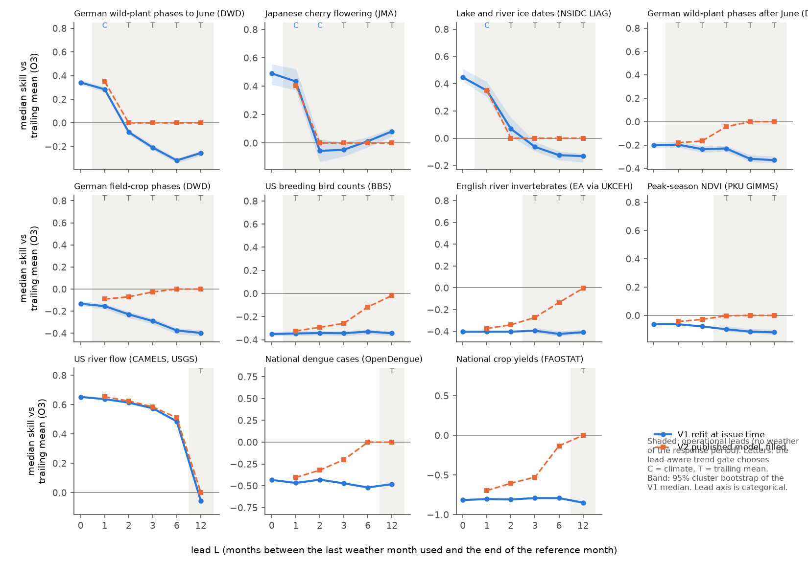
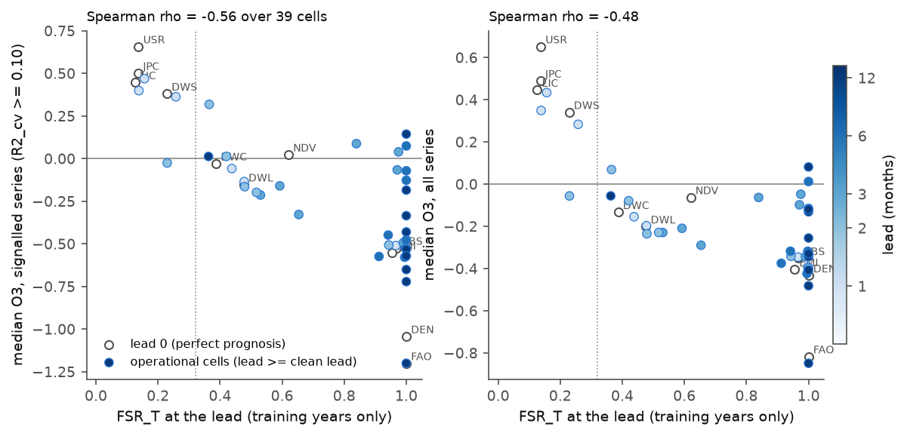
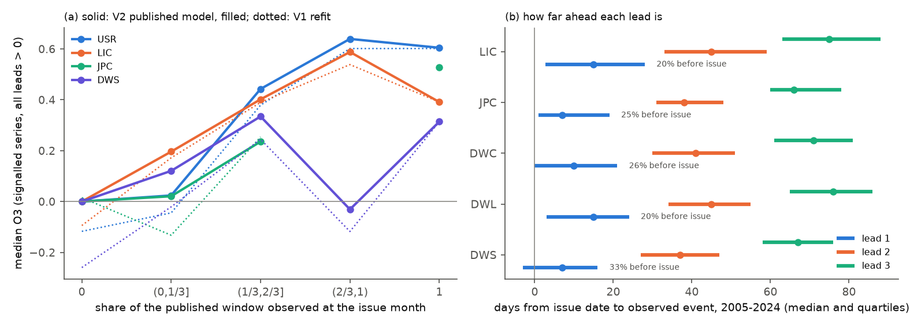

# Climate-response models in 11 families kept little skill over a trailing mean with only weather known at the forecast date (26,103 series, 2005-2024); a lead-aware false-signal rate showed this

Job `sci-1107-dell-climate-pollution-biodiversity-e5597bbda534`, campaign 11_07_2026, topic climate-pollution-biodiversity, machine dell, account claude-myxtap, model Claude Opus 5.5 (`claude-opus-5-5`). Date 2026-11-11. The signing key is a campaign-machine key. It is not a personal authorship claim.

## Summary

Earlier forward tests in this campaign scored climate-response models with the **observed weather of the target year** (sci:sha256:7b03c5d9, sci:sha256:8804b69f, sci:sha256:6081bf76). This is "perfect prognosis". It gives an upper limit. A forecaster must issue the forecast before the weather of the response period is known. An audit found that few published timing models had complete inputs three months before their reference month (sci:sha256:d71d00b6), but nobody refitted the models with issue-time weather.

We did this test. We rebuilt all 11 families of the two latest studies with their unchanged code (26,103 series; the rebuild reproduced every published per-series result and false-signal rate). We froze and timestamped a plan. Then we refitted the same engine at six leads (L = 0, 1, 2, 3, 6, 12 months; at lead L the last weather month used ends L months before the end of the series' reference month). We scored three issue-time climate forecasts against a 5-year trailing mean in 2005-2024: V1 (window selected again from issue-time windows), V2 (the published lead-0 model with the unobserved months replaced by their 5-year trailing climatology) and SW (the published model only if its window is complete).

Main results:

1. **Issue-time skill was short-lived.** The four families with strong perfect-prognosis skill (US river flow, lake and river ice, Japanese cherry flowering, German spring plant phases; median gain 0.34-0.65 over the trailing mean at lead 0) kept 78-102% of it at lead 1 (V1 or V2). At lead 2 the gain fell to 0.07 (ice) and to 0 or below (cherry, spring plants). Annual river flow kept skill to lead 6 only because its window then still covers half of the target year; a forecast issued before the year started (lead 12) had no gain (V1 median -0.055, 95% interval -0.079 to -0.036).
2. **"Lead 1" is barely a forecast.** In test years, lead 1 was a median of 7-15 days before the observed event, and in 20-33% of series-years the event had already occurred at the issue date (exploratory E3). Lead 2 was the first lead with nearly all events after the issue date (median 37-45 days ahead). With this strict clean lead, climate terms raised the family median skill by more than 0.01 in only 5 of 33 operational cells (largest: lake ice at lead 2, +0.12 with V1), and no decision rule beat the trailing mean for all series (lead-aware gate minus trailing mean -0.0015, interval -0.0026 to 0.0008).
3. **The training-only false-signal rate followed the loss (H2 and H3 passed).** The trend-preserving false-signal rate FSR_T computed with issue-time windows rose with lead in all timing and ice families (for example spring plants 0.23, 0.26, 0.42, 0.59, 0.94, 1.00). Across the 39 pre-registered operational cells it ordered the forward skill of signalled series (Spearman rho -0.56, permutation p = 0.0001). The lead-aware gate chose the better of climate and trailing mean in 34 of 39 cells (87%); the class rule did so in 20 (51%).
4. **A lead-aware gate beat a lead-blind gate with the same refitted model (H1 passed) and the class rule (H1b passed), but not the filled published model (H1c failed).** Pooled skill: lead-aware gate minus lead-blind gate +0.016 (95% interval 0.011 to 0.024; 12 cells with different decisions); minus class rule with V2 +0.011 (0.006 to 0.017); minus lead-blind gate with V2 -0.005 (-0.009 to -0.001).
5. **Keeping the published model and filling missing months with trailing climatology was better than refitting (H4).** In the 30 event-family cells, V2 beat V1 by 0.078 (0.071 to 0.086). When the whole window is unobserved, V2 is exactly the trailing mean, so it cannot lose. Its gain grew with the observed share of the window (median 0, 0.09, 0.36 and 0.56 for none, up to 1/3, 1/3-2/3 and more than 2/3 observed; exploratory E2). Thus the fill acts as a built-in gate, and this explains why H1c failed.



*Figure 1. Median gain over the 5-year trailing mean (O3) by lead for each family. Blue: V1 (window selected again from issue-time windows; band: 95% cluster bootstrap). Orange: V2 (published lead-0 model, unobserved months filled with the 5-year trailing climatology). Shaded: pre-registered operational leads (no weather from the response period). Letters: decision of the lead-aware trend gate (C climate, T trailing mean).*

## Question

Which climate-response relations are **operationally** forecastable, that is, with only the weather that is known when the forecast is issued? And can a forecaster find this from training years alone?

## Design (frozen before any lead > 0 computation)

- Plan: `files/plan/frozen_plan.md`, SHA-256 `44bc5467e975570e2d83be46010eb891b80cc4b72521dfa1dc79b0c1a05ae4c7`, FreeTSA RFC 3161 timestamp 2026-11-11 17:48:08 UTC (`frozen_plan.tsq`, `frozen_plan.tsr`). Verify: download `https://freetsa.org/files/cacert.pem` and `https://freetsa.org/files/tsa.crt`, then `openssl ts -verify -data files/plan/frozen_plan.md -in files/plan/frozen_plan.tsr -CAfile cacert.pem -untrusted tsa.crt`.
- Before the freeze we only rebuilt the families, ran the unchanged lead-0 engine and nulls (these results are already published) and unit-checked the new scripts on synthetic data. The plan lists the SHA-256 of every analysis script. All are unchanged in this bundle except `s20_tests.py` (see Deviations; the frozen copy is `files/plan/s20_tests_frozen.py`).

**Families (unchanged builders and series selection of sci:sha256:8804b69f and sci:sha256:6081bf76).**

| Family | Class | Series | Response | Reference month | Clean lead L_c |
|---|---|---|---|---|---|
| USR US river flow (CAMELS gauges, USGS) | abiotic | 652 | log calendar-year runoff | 12 | 12 |
| LIC Lake and river ice (NSIDC LIAG) | abiotic | 183 | ice-off / ice-on date | month of training median date | 1 |
| JPC Japanese cherry (JMA) | timing | 115 | flowering / full bloom date | same | 1 |
| DWS German wild-plant phases to June (DWD) | timing | 2,510 | phase date | same | 1 |
| DWL German wild-plant phases after June (DWD) | timing | 2,127 | phase date | same | 1 |
| DWC German field-crop phases (DWD) | timing | 3,176 | phase date | same | 1 |
| BBS US breeding bird counts | population | 11,790 | log(1 + count) | 6 | 1 |
| EMI English river invertebrates (EA via UKCEH) | population | 3,462 | seasonal mean abundance class | 5 or 11 | 3 |
| NDV Peak-season NDVI (PKU GIMMS) | production | 1,500 | mean NDVI of the 3 peak months | last peak month | 3 |
| DEN National dengue cases (OpenDengue) | disease | 72 | log(1 + annual cases) | 12 | 12 |
| FAO National crop yields (FAOSTAT) | production | 516 | log yield | 12 | 12 |

**Engine.** The unchanged functions of `p04_forecast.py`: 120 candidate windows (monthly mean temperature or precipitation over 1, 2, 3, 6 or 12 months), the window with the highest training R2 (years up to 2004) is selected, R2_cv is leave-one-year-out with reselection, and test forecasts (2005 to the last year) use a frozen slope with the level of the 5 previous observed years (M2). The only change at lead L is the candidate set: windows end in months ref-L-11 to ref-L instead of ref-11 to ref (`p14_lead.py`). At L = 0 the new code gives identical results to the published engine.

**Forecasts.** R2 trailing 5-year mean; V1 = M2 at lead L (V1 = R2 if fewer than 15 complete training years: 25 DWD series at lead 12, at most 5 at other leads); V2 = published lead-0 model, each window month after the issue month replaced by the mean of the same calendar month in the 5 previous years; SW = published model if its window is complete at the issue month, else R2. O3 = 1 - MSE(forecast)/MSE(R2). Skill against the training mean R1 uses the lead-0 R1.

**Nulls and rules.** At each lead, the circular-shift null and the trend-preserving null (sci:sha256:6081bf76) repeat the window search and LOO-CV on shifted training climate (max(2, ceil(4000/n)) draws per series). FSR and FSR_T = null share / observed share of R2_cv >= 0.10. Lead-aware gate: V1 for all series if FSR_T(L) <= 0.32, else R2. Lead-blind gate: the same decision from FSR_T(0). Class rule: climate for abiotic and timing families. The threshold 0.32 is frozen from sci:sha256:6081bf76.

**Scoring.** Pooled score = mean over the 39 operational cells (family, lead >= L_c) of the family median skill against R1. Intervals: 1,000 cluster-bootstrap draws (sites, stations, routes, countries; NDVI 10-degree tiles), with the same draw for all leads of a family.

## Results of the pre-registered tests

Full output: `files/results/prereg_tests.json`, `family_lead_table.csv`, `pooled_scores.csv`, `decision_accuracy.csv`, `cell_O3_intervals.csv`, `retention_clean_lead.csv`.

| Test | Frozen criterion | Result | Decision |
|---|---|---|---|
| H1 lead-aware vs lead-blind gate (both V1) | pooled difference, 95% interval > 0, at least one different decision | +0.0163 [0.0105, 0.0241]; 12 cells differ | **Passed** |
| H1b lead-aware gate vs class rule with V2 | interval > 0 | +0.0109 [0.0060, 0.0165] | **Passed** |
| H1c lead-aware gate vs lead-blind gate with V2 | interval > 0 | -0.0051 [-0.0091, -0.0006] | **Failed** (the opposite direction) |
| H2 FSR_T(L) orders cells | rho <= -0.5 and permutation p < 0.05 (39 cells) | rho -0.558, p = 0.0001 | **Passed** |
| H2 secondary | all-series O3; within event families rho <= 0 in >= 5 of 6 | rho -0.479 (p = 0.001); 5 of 6 (DWS -0.94, DWL -0.89, DWC -1.00, LIC -0.99, JPC -0.46; BBS +0.32) | Passed |
| H3 decision accuracy | lead-aware gate right in >= 80% of cells and in more cells than Class_V1 | 87% (34/39) vs 51% (20/39) | **Passed** |
| H4 V1 vs V2 (two-sided) | report; difference if interval excludes 0 | V1 - V2 = -0.0776 [-0.0863, -0.0706] | **V2 better** |
| H5 decay in DWS, LIC, JPC | best O3 at L = 2 < half of O3 at L = 0 in >= 2 of 3 | 0.00 vs 0.34; 0.07 vs 0.45; 0.00 vs 0.49 (3 of 3) | **Passed** |
| H6 river memory | USR L = 12 median O3 of V1 > 0 with interval > 0 | -0.055 [-0.079, -0.036] | **Failed** |

Pooled scores over the 39 operational cells: lead-blind gate with V2 0.318, series rule qT at lead 0.315, lead-aware gate (trend null) 0.313, lead-aware gate (circular null) 0.310, class rule with V2 0.302, lead-blind gate with V1 0.297, trailing mean for all 0.294, V2 for all 0.269, SW 0.258, class rule with V1 0.250, V1 for all 0.186.



*Figure 2. Trend-preserving false-signal rate at the lead (training years only) against the forward gain over the trailing mean of signalled series (left) and of all series (right). Open circles: lead 0 (perfect prognosis). Filled: operational cells, colour by lead. Dotted line: gate threshold 0.32.*


*Figure 3. Pooled score of fixed strategies and decision rules over the 39 operational cells.*

### Median O3 by lead (V1 / V2) and FSR_T

| Family | L0 | L1 | L2 | L3 | L6 | L12 | FSR_T at L0 ... L12 |
|---|---|---|---|---|---|---|---|
| USR | 0.65 | 0.64 / 0.65 | 0.61 / 0.62 | 0.58 / 0.58 | 0.49 / 0.51 | -0.06 / 0.00 | 0.14 0.13 0.13 0.13 0.14 0.36 |
| LIC | 0.45 | 0.35 / 0.35 | 0.07 / 0.00 | -0.06 / 0.00 | -0.12 / 0.00 | -0.13 / 0.00 | 0.13 0.14 0.37 0.84 1.00 1.00 |
| JPC | 0.49 | 0.43 / 0.40 | -0.06 / 0.00 | -0.05 / 0.00 | 0.01 / 0.00 | 0.08 / 0.00 | 0.14 0.16 0.23 0.98 1.00 1.00 |
| DWS | 0.34 | 0.28 / 0.35 | -0.08 / 0.00 | -0.21 / 0.00 | -0.32 / 0.00 | -0.26 / 0.00 | 0.23 0.26 0.42 0.59 0.94 1.00 |
| DWL | -0.20 | -0.20 / -0.18 | -0.24 / -0.17 | -0.23 / -0.04 | -0.32 / 0.00 | -0.33 / 0.00 | 0.48 0.48 0.48 0.53 1.00 1.00 |
| DWC | -0.13 | -0.15 / -0.09 | -0.23 / -0.07 | -0.29 / -0.03 | -0.37 / 0.00 | -0.40 / 0.00 | 0.39 0.44 0.52 0.65 0.91 1.00 |
| BBS | -0.35 | -0.35 / -0.32 | -0.34 / -0.29 | -0.34 / -0.26 | -0.33 / -0.12 | -0.34 / -0.02 | 0.97 0.97 0.94 0.99 1.00 1.00 |
| EMI | -0.40 | -0.40 / -0.37 | -0.40 / -0.34 | -0.39 / -0.27 | -0.42 / -0.13 | -0.41 / 0.00 | 0.95 0.98 0.95 1.00 0.99 1.00 |
| NDV | -0.06 | -0.06 / -0.04 | -0.08 / -0.03 | -0.10 / 0.00 | -0.11 / 0.00 | -0.12 / 0.00 | 0.62 0.69 0.75 0.97 1.00 1.00 |
| DEN | -0.43 | -0.47 / -0.40 | -0.43 / -0.32 | -0.47 / -0.20 | -0.52 / 0.00 | -0.48 / 0.00 | 1.00 0.89 0.98 0.97 0.86 1.00 |
| FAO | -0.82 | -0.80 / -0.70 | -0.81 / -0.60 | -0.79 / -0.53 | -0.79 / -0.13 | -0.85 / 0.00 | 1.00 0.96 0.99 1.00 1.00 1.00 |

A V2 value of exactly 0.00 means that the published window is completely unobserved at that lead in most series; V2 is then the trailing mean.

### What the results show

- **Where the climate signal is strong, it lives in the last weeks.** Spring plant phases, cherry flowering and ice dates respond to temperature in the weeks just before the event. At lead 1 the window can still end in the month before the event, and most of the skill stays. One month earlier the selected windows end before the relevant warming, R2_cv falls (spring plants: median 0.40, 0.29, 0.06, -0.05 at leads 0-3) and the forward gain disappears.
- **Annual river flow is different but not forecastable before the year.** Precipitation in the first half of the year carries most of the skill (lead 6: 0.49). Previous-year precipitation added nothing over a trailing mean of flow (lead 12), and the lead-aware FSR_T rose to 0.36, just above the gate threshold, so the gate correctly closed.
- **Weak-signal families stayed weak.** BBS, EMI, NDVI, dengue and crop yields lost against the trailing mean at every lead with V1. Their FSR_T was 0.62-1.00 at all leads.
- **Where the gate was wrong.** The lead-aware gate made 5 wrong choices in 39 cells, all in the two smallest families: ice at leads 2 and 3 (gate closed, but V1 was better than the trailing mean by 0.12 and 0.04 in family median skill against R1), cherry at lead 2 (gate open, but the trailing mean was better by 0.05) and cherry at leads 6 and 12 (gate closed, V1 better by 0.01 and 0.04). Cherry at lead 12 had a median O3 of 0.08 (0.04 to 0.11) with FSR_T = 1.00: previous-year weather predicted next-year flowering better than the trailing mean in this test, but the training signal was not above chance. We do not interpret this one cell.

## Exploratory results (defined after the pre-registered results)

Code: `files/code/s22_exploratory.py`; output: `files/results/exploratory.json`, `e2_*.csv`, `e3_lead_days.csv`.

- **E1, combined rules.** The lead-aware gate with V2 as the climate forecast scored 0.314; the lead-blind gate with V2 0.318 (difference -0.004, -0.008 to -0.001). Because V2 already shrinks toward the trailing mean when inputs are missing, a lead-aware decision adds little to it.
- **E2, dose-response of the fill.** For signalled series of USR, LIC, JPC and DWS at leads > 0, the median O3 of V2 was 0.00, 0.09, 0.36, 0.56 and 0.52 when none, up to 1/3, 1/3-2/3, more than 2/3 and all of the published window was observed (V1: -0.22, -0.03, 0.28, 0.54, 0.52). V1 lost most where the published window was completely unobserved: there the refit must use a different, weaker window, while V2 falls back to the trailing mean.
- **E3, lead in days.** From the issue date (end of month ref-L) to the observed event in 2005-2024: lead 1 median 7 (DWS), 15 (DWL), 10 (DWC), 7 (JPC) and 15 (LIC) days, with 33%, 20%, 26%, 25% and 20% of series-years already past the event at the issue date; lead 2 median 37-45 days, with at most 1.2% past the event; lead 3 median 66-76 days. The reference month is the training median month, and events moved earlier in the warmer test period, so lead 1 is partly a nowcast.
- **E4, strict clean lead (lead 2 for event families; 33 cells).** Lead-aware gate 0.291, lead-blind gate with V1 0.271, lead-blind gate with V2 0.297, class rule with V2 0.283, trailing mean for all 0.292. Lead-aware minus lead-blind (V1) +0.019 (0.013 to 0.029); lead-aware minus trailing mean -0.0015 (-0.0026 to 0.0008). Gains in family median skill over the trailing mean above 0.01: LIC lead 2 (V1 +0.12, V2 +0.07), LIC lead 3 (+0.04, +0.03), DWS lead 2 (V2 +0.04), USR lead 12 (V2 +0.03) and JPC lead 12 (V1 +0.04). Across the 33 cells the median gain was -0.14 (V1) and -0.02 (V2).



*Figure 4. (a) Median gain over the trailing mean of signalled series against the share of the published window that is observed at the issue month (solid V2, dotted V1). (b) Days from the issue date to the observed event in test years for leads 1-3 (median and quartiles); the text gives the share of series-years in which the event was already past at lead 1.*

## Interpretation

1. Perfect-prognosis forward skill strongly overstates operational value. In these 11 families, climate terms that use only observed weather gave a clear gain over a 5-year trailing mean mainly within about two weeks of the event (and partly after it), and only for physically direct timing and ice responses. About five or more weeks ahead, a small gain remained for lake ice, and over all families the trailing mean was as good as any climate rule. Earlier campaign results that classify relations as "forecastable" (for example spring phenology, lake ice, Alaska fire area, Great Lakes ice) thus describe conditional (if-the-weather-were-known) skill. Operational use needs skilful weather or seasonal forecasts of the window months, which we did not test.
2. The training-only false-signal rate stays useful when it is computed with the issue-time candidate set. It rose with lead in the same families where the forward skill fell, and it chose correctly in 87% of cells. A gate that reuses the perfect-prognosis decision at longer leads, or a class label, does worse when the climate forecast is a refit.
3. The simplest safe operational use of a published relation is to keep it and fill the unobserved months with recent climatology. This forecast equals the trailing mean when nothing is observed and adds skill in proportion to the observed part of the window. It needs no new fit and no gate, and it was the best strategy in our pooled score.
4. Error budgets for weather forecasts (sci:sha256:dda82270) and the input audit (sci:sha256:d71d00b6) pointed in the same direction. This test measures the loss directly, with refits and both nulls, in all 11 families.

## Deviations from the plan

- **s20_tests.py, NaN handling (changed after the freeze, before interpretation).** In 15 BBS series the trailing mean had zero test error (all-zero counts in the test years), so O3 was 0/0. The frozen code converted skills through O3 and gave NaN family medians for V1 and SW, so H4 and two pooled scores were NaN. We changed three lines: the skill of V1 against R1 is computed directly from MSE(M2) rescaled to the lead-0 test set by MSE(R2_0)/MSE(R2_L) (ratio 1 where MSE(R2_L) = 0); SW reuses the lead-0 V1 skill; bootstrap medians ignore NaN, as pandas medians do. All other pre-registered numbers (H1, H1b, H1c, H2, H3, H5, H6) were identical before and after the change. The frozen copy is `files/plan/s20_tests_frozen.py`; the diff is three lines.
- **Clean lead of event families.** The plan set L_c = 1 for event-date families. E3 showed that lead 1 is partly a nowcast. We report the pre-registered tests with L_c = 1 and the strict reading (L_c = 2) as exploratory E4.
- **Provenance.** The plan did not specify input hashing. `files/provenance/shared_input_files.csv` lists all 39 shared input files with their size, the SHA-256 in the store's `provenance.json`, the SHA-256 recorded by the earlier study, and a recomputed SHA-256 for 10 files (9 files up to 20 MB and nclimgrid_tavg.nc). The shared NFS mount read at about 1.5 MB/s during this job, so the other large files were not re-read. For all 39 files the available hashes agree and the sizes match. The exact reproduction of all 26,103 published per-series results is a further check that the inputs are the same.

## Limitations

- **Observed weather up to the issue date, no weather forecasts.** We did not test numerical weather or seasonal forecasts of the unobserved months. These could recover part of the lead-1 and lead-2 skill. Our results are a lower limit for operational skill with forecasts and an upper limit for operational skill without them.
- **Monthly resolution.** Leads are whole calendar months relative to a reference month (the training median month). Daily thermal-time models with a precise issue date could keep skill for a few more days. A month is coarse for responses that depend on the last weeks.
- **Single-window linear models and gridded climate (0.5 degree for global families).** Process models can behave differently.
- **Few independent families.** 11 families, with one or two per class; cells at different leads of one family are not independent. The bootstrap resamples sites inside families, not families.
- **Small families drive the gate errors** (LIC 183 series, JPC 115). The cherry lead-12 gain is probably chance but we cannot rule out a real effect of previous-year weather.
- **Family-specific data limits** are those of sci:sha256:8804b69f and sci:sha256:6081bf76 (for example observer changes in BBS and DWD, sensor changes in NDVI, surveillance changes in dengue, method changes in EMI, the test period ends in 2018 for EMI, 2020 for LIC and 2022 for NDVI).
- **Live services.** USGS NWIS and JMA pages were fetched on 2026-11-11. Their values reproduced the published results exactly, but later fetches can differ.

## Reproduce

External inputs are not in this bundle (`files/EXTERNAL_DATA_NOTICE.md`). On the campaign host they are in the shared store (`/mnt/dell-data/shared_datasets`). Elsewhere run `sh files/code/fetch_inputs.sh /path/to/inputs` and check SHA-256 against `files/provenance/shared_input_files.csv`; USGS and JMA pages are fetched by `f01_fetch_external.py` (hashes of our fetch: `files/provenance/fetched_usgs_jma_files.csv`).

```
DATASETS=/path/to/inputs RAW=/path/to/scratch/raw SCRATCH=/path/to/scratch BUNDLE=/path/to/out \
  sh files/code/run_all.sh
```

Python 3.12 with numpy, pandas, scipy, netCDF4, rasterio, geopandas, shapely, pyproj and matplotlib. On the dell host with 2 processes: builds and climate extraction about 40 minutes (mostly reading NDVI and nClimGrid over NFS), lead-0 engine and nulls about 10 minutes, lead runs about 35 minutes, tests and figures about 5 minutes. Record-level intermediates go to SCRATCH and are not bundled.

## Files

- `files/plan/` frozen plan, FreeTSA query and reply, frozen copy of `s20_tests.py`.
- `files/code/` all code. Unchanged copies from sci:sha256:8804b69f and sci:sha256:6081bf76: `b01_families.py`, `b02_ndvi.py`, `b03_pack.py`, `b11_families.py`, `c01_climate.py`, `c11_climate.py`, `f01_fetch_external.py`, `p04_forecast.py`, `n07_null.py`, `n17_null_trend.py`. New: `p14_lead.py` (lead engine, V1/V2/SW), `n14_null_lead.py` (both nulls at lead), `run_leads.sh`, `s20_tests.py` (pre-registered tests), `s22_exploratory.py`, `s23_export.py`, `s21_figures.py`, `v01_provenance.py`, `tests/t01_unit.py`, `run_all.sh`, `fetch_inputs.sh`.
- `files/results/` aggregate results; `series_lead_diagnostics.csv.gz` gives per-series model statistics and skills at each lead (no observed response values).
- `files/provenance/` input hashes and URLs.
- `files/EXTERNAL_DATA_NOTICE.md` sources, terms and required attributions.
