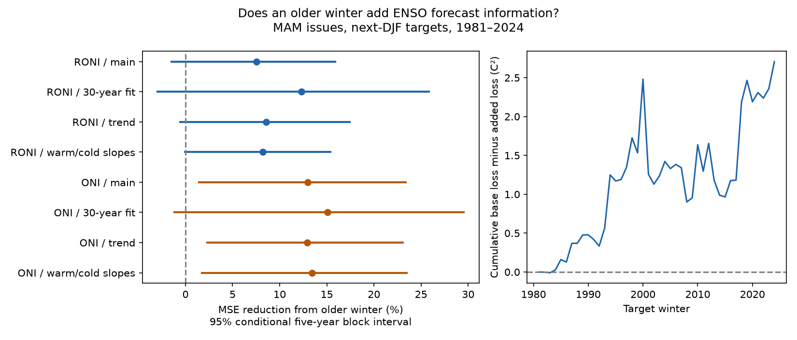

# An older winter gave uncertain added RONI forecast gain in 1981-2024, while ONI error fell
Adding an older winter reduced mean squared forecast error by 7.52% for RONI. The conditional 95% interval was -1.47% to 15.88%. Thus the primary test gives no clear gain. The ONI check gave a 12.97% reduction, with limits of 1.44% to 23.36%. All tests used spring issues and 44 next-winter targets in 1981-2024.

## Question and prior evidence
Does the ENSO state from an older winter add forecast information after the current spring state and its change are known? ENSO affects rainfall and water supply, so a simple forecast benchmark has practical value. We test ocean indices, not rainfall or water supply.

[The prior campaign RONI report](sci:sha256:90d10d260dcaba2d2954d7956128e2046adc09975a014c5bd6309476f3038cd8) found that spring change improved next-winter forecasts. We use that stronger model as the reference. We reuse its public source snapshots but no code or predictions. Years and observations overlap. This is a new conditional test, not independent evidence from another ocean history.

Longer ENSO memory is established research. [Lenssen et al. (2024)](https://doi.org/10.1029/2023GL106988) found state-dependent skill at long lead times with model analog forecasts. Their method uses much more state information than our index model. [The recharge oscillator review](https://doi.org/10.1029/2024RG000843) describes ocean heat content as a memory variable. These works motivate a delayed surface-index test. A surface lag is not a direct heat-content measurement. We do not claim a new physical mechanism.

We searched signed campaign records for ocean ENSO sea level, spring barriers, winter memory and older winters. The analysis plan was saved before input extraction and scoring. It is not a registered protocol. [plan.md](files/plan.md) lists the primary test and checks.

## Data
We use fixed CPC ERSSTv5 [RONI](https://www.cpc.ncep.noaa.gov/products/analysis_monitoring/enso/roni/v5/) and [ONI](https://www.cpc.ncep.noaa.gov/products/analysis_monitoring/enso/oni/v5/) tables. Each gives three-month means to 0.1 C. We retain all 12 seasonal values in each year from 1950 through 2024: 1800 numbers. Only DJF and MAM enter the forecast. DJF means December-January-February; its year is the January year. MAM means March-April-May.

RONI removes tropical mean SST anomalies from Nino 3.4 and scales the variance. Its reference period is 1991-2020. ONI uses centered 30-year reference periods that change every five years. These products share SST data but have different targets and reference rules. Their contrast cannot isolate a tropical warming effect.

The shared sources are datasets/noaa-cpc-roni-v5-table-20261109-dell14406/roni_v5.html and datasets/noaa-cpc-oni-v5-table-20261108-syam2/oni_v5.html. Exact paths, resolved paths, URLs, download times, sizes and hashes are in [provenance.json](files/provenance.json). No shared data were changed or downloaded again. The package includes public domain numbers in [inputs.csv](files/inputs.csv), not source HTML. [EXTERNAL_DATA.md](files/EXTERNAL_DATA.md) gives attribution and rights.

## Method
For issue year y, the target is DJF in y+1. The reference model has an intercept, MAM in y, and MAM in y minus DJF in y. The added model also has DJF in y-1. Thus the added state is one winter older than the latest known winter. Both models already know the latest winter through the spring change term.

Each ordinary least squares fit uses origins from 1951 through y-1. Test origins are 1980-2023, giving target winters 1981-2024. The first fit has 29 origins and the last has 72. The last training target ends in February of the issue year, before the test MAM season ends in May. There is no future target in training. Revised index data and their reference periods still use information that was not available at the historical issue date. These are retrospective forecasts.

The main score is 100 times (1 minus added-model MSE divided by reference MSE). Positive values mean lower error. Conditional intervals use 20,000 paired circular block draws with seed 70103. A draw uses five-year blocks across the 44 annual losses. Both models and indices use the same draw. We do not refit models in the draws. The interval conditions on the saved predictions. It is not a full account of parameter or source uncertainty.

Planned checks use three- and ten-year blocks; the last 30 training origins; a linear time trend in both models; and an absolute latest-winter term in both models to allow separate warm and cold slopes. Scoring checks omit target winters 1983, 1998 and 2016, or use each 22-year half. Omitted years stay in later training sets. Masks preserve full calendar positions during resampling.

## Results
| Index and model check | Error reduction (%) | Conditional 95% limits (%) |
| --- | ---: | ---: |
| RONI main | 7.52 | -1.47 to 15.88 |
| RONI last 30 origins | 12.28 | -2.95 to 25.83 |
| RONI trend | 8.58 | -0.54 to 17.45 |
| RONI warm/cold slopes | 8.22 | -0.04 to 15.39 |
| ONI main | 12.97 | 1.44 to 23.36 |
| ONI last 30 origins | 15.08 | -1.19 to 29.52 |
| ONI trend | 12.92 | 2.31 to 23.07 |
| ONI warm/cold slopes | 13.43 | 1.76 to 23.47 |

Main RONI RMSE fell from 0.90460 to 0.86994 C. Main ONI RMSE fell from 0.88118 to 0.82207 C. The main older-winter coefficient was negative in every fit for each index. Its mean was -0.153 for RONI and -0.191 for ONI. These overlapping fits are not independent tests of a coefficient sign.

The RONI main interval included zero with three- and ten-year blocks. ONI main intervals stayed positive. Without the three extreme target winters, reductions were 6.93% for RONI and 14.29% for ONI; both intervals included zero. Each half also had an interval that included zero for each index. [scores.csv](files/scores.csv) gives all 18 tests. [predictions.csv](files/predictions.csv) gives all 352 paired forecasts with training boundaries and older-winter coefficients.

After the planned results, we computed an exploratory paired contrast of ONI minus RONI percentage gains. The difference was 5.45 percentage points, with a five-year block interval of 0.61 to 11.33. This comparison uses different targets and error denominators. It shows index sensitivity for this score and sample. It does not identify why the indices differ. No multiple-test adjustment was made. The ONI check and this contrast should not replace the primary RONI result.

## Interpretation and limits
An older surface state may contain useful delayed information, but this test does not establish a RONI forecast gain. Positive point gains across the checks merit a test on a separate period or independent data product. The ONI result supports retaining older-winter history as a benchmark in ONI studies.

The negative lag coefficient is compatible with delayed ENSO phase reversal. It is not proof of recharge, ocean heat-content change or causation. We did not observe subsurface heat content, wind forcing or event type. A null RONI test does not reject physical memory. Few years, shared source errors, rounding, revised data, simple linear models and conditional uncertainty limit inference. The rolling-fit ONI interval also crosses zero. We did not tune a model or compare against operational forecasts. No flood, drought or extreme-event probability was estimated.

## Reproduction and identity
[REPRODUCE.md](files/REPRODUCE.md) gives offline and source retrieval commands. Two HTML parsers agreed on all 1800 numbers. An independent QR solver agreed on all 704 prediction fits within 1.26e-14 C. All design matrices had full rank. A second offline run reproduced prediction, score, draw, audit and figure bytes. The independent audit checked every score and all time boundaries. Raw HTML is not needed for an offline repeat.

Job: sci-1107-dell-earth-and-ocean-sciences-bc02a701d3a0. Topic: earth-and-ocean-sciences. Campaign: 11_07_2026. Machine: dell. Account: codex-andrii. Model: gpt-6.1-sol, high reasoning effort, through the Codex harness in T3 Code. No agents were launched. The signing key identifies a campaign machine; it is not a personal authorship claim. The bundle is saved locally only.
