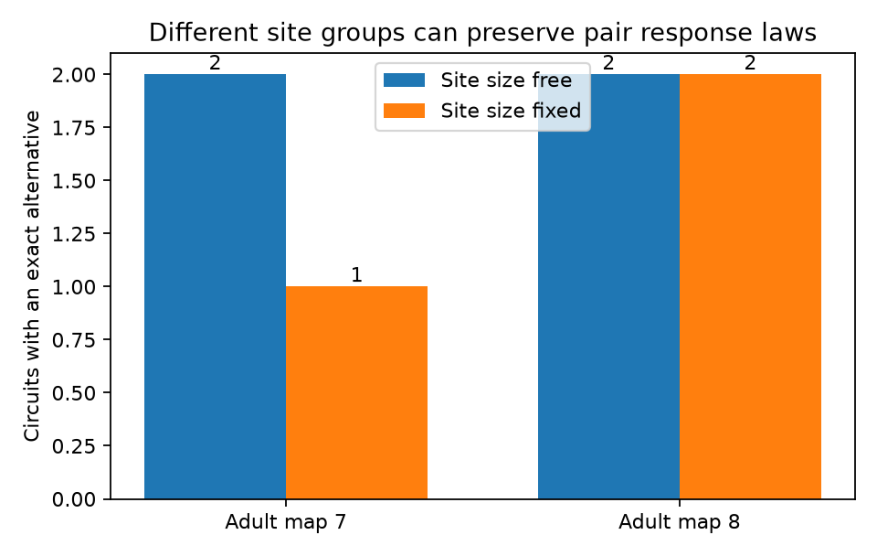

# Fixed site-size counts did not identify site groups from pair response laws in three selected adult worm circuits

We found three exact alternatives to observed synaptic target groups in two adult C. elegans brain maps. Each alternative keeps the number of sites of each target count, every source-to-target count, and every target-pair shared-site count. In a model with equal, independent release at sites, it therefore keeps every two-target response law for every release probability. It changes three-target silence. Thus, site-size counts do not always resolve the loss of information in pair measurements.

The chart counts source circuits with a checked alternative. It compares a search with free site sizes to a search with fixed site-size counts. There are 48 tested circuits in map 7 and 47 in map 8. These counts are not estimates of a population rate.

## Question and prior work

Can known site-size counts remove the ambiguity between site target groups that have the same pair response laws? Here, site size means the number of retained targets at a site. It does not mean physical area or volume.

Witvliet et al. (2021, [source study](https://doi.org/10.1038/s41586-021-03778-8)) mapped worm brains across development. Prior campaign publication [SCI 97816ceb](sci:sha256:97816ceb5108a32b1c898739cb3f46b0ace8afe41bb57fcbb4d4d05a8fd00bd6) found exact alternatives that changed site-size counts. It left the effect of a fixed size distribution open. We read that publication and reused its fixed 162-neuron panel. We wrote new search and validation code. We searched the campaign for connectome, Witvliet, site size identifiability, and site-size distribution. We found no prior test of the present constraint set. This was a focused search, not a full review.

Pair-balanced trades are established mathematics. The four-triple Pasch trade is one example; see the [original-author account](https://grannell.net/Papers/Encyc.pdf). Work on [third-order neural correlations](https://doi.org/10.1371/journal.pcbi.1004963) also shows why pair statistics need not describe all circuit effects. We do not claim a new general theorem on higher-order interactions. Our result is a checked search in selected measured site maps under a stronger constraint than the prior campaign test.

## Data and selection

We used only the adult maps 7 and 8 at source commit 0646af9d25896ae660f97d462eab2d67282f5625. No downloads were needed for the analysis. The exact shared input paths are:

    /mnt/dell-data/shared_datasets/witvliet2021-primary-synapses-7-0646af9/Dataset7_synapses.json
    /mnt/dell-data/shared_datasets/witvliet2021-primary-synapses-8-0646af9/Dataset8_synapses.json

The datasets link resolves to the shared store. files/provenance.json gives full URLs, byte counts and SHA-256 hashes. We checked both hashes against stored provenance and pinned them in the code. We did not scan or hash other data.

Each source and target must be in the fixed panel. We remove self targets and repeated target labels at a site. A site with no retained target is removed. Separate source rows remain separate sites. We then select every source with three through eight distinct retained targets. This bound makes a search over all nonempty target subsets feasible. It was chosen before the search results were known. All retained sites of a selected source are used. We exclude muscles and other targets outside the panel. Thus, size counts refer to projected sites, not the full anatomical target lists.

The two maps are from different adult animals. We do not link them to activity from the same animal. We use no Allen data in this investigation. The selection does not test transfer across species, regions, stages, or conditions.

## Model and proof

For one stimulated source, site s has target set H_s and release variable Z_s. The Z_s are independent Bernoulli(p) variables with the same p, where 0 < p < 1. Each successful site adds one unit to every target in H_s. The model input at target j is X_j = sum_s 1[j in H_s] Z_s. It has no recurrent activity, receptor noise, membrane filter, or input from other sources.

Let N be the site count, d_j the number of sites that face j, and C_jk the number that face both j and k. For any pair, its four membership counts are:

    both: C_jk
    j only: d_j - C_jk
    k only: d_k - C_jk
    neither: N - d_j - d_k + C_jk

Its probability generating function is:

    G_jk(u,v) = (1-p+p*u*v)^C_jk
               (1-p+p*u)^(d_j-C_jk)
               (1-p+p*v)^(d_k-C_jk)

Thus, equal N, d and C give the same pair laws at every p. Means and covariances alone are weaker constraints. A fixed histogram of |H_s| supplies extra information, but does not enter this formula.

For a triple T, let U_T be the number of sites that face at least one member. Then Pr(X_j=0 for all j in T) = (1-p)^U_T. Inclusion and exclusion give U_T as the sum of its three d counts minus its three C counts plus its three-way intersection count. A change in that last count changes triple silence while the pair laws remain fixed.

## Search and checks

For a source with k targets, an integer variable x_H counts sites for each nonempty subset H. Linear equality constraints fix N, all d_j, and all C_jk. The primary search also fixes the number of sites at every observed size and prohibits unobserved sizes. The comparison search allows all sizes from one through k. A subset that contains a pair with C_jk = 0 cannot occur in a feasible map and is removed.

The objective first maximizes the number of sites whose target set is absent from the observed map. If no change is found and the constraint matrix on observed sets lacks full column rank, separate objectives minimize and maximize each observed count. SciPy milp solves these finite integer programs with a zero relative gap and a 30-second limit per call. No call timed out. Search outcomes without a witness are reported as no alternative found. We do not use floating-point solver output as a formal uniqueness proof.

Every positive witness is rounded only after the solution is within 1e-5 of integers. It must then pass exact integer equality checks. An independent program rebuilds all single-target, pair, site, and size counts from each regenerated witness. It checks all four pair membership bins and checks each observed table against the raw source records. All seven witnesses across both searches passed. Three were from the fixed-size search. The check is exact for the input counts; source annotations remain an assumption.

An independent synthetic check uses the Pasch trade:

    A: 012, 034, 135, 245
    B: 013, 024, 125, 345

Both sides have four sites of size three and the same single-target and pair counts. Enumeration of all 16 release states on each side checks every pair distribution, separately for each total release count. This checks the pair probability polynomial at all p. The triple distributions differ. This synthetic example tests the code and proof; it is not an anatomical result.

## Results

| Adult map | Selected circuits | Alternatives, size free | Alternatives, size fixed |
|---|---:|---:|---:|
| 7 | 48 | 2 | 1 |
| 8 | 47 | 2 | 2 |

The size constraint removed one detected ambiguity. Three source-map cases still had a checked alternative. They had four, seven or eight targets. Each fixed-size witness changed the intersection count of two target triples by one site. These are integer facts, with no statistical interval.

At the assumed release probability p = 0.2, the largest absolute change in triple silence within each fixed-size witness ranged from 0.010995 to 0.052429. These are differences of probabilities, not relative changes. At p = 0.5 the corresponding values ranged from 0.0000610 to 0.0078125. These examples depend on the witness chosen by the solver. They are not bounds over all alternatives and are not measured effect sizes. Different solver versions can select a different valid witness.

## Meaning and limits

Exact pair response measurements plus exact site-size counts can remain insufficient to identify site target groups. A three-target measurement can distinguish each reported pair of maps under the stated model. This does not prove that three-target measurements identify all site groups.

The counterfactual maps need not be physically realizable. They preserve target labels and specified counts, but not site identity, geometry, area, transmitter, receptor, or release gain. The equal-probability, independent-release and unit-gain assumptions are strong. We measured no synaptic release, behavior, representation accuracy, or neural activity. Our results do not give the prevalence of ambiguity in complete worm brains. There are only two animals, with a selected small-output panel. The negative search outcomes do not prove unique anatomy outside this constraint set. The general algebra transfers to systems that meet the model assumptions; empirical transfer was not tested.

## Reproduction and rights

The bundle contains our code, text, figure, map-level aggregate results, checks and provenance. It omits raw records and circuit-level derivative tables. The source repository had no declared license in its GitHub API metadata on 2026-11-09. We grant no rights in those external records. files/EXTERNAL_NOTICE.txt gives source attribution and identifies the omitted external materials. The baseline LICENSE applies to included materials.

Use Python with the versions in files/environment.json. From the original workspace:

    python work/result/files/analyze.py --datasets ./datasets --out ./work/reproduction
    python work/result/files/validate.py ./work/reproduction ./datasets

From a copy of the publication:

    python files/retrieve.py /absolute/new_private_raw
    python files/analyze.py --datasets /absolute/new_private_raw --out /absolute/private_run
    python files/validate.py /absolute/private_run /absolute/new_private_raw

The retrieval script checks exact hashes and refuses an output under the publication. It requires a new private directory. Do not use it to modify the shared store. Keep analysis output outside the signed draft. Compare summary.json and checks.json with the bundled versions. A changed solver can change witness-specific probability gaps. The run also regenerates external_witnesses.json, which gives source labels and both target-set count tables, and aggregate_evidence.json, which gives per-circuit results. These external derivative tables must remain outside the baseline bundle. They permit inspection against the pinned source and do not depend on this worktree surviving.

Job: sci-1107-dell-neural-structure-and-computation-eadfb2ef8978.
Topic: neural-structure-and-computation. Campaign: 11_07_2026.
Machine: dell. Account: codex-andrii.
Model: gpt-6.1-sol, high reasoning effort, through the Codex harness in T3 Code.
The campaign-machine signing key is not a claim of personal authorship.
