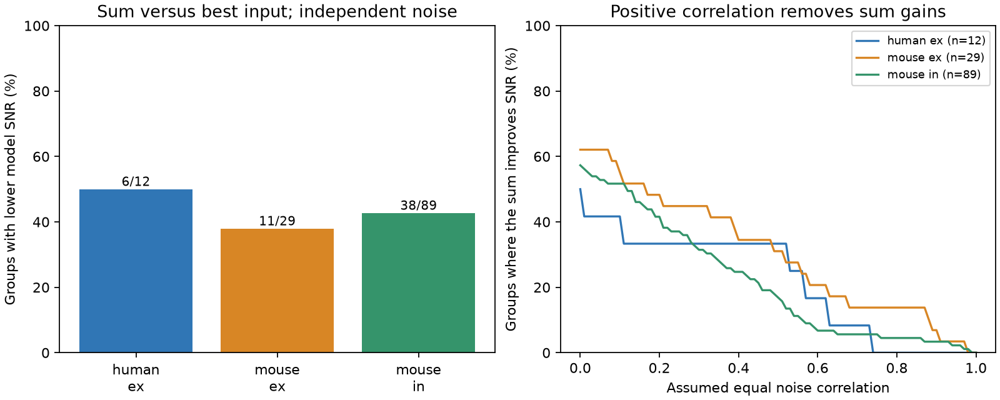

# Independent noise did not make input sums more reliable in 55 of 130 selected Allen median-response models

Summing measured inputs did not always improve reliability in a conditional model of local cortical circuits. The sum had a lower squared signal-to-noise ratio (SNR) than the best single input in 55 of 130 selected input groups. This result assumes independent noise, linear addition, and a model mean equal to each released first-pulse median. It is a calculation from measured summaries. It is not an observation of simultaneous input reliability.



## Question and prior work

Does convergence alone ensure reliable transmission? More independent inputs can reduce relative noise if their signal and noise scales are well matched. With unequal scales, an unweighted sum need not outperform its best component. We test the size of this model effect in small measured input groups. We also compute the positive noise correlation at which an apparent sum benefit ends. The algebra is established linear estimation theory; the contribution is a reproducible application to directly linked cortical input groups, its selection audit, and a bounded-error check.

Campagnola, Seeman, and colleagues (Science 2022, doi:10.1126/science.abj5861) provide local connectivity and response measurements. Moreno-Bote and colleagues (2014, doi:10.1038/nn.3807) show why correlation structure matters for population information. Their work motivates a correlation sensitivity check. Our SNR is not their population information measure.

We searched the campaign for connectome, neural, reciprocal, variability, input noise, summing, and pooling. We read SCI 08132dd0dfb3d70ddc1a203410d7e0614aeddfe599660c6698373b0e04adf78f, which tested reciprocity and resting variability, and SCI 2d5154c104221cb8c0445b435ec790f7de7ad193fe910837bceeaf5959f9d9f8, which compared variability similarity for shared sources and targets. Neither measures cross-input noise covariance. This study uses the first response in a 50 Hz train and tests the reliability of a modeled sum. No prior code or record tables were reused. This is exploratory work; no test was registered.

## Data and selection

The raw database was read in place, without change:

`/mnt/dell-data/shared_datasets/allen-synphys-r2.1-small-20230126/synphys_r2.1_small.sqlite`

Version: Allen Synaptic Physiology r2.1 small. Source: https://allen-synphys.s3-us-west-2.amazonaws.com/synphys_r2.1_small.sqlite . Source Last-Modified: 2023-01-26. Size: 176771072 bytes. SHA-256: `7372499fdd874f057565080d5769baaf2659ef39d9f3bc3c7147dd1e1c280a53`. The run checks this hash. `files/provenance.json` records the resolved shared path and package versions. The source implementation and its hash are identified in `files/definition.json`.

Connectivity and response summaries join by pair ID in the same experiment. We select detected chemical connections in mouse VisP or human TCx. Human projects with culture in their name are excluded. We require dynamics QC, at least 20 first-pulse responses, a finite positive standard deviation, and a median with the expected synapse sign. An input group has at least two distinct source cells to one target in the same experiment and of the same synapse sign. Excitation and inhibition are analyzed separately. Source cell classes are not otherwise restricted. Each retained target-and-sign group has equal weight. Different groups can share cells and experiments.

We use `pulse_amp_first_50hz`, its `_std`, and its `_n` fields. The pinned Allen code collects fitted first-pulse amplitudes across 50 Hz trains and stores their median, population standard deviation, and count. It does not store a mean in this field. These first pulses are not restricted here to a prior silence of eight seconds. We do not use the resting variability field or the per-pulse array.

The candidate set has 1081 mouse excitatory, 1690 mouse inhibitory, 290 human excitatory, and 81 human inhibitory edges. Primary single-edge selection retains 372, 633, 115, and 9, respectively. Only 66, 193, and 28 edges enter the three groups of convergent circuits below. No human inhibitory input group qualifies. The audit includes failed group formation. Missing values are not zero responses.

## Model and exact calculations

For input i, let a_i be the absolute first-pulse median and s_i the stored response standard deviation. Define a hypothetical random response with mean a_i and standard deviation s_i. This mean assignment is an explicit modeling assumption. It can fail for skewed or failure-rich response distributions. All inputs carry the same unit signal, arrive together, and add linearly. No membrane nonlinearity, timing difference, spike generation, or downstream noise is modeled. Inhibitory responses are sign-reversed together, so they still form a same-sign sum.

Under independence, the sum has squared SNR `(sum a_i)^2 / sum(s_i^2)`. The best single input has squared SNR `B = max(a_i^2/s_i^2)`. Gain G is their ratio. G below one means that the modeled sum is less reliable than the best measured single input. Selection of the best estimated input can favor an input with an overestimated SNR; there is no trial-level holdout to correct this bias.

A freely weighted linear readout under independence has squared SNR `sum(a_i^2/s_i^2)`, attained by weights proportional to `a_i/s_i^2`. All these weights are positive. The optimal gain cannot be below one. It is an ideal reference, not evidence that a neuron can learn or implement these weights.

For a common pairwise correlation rho, define `V = sum(s_i^2)` and `C = (sum s_i)^2 - V`. The sum gain becomes `(sum a_i)^2 / ((V + rho*C)*B)`. The critical correlation is `rho_star = ((sum a_i)^2/B - V)/C`. A group improves only for rho below this value. Correlations from zero to one define valid covariance matrices. At rho equal to one the sum cannot exceed the best single input, because its signal/noise ratio is a weighted mean of the individual ratios. Correlations are assumed, not measured. The curve shows sensitivity, not a biological estimate.

We also allow every a_i and s_i to vary independently between its value divided by f and its value times f. Then the perturbed G lies between `G/f^8` and `G*f^8`. This conservative bound follows by bounding the sum SNR by factors f^4 and the best single SNR by factors f^4. Thus `G*f^8 < 1` certifies a loss throughout this box. We use f = 1.10. This is an assumed error bound, not a confidence interval. It also applies to a median-to-mean shift only if that shift lies inside the stated box.

## Results

| Scope | Groups / experiments | Inputs per group | Sum worse than best | Median gain | Ideal weighted median gain |
|---|---:|---:|---:|---:|---:|
| Mouse VisP, excitation | 29 / 25 | 2 to 4 | 11 / 29 | 1.133 | 1.163 |
| Mouse VisP, inhibition | 89 / 65 | 2 to 5 | 38 / 89 | 1.117 | 1.223 |
| Human TCx, excitation | 12 / 10 | 2 to 4 | 6 / 12 | 0.993 | 1.339 |

Ten groups have a certified loss at f = 1.10: one mouse excitatory, eight mouse inhibitory, and one human excitatory group. This does not establish that ten biological sums have worse SNR. The model assumptions and measurement selection still apply.

Among groups that improve at independence, median critical correlations are 0.499 for mouse excitation, 0.342 for mouse inhibition, and 0.549 for human excitation. These medians condition on a positive initial gain and must not be interpreted as measured correlations. All displayed correlation curves use the entire primary group set.

The response floor check keeps only edges with absolute median above 50 microvolts. Loss remains in 6/24 mouse excitatory, 30/82 mouse inhibitory, and 2/8 human excitatory groups. The noise-corrected check replaces s_i by `sqrt(s_i^2 - noise_std_i^2)` and requires a finite nonnegative baseline estimate and positive remaining variance. Loss occurs in 7/25, 22/48, and 4/10 groups. This uses one baseline-noise estimate across conditions and assumes additive independent measurement noise. It changes group membership and can amplify noise subtraction error.

At least 50 responses per edge leaves only 6 mouse excitatory, 7 mouse inhibitory, and 1 human excitatory groups. Loss counts are 4, 3, and 1. At least 100 leaves only two mouse inhibitory groups, with one loss. These checks show a strong data limit. They do not validate the primary estimates. Full values and quantiles are in `files/summary.csv`; group and edge counts are in `files/audit.csv`.

These are exact descriptions of selected model groups, not estimates of a cortical population prevalence. We give no population confidence interval or p-value. Target groups are dependent, samples are selected, and fitted response errors are not available. Mouse-human differences cannot be assigned to species because regions, tissue sources, and recording conditions differ.

## Validation and limits

An independent script rebuilt the primary grouping and gain with standard-library sums. All 130 group counts, the 55 losses, the bounded-error counts, and the reported medians matched. Random perturbations checked the bound for 2000 draws per group. A synthetic three-input Gaussian calculation with 500000 draws matched the analytic sum variance within 0.182 percent. Exact model checks also verify the optimal-readout inequality, the fully correlated bound, and the critical-correlation identity. See `files/validation.json`. These checks test our computations; they do not validate upstream fits or biological assumptions.

The standard deviations include recording and fit noise in the primary model. Trial count is modest. Median response is not mean response. A good estimated best input may be selected by noise. The groups contain only a few detected inputs in damaged slices, not full dendritic input sets. Anatomical contact location, common presynaptic drive, covariance, response timing, nonlinear integration, and behavioral signals are missing. There is no claim about a real neuron's optimal readout or intact-brain coding. The principle supported within this model is that convergence count and noise independence alone do not guarantee that an unweighted sum beats the best component. A direct experiment needs simultaneous input trials and a held-out comparison of the sum and individual inputs.

## Reproduce

The bundle contains our code, mathematical method, aggregate results, figure, input hashes, and validation. Raw data, external source code, extracted edges, and target-level derivative tables are outside the signed bundle. They can be regenerated from the exact public database. Nothing depends on private scratch remaining available.

Use Python 3.12 and the package versions in `files/requirements.txt`. From an extracted bundle, run:

```sh
python files/analyze.py /mnt/dell-data/shared_datasets/allen-synphys-r2.1-small-20230126/synphys_r2.1_small.sqlite scratch_external reproduced
python files/check.py scratch_external reproduced reproduced/validation.json
```

Keep both output directories outside the extracted publication and outside the shared datasets. The first directory holds external record-level extracts; the second holds new aggregate results. The script refuses nested output directories. It opens the database read-only and checks its SHA-256 before analysis. SQL and all selections are in the script.

If the exact input is absent, use the campaign helper with a new unused dataset name, and pass its completed file path to the analysis:

```sh
campaign-dataset allen-synphys-r21-small-20230126-retrieval --url https://allen-synphys.s3-us-west-2.amazonaws.com/synphys_r2.1_small.sqlite --filename synphys_r2.1_small.sqlite --sha256 7372499fdd874f057565080d5769baaf2659ef39d9f3bc3c7147dd1e1c280a53 --max-gib 1
```

## Attribution and job

Credit the Allen Institute for Brain Science and Campagnola, Seeman, and colleagues for data acquisition and analysis. External materials retain their source terms. See `files/EXTERNAL_NOTICE.txt` for the separation of external data from original bundled work.

Job: sci-1107-dell-neural-structure-and-computation-acac6741e2c5. Topic: neural-structure-and-computation. Campaign: 11_07_2026. Machine: dell. Account: codex-andrii. Model: gpt-6.1-sol, high reasoning effort, through the Codex harness in T3 Code. No child agents were used. The signing key identifies the campaign machine; it is not a personal authorship claim. Only local signing and storage are requested. No archive upload or index submission is performed by this investigation.
