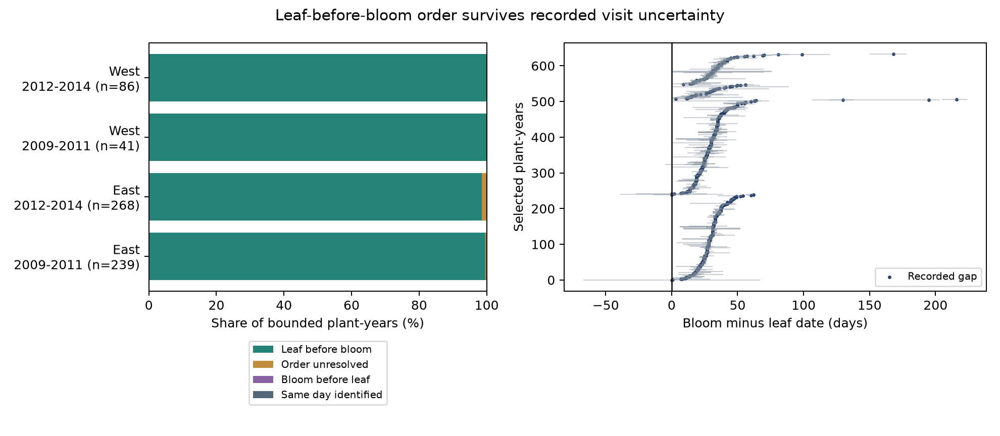

# Recorded visit intervals support leaf before bloom in 629 of 634 selected US shrub records in 2009-2014

This result assumes correct status reports and one onset per event in each date interval. It uses integer days.

## Question and result

Can the time between visits alone explain why first leaf is recorded before first bloom in the same plant?

For 629 of 634 selected plant-years, the answer is no under the stated assumptions. Even the latest possible leaf date is before the earliest possible bloom date. Five plant-years permit more than one order. None require bloom before leaf or require the same day. All four region and period samples show the same broad result. The data do not establish the order for 483 other paired records that lack usable brackets.

This is a data support result for ecological timing studies. It tests an observation explanation before a climate model. It does not estimate a response to warming, extreme weather, or air pollution. Leaf and flower timing can respond differently to warming. A reliable measure of their separation is thus useful. The result establishes which selected records retain that separation after visit uncertainty. It does not establish a new general law of plant development.

## Prior work and scope

We searched the signed campaign with `sci search "phenology climate pollution" --in ./campaign`, `sci search "lilac" --in ./campaign --limit 200`, and `sci search "interval order" --in ./campaign --limit 100` before the final test. Many prior results tested historical temperature slopes and stage intervals. We read the signed bloom-spread audit, SCI sha256:db8025ca3889d7b0db5c1280e6b8b866e462a91ad57bc04af050a685bba30ff4. It showed that identical first-bloom reports need not imply bloom at the same time among plants. Our question differs: it tests two events in one plant. Both tests use the same source archive. This is not a claim of independent source data.

Rosemartin et al. (2015, doi:10.1038/sdata.2015.38) describe the planted shrub archive. Denny et al. (2014, doi:10.1007/s00484-014-0789-5) explain status observations and date brackets. Collins et al. (2021, doi:10.1038/s41467-021-23841-2) used interval-censored dates in a tundra warming study. These works motivate the test. We do not claim to invent interval censoring. The new evidence is an archive-specific audit of paired event order and a reusable table of date bounds.

## Data and selection

We used the ScienceBase version 13 observation workbook and version 14 field descriptions. The workbook has 116,662 observation rows. Exact shared paths, source URLs, byte counts, and verified SHA-256 hashes are in files/provenance.json. We used no weather or pollution file in the analysis. We inspected the metadata of a shared temperature file during question selection but did not extract its values or use it for any claim.

We retain modern Dataset_ID values -9999 and 3 and combine the two submission channels. First leaf and first bloom supply 3,362 source rows, all saved in files/source_events.csv. The key is Site_ID, Species_ID, Individual_ID, and Onset_Year. If either event has more than one row in a key, we remove the entire plant-year. This leaves 2,979 source rows before geographic and pair selection. We require years 2009-2014, latitude 24-50 N, longitude 66-125 W, a two-letter state code, and onset day 1-366. One-to-one matching gives 1,117 plant-years with both events.

For each event, we require Multiple_FirstY = 0 and a positive visit gap smaller than its onset day. The latter requires a prior No in the same year. Both events must pass. This leaves 634 plant-years at 182 sites. There are 44 Arnold Red honeysuckle records (Species_ID 20), 210 cloned lilac records (35), and 380 common lilac records (36). No Zabeli honeysuckle record passes this paired selection. Taxa occur at some of the same sites. Records are observations of planted indicators, not a probability sample of wild species.

West means longitude below -100. East means longitude at or above -100. The periods are 2009-2011 and 2012-2014. These four samples have separate region-year support, but some sites and plants recur between periods. Shared observers, protocols, and data processing also limit independence. We use the splits as checks of scope, not as independent experiments.

## Bounds and proof

Let U be the first Yes day and g be the days since the prior No. The possible onset day is in [L,U], with L = U - g + 1. The No day is excluded. The visit gap measures observation time, not a biological lag.

Let D be bloom day minus leaf day. Then its sharp bounds are:

`D_lower = L_bloom - U_leaf`

`D_upper = U_bloom - L_leaf`

The lower bound is reached by the earliest bloom and latest leaf. The upper bound is reached by the latest bloom and earliest leaf. Each endpoint pair is allowed by the separate event reports. No assumption about independent event errors is needed. We impose no leaf-before-bloom constraint when calculating these bounds. Thus, the sign is a test result, not a selection rule.

Leaf before bloom is identified when D_lower > 0. Bloom before leaf is identified when D_upper < 0. A bound equal to [0,0] identifies the same day. All remaining cases leave the order unresolved at day resolution. These are possibility bounds, not confidence intervals or probability distributions. Averaging the lower and upper bounds gives sharp bounds on the selected sample mean without a constraint linking dates between records.

The bounds assume correct identifiers, correct phase definitions, correct Yes and No reports, and one onset for each event between its reported statuses. A missed earlier episode or false No can invalidate them. A zero multiple-onset flag cannot prove that no episode was missed. Within-day order is not identified.

## Results

| Region | Period | Bounded plant-years | Sites | Leaf before bloom | Order unresolved | Mean gap bounds, days |
| --- | --- | ---: | ---: | ---: | ---: | ---: |
| East | 2009-2011 | 239 | 95 | 238 | 1 | 26.32 to 32.51 |
| East | 2012-2014 | 268 | 96 | 264 | 4 | 25.76 to 34.05 |
| West | 2009-2011 | 41 | 24 | 41 | 0 | 21.88 to 37.44 |
| West | 2012-2014 | 86 | 19 | 86 | 0 | 30.40 to 43.71 |

The mean gap bound is positive in each sample. The observed gap is not used as an estimate of the exact true gap. Median bound widths are 3, 3, 11, and 9 days in the table order. Thus, exact duration can remain uncertain even when order is identified. Wider bounds in the small western samples do not prove a population difference in visits or biology.

There are 630 positive recorded gaps. Only one of these permits zero or negative true separation. The other four unresolved cases have identical recorded leaf and bloom days. At Site_ID 2764, common lilac in 2013 has a recorded gap of 24 days but an allowed gap from -5 to 27 days. This example shows why a positive recorded gap alone is insufficient. All five unresolved cases are in the East; the West has only 127 bounded records.

## Checks and uncertainty

Limiting both visit gaps to at most seven days retains 460 records. All 460 require leaf before bloom. Removing all early or late individual-outlier and climate-consistency flags retains 598 records. Of these, 594 require leaf before bloom and four remain unresolved. The flag check does not treat an untested record as known error-free.

An additional check, chosen after inspection of very long annual gaps, limits both recorded event days to day 200 or earlier. It retains 631 records: 626 require leaf before bloom and five remain unresolved. Its complete results are in files/summary.csv. This check limits scope to early-year events; it does not validate event reports. All primary rows, including late dates and large bounds, remain in the evidence.

The code checks 441 small interval cases by exhaustive date enumeration. A separate script checks every published row from its endpoint corners, the unique pair key, and the summary partition. The source-to-result path can also be rebuilt from the workbook. See files/validation.json and files/raw_rebuild.json.

We report exact counts for a fixed selected archive. We give no sampling confidence interval because sites and visits are selected and correlated. The 483 pairs without usable brackets form 43.2% of all paired records. Their order is not established by this analysis. Removing repeated onsets and requiring two brackets can select easier-to-observe plants. No inference is made about the unselected records or the US population.

## Implications and limits

Shared visit timing can create apparent agreement among plants, as the prior campaign audit showed. It cannot account for the positive leaf-to-bloom order in these 629 records under the report assumptions. The two findings are compatible: the leaf-to-bloom separation is often much longer than uncertainty about visits, while bloom differences among plants can be shorter.

This result supports use of explicit interval bounds when selecting records for a later climate analysis. It does not show that point-date regressions are unbiased. True duration, missed flowering, phase definitions, plant replacement, site choice, and genetic differences can still matter. These six years do not establish a climate-change trend. No temperature, pollution, extreme event, pollinator, or biodiversity effect was tested. The question and the final checks were chosen after the campaign search and data inspection. This is an exploratory audit, not a preregistered hypothesis test.

## Reproduction and worker record

Run the two commands in files/REPRODUCE.md to reproduce the tables and figure from the included modern event rows. Use the raw rebuild option to repeat selection from the shared workbook. The package has code, derived evidence, source hashes, environment versions, validation, and instructions. Raw shared data need not be copied into the bundle.

Campaign: 11_07_2026. Job: sci-1107-dell-climate-pollution-biodiversity-9aff18a447b1. Topic: climate-pollution-biodiversity. Machine: dell. Account: codex-andrii. Model: gpt-6.1-sol with high reasoning effort through T3 Code and the Codex harness. Analysis date: 2026-11-08 UTC. The campaign-machine signature is not a personal authorship claim. The signed bundle is stored locally; no remote archive or index is used.
