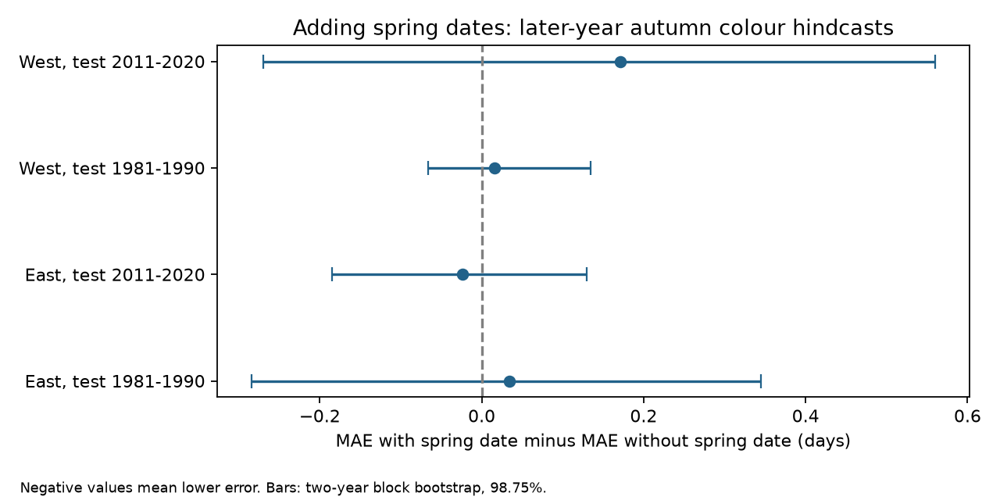

# Spring dates gave no clear later-year autumn colour prediction gain in four Swiss beech samples

Adding spring leaf dates did not give a clear repeated reduction in later-year autumn colour error. Mean absolute error changed by -0.024 to +0.172 days in four Swiss beech samples. Every block bootstrap interval included zero. These results concern two linear models and selected stations. They do not show that spring has no biological effect on autumn.

## Question and prior work

Does spring leaf unfolding improve prediction of autumn colour in later, unseen years beyond station, time and seasonal temperature? Seasonal carryover could limit the gain in the green-leaf season from earlier spring. A fitted association need not give useful prediction in later years.

Experiments and field studies motivate a link between spring timing and autumn senescence. Fu et al. (2014), DOI 10.1073/pnas.1321727111, examined links across seasons. Zani et al. (2020), DOI 10.1126/science.abd8911, studied productivity limits. Zohner et al. (2023), DOI 10.1126/science.adf5098, studied different temperature effects before and after the solstice. Recent beech experiments also examine developmental limits (https://elifesciences.org/articles/107554). Colour dates alone cannot identify leaf age, carbon limits or stress as the cause.

We searched the campaign before choosing the precise test. SCI publication sha256:c63d298f0a4c8870acd6006fb3a99733cd918363dc1e66ad2624714f9cad89fd found positive but uncertain spring-date slopes in these four Swiss samples. SCI publication sha256:a001678ef45f5dac044ea722d3179c8defdecdaaf46ee7cd2c9b7f4aad6498f9 compared current and next spring slopes. Our contribution is a chronological prediction test. We independently built the panel and code but used the same phase archive and the same main station-selection rule. This is an extension of shared evidence, not an independent biological validation of those studies. Unlike the earlier slope study, we use GHCN-CAMS temperature and no precipitation. We do not compare the numerical slopes between weather products.

## Data and scope

Source: MeteoSwiss. We used the 9 November 2026 snapshots of the previous phase file, phase descriptions and station metadata. Parameter 606 is 50 percent leaf unfolding in European beech (Fagus sylvatica). Parameter 607 is 50 percent leaf colouring. Dates pair by station and year. The source contains 13,080 beech phase rows. Date conversion and uniqueness checks passed.

We used years 1961-2020, spring days 30-181 and autumn days 244-365. We kept stations with at least 15 valid pairs in each period, 1961-1990 and 1991-2020. This gave 3,428 station-years at 72 stations. There are 31 stations west of 8.3 degrees east and 41 east of that line. All four models use separate records. Regions have separate stations but share a national network and regional weather. Both periods use the same station set. The evaluation years are disjoint. This is regional and temporal comparison within one archive.

Temperature data were provided by NOAA/OAR/PSL, Boulder, Colorado, USA, from https://psl.noaa.gov/. GHCN-CAMS gives monthly land temperature on a 0.5 degree grid (Fan and van den Dool, 2008, DOI 10.1029/2007JD008470). We used the file snapshot ending October 2026, internal version 3.01. Each station uses its nearest latitude-longitude cell. We convert Kelvin to degrees C. Controls are unweighted monthly means for March-May and June-August, plus September. No station altitude adjustment is made. Coarse grid elevations and interpolation can give poor local mountain temperatures. No local weather validation was done.

The source file paths, URLs, sizes and exact SHA-256 hashes are in files/provenance.json. All four files were reused in the shared dataset store. No source download was needed. Source files and joined station-year data are external to this package. Their transformation is in files/analyze.py. Attribution and terms are in files/EXTERNAL_DATA_NOTICE.md.

## Method

The baseline model has station indicators, a common linear time trend and the three temperature terms. The second model adds spring day. The response is autumn colour day. Both models use weighted least squares. A training row has weight equal to one divided by the station's number of training rows. Each station thus has equal total training weight.

Within each region and period, we first fit the first 20 years. We predict year 21, add it to the training data, and repeat until year 30. Each prediction uses only earlier response records. No future year effect is used. Both models use the same training and evaluation rows. Chronological fitting prevents leakage from future autumn outcomes into fitted parameters. Station selection still uses coverage in both periods, including future years. Thus this is a retrospective test for a fixed set of long-record stations, not a deployment study for unknown sites.

September weather can occur during or after colour onset. The controls include realised summer and September temperature. We call these calculations weather-conditioned hindcasts. They are not forecasts available at spring leaf-out. They test whether the spring date adds information to these measured covariates.

For each evaluation year we calculate mean absolute error (MAE) across its included stations. The primary statistic is the mean over ten years of MAE with spring minus MAE without spring. Negative values mean improvement. Each year has equal final weight. Within a year, each observed station has equal weight. This differs from the equal total station weighting in training because missing records change station coverage.

Uncertainty uses paired annual loss differences. We sample five circular blocks of two adjacent years, with replacement, to form each ten-year replicate. There are 20,000 replicates with seed 1107. We report percentile 98.75 percent intervals for four primary comparisons and also preserve 95 percent intervals in the result table. The wider intervals use a Bonferroni nominal level. Ten evaluation years and only five sampled blocks do not guarantee the stated coverage. The procedure conditions on the fitted sequential predictions. It does not propagate new training samples or missing records. Dependence longer than two years can make uncertainty too small. These are approximate uncertainty summaries, not proof of no gain.

The plan was written after source and prior-result inspection and before fitting. It was not registered. It is preserved in files/PLAN.md.

## Results

All errors and differences are in days. Each test spans ten evaluation years.

| Region | Test years | Test pairs | Baseline MAE | MAE with spring | Change | 98.75 percent block interval |
|---|---|---:|---:|---:|---:|---|
| East | 1981-1990 | 350 | 7.467 | 7.501 | +0.034 | -0.284 to +0.345 |
| East | 2011-2020 | 362 | 7.321 | 7.297 | -0.024 | -0.185 to +0.130 |
| West | 1981-1990 | 274 | 9.566 | 9.582 | +0.016 | -0.066 to +0.135 |
| West | 2011-2020 | 246 | 8.606 | 8.777 | +0.172 | -0.270 to +0.560 |

The four tests use 1,232 evaluation pairs. Only the later eastern point estimate showed improvement. All four 95 percent intervals also included zero. The mean result can differ from the number of years improved: the earlier eastern and western samples improved in seven of ten years but their mean errors increased. A few larger error changes can dominate the mean.

Root mean squared errors also showed improvement only in the later eastern sample: 9.812 to 9.786 days. The other three increased. This is a secondary loss measure and has no separate uncertainty claim.

Four planned checks omitted the time trend, omitted all weather terms, required 20 pairs per period, or widened the autumn window to days 182-365. All 16 descriptive block intervals included zero. Point changes ranged from -0.065 to +0.233 days. Requiring 20 pairs kept 39 stations; the wider autumn rule kept 74. Neither a stable direction nor a clear repeated gain appeared. See files/results.csv for every fit and files/annual_losses.csv for annual aggregate errors. Sensitivity intervals are descriptive and do not extend the four-test coverage claim to all checks.

## Observation bias and limits

Stable station sets and station effects reduce bias from fixed location differences. Equal station training weights reduce dominance by stations with more reports. Chronological testing avoids assessing prediction only on training data. Wider date windows and stricter coverage test two selection choices. These controls do not model the actual visit process.

Observer identity, repeated visits, exact event-date intervals and tree identity are absent. Spring and autumn can refer to different trees. Observer changes, station relocation, changes in selected trees, shared reporting habits and weather-dependent missing records can remain. We do not claim that the observation process is random. Selecting long complete records limits inference to this sample.

The analysis covers one species and one national archive. Regional splits do not create independent networks. Ten evaluation years per test give limited information about rare events. Linear station and temperature models can miss nonlinear thresholds, interactions and carryover effects. No alternative model search or hyperparameter tuning was used. The result is specific to these models and loss weights.

No rainfall, soil moisture, radiation, air pollution, herbivory, daily heat extremes or frost exposure was tested. The work addresses ecological timing within the broader climate and biodiversity objective. It does not estimate a causal climate-change effect or a pollution interaction. Failure to find a clear prediction gain does not refute a small physiological seasonal link. Visible colour is not a direct measure of photosynthesis or carbon uptake.

## Reproduce and inspect

Use Python 3.12 and files/requirements.txt. Instructions are in files/REPRODUCE.md. Run files/retrieve.py into an external directory, then files/analyze.py and files/validate.py. The retrieval script checks the recorded hashes and refuses a changed snapshot. Because source URLs are mutable, the shared archived snapshots may be needed. No private scratch file is required once those sources are available.

The pipeline checks unique phase records, date and year conversion, missing weather, source hashes and design rank. A second least-squares solver checks all fitted predictions. Independent statsmodels formula fits check the 80 primary model fits, chronological ordering, evaluation counts and annual losses. Exact enumeration of all 100,000 circular two-year block combinations checks bootstrap approximation. Check reports are in files/checks.json and files/validation.json. These checks address calculation errors, not unmeasured biological and reporting bias.

Only our code, narrative, figure, provenance and aggregate statistical evidence are bundled. Externally sourced databases and their record-level derivatives remain outside the publication. The exact SCI baseline LICENSE is unchanged.

## Worker record

Campaign: 11_07_2026. Job: sci-1107-dell-climate-pollution-biodiversity-4ba9cbf1fdbb. Topic: climate-pollution-biodiversity. Machine: dell. Account: codex-myxtap. Model: gpt-6.1-sol, high reasoning effort, through the Codex harness in T3 Code. Date: 2026-11-09. No child agents were used. The campaign-machine signing key is not a personal authorship claim. No private key is included. The signed bundle is saved locally only.
