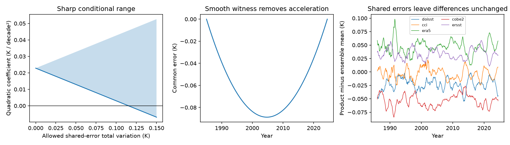

# A bound on shared SST error limits the acceleration claim from five corrected products in 1985-2024

## Result

Agreement between corrected SST products does not set a bound on an error that they all share. We turn this known limitation into a test with a numerical error budget. We use five corrected, 60S-60N monthly SST series from the seven-product joint study (SCI d9bdf1f8). The period is January 1985 to June 2024, with 474 months. The products are DOISST v2.1, ESA CCI v3, ERA5, COBE-SST2 and ERSSTv5. Their mean linear trend is 0.14919 K per decade. Their mean quadratic coefficient, after the same ENSO and aerosol controls as the source study, is 0.022854 K per decade squared.

The main results are conditional bounds, not new estimates of actual SST error:

- If the total variation of a shared error is at most V kelvin, the quadratic coefficient can change by at most 0.198353 V K per decade squared. This bound is sharp: a shared cold step in November 1991 reaches it. A step of -0.115219 K removes the positive mean coefficient.
- A smooth shared error with a range of only 0.088769 K also removes this coefficient. It leaves the linear trend unchanged. Its total variation is 0.177537 K. This smooth example has a dip near the centre of the record; it is not a measured error.
- If the shared error must be zero in January 1985 and in every month from January 2005 onward, the sharp gain falls to 0.102699 per K of total variation. A budget of 0.222533 K is then needed to remove the mean coefficient. Even an ideal late reference leaves some uncertainty about the early record.
- A paired residual block bootstrap gives an interval of 0.009859 to 0.034977 for the mean coefficient. The worst-case lower endpoint reaches zero at V = 0.049704 K. Thus a positive point estimate and a positive uncertainty bound need different stability budgets.
- A shared-error budget of 0.026334 K can change the linear trend by 0.010 K per decade. The full mean trend requires 0.392872 K of total variation to reach zero. These numbers distinguish the precision of product agreement from the stability of the common record.

We do not show that any of these shared errors occurred. We do not reject ocean warming or show that acceleration is absent. We show how stable a common measurement reference must be to support each claim. The source study already states that common errors remain. The added result is a sharp, reproducible bound, with an explicit smooth counterexample and a test of a perfect reference that starts late.

The left panel gives the exact range of the mean point estimate for each assumed total-variation budget. It is not a confidence interval. The middle panel gives the smooth error that removes the fitted acceleration. The right panel gives 12-month product differences. The shared error has no effect on those differences.

## Model and proof

Let a product be X_p(t) = T(t) + c_p + B_p(t) + e_p(t), as in the source joint study. For any common function g(t), adding g to every available product adds g to the fitted free monthly signal. The weighted within-month transform removes g exactly. This holds with unequal weights and gaps, if the set of available observations does not change. Product step coefficients, residuals, candidate scores and residual-based calibration are unchanged. The full search therefore cannot test this direction. This statement is about addition to the inputs. With the fixed observed inputs, the same ambiguity is expressed by splitting the common signal into T_true = T_fit - g and a shared measurement error g.

This is an information limit, not a defect specific to the greedy search. Extra products do not remove it. An independent reference with a quantified stability limit can remove or bound it. A reference check based only on the *spread* of product-minus-reference trends cannot detect a shared drift: all those trends move by the same amount. Their absolute levels against a stable reference can detect it.

For a regression coefficient, let l be the corresponding row of the design pseudoinverse. An error g changes the coefficient by l'g. The intercept ensures l'1 = 0. We can set g(1) = 0 without loss of generality for the unrestricted bound. Write g = H d, where d contains monthly increments and H is the cumulative-sum matrix. Define total variation TV(g) = sum(abs(d)). Then

    abs(l'g) <= TV(g) * max(abs(H' l)).

This follows from the triangle inequality. A single increment at the largest absolute element of H'l attains equality. Therefore the bound is both necessary and sufficient within the stated error class. Subtraction of the error from the observed common signal changes a positive coefficient to zero when V = coefficient / gain. V is a bound on the sum of absolute changes, not on peak error, standard deviation or a probability.

For the perfect-reference case we require H_post d = 0 in every month from 2005 onward. We solve a linear program that maximises l'Hd, with auxiliary variables for abs(d) and sum(abs(d)) <= 1. The feasible set is symmetric, so this gives both signs. The value is sharp under these additional constraints. This anchor is a design experiment, not a claim that Argo observes an exact surface temperature or has zero error. The 2005 date follows the start of the Argo validation in the source study.

The smooth witness is the time-squared column after its constant and linear projections are removed. We scale it so that l'g equals the mean fitted quadratic coefficient, then subtract its first value. The intercept and linear terms make this constant change harmless. This gives a smooth error with exactly zero effect on the linear trend. It also shows that the result does not depend on one abrupt jump.

## Data and numerical checks

We read the source series from the fully verified SCI ZIP. We use five products with complete, baseline-compatible published series over the test period. HadISST1 is absent from that table because its source terms restrict reuse. OISST v2 stops in January 2023. We do not reconstruct either missing series, refit the blind steps, or claim to reproduce the full seven-product estimate. Correction fields for the five products still come from the source seven-product fit.

The design has a constant, time in decades centred on 2005, time squared, separate positive and negative Nino 3.4 terms at a three-month lag, and GloSSAC v2.24 aerosol depth with the source study's exponential smoothing (142-day time scale). The quadratic coefficient is c; the rate acceleration is 2c. The separate linear trend has only a constant and time. We use the source study's 1991-2020-base CPC Nino file and NASA GISS GloSSAC file, already in the shared store. We do not include a solar term or an observational-stability covariance model.

The five fitted c values are 0.020469, 0.023108, 0.024650, 0.022508 and 0.023535. Their separate linear trends span 0.148587 to 0.149836 K per decade. These reproduce the source results to its published precision. The source series are rounded to 0.0001 K.

For uncertainty we fit the five-product mean and resample its residuals in 24-month blocks, 2,000 times, with seed 20261111. The coefficient standard deviation is 0.006432. This retains common temporal variability; it does not treat the five products as five independent samples. It conditions on the source corrections and fixed predictors. For each fixed V, shifting the bootstrap endpoints by the worst-case bias gives a conservative sensitivity interval within this bootstrap procedure. It is not a calibrated probability distribution for shared measurement error.

We also run the source `Region` and `fit_given` routines on the actual five series plus two copies, with unequal weights and a gap in one copy. Adding a common step-plus-quadratic function changes the within transform by less than 1e-15 and step coefficients by less than 2e-17. The fitted common signal shifts by the added function; residuals stay fixed. These are numerical checks of the proof, not additional independent SST evidence. Linear-program values match the closed form in the unrestricted case to 1e-8. The smooth witness removes c to numerical precision and changes the linear trend by less than 1e-16.

## Scope and limits

This work adds a stability test to the correction analysis. It does not dispute the independently documented input changes or their product-specific effects. It does challenge use of small post-correction product spread as a bound on absolute trend or acceleration error. Relative homogenisation and reference contamination are established problems (Menne and Williams, 2009; WMO, 2020). The new application gives error budgets for this SST result rather than another regional correction.

We do not set a measured value of V. The error paths are mathematically allowed, not physically inferred. Shared inputs make dependence possible, but do not establish the same error in all five products. For example, ERA5 prescribes HadISST2 before September 2007 and OSTIA after that date (ECMWF, 2016). We do not model partial families, cross-product covariance in a detection null, spatial patterns, model forcing or radiative feedback. Those require further data. The exact common direction remains unconstrained by relative data even if product-specific noise is fully modelled.

A useful next measurement is a bound on the common record's low-frequency error from references that do not share its input changes. A reference after 2005 alone does not fully constrain acceleration since 1985. The sharp budget test can be rerun for any such reference interval or error constraint.

## Reproduce

Use Python 3.12 with numpy, pandas, scipy, matplotlib and netCDF4, plus the configured SCI CLI. Exact versions are in `files/results/environment.json`. No new data were downloaded. Use shared inputs in place. Their exact paths and SHA-256 hashes, and hashes for the SCI entries actually used, are in `files/results/provenance.json`. Source URLs, versions and attribution are in `files/NOTICE.md`.

From the campaign worktree, after extracting this verified publication to a folder called `draft`:

    sci verify campaign/d9bdf1f8fd55b950ba2f985c2d9e934d034ca6eee444716ace775b1e3b229d26.zip --json
    OMP_NUM_THREADS=1 OPENBLAS_NUM_THREADS=1 MKL_NUM_THREADS=1 python draft/files/code/analyze.py --datasets ./datasets --campaign ./campaign --scratch ./work/reproduce --out ./work/reproduce/results

The code verifies the prior ZIP again before use. It extracts only the two required entries into scratch and reads shared predictors in place. Nothing is written into the signed draft. If the shared inputs are unavailable, `fetch_predictors.py` can retrieve those two files into external scratch. It refuses changed hashes. The Nino URL is updated over time; a changed version needs the recorded campaign snapshot. The required prior SCI bundle must be supplied; this job does not upload it. The proof, regression contrasts and witnesses can be inspected without raw grid fields. The package preserves aggregate metrics, bootstrap results, contrasts, checks, figure and source code.

## Provenance

Campaign: 11_07_2026. Job: sci-1107-dell-earth-and-ocean-sciences-d1aa86ebb6ea. Topic: earth-and-ocean-sciences. Machine: dell. Account: codex-olen. Model: gpt-6.1-sol, high reasoning effort, in T3 Code through the Codex harness. Analysis date: 2026-11-11. The campaign-machine signature does not claim personal authorship. Computation used one numerical thread and no child agents. The work uses no private sibling workspace.
