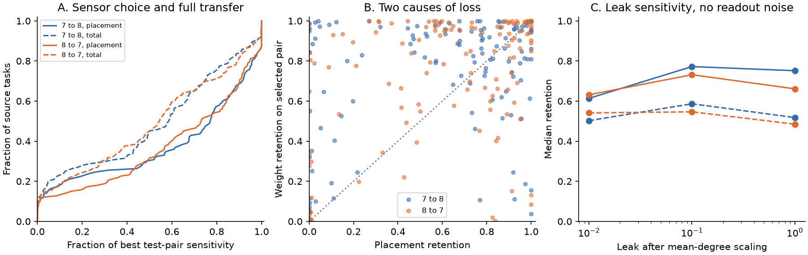
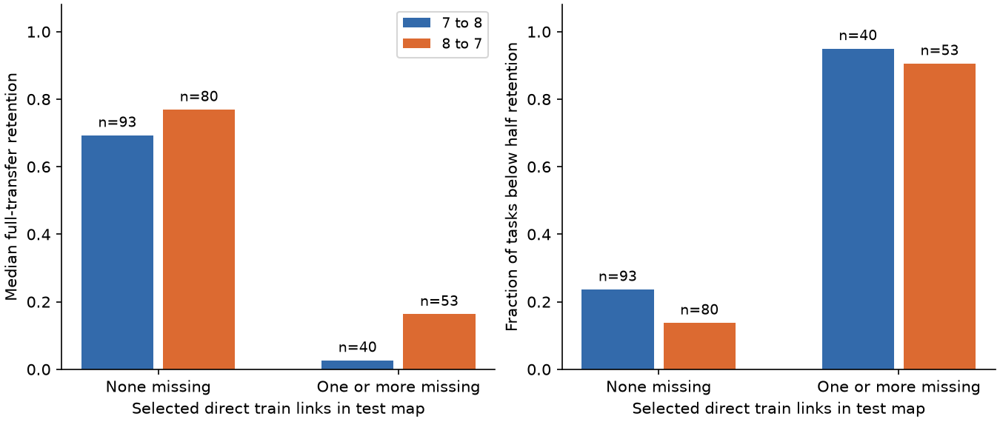

# Transferred two-cell readouts retained 55 to 59 percent median sensitivity in two passive adult worm circuit models

A two-cell readout selected and fitted on one adult worm electrical map retained 58.66% of the best test-pair sensitivity in the other map at the median source. Transfer in the reverse direction retained 54.65%. Refitting the decoder weights on the same selected cells raised these medians to 77.21% and 73.16%. Thus both recording location and readout weights limited transfer in this model. These results describe two partial anatomical maps under stated assumptions. They do not measure neural decoding in animals.

Figure 1. Each direction uses 133 common source identities. The source cannot be a sensor. Count weights have mean weighted degree one, leak is 0.1, and independent current noise has unit variance. A: Cumulative source-task distributions of placement retention (solid) and full transfer (dashed). B: Placement and conditional weight retention for each source; their product is full retention. The dotted line marks equal factors. C: Median retention at three leak levels, with no added recording noise. Blue is map 7 to map 8; orange is the reverse direction. Lines join tested values. Source tasks are not independent animal samples.

## Question and prior evidence

Can a small recording design based on one animal's anatomy support a reliable source readout in another animal's circuit model? The useful distinction is between choosing the wrong cells and using the wrong weights on suitable cells. A within-map optimum alone cannot answer this transfer question.

Witvliet and colleagues supplied developmental worm connectomes [1]. Their electrical annotations are partial. Varshney and colleagues studied passive electrical network models [2]. Sensor selection with correlated measurement noise is an established problem; Liu and colleagues gave information criteria that keep the full selected covariance [3]. We use that principle and do not claim a new general sensor-selection method.

We searched the signed campaign before choosing the precise question. The saved search log gives terms and limits. SCI 443f103e tested a sequential sensor rule against exhaustive within-map two-cell selection [4]. SCI e424c67f gave a sensor-count limit averaged across source pairs [5]. SCI 5664d348 tested decoder transfer under a chemical site-release model with many targets [6]. SCI b67bdeb8 used degree from another electrical map to select cells for link recovery [7]. We also read the bilateral source-distance and capacitance-ambiguity reports [8,9]. The new test here holds a remote two-cell recording design fixed between electrical maps, and separates placement loss from weight loss. These are different tasks and noise models from [5-7]. We wrote the code for this study; no earlier code or cell panel was copied.

The local plan was saved before calculation. It is not an external registration. A direct-link audit was added after the primary result was seen and is labeled below. We did not fit parameters to transfer results or neural activity.

## Inputs and circuit model

We reused two completed shared CSV files in place, with no new shared download. They are wormneuroatlas exports of adult maps 7 and 8 at commit `b2e13d88b670efcb3438aeacba2ad4bd6c383933`. Attribution, exact source URLs, used paths, resolved paths, byte sizes and hashes are in files/provenance.json and files/EXTERNAL_DATA_NOTICE.txt.

| Shared dataset file, below the worktree's datasets/ link | SHA-256 |
|---|---|
| worm-witvliet7-b2e13d88/adult7.csv | 1370d2a7e26a17e0765edfa834c95ca59ab44d8587efb5fda330432233074165 |
| worm-witvliet8-b2e13d88/adult8.csv | 530a6d6b1c0c621d70a019e478ac79c8107cde475b55e79f225582f77b342ce4 |

The shared root is `/mnt/dell-data/shared_datasets`, a compatibility path to the HP store. The files contain 55,102 and 55,153 bytes. Only these two raw files were hashed. We did not scan or change the shared dataset store.

We first intersect endpoint names in the two complete CSV tables. We exclude prefixes BWM, CEPsh, GLR and excgl. This gives 180 names before component selection. Each positive non-self electrical row gives one symmetric contact-count weight; no unordered pair is repeated. Chemical rows provide names only and do not enter the dynamics. We take the largest electrical component separately in each map. Map 7 has 147 cells and 258 links; map 8 has 149 cells and 294 links. Their intersection has 133 cell identities. Those common cells are the eligible sources and sensors. Each model keeps its whole selected component, including 14 or 16 cells outside the common recording panel. Those extra cells still carry current noise and relay voltage.

Common support uses both maps. It is not a fully prospective choice from training anatomy alone. An unlisted electrical link is treated as zero for this model, but is not proved absent in the animal. Different annotation coverage can change components, source routes and the common panel.

Let W be the symmetric count matrix divided by its mean weighted degree. Let L = diag(W 1) - W, M = L + alpha I, and G = inverse(M). In one independent static trial,

    y = G (theta e_s + epsilon) + xi,
    epsilon ~ Gaussian(0, I),
    xi ~ Gaussian(0, r I), independent of epsilon,
    r = eta * median(diag(G G.T)).

The source identity s is known; its scalar current amplitude theta is unknown. Current noise enters every modeled cell. Capacitance and time are absent from this static calculation. The model can also describe the zero-frequency limit of a passive circuit after suitable noise scaling, but no finite-window or snapshot claim is made for a time series.

The voltage mean derivative is g = G e_s and its covariance is K = G G.T + r I. The primary values are alpha=0.1 and eta=0. Thus normalized mean coupling is ten times leak. Counts are assumed proportional to conductance. These values are reference scales, not measurements. Models in different animals have their coupling normalized separately.

## Selection, scores and exact loss split

For each source, we test all 8,646 unordered pairs among the 132 eligible remote cells. The source itself cannot be observed. For a pair R, the optimal scalar sensitivity is

    J_opt(R) = g_R.T inverse(K_RR) g_R.

The training design chooses the pair R_train with the largest training J_opt. We use alphabetical order to resolve ties. The training readout is w_train = inverse(K_train,RR) g_train,R. At test, its sensitivity is

    J_fixed = (w_train.T g_test,R)^2 / (w_train.T K_test,RR w_train).

For the Gaussian model, this is the Fisher information in the one scalar readout. It is also squared linear signal-to-noise sensitivity per unit squared input. It is not decoding accuracy or mutual information. We compare it with J_best, the exhaustive best test-pair score over the same candidate cells. Define

    placement retention = J_opt,test(R_train) / J_best,
    weight retention = J_fixed / J_opt,test(R_train),
    full retention = J_fixed / J_best.

Each factor lies between zero and one. Placement retention uses ideal test weights on the training-selected pair; weight retention conditions on that pair. The two factors multiply exactly for each source. Their separate medians need not multiply to the full-retention median. Cauchy-Schwarz in the test covariance metric gives the weight bound: weight retention is the squared cosine between K_test^(1/2) w_train and K_test^(-1/2) g_test.

The squared score allows readout polarity and scalar response gain to be calibrated at test. It does not establish that an estimator scaled on the training map remains unbiased. We therefore also report the response gain after scaling the training response to one, including sign reversals. Baseline offsets, thresholds and any uncertain source identity are outside this test.

## Primary transfer result

Each row below describes the same finite set of 133 source identities. The two directions reuse the same two animals and are not independent validation cohorts.

| Outcome | Map 7 to 8 | Map 8 to 7 |
|---|---:|---:|
| Median placement retention | 0.7721 | 0.7316 |
| Median conditional weight retention | 0.8854 | 0.8894 |
| Median full retention | 0.5866 | 0.5465 |
| Mean full retention | 0.5167 | 0.5194 |
| Full retention, 10th to 90th percentile | 0.0033 to 0.9690 | 0.0028 to 0.9784 |
| Sources below half of best test-pair sensitivity | 60 / 133 | 59 / 133 |
| Sources below half after ideal test-weight refit on selected cells | 40 / 133 | 42 / 133 |
| Selected pair exactly equals test-optimal pair | 17 / 133 | 17 / 133 |
| Response sign reversals under fixed training weights | 3 / 133 | 7 / 133 |

The median test-optimal pair sensitivities before division were 0.1142 and 0.1324. With all modeled cells observed, zero recording noise and this static current-noise model, the full sensitivity would be one. The chosen benchmark is the best remote pair, not all-cell recording.

Weight mismatch was not the only loss. Ideal weight refitting still left 40 and 42 sources below half of the best-pair value. For 50 and 52 sources, conditional weight retention was lower than placement retention. There is no common dominant factor for every source.

The training-scaled unit response had median gain 0.5578 and 0.8702. Its 10th to 90th percentile ranges were 0.0461 to 1.2353 and 0.0327 to 1.6973. Thus high sensitivity under test calibration should not be read as an unchanged current estimator.

As a placement control, we averaged test-optimal sensitivity over every possible random pair. The median source value, divided by its best-pair score, was only 0.0497 and 0.0451. The trained placement exceeded this exact random-pair mean for 115 and 117 sources. Full transferred weights fell below that refitted random-pair reference for 24 and 20 sources. The latter comparison changes both pair choice and weight knowledge, so it is not a matched test of fixed-weight random decoding.

A second placement control chose the two largest direct training conductance neighbors, then refit weights at test. Its paired mean difference from the training-optimal placement was +0.0712 in map 7 to 8, but -0.0153 in reverse. The simple local rule did not give a consistent gain in both directions. All ties, paired differences and finite-source summaries are in files/local_control_aggregate.csv. No significance test over source cells is used.

## Sensitivity to model assumptions

We report all 24 directed settings: count or unit link weights, alpha in 0.01, 0.1 and 1, and eta in 0 and 0.1. Each setting selects and fits its own training design, then tests it in the other fixed map. The setting is shared across training and test; it is not selected from transfer outcomes.

| Weights | Leak alpha | Recording-noise eta | Median full retention, 7 to 8 | Median full retention, 8 to 7 |
|---|---:|---:|---:|---:|
| Count | 0.01 | 0 | 0.5024 | 0.5410 |
| Count | 0.1 | 0 | 0.5866 | 0.5465 |
| Count | 1 | 0 | 0.5177 | 0.4849 |
| Count | 0.01 | 0.1 | 0.7631 | 0.7939 |
| Count | 0.1 | 0.1 | 0.6395 | 0.5772 |
| Count | 1 | 0.1 | 0.5264 | 0.4671 |
| Unit | 0.1 | 0 | 0.5526 | 0.5504 |

The complete table is files/aggregate.csv. Median full retention over the full grid ranged from 0.3884 to 0.7939. The primary percentage is therefore not a universal circuit constant. Added recording noise can raise relative retention while reducing the absolute test-optimal sensitivity, because the reference changes. We do not infer a benefit of adding noise to an experiment. Unit weights also change the placement-control tie structure. These settings are a model check, not a fitted physiological range.

## Post-plan audit of selected direct links

After seeing the transfer losses, we split primary tasks by whether any direct source-to-selected-sensor link in the training map was missing from the test table. The split uses test anatomy and cannot guide a prospective design without extra information. It is descriptive and was not in the initial plan.

Figure 2. The bars split the primary source tasks by absence of at least one selected direct training link in the test table. Labels give group sizes. Left: median full retention. Right: fraction below half retention. Blue is map 7 to 8; orange is map 8 to 7. There are no animal error bars. Missing table entries may reflect incomplete annotation.

| Selected direct training links in test table | Direction | Sources | Median full retention | Below half |
|---|---|---:|---:|---:|
| None missing | 7 to 8 | 93 | 0.6929 | 22 |
| At least one missing | 7 to 8 | 40 | 0.0266 | 38 |
| None missing | 8 to 7 | 80 | 0.7691 | 11 |
| At least one missing | 8 to 7 | 53 | 0.1633 | 48 |

Large losses were concentrated in the groups with missing selected direct links: those groups contained 38 of 60 and 48 of 59 below-half cases. The split does not isolate a causal link effect; it also changes source identity and circuit context. The group with no missing training links can include designs with no direct training link to begin with, and does not require unchanged weights or unchanged indirect paths. Partial electrical annotation is a major limit on interpreting this pattern as animal variation. files/link_audit_aggregate.csv preserves all group summaries. The complete transformation is in files/audit.py.

## Independent checks

The main program checks pair formulas against direct covariance solves, same-map transfer, the optimal-score identity, bounds and exact loss multiplication. Its largest same-map error was 3.49e-14.

The separate validator reads the CSV records with another parser. It rebuilds the graph, adds edge outer products to form the Laplacian, and uses an eigen solve for signal and covariance. It tests every candidate pair in all 266 primary source tasks with batched direct 2-by-2 covariance solves. The graph difference was zero. The largest transfer-ratio difference was 3.68e-13. It also checks the covariance-metric cosine relation and 100 synthetic scale-invariance cases.

One training source in map 7 had a best-to-next-best relative gap at most 1e-8. Removing it gave median full retention 0.5852 across 132 sources and kept all 60 below-half cases. Map 8 had no such near tie. The main loss is not a result of the fixed tie rule.

Two checks propagated 50,000 independent Gaussian current-noise draws through the test graph. Empirical readout variance divided by its exact value was 0.9949 and 0.9920. These are implementation checks, not neural-data validation. files/checks.json and files/validation.json preserve exact results.

## Limits and next work

These are two anatomical maps from one study and one species. Reversing training and test does not supply more animals. Electrical links were only partly annotated. The analysis cannot separate real variation, missing tissue, annotation error and selection effects. Contacts are not measured conductances. The model assumes symmetric passive coupling, uniform leak, exact signal and covariance, equal independent Gaussian current noise, unrestricted signed weights and simultaneous access to two identified cells. It omits chemical transmission, rectification, active currents, adaptation, source uncertainty, movement, readout costs and finite-sample learning.

No neural activity, behavior condition or Allen dataset was linked in this investigation. Adding unmatched activity would not validate these exact transfer scores. The model result does not establish a rule across species, brain regions or behavioral conditions. Its useful output is a small, exact benchmark that makes placement and weight transfer losses visible under fixed assumptions.

A stronger next test should use more completely annotated electrical maps and measured source-evoked responses. It should choose recording cells from training animals, calibrate only allowed test quantities, and report both sensitivity and response gain. A direct comparison of missing-link robustness, source-response mismatch and covariance estimation would test whether this benchmark's losses survive realistic recording noise. No such experiment, broader cohort or robust design optimization was completed here.

## Reproduction and rights

Read files/REPRODUCE.txt and files/EXTERNAL_DATA_NOTICE.txt. The package includes original source code, the local plan, aggregate results, figures, exact input hashes and software versions. External raw tables, cell-name panels, graph matrices and per-source derivative tables are excluded. Exact retrieval and regeneration scripts put these materials into separate private scratch, outside the signed publication. The source repository notice is preserved with retrieved inputs. The baseline license does not relicense those external files.

On this campaign host, from the extracted publication directory:

    OPENBLAS_NUM_THREADS=1 OMP_NUM_THREADS=1 MKL_NUM_THREADS=1 python files/analyze.py --datasets /absolute/path/to/datasets --out /absolute/path/to/new_analysis
    OPENBLAS_NUM_THREADS=1 OMP_NUM_THREADS=1 MKL_NUM_THREADS=1 python files/validate.py --datasets /absolute/path/to/datasets --analysis /absolute/path/to/new_analysis --out /absolute/path/to/new_validation
    OPENBLAS_NUM_THREADS=1 OMP_NUM_THREADS=1 python files/audit.py --analysis /absolute/path/to/new_analysis --out /absolute/path/to/new_audit

On another machine, first run `python files/retrieve.py /absolute/path/to/new_external_inputs` and use that directory as the dataset root. This uses pinned URLs and checks exact hashes. No private workspace, sibling worker files or private key is needed. One numerical thread is enough. Network access is needed only for retrieval.

## Sources and job record

[1] Witvliet et al. (2021). Connectomes across development reveal principles of brain maturation. doi:10.1038/s41586-021-03778-8.

[2] Varshney et al. (2011). Structural properties of the Caenorhabditis elegans neuronal network. doi:10.1371/journal.pcbi.1001066.

[3] Liu et al. (2016). Sensor selection for estimation with correlated measurement noise. doi:10.1109/TSP.2016.2550005. Author-hosted paper: https://ecs.syr.edu/faculty/fardad/Papers/LiuCheFarMasLeuVar16.pdf.

[4] sci:sha256:443f103ea830bb72d28898f754974502e23bf597d1cfa03cd41874357f444d28. Within-map two-cell sensor selection.

[5] sci:sha256:e424c67fe97ab8b7f332df0820c22ed404a91ca1b3a114b7cb926699969b6160. Sensor count and average source-pair information.

[6] sci:sha256:5664d34867b7abfd1085d90b7b672b2ec6635a4b1ab955b4a613926bb3a2db78. Chemical site-model decoder transfer.

[7] sci:sha256:b67bdeb8ca7d93b2b8069b8338c615be12fbe79f9c69885ad0d388c232db3feb. Degree-based recording choice for link inference.

[8] sci:sha256:7f9fa236b7d0d07d9f9db97adca73cae12a507e8ee9f23fe7b264dd8beb2b2e2. Bilateral source-distance models.

[9] sci:sha256:e06cdbeb40f2c89b49d10460e5acde885d3bb250ec2d962265b6743d43d333ad. Capacitance and steady source ambiguity.

Campaign: 11_07_2026. Job: sci-1107-hp-neural-structure-and-computation-4585d25fc13e. Topic: neural-structure-and-computation. Machine: hp. Account: codex-olen. Model: gpt-6.1-sol, high reasoning effort, through the Codex harness in T3 Code. Analysis date: 2026-11-11. One worker; no agents were launched. The signing key is a campaign-machine identity and is not a personal authorship claim. No private key is included. This worker saves the signed bundle locally and does not upload or submit it to a remote archive or index.
