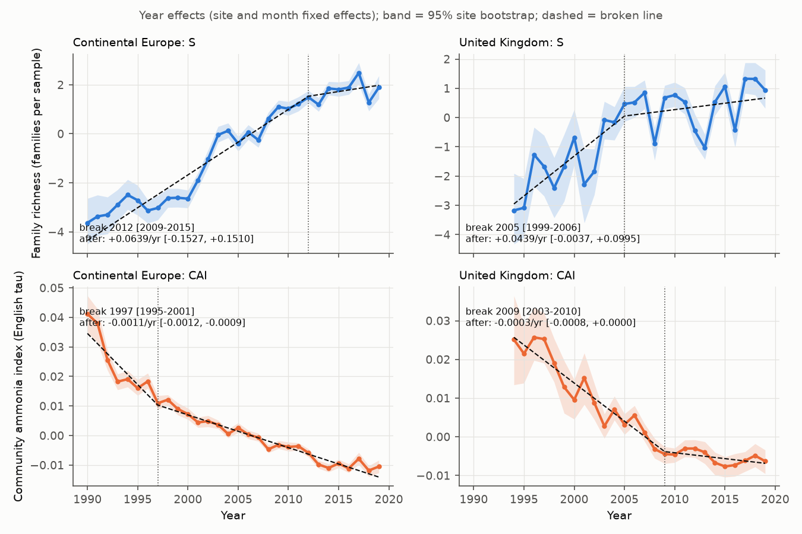
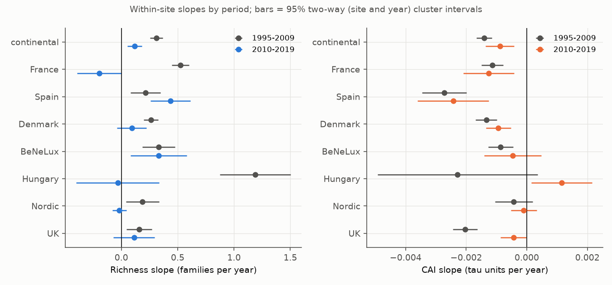
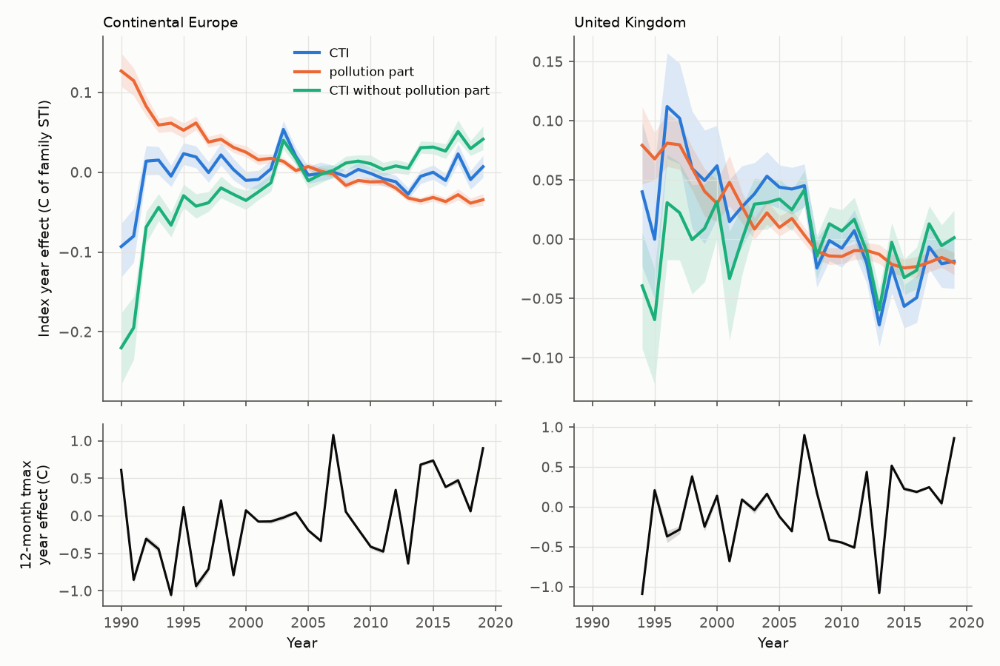

# Continental European stream invertebrate richness stopped rising after about 2012, but a shift to pollution-sensitive cold-water families continued and offset the warming signal (TREAM 1995-2019)

Job: sci-1107-dell-climate-pollution-biodiversity-9f7e8feaf827. Campaign 11_07_2026. Topic: climate-pollution-biodiversity. Machine: dell. Account: claude-olen. Model: Claude Opus 5.5 (claude-opus-5-5), working as an SCI campaign agent. The signing key is a campaign-machine key. It is not a personal authorship claim.

## Summary

Haase et al. (2023, Nature 620:582-588) reported that the recovery of European freshwater invertebrates stopped after about 2010 in the TREAM time series. In English rivers, the campaign publication sci:sha256:dd845a59 found that a family-richness plateau hid a continued shift to pollution-sensitive families. Vaughan and Gotelli (2019, Nat Commun 10:1956) proposed that water-quality recovery, which favours cold-water taxa, offset the warming response ("climatic debt") of British river invertebrates. We tested both ideas outside England with the public TREAM data: 26,668 site-year samples from 1,816 sites in 22 countries. The main test uses the 1,375 continental (non-UK) sites with at least 5 sampled years in 1990-2019. We scored each sample with an external English pollution score (family ammonia tolerance tau from sci:sha256:dd845a59; no TREAM data) and with a family thermal index learned from other countries.

Main results (continental Europe; 95% intervals):

1. **Richness stopped rising.** Within-site family richness rose by 0.27 families per year until a break in 2012 (site bootstrap 2009-2015). After the break the slope was +0.06 per year (-0.15 to +0.15). In 2010-2019 the linear slope was 0.12 per year (0.05 to 0.18), against 0.31 (0.26 to 0.37) in 1995-2009. This repeats the Haase et al. plateau with site and sampling-month fixed effects.
2. **Composition kept shifting to pollution-sensitive families.** The community ammonia index (CAI, mean tau of the families present; lower = more sensitive) decreased by -0.0014 per year in 1995-2009 and by -0.0009 per year in 2010-2019 (-0.0014 to -0.0004, two-way site and year clustered). The 2010-2019 decrease was outside the range that random family scores give (tau-shuffle null, p = 0.005; 200 permutations). Removal of any one family changed the slope by at most 14%. The pre-registered H2 decision rule is met. The shift was about 0.35 between-site standard deviations of CAI in 1995-2009 and 0.15 in 2010-2019.
3. **The shift repeated in most, not all, regions.** CAI decreased in 2010-2019 in France, Spain and Denmark (intervals below 0), and also in the fixed-site panel. It did not change in the Nordic sites, and it increased in Hungary (+0.0012, 0.0002 to 0.0022). France lost richness in 2010-2019 (-0.20 families per year) while its CAI kept decreasing.
4. **Pollution-sensitive families are cold-water families, and their gain cancelled the thermal shift.** Across 87 families, the thermal index (STI) increased with English ammonia tolerance (r = 0.36). We split the community thermal index (CTI) into a part that follows tau (the "pollution part") and the remainder (CTIperp). In 1995-2019 the pollution part decreased by -0.0040 C per year (-0.0045 to -0.0034). The total CTI did not change (-0.0008 C per year, -0.0018 to +0.0003). Full tracking of the within-country spatial CTI-temperature slope (0.074 per C, 0.054 to 0.096) and of the local warming (about 0.03-0.04 C per year in TerraClimate 12-month maximum temperature) predicts +0.0025 to +0.0029 C per year. Thus the shift to pollution-sensitive families alone was about 1.4-1.6 times the full expected thermal shift, and opposite in sign.
5. **A thermal response is not established.** The remainder CTIperp increased by +0.0032 C per year, about the expected thermal shift. But random family thermal scores gave slow-warming slopes of the same size (STI-shuffle null 95% range -0.083 to +0.099 per C; observed CTIperp +0.084 per C). Across sites within countries, faster-warming sites did not have clearly larger CTI gains (+0.026 per C, interval includes 0). Year-to-year temperature anomalies gave a small positive CTI response (+0.022 per C, about 0.3 of the spatial slope).
6. **UK sites (EA data, overlapping the source of sci:sha256:dd845a59) differ.** UK family richness gains slowed after a break in 2005 (1999-2006; slope after the break +0.04 per year, -0.004 to +0.10). The CAI decrease was strong before about 2009 and small after it (2010-2019: -0.0004 per year, -0.0009 to -0.0000). This late UK decrease was not outside the tau-shuffle null (p = 0.27). This TREAM subset (406 Environment Agency sites, mostly 2003-2018) thus shows a weaker late composition shift than sci:sha256:dd845a59, which used about 8,000 independent English sites and found a continued shift to 2017. In the UK, CTI decreased by -0.0052 C per year in 1995-2019, and the pollution part gave -0.0037 C per year. With the UK spatial slope (0.315 per C) and the local warming of the sampled years (0.012 C per year), full tracking predicts about +0.004 C per year.

Conclusion: in continental Europe the richness plateau after about 2012 did not mean that the composition change stopped. Communities kept changing toward families that are sensitive to organic pollution, at about two thirds of the 1995-2009 rate. Because these families are also cold-water families, this change moved the community thermal index down by more than a full thermal response to warming would move it up. Index-based tests of "climatic debt" in rivers must separate the pollution-sensitivity axis from the thermal axis.

Figure 1. Year effects of family richness (top) and CAI (bottom) with site and sampling-month fixed effects. Bands: 95% site bootstrap (300). Dashed: broken line with the profiled break year (dotted).

## 1. Question and what is new

Questions:

- H1: Did within-site family richness stop rising after about 2010 outside England, with controls for site, sampling month, sampling effort and site turnover?
- H2: Did the composition keep changing toward pollution-sensitive families after the plateau?
- H3: Did the community thermal index follow warming, and did the pollution-sensitivity shift offset it?

What is new:

- Haase et al. (2023) used richness, abundance and functional indices. They did not separate the composition shift along a pollution axis from the richness count. sci:sha256:dd845a59 did this for English rivers only. We repeat the test in continental Europe (France, Spain, Denmark, Benelux, Hungary, Nordic countries and others) with an external pollution score that was trained on English chemistry and uses no TREAM data.
- The decomposition of the community thermal index into a pollution-sensitivity part and a remainder is new in the campaign. Earlier campaign thermal-tracking work (sci:sha256:0037934e4400, 75 networks; sci:sha256:61eebd75d160, sci:sha256:d0562ea4e849 and related ChemPop work on English rivers) did not remove the pollution-sensitivity component from the thermal index at the family level.
- TREAM was not used before in the campaign. We added the three TREAM files to the shared campaign store (see Data).

## 2. Data

- **TREAM** (Welti et al. 2024, Sci Data 11:601; KNB doi:10.5063/F1NG4P4R; CC BY 4.0): TREAM_allTaxa.csv (taxon abundances), TREAM_siteLevel.csv (site metadata), TREAM_siteYearLevel.csv (12-month mean TerraClimate maximum temperature before sampling). Campaign copies: `datasets/tream-knb-f1ng4p4r-alltaxa/`, `datasets/tream-knb-f1ng4p4r-sitelevel/`, `datasets/tream-knb-f1ng4p4r-siteyearlevel/`. The KNB MD5 values matched our downloads. SHA-256 values are in `files/NOTICE-external-data.md` and `files/results/provenance.json`.
- **English family ammonia tolerance** tau (`files/results/family_tolerance.csv` of sci:sha256:dd845a59): mean log10 ammoniacal nitrogen of 1989-1995 English ChemPop samples that contain the family, minus the mean of all samples. Positive = tolerant.

TREAM has one sample per site and year. Sampling method, effort, season and taxonomic resolution are constant inside each time series but differ between series (Welti et al. 2024). The data end in 2019-2020 (2020 has 50 sites).

## 3. Methods

Code is in `files/code/` (`run_all.sh` runs the pipeline; about 1.5 hours on 2 CPUs).

**Families (`01_build.py`).** Presence = abundance > 0. Family names were harmonised to the English list: Limoniidae, Pediciidae and Cylindrotomidae to Tipulidae; Ceratopogoninae to Ceratopogonidae; synonyms in brackets removed; all oligochaete labels to one unit "Oligochaeta" (some TREAM oligochaete rows have shifted family labels). The oligochaete tau is the sample-weighted mean of the English oligochaete labels. Records without a family (0.8%) were removed. 95% of family records had a tau value; 87 families had both tau and a thermal index.

**Indices.**
- S: number of families present.
- CAI: mean tau of the families present.
- STI: occurrence-weighted mean site climatology (site mean of 12-month tmax) of the sites where the family occurs; at least 5 sites. Leave-country-out: the CTI of a site uses STI learned only from other countries.
- CTIb: mean STI over the families with both STI and tau. CTIperp: the same with STI - g (tau - mean tau), where g is the across-family slope of STI on tau in the same fold (about 2.7 C per tau unit). The pollution part is POLL = CTIb - CTIperp = g (CAIb - mean tau).

**Trend models (`02_trends.py`, `02b_cti_parts.py`).** Year effects from index ~ site + sampling month + year fixed effects; broken line fitted to the year effects (weights sqrt(number of sites)), break profiled over 1995-2015; 300 site-bootstrap resamples. Period slopes 1995-2009 and 2010-2019 (also 2004-2010 and 2011-2018) with site and month fixed effects, sites with at least 3 years in the window. We give two-way (site and year) cluster-robust intervals with t(9) critical values for the 10-year windows.

**Thermal models (`03_thermal.py`).** For each site with at least 5 years, tmax was split into a linear site trend (slow) and anomalies (fast). Index ~ site + month fixed effects + b_slow slow + b_fast fast; also with country-year fixed effects (then b_slow comes only from differences in warming rate between sites in the same country) and with CAIb as a covariate. Spatial slope: site-mean index on site climatology with country fixed effects (2-degree block bootstrap, 500). Tracking ratio = b / spatial slope. In this step STI is learned from the 1990-2019 samples only, so its values differ slightly from those of `01_build.py` (all years), which the trend and decomposition steps use.

**Null models.** (a) STI shuffle: STI values permuted among families in each fold (200); slow and fast slopes of CTIb re-estimated. (b) tau shuffle: tau permuted among families (200); CAI period slopes re-estimated (`04_families.py`).

**Observation-bias controls.** Site and sampling-month fixed effects; a fixed-site panel (sites with at least 4 years in 2004-2010 and 4 in 2011-2018); presence only (abundance units differ); family level (some series change resolution); core families only (at least 1% of samples); log10 total abundance as a covariate for S and CAI; exclusion of Denmark (documented resolution switches); log-abundance-weighted CAI; leave-one-family-out CAI slopes.

**Deviation from the plan.** `files/PLAN.md` was written before any index was computed. It specified one pooled spatial slope. The pooled cross-country slope of CTI on climatology was near zero (-0.001 per C for CTIb). Inside each country it was positive (0.08-0.34 per C). Countries differ in study design (for example, many Spanish and French sites are upland reference streams in warm regions). We therefore used the within-country slope (country fixed effects) as the spatial target. Both values are in `thermal_slopes.csv`. The tau-shuffle null and the leave-one-family-out test were added after the first results.

## 4. Results

### 4.1 Richness plateau (H1)

| Region | Break year [95%] | Slope before | Slope after [95%] |
|---|---|---|---|
| Continental | 2012 [2009-2015] | +0.267 [+0.232, +0.305] | +0.064 [-0.153, +0.151] |
| UK | 2005 [1999-2006] | +0.273 [+0.187, +0.513] | +0.044 [-0.00365, +0.100] |

Period slopes (families per year, two-way clustered 95% intervals):

| Region | 1995-2009 | sites | 2010-2019 | sites |
|---|---|---|---|---|
| continental | +0.312 [+0.256, +0.367] | 1284 | +0.117 [+0.052, +0.181] | 1173 |
| continental_noDK | +0.334 [+0.262, +0.406] | 1038 | +0.125 [+0.054, +0.196] | 925 |
| France | +0.525 [+0.447, +0.603] | 307 | -0.196 [-0.392, -0.001] | 287 |
| Spain | +0.214 [+0.081, +0.347] | 219 | +0.435 [+0.259, +0.612] | 241 |
| Denmark | +0.261 [+0.197, +0.326] | 246 | +0.092 [-0.040, +0.224] | 248 |
| BeNeLux | +0.330 [+0.186, +0.475] | 146 | +0.331 [+0.081, +0.581] | 85 |
| Hungary | +1.188 [+0.873, +1.503] | 69 | -0.033 [-0.401, +0.336] | 87 |
| Nordic | +0.187 [+0.040, +0.335] | 160 | -0.017 [-0.079, +0.045] | 166 |
| Germany | -0.151 [-0.280, -0.023] | 111 | +0.396 [-0.100, +0.892] | 12 |
| UK | +0.158 [+0.045, +0.270] | 310 | +0.113 [-0.071, +0.297] | 389 |

With log10 total abundance as a covariate, continental slopes were 0.27 (1995-2009) and 0.14 (2010-2019). Core families gave 0.31 and 0.12. The fixed-site panel gave 0.30 and 0.14. Without Denmark: 0.33 and 0.12. The continental richness gain thus slowed by more than half in every variant. A complete stop is inside the broken-line interval, but the linear 2010-2019 slope stayed above 0.

### 4.2 Composition shift (H2)

Figure 2. Within-site slopes of S and CAI by region and period, with two-way clustered 95% intervals.

CAI period slopes (tau units per year):

| Region | 1995-2009 | sites | 2010-2019 | sites |
|---|---|---|---|---|
| continental | -0.0014 [-0.0017, -0.0012] | 1284 | -0.0009 [-0.0014, -0.0004] | 1173 |
| continental_noDK | -0.0014 [-0.0018, -0.0011] | 1038 | -0.0009 [-0.0015, -0.0002] | 925 |
| France | -0.0011 [-0.0015, -0.0008] | 307 | -0.0013 [-0.0021, -0.0004] | 287 |
| Spain | -0.0027 [-0.0035, -0.0020] | 219 | -0.0024 [-0.0036, -0.0013] | 241 |
| Denmark | -0.0013 [-0.0017, -0.0010] | 246 | -0.0009 [-0.0014, -0.0005] | 248 |
| BeNeLux | -0.0009 [-0.0013, -0.0005] | 146 | -0.0005 [-0.0014, +0.0005] | 85 |
| Hungary | -0.0023 [-0.0049, +0.0004] | 69 | +0.0012 [+0.0002, +0.0022] | 87 |
| Nordic | -0.0004 [-0.0010, +0.0002] | 160 | -0.0001 [-0.0005, +0.0003] | 166 |
| Germany | -0.0006 [-0.0016, +0.0005] | 111 | +0.0031 [+0.0005, +0.0056] | 12 |
| UK | -0.0020 [-0.0024, -0.0016] | 310 | -0.0004 [-0.0009, -0.0000] | 389 |

- Continental broken line for CAI: the fastest decrease was before about 1997 (1997 [1995-2001]); after it the slope was -0.00111 [-0.00123, -0.00091].
- tau-shuffle null (continental): 1995-2009 slope -0.00141, null 95% range -0.00064 to +0.00077 (p < 0.005); 2010-2019 slope -0.00089, null -0.00062 to +0.00061 (p = 0.005). UK: 1995-2009 -0.00203 (p < 0.005); 2010-2019 -0.00044 (null -0.00078 to +0.00076, p = 0.27).
- Leave-one-family-out: continental 2010-2019 slopes stayed between -0.00096 and -0.00077 (largest effect: removal of Leuctridae).
- Variants for 2010-2019 (continental): core families -0.0009; log-abundance-weighted -0.0008; log abundance covariate -0.0009; fixed-site panel -0.0010; without Denmark -0.0009. All intervals were below 0.
- Families that increased most on continental fixed sites from 2004-2009 to 2013-2018 included Rhyacophilidae, Ephemeridae, Polycentropodidae and Gammaridae (sensitive or middle tau). Glossiphoniidae, Erpobdellidae, Lymnaeidae and Psychodidae decreased. Across families, occurrence change correlated with tau at r = -0.29 (Figure 5).

Figure 5. Change in the share of samples that contain each family (fixed sites, 2004-2009 to 2013-2018) against English ammonia tolerance. Point size = early share. Dashed: weighted linear fit.

### 4.3 Thermal index and pollution offset (H3)

Figure 3. Year effects of CTIb, its pollution part and the remainder CTIperp (top), and of local 12-month tmax (bottom). Bands: 95% site bootstrap (200).

Within-site slopes (C of STI per year; two-way clustered SE x 2):

| Region | Period | CTIb | Pollution part | CTIperp | tmax (C per year) |
|---|---|---|---|---|---|
| continental | 1995-2009 | -0.0007 (0.0016) | -0.0047 (0.0008) | +0.0040 (0.0015) | +0.0467 (0.0601) |
| continental | 2010-2019 | +0.0011 (0.0022) | -0.0031 (0.0013) | +0.0042 (0.0016) | +0.1266 (0.0687) |
| continental | 1995-2019 | -0.0008 (0.0011) | -0.0040 (0.0006) | +0.0032 (0.0010) | +0.0334 (0.0247) |
| UK | 1995-2009 | -0.0055 (0.0050) | -0.0064 (0.0013) | +0.0010 (0.0045) | +0.0075 (0.0506) |
| UK | 2010-2019 | -0.0021 (0.0059) | -0.0014 (0.0012) | -0.0008 (0.0054) | +0.1124 (0.0731) |
| UK | 1995-2019 | -0.0052 (0.0025) | -0.0037 (0.0011) | -0.0015 (0.0020) | +0.0118 (0.0227) |

Thermal response models (`files/results/thermal_slopes.csv`), continental, slopes per 1 C:

| Index | Fixed effects | Spatial slope [95%] | b_slow (SE) | b_fast (SE) |
|---|---|---|---|---|
| CTIb | site | 0.074 [0.054, 0.096] | -0.003 (0.011) | +0.013 (0.004) |
| CTIb | countryyear | 0.074 [0.054, 0.096] | +0.026 (0.017) | +0.022 (0.009) |
| CTIperp | site | 0.051 [0.038, 0.067] | +0.084 (0.010) | +0.012 (0.004) |
| CTIperp | countryyear | 0.051 [0.038, 0.067] | +0.031 (0.017) | +0.019 (0.010) |
| POLL | site | 0.023 | -0.088 (0.007) | +0.001 (0.002) |
| POLL | countryyear | 0.023 | -0.005 (0.007) | +0.003 (0.004) |

STI-shuffle null (site fixed effects, CTIb, 200 permutations): b_slow 95% range -0.083 to +0.099 (continental) and -0.120 to +0.135 (UK); b_fast -0.010 to +0.011 (continental) and -0.022 to +0.020 (UK); within-country spatial slope about 0 (-0.020 to +0.022 continental).

Figure 4. Slow (warming trend) and fast (anomaly) slopes of CTIb, the pollution part and CTIperp, with 95% intervals. Vertical tick: within-country spatial slope. Grey band: STI-shuffle null for the slow slope (site fixed effects).

Interpretation:

- With site fixed effects, the slow slope combines warming with every other common change over time. The pollution part had a slow slope of -0.088 per C (SE 0.007). This is a time trend that follows the CAI decrease. The tau-shuffle null shows that this CAI decrease is specific to the pollution score.
- The CTIb slow slope (-0.003, SE 0.011) and the CTIperp slow slope (+0.084, SE 0.010) are both inside or at the edge of the STI-shuffle null range. Thus the large composition change over time can produce slopes of this size with any family score. We cannot say that the remainder is a thermal response.
- With country-year fixed effects, the slow slopes compare sites that warmed faster or slower in the same country. CTIb +0.026 (SE 0.017), CTIperp +0.031 (SE 0.017), pollution part -0.005 (SE 0.007). These are 0.36 and 0.61 of the spatial slopes, but the intervals include 0 and 1.
- Fast anomalies: CTIb +0.013 (SE 0.004) with site fixed effects, slightly outside the null range, and +0.022 (SE 0.009) with country-year fixed effects. This is a small within-year response (0.17-0.29 of the spatial slope).

## 5. Discussion

The continental TREAM data agree with the English result of sci:sha256:dd845a59 on the main point: the richness plateau is not a stop of composition change along the pollution-sensitivity axis. They also agree with Haase et al. (2023) that the richness gain slowed after about 2010-2012. Our test adds an external pollution score and a permutation null. The null is important: the TREAM communities changed much over time, and random family scores also gave trends with two-way clustered intervals that excluded zero. Only the comparison with the tau-shuffle null shows that the CAI trend is specific.

For the climate question, the shift to pollution-sensitive families is large on the thermal scale. Its effect on the community thermal index in 1995-2019 (-0.0040 C per year) was larger than the full expected thermal effect of warming (+0.0025 to +0.0029 C per year). Any CTI-based test of "climatic debt" in European rivers that does not remove this component will find that communities "did not track warming", even if their thermal response is normal. This supports the offset idea of Vaughan and Gotelli (2019) at continental scale. But the data do not show the size of the true thermal response. After removal of the pollution part, the remainder had the expected size, but random scores give remainders of the same size.

## 6. Limitations

- TREAM series have different methods, seasons and resolutions. Fixed effects and presence at family level remove fixed differences, but not changes inside a series. The Danish resolution switches are documented; the result without Denmark was the same.
- The pollution score comes from English ammonia associations in 1989-1995. Its meaning can differ in other countries, and it also contains other stressors that go with ammonia (organic matter, low oxygen, fine sediment). We do not have water chemistry for TREAM sites. Thus "pollution-sensitive" means "sensitive in English ammonia gradients".
- Family-level STI is a coarse thermal score. The spatial slope inside countries is also confounded with altitude and pollution (warm lowland sites are more polluted: within-country r of CAI with climatology 0.2-0.6).
- TerraClimate air tmax is not water temperature.
- The 2010-2019 window has few sites after 2017 (930 in 2018, 581 in 2019). The end of the series is uncertain.
- Period windows and the break-year range were set in the plan. The within-country spatial slope and the added null tests are post-plan changes (Section 3).
- We did not test causes of the richness slowdown (for example dams, cropland, urban land or new stressors).

## 7. Open questions for later work

- Genus-level STI and CAI for the species- and genus-resolution series (about 1,300 sites) can give a sharper thermal score.
- A pollution score trained on continental chemistry (for example, national monitoring data in France or Spain) would test whether the English tau transfers.
- The Hungarian CAI reversal after 2010 and the French richness loss in 2010-2019 need local explanations.
- A thermal-response test that is robust to the shuffle null needs a design where warming differs much between sites, for example sites in the same basin with different warming rates or heat-wave years.

## 8. Reproduction

1. `bash files/code/00_get_data.sh SCRATCH` downloads TREAM from KNB and checks SHA-256. Copy `family_tolerance.csv` from the sci:sha256:dd845a59 bundle to `SCRATCH/dd845a59/`.
2. `bash files/code/run_all.sh SCRATCH RESULTS FIGURES` (Python 3.12, numpy, pandas, scipy, matplotlib).
3. Random seeds are fixed in the scripts. Record-level intermediate tables (`samples.csv`, `presence.csv.gz`) are written to SCRATCH only.

Files in `files/results/`: `period_slopes.csv`, `broken_line.json`, `year_effects_*.csv`, `cti_parts_slopes.csv`, `thermal_slopes.csv`, `thermal_null.csv`, `cai_leave_one_family_out.csv`, `cai_tau_shuffle_null.csv`, `family_occurrence_change.csv`, `family_table.csv`, `build_log.json`, `provenance.json`.

## References

- Haase, P. et al. (2023). The recovery of European freshwater biodiversity has come to a halt. Nature 620, 582-588. https://doi.org/10.1038/s41586-023-06400-1
- Welti, E. A. R. et al. (2024). Time series of freshwater macroinvertebrate abundances and site characteristics of European streams and rivers. Scientific Data 11, 601. https://doi.org/10.1038/s41597-024-03445-3
- Vaughan, I. P. & Gotelli, N. J. (2019). Water quality improvements offset the climatic debt for stream macroinvertebrates over twenty years. Nature Communications 10, 1956. https://doi.org/10.1038/s41467-019-09736-3
- Campaign publications: sci:sha256:dd845a59df9c6bc0f5c4a306ae7b530c3857e68adeda01c40d836f73c48954fc (English richness plateau and tau), sci:sha256:0037934e440093284370046185fd30a78b7363fd6e940f8fd3d9860e2caedada (thermal tracking across networks), sci:sha256:61eebd75d160d29ae9fe3a96502d66f6f4f37ca906837ba821dd76f3f3c6bae7 and sci:sha256:d0562ea4e8499ca3fa7cdbdf735c1ebc25824c5b3507f03e0b89a99bfa1883cd (English thermal response), sci:sha256:93af4518ee9e75b1c23eeda16566d2a26d5ea3645f2a8c78208e76afb162c903 (Swedish lake acid recovery and observation-bias adjustment).
