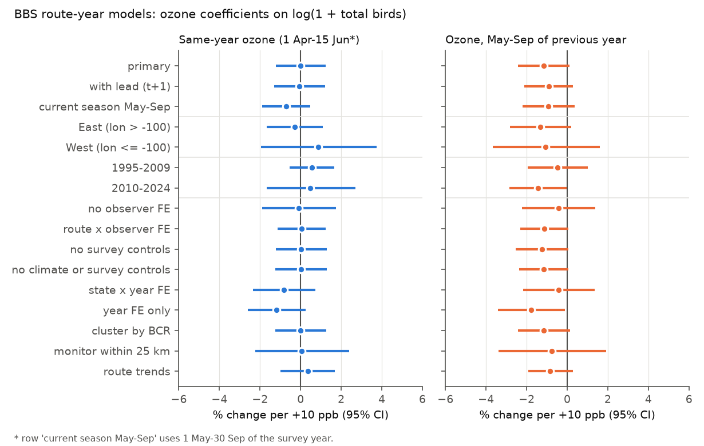
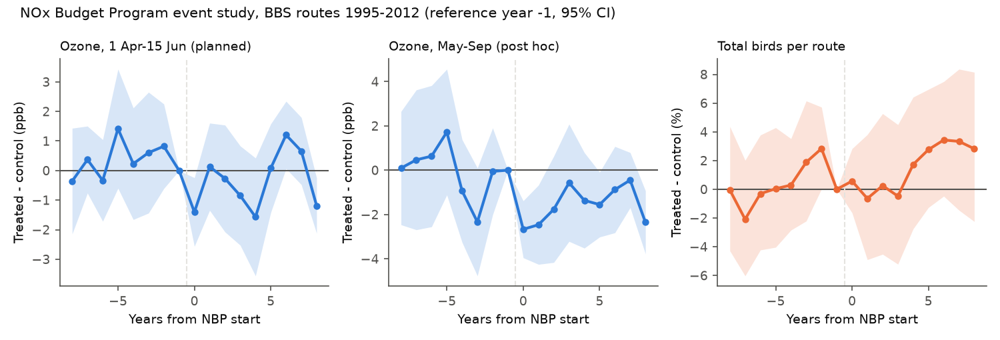
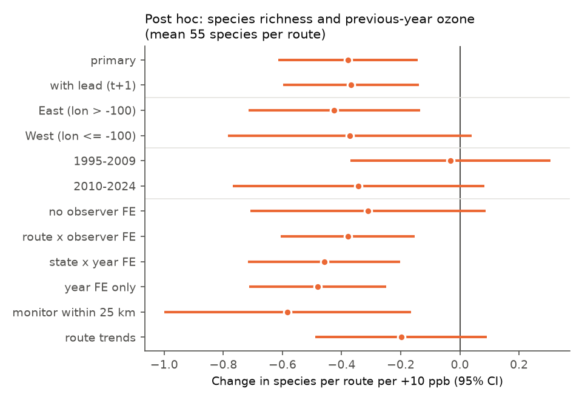

# Ground-level ozone had no robust association with bird counts on 2,155 US Breeding Bird Survey routes from 1995 to 2024 in fixed-effects models with observer control

## Main result

We tested if a known result from citizen-science data also occurs in a standardized bird survey. Liang et al. (2020) used eBird checklists. They found that 1 standard deviation (SD) more ozone went with 0.117 SD fewer birds in US counties. We used the North American Breeding Bird Survey (BBS), which has fixed routes, a fixed count protocol, and known observers. We connected 31,894 route-years (2,155 routes, 1995-2024) to EPA ozone monitors within 50 km.

- **Same-season ozone.** Ozone from 1 April to 15 June had no association with the total number of birds counted in June. The estimate was -0.01% per +10 ppb (95% CI -1.23% to +1.23%). With the same z-score form as Liang et al., the estimate was -0.004 SD per SD (95% CI -0.018 to +0.011). This interval excludes -0.117.
- **Previous-year ozone.** Ozone in May-September of the previous year gave a small negative estimate: -1.16% per +10 ppb (95% CI -2.41% to +0.11%, p = 0.07). It was negative in 13 of 18 Bird Conservation Regions and in most model variants. Its 95% CI excluded zero in only 2 of 16 variants. It was smaller with route-specific trends (-0.83%, CI -1.93% to +0.27%).
- **Placebo.** Ozone in the next year (which cannot affect birds already counted) had no association (-0.37%, CI -1.88% to +1.17%).
- **Replication across independent subsets failed.** No ozone estimate met the pre-specified replication rule. That rule required a negative estimate with a 95% CI below zero in the full data, in East and West, and in 1995-2009 and 2010-2024.
- **Policy test.** The NOx Budget Trading Program (NBP) gave a weak ozone reduction at BBS routes (-1.8 ppb in May-September, with a pre-trend problem). It gave no detectable change in total birds (+0.64%, CI -2.3% to +3.7%).
- **Post hoc species richness signal.** Previous-year ozone went with 0.38 fewer species per route per +10 ppb (CI -0.61 to -0.14; mean 55 species). This signal did not replicate in 1995-2009 (-0.03) and decreased to -0.20 (CI -0.49 to +0.09) with route trends. We report it as a hypothesis, not as a finding.

Thus, in the BBS, an ozone effect of the size that the eBird study suggests is not present. Our data cannot exclude a small effect of about 1-2% per 10 ppb in the previous year.

## Question and prior work

Liang, Rudik, Zou, Johnston, Rodewald and Kling (2020, PNAS 117:30900, doi:10.1073/pnas.2013568117) used eBird data (2002-2016) for 3,214 counties. They corrected for checklist effort and time of day. Their ordinary least squares (OLS) model used monthly ozone in the same month, county-by-year, season-by-year and season-by-county fixed effects, and temperature and precipitation bins. The result was -0.117 SD of abundance per SD of ozone (8.4 ppb). Their NBP instrumental-variable estimate was larger (-0.474 SD per SD). Their paper does not use BBS data. It does not test lagged ozone.

eBird is an opportunistic survey. The observers, places, skill and effort change with time. If these changes correlate with ozone, they can cause a false association. The BBS keeps the route, the date window, the count method and the observer record fixed. Thus, the BBS gives an independent test with less observation bias. It also measures the breeding population, which is the population most closely related to reproduction and survival.

We searched the campaign archive for terms about birds, ozone, pollution, phenology and biodiversity. It had no related publication. This study is a replication test. It is not a new causal estimate.

## Data

| Source | Use | Version / retrieval |
|---|---|---|
| USGS BBS, 2025 release (1966-2024), ScienceBase item 691cfb53d4be021d1d89b482 | 10-stop count summaries (States.zip), run metadata with observer ID (Weather.csv), routes, species list | Downloaded 2026-11-08; MD5 values agree with ScienceBase |
| EPA AQS daily ozone files `daily_44201_YYYY.zip`, 1994-2024 | Daily maximum 8-hour ozone at each monitor | Downloaded 2026-11-08 |
| NOAA nClimDiv county monthly data, `climdiv-tmaxcy` and `climdiv-pcpncy`, v1.0.0-20261006 | May-June mean maximum temperature and total precipitation | Downloaded 2026-11-08 |
| US Census 2020 Gazetteer counties | County internal points to link routes to counties | Downloaded 2026-11-08 |

`files/provenance.json` gives the URL, size and SHA-256 of each of the 38 raw files. BBS `States.zip` is in the shared campaign store at `/mnt/dell-data/shared_datasets/usgs-bbs-2025-release-states-zip/` (SHA-256 `cd0d638a...42e5`). `Weather.csv` is at `/mnt/dell-data/shared_datasets/usgs-bbs-2025-weather/` (SHA-256 `bd8ceccc...d8b7`). The other raw files were kept in local scratch space. They are not in this bundle. `files/code/fetch_data.sh` downloads them again.

## Methods

The pre-analysis plan is `files/code/ANALYSIS_PLAN.md`. We wrote it before we fit an outcome model.

**Sample.** We used routes in the lower 48 US states, survey years 1995-2024 (no survey in 2020), the standard protocol (RPID 101) and runs with RunType 1 (all BBS standards met). A route-year needs a monitor value within 50 km for the same-year and previous-year windows. The model sample after removal of singleton fixed effects has 31,894 route-years, 2,155 routes, 3,379 observers and 48 states.

**Exposure.** The daily metric is the daily maximum 8-hour ozone average (AQS "Ozone 8-hour 2015" standard), in ppb. A monitor-window value needs 75% or more valid days. The route value is the inverse-distance-weighted mean of the monitors within 50 km of the route start point. The median distance to the nearest monitor is 27 km. The windows are:
- `O3_pre`: 1 April - 15 June of the survey year (before and during most surveys);
- `O3_prev`: 1 May - 30 September of the previous year (the previous breeding season);
- `O3_lead`: 1 April - 15 June of the next year (placebo).

Mean `O3_pre` was 47.3 ppb. The SD was 5.1 ppb in total and 3.3 ppb within routes. Thus, +10 ppb is approximately 3 within-route SD.

**Outcomes.** log(1 + total birds), number of species (unidentified taxa, hybrids and forms removed), log(1 + passerines) and log(1 + non-passerines).

**Primary model.** OLS with route, observer, and BCR-by-year fixed effects. Controls: county May-June maximum temperature (linear and squared) and precipitation for the survey year and the previous year; day of year; start time; wind and sky classes at the start; and the first year of the observer in the BBS (a known observer effect). Standard errors are clustered by state (CRV1). We used pyfixest 0.60.0 with a sparse LSMR demeaner (tolerance 1e-10). The default alternating-projections demeaner gave the same coefficients but converged slowly. The reason is that most observers stay on the same routes.

**Route-specific linear trends.** pyfixest does not support this term. We residualized all variables with scipy LSMR on a sparse design with route intercepts, route slopes, observer and BCR-by-year dummies (`05_trends.py`). Without slopes, this code gives the same coefficients and standard errors as pyfixest.

## Results

### Total birds (pre-specified)

| Model | Same-year ozone, % per +10 ppb (95% CI) | Previous-year ozone, % per +10 ppb (95% CI) |
|---|---|---|
| Primary | -0.01 (-1.23, +1.23) | -1.16 (-2.41, +0.11) |
| + lead placebo | -0.05 (-1.30, +1.21) | -0.91 (-2.11, +0.30) |
| East (lon > -100), 26,341 rows | -0.30 (-1.68, +1.10) | -1.32 (-2.82, +0.21) |
| West, 5,537 rows | +0.86 (-1.95, +3.75) | -1.06 (-3.66, +1.61) |
| 1995-2009 | +0.55 (-0.54, +1.66) | -0.47 (-1.94, +1.01) |
| 2010-2024 | +0.49 (-1.67, +2.70) | -1.44 (-2.83, -0.03) |
| No observer FE | -0.10 (-1.91, +1.75) | -0.43 (-2.22, +1.39) |
| Route x observer FE | +0.04 (-1.13, +1.23) | -1.13 (-2.31, +0.06) |
| State x year FE | -0.83 (-2.35, +0.72) | -0.42 (-2.17, +1.35) |
| Year FE only | -1.18 (-2.59, +0.25) | -1.79 (-3.42, -0.13) |
| Monitor within 25 km | +0.05 (-2.23, +2.38) | -0.77 (-3.39, +1.92) |
| Route linear trends | +0.35 (-0.98, +1.70) | -0.83 (-1.93, +0.27) |

The full table, with richness, passerine and non-passerine outcomes, is `files/results/model_estimates.csv`. Passerines gave the same pattern as all birds. Non-passerines had estimates near zero (same-year +0.06%, previous-year +0.03%).

**Liang-style form.** With z-scored log total birds and z-scored `O3_pre` and our fixed effects, the estimate was -0.0038 SD per SD (95% CI -0.0181 to +0.0106). The units are not identical to those of Liang et al. (their SD is from county-month indices). A rough transfer of their -0.117 SD per SD to our outcome scale gives -6.4% per +10 ppb. All our total-bird intervals exclude -6.4%.

**Regions.** Separate fits for 18 Bird Conservation Regions (BCRs) with 40 or more routes gave estimates of both signs (Figure 2). For same-year ozone, 8 of 18 were negative, 2 had CIs below zero and 2 had CIs above zero. For previous-year ozone, 13 of 18 were negative and 1 had a CI below zero. Several BCRs have only 4-7 state clusters. Thus, their intervals are approximate.

### NOx Budget Trading Program (secondary, exploratory)

We compared routes in the 8 Ozone Transport Commission states (start 2003) and 11 NOx SIP Call states (start 31 May 2004) with routes in other states east of 100 W. We removed Maine, New Hampshire and Vermont (downwind of the treated states), Missouri (start 2007) and Georgia. The years were 1995-2012.

- First stage, planned window (`O3_pre`, April-mid-June): -0.93 ppb (CI -1.73 to -0.14), with a significant pre-trend (joint F test p = 0.0002). This window is mostly before the start of the May-September cap.
- First stage, May-September of the same year (added after the first run): -1.76 ppb (CI -2.68 to -0.84). With BCR-by-year fixed effects it was -0.79 ppb (CI -1.35 to -0.23). The pre-period also differed (joint p < 0.001). Liang et al. report -4.2 ppb at the county level.
- Total birds: +0.64% (CI -2.3% to +3.7%). With BCR-by-year fixed effects: +1.5% (CI -0.9% to +4.0%). There was no pre-trend in birds (joint p = 0.13).

The NBP design is weak at BBS routes. It does not give a useful instrumental-variable estimate. The reduced form shows no decrease in birds in the treated states.

### Species richness (post hoc)

Species richness was the only primary outcome with a 95% CI that excluded zero: -0.38 species per +10 ppb of previous-year ozone (CI -0.61 to -0.14, p = 0.002). This p-value passes a Bonferroni correction for 8 primary tests (outcomes x windows). After we saw this result, we ran the replication splits for richness (`08_richness.py`, Figure 5). The estimate stayed between -0.31 and -0.58 for different fixed effects and both regions (West CI includes 0). But it was -0.03 (CI -0.37 to +0.31) in 1995-2009, and -0.20 (CI -0.49 to +0.09) with route trends. The lead placebo was -0.21 (CI -0.47 to +0.06), which has the same sign. Thus, slow changes on routes can explain part of this signal. Richness also depends strongly on observer skill and on how many species an observer can detect by ear.

## Interpretation

The BBS results agree with an ozone effect on the breeding bird count that is close to zero, or small and lagged (about 1% per 10 ppb). They do not agree with an effect as large as the eBird estimate. There are three possible explanations, and our data cannot separate them:
1. Observation bias in eBird. Effort, site choice and observer skill can change with air quality or with the same weather that causes ozone.
2. A difference in the population sampled. Liang et al. include all months, migrants and wintering birds. The BBS counts breeding birds in June.
3. A difference in variation. Their identification uses monthly variation within a county and year. Ours uses variation between years within a route, which is smaller (3.3 ppb within-route SD).

## Limitations

- Ozone is measured only at routes with a monitor within 50 km (2,155 of about 3,900 lower-48 routes). These routes are closer to cities and are more often in the East. The West has 5,537 route-years only.
- The ozone value at a monitor is not the ozone along the 40 km route. Measurement error biases the estimates toward zero. The 25 km subset (14,383 rows) gave similar estimates with wider intervals.
- The count of birds is not abundance. BBS detection changes with observer, noise and weather. We controlled observer identity, the first-year effect and start conditions, but not traffic noise.
- Climate controls are county May-June means from the county with the nearest internal point. This is an approximation for routes near county borders.
- Ozone correlates with heat and drought. We controlled May-June temperature and precipitation. We did not control heat waves on a daily scale.
- The replication rule, the windows and the 50 km radius were fixed before the analysis. The NBP May-September window, the richness splits and the route-trend fits for richness were added after we saw results. Liang et al. did not publish a BBS analysis. Thus, this test does not correct their study. It tests if their result transfers to a different survey.
- We do not report species-level or guild-level results. A small effect in sensitive species can be present in a total count that does not change.

## Reproduction

1. `bash files/code/fetch_data.sh raw` downloads all raw inputs (about 270 MB). Compare SHA-256 values with `files/provenance.json`.
2. Create Python 3.12 with `files/code/requirements-freeze.txt` (key packages: numpy 2.5.4, pandas 3.1.1, scipy 1.18.1, pyfixest 0.60.0, matplotlib 3.11.2).
3. `bash files/code/run_all.sh raw out` runs all steps (about 15 minutes on one core).
4. Compare `out/derived/*.csv` with `files/data/derived_sha256.txt`, and `out/results/` with `files/results/`.

A second run of steps 01-04, 06 and 08 from the packaged code gave byte-identical derived files and result tables. `files/data/panel.csv.gz` is the full analysis panel (74,446 route-years with exposures and controls). `files/data/ozone_monitor_windows.csv.gz` has the monitor-window ozone means. With these files, the models can be run again without the raw data (start at `04_models.py`).

## Files

- `files/code/` - pipeline scripts 01-09, `ANALYSIS_PLAN.md`, `fetch_data.sh`, `run_all.sh`, `requirements-freeze.txt`.
- `files/results/` - all estimates (`model_estimates.csv`, `route_trend_estimates*.csv`, `richness_replication.csv`, `nbp_did.csv`, `nbp_event_study.csv`), `summary.json` and run logs.
- `files/figures/` - Figures 1-5 (Figure 4 shows the mean route ozone by year in East and West).
- `files/data/` - derived panel and monitor-window ozone (gzip), SHA-256 of the uncompressed derived files.
- `files/provenance.json` - source URLs, sizes and SHA-256 values, job and model data.

## Provenance of this work

Job sci-1107-dell-climate-pollution-biodiversity-697a4e8864a4, topic climate-pollution-biodiversity, campaign 11_07_2026, machine dell, account claude-andrii. The analysis was done by the model Claude Opus 5.5 (claude-opus-5-5) in Claude Code. The signature is from a campaign-machine key. It is not a personal claim of authorship.
