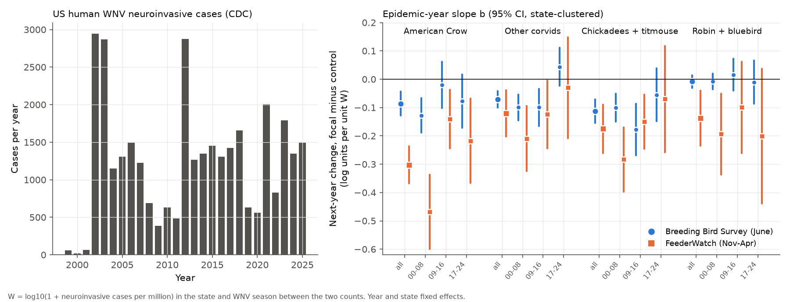
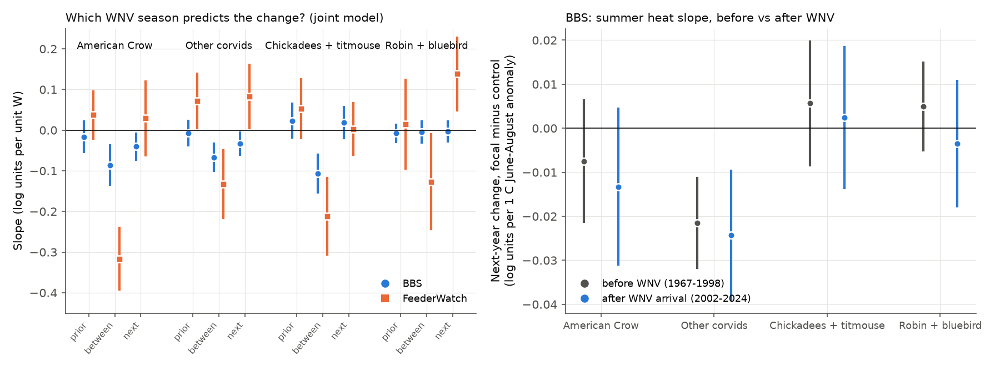
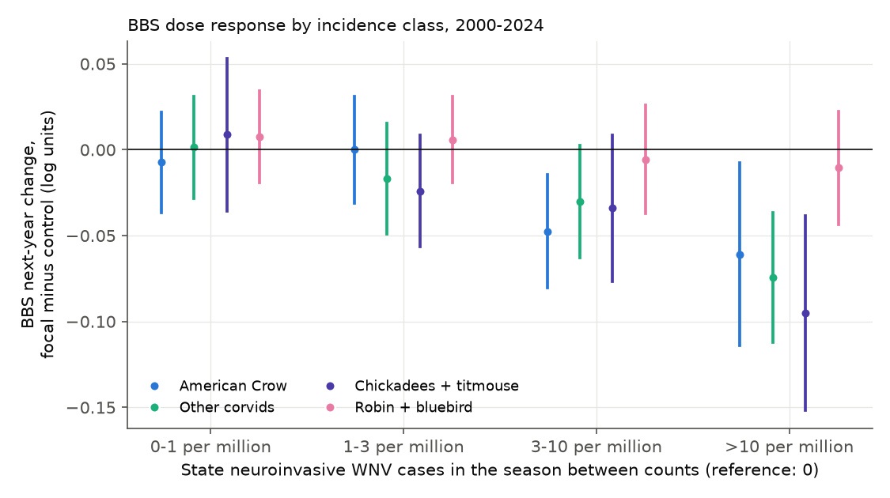

# West Nile virus epidemic years predicted next-year decreases of crows, other corvids and chickadees in two independent US bird surveys in 2000-2024; the link became weaker after 2008, and summer heat alone did not show it

**Job:** sci-1107-hp-climate-pollution-biodiversity-62c7b8e70515 · **Topic:** climate-pollution-biodiversity · **Machine:** hp · **Model:** Claude Opus 5.5 (claude-opus-5-5) · **Campaign:** 11_07_2026 · **Date:** 2026-11-11.
The signing key is a campaign-machine key. It is not a personal authorship claim.

## 1. Question

West Nile virus (WNV) came to North America in 1999. Earlier studies found large decreases of American Crow and some other species after the arrival of the virus (LaDeau et al. 2007; George et al. 2015). Two questions stay open:

1. Do the **epidemic years** after the invasion (for example the heat-related epidemic of 2012) still decrease susceptible bird species in the next year, or did this effect stop after the first wave?
2. Warm summers increase WNV transmission. Is there a **climate x pathogen** interaction: does summer heat decrease susceptible birds only after the virus arrived?

We also wanted an independent check of each result with a second observation system, so that observer and survey bias in one program cannot make the result.

The campaign record had no publication on WNV and birds. The only WNV publication (sci:sha256:eb7cf679...) forecasts human disease counts.

## 2. Data

All inputs are public. We read them in place from the shared campaign dataset store. `files/data_sources.tsv` gives the exact file names, source URLs, sizes and SHA-256 hashes. We checked the hashes of all small and medium input files against the store records.

| Source | Use | Terms |
| --- | --- | --- |
| CDC ArboNET "Historic State" WNV human case table, 1999-2025 (Internet Archive capture of 2026-07-26) | Neuroinvasive cases per state and year | US Government work |
| US Census Bureau state population estimates (2000-2010 intercensal; 2010-2020 and 2020-2024 vintages) | Cases per million | US Government work |
| USGS North American Breeding Bird Survey (BBS), 1966-2025 release (States.zip, Weather.csv, Routes.csv, SpeciesList.csv) | Breeding-season counts on roadside routes, June | US Government work (public domain) |
| Project FeederWatch raw data, May 2024 release (Cornell Lab of Ornithology and Birds Canada), seasons 1988/89-2023/24 | Winter counts at feeders, November-April | Open access; see `NOTICE-external-data.md` |
| NOAA PSL GHCN-CAMS monthly 0.5 degree land air temperature | June-August temperature anomaly at each route | US Government work |

The bundle does **not** contain record-level BBS or FeederWatch data. It contains only our code, our aggregate result tables, state-year exposure tables from US Government sources, and figures.

## 3. Method

A pre-analysis plan (`files/plan.md`) was written before we fitted any outcome model. Section 6 lists the differences from the plan.

**Exposure.** W(s,t) = log10(1 + human neuroinvasive WNV cases per million residents) in state s and year t. Human neuroinvasive cases are a proxy for local bird-mosquito transmission in July-October. State-years without a CDC row have 0 cases. Median W in 2000-2024 is 0.38 (1.4 cases per million). The 90th percentile is 1.10 (11.6 per million).

**Bird groups (fixed before analysis).** G1 American Crow (primary); G2 other corvids (Blue Jay, Fish Crow, magpies, scrub-jays); G3 parids (Black-capped and Carolina Chickadee, Tufted Titmouse); G4 American Robin and Eastern Bluebird. The BBS control is the sum of all other identified species on the same run. The FeederWatch control is the sum of six common feeder species (Northern Cardinal, Mourning Dove, Dark-eyed Junco, Downy Woodpecker, White-breasted Nuthatch, American Goldfinch).

**Test 1, BBS.** We used consecutive-year pairs (t, t+1) on one US route, with acceptable runs in both years and the same observer. The June count of year t comes before the WNV season of year t; the June count of year t+1 comes after it. D = [ln(group(t+1)+1) - ln(group(t)+1)] - [same for control]. Routes enter a group's analysis only if the group was recorded on at least half of the route's runs since 1990. Model: D ~ b W(s,t) + year fixed effects + state fixed effects. Thus b uses the year-to-year epidemic variation within each state, after removal of continent-wide year effects. Standard errors are clustered by state. We also used a state block bootstrap (499 draws).

**Test 2, heat before and after WNV.** The same D was regressed on the June-August temperature anomaly at the route (GHCN-CAMS, base 1991-2020), separately for 1967-1998 (before WNV) and for 2002-2024 (after first WNV case in the state). We also tested whether state summer heat predicts W.

**Test 3, FeederWatch.** We used the same site in consecutive winters. The winter that starts in November of year t comes after the WNV season of year t. For each group we used the mean count per checklist (absent = 0). Sites needed at least 4 checklists in each winter. D = [ln(mean(k+1)+0.1) - ln(mean(k)+0.1)] - [same for control]. The model and the inference are the same as in Test 1.

**Falsification.** In a joint model, we added the WNV index of the season before the pair (lag) and of the season after the second count (lead). If the link is causal and has the correct timing, only the "between" season should predict D.

## 4. Results

### 4.1 Epidemic years predicted next-year decreases in both surveys

Table 1. Slope b of next-year change (focal minus control, log units) per unit of W. 95% confidence intervals, clustered by state. Year and state fixed effects. BBS exposure years 2000-2024; FeederWatch (FW) 2001-2023.

| Group | BBS all | BBS 2000-08 | BBS 2009-16 | BBS 2017-24 | FW all | FW 2001-08 | FW 2009-16 | FW 2017-23 |
| --- | --- | --- | --- | --- | --- | --- | --- | --- |
| American Crow | -0.086 [-0.129, -0.043] | -0.128 [-0.188, -0.067] | -0.020 [-0.102, +0.062] | -0.077 [-0.171, +0.016] | -0.302 [-0.368, -0.236] | -0.468 [-0.600, -0.337] | -0.140 [-0.244, -0.037] | -0.217 [-0.367, -0.068] |
| Other corvids | -0.072 [-0.101, -0.042] | -0.100 [-0.145, -0.054] | -0.099 [-0.165, -0.033] | +0.044 [-0.024, +0.111] | -0.121 [-0.202, -0.039] | -0.210 [-0.325, -0.094] | -0.124 [-0.244, -0.005] | -0.030 [-0.209, +0.149] |
| Chickadees + titmouse | -0.113 [-0.155, -0.072] | -0.101 [-0.150, -0.051] | -0.178 [-0.269, -0.086] | -0.055 [-0.149, +0.038] | -0.175 [-0.261, -0.090] | -0.284 [-0.398, -0.169] | -0.150 [-0.246, -0.054] | -0.070 [-0.258, +0.117] |
| Robin + bluebird | -0.008 [-0.031, +0.014] | -0.009 [-0.036, +0.019] | +0.016 [-0.041, +0.072] | -0.010 [-0.087, +0.066] | -0.137 [-0.234, -0.040] | -0.194 [-0.337, -0.050] | -0.100 [-0.261, +0.062] | -0.200 [-0.438, +0.037] |

- For all-period BBS slopes, Holm-adjusted p values are 1.5e-4 (crow), 4.9e-6 (corvids), 3.5e-7 (parids) and 0.46 (robin + bluebird). For FeederWatch they are 1.3e-18, 0.0073, 1.7e-4 and 0.0073.
- State block bootstrap 95% intervals: BBS crow [-0.128, -0.042], corvids [-0.101, -0.039], parids [-0.155, -0.069], robin + bluebird [-0.032, +0.013]. FW crow [-0.364, -0.221], corvids [-0.206, -0.040], parids [-0.264, -0.088], robin + bluebird [-0.218, -0.032].
- The control species did not change with W in BBS (b = +0.001 [-0.008, +0.009]). In FeederWatch they increased slightly (b = +0.031 [+0.002, +0.061] in the crow sample). Thus the decreases come from the focal species, not from the control.
- **Size.** In a state-year at the 90th percentile of W (about 12 neuroinvasive cases per million), the BBS slope gives a next-year crow count about 9% lower relative to the control species (exp(-0.086 x 1.10) = 0.91). The FeederWatch slope is larger on its log(mean + 0.1) scale (about -0.33 log units at W = 1.10). Winter feeder counts include flocks and roosts, so the two scales are not directly comparable.
- **Dose response (BBS, Figure 3).** Relative to state-years with 0 cases, the crow decrease is -0.007 [-0.037, +0.022] at 0-1 cases per million, 0.000 at 1-3, -0.047 [-0.080, -0.015] at 3-10, and -0.061 [-0.114, -0.008] above 10. Corvids and parids show the same monotonic pattern. Robin + bluebird does not.

### 4.2 The link became weaker after 2008, but did not stop for crows in FeederWatch

In BBS, a model with W x period terms shows that the crow slope in 2009-2016 was +0.092 [+0.038, +0.147] less negative than in 2000-2008. In 2017-2024 it was +0.064 [+0.008, +0.120] less negative. For other corvids the differences were +0.056 and +0.072, both with intervals above zero. For parids the slope did not clearly become weaker in 2009-2016 (-0.049 [-0.104, +0.007]).

In FeederWatch, the crow slope remained clearly negative in each period (-0.140 in 2009-2016 and -0.217 in 2017-2023). The corvid and parid slopes in 2017-2023 had wide intervals that include zero. Thus the data agree with an epidemic-year effect that was largest during the invasion wave. A smaller effect continued at least for crows. The data do not show whether the decrease is from host adaptation, from population decreases that leave fewer susceptible birds, or from changes in human case reporting.

### 4.3 Falsification: timing is mostly correct, with one BBS exception

In the joint lag-between-lead model (Figure 2, left):

- FeederWatch crow: lag +0.038 [-0.020, +0.095], **between -0.316 [-0.392, -0.241]**, lead +0.029 [-0.061, +0.120]. The timing is as predicted.
- FeederWatch parids: lag +0.053, **between -0.212 [-0.307, -0.118]**, lead +0.003. As predicted.
- BBS parids: lag +0.023, **between -0.107 [-0.154, -0.061]**, lead +0.019. As predicted.
- BBS crow and corvids: between -0.086 and -0.067 (both clearly negative), but the lead term was also negative (crow -0.041 [-0.073, -0.009]; corvids -0.033 [-0.061, -0.006]). A part of the next-season WNV signal may already act before the June count (early-season transmission), or a part of the BBS corvid link may come from state trends that W follows. This is a partial failure of the falsification test for BBS corvids.
- FeederWatch robin + bluebird failed the test: lead +0.139 [+0.049, +0.228]. Winter robins and bluebirds move in flocks that follow fruit and weather. We do not consider the FeederWatch robin + bluebird decrease to be a WNV effect. In BBS this group showed no link.

Other robustness checks for BBS (in `files/data/bbs_results_robust.csv`) did not change the signs or the conclusions for crow, corvids and parids: no state fixed effects, a route fixed effect, cases per million (linear, top-coded at the 99th percentile), observer changes allowed, and removal of the 2002-2003 invasion years. With 2002-2003 removed, the crow slope decreased to -0.048 [-0.085, -0.012] in BBS and to -0.220 [-0.278, -0.162] in FeederWatch.

### 4.4 Summer heat alone did not show a pathogen-dependent effect (null result)

- Summer heat predicted state WNV incidence: +0.056 W per 1 C of June-August anomaly [+0.017, +0.096] in 2002-2025 (year and state fixed effects). The slope was larger in 2002-2008 (+0.114) than in 2009-2025 (+0.032, interval includes zero).
- But the route-level heat slope on D did not become more negative after WNV arrived. For crow: -0.008 [-0.021, +0.006] before 1999 and -0.013 [-0.031, +0.004] after. Other corvids had a negative heat slope both before (-0.022 [-0.032, -0.011]) and after (-0.024 [-0.039, -0.010]) WNV. Thus this heat effect is not WNV-dependent. Parids and robin + bluebird showed no heat link in either period.
- This null result is what the two measured links predict. The chain heat -> W -> crows gives about 0.056 x -0.086 = -0.005 log units per 1 C. This is less than the standard error of the direct heat test (about 0.009). Thus heat-driven WNV transmission can have an effect on crows that these data cannot detect through temperature alone. The epidemic index is a much stronger exposure measure than temperature.

## 5. What is new

- A dose-response test of **each epidemic year** after the invasion, with year and state fixed effects. Earlier BBS work mostly compared periods before and after WNV arrival.
- **Independent replication** with a second program that has different observers, season (winter, at feeders) and protocol. The crow, corvid and parid results repeat in both programs.
- A **time split** that shows a weaker but continuing effect after 2008, with a formal test of the period difference.
- A **climate x pathogen null** with a quantitative explanation: summer heat is too weak and too indirect a proxy to show the WNV effect on birds.

## 6. Differences from the plan and limitations

- **Differences from plan.** (1) The BBS 50-stop files are complete only from 1997, so we used the 50-stop totals in the 10-stop summary files (States.zip) for all years. (2) FeederWatch G2 also includes Florida Scrub-Jay (very rare in the sample). (3) The bootstrap used 499 draws, as planned, after a faster implementation. (4) We added the dose-class model and the heat -> W model after the main tests. These are descriptive additions.
- **Exposure error.** Human neuroinvasive cases depend on human exposure, testing and reporting, not only on bird infection. State totals hide large differences within states. This error probably makes the slopes smaller than the true effect, but reporting changes over time can also produce part of the period differences.
- **Correlational design.** Year and state fixed effects remove continent-wide shocks and fixed state differences. They do not remove state-specific weather or land-use shocks in the same year that change both WNV and birds. The control-species difference removes shocks that act on all species.
- **BBS lead term.** The negative lead term for BBS crow and corvids (Section 4.3) shows that a part of the BBS corvid link may not have the correct timing.
- **Counts are not abundance.** BBS and FeederWatch give relative counts. Detection can change if sick birds behave differently, or if crow roosts move. The two programs have different detection processes and give the same sign, but this does not prove that detection bias is absent.
- **Group results** combine species. We did not estimate species-level slopes, except American Crow.
- **No Canadian data.** WNV exposure is only for US states. Canada was not used.
- We did not test air pollution. The campaign topic includes pollution, but this study tests a weather -> pathogen -> wildlife path only.

## 7. Open questions for the next study

- Species-level slopes for the 23 species that George et al. (2015) flagged, and for species with lab-measured mortality (Komar et al. 2003).
- County-level exposure (CDC county data, or ArboNET mosquito and dead-bird data) instead of state totals.
- Mosquito infection rates or dead-bird reports as a better proxy of bird transmission than human cases.
- Population recovery after epidemic years: our lag term was close to zero, so a single epidemic year did not show a clear rebound in the next pair.
- Canadian provinces with Public Health Agency of Canada WNV data, and Christmas Bird Count data as a third observation system.

## 8. Reproduce

1. `bash files/code/fetch_data.sh /path/to/scratch_root` downloads all raw inputs into a scratch folder outside this bundle and checks the SHA-256 hashes.
2. In `/path/to/scratch_root`, copy this bundle's `files/` to `work/result/files/`. Then run `bash work/result/files/code/run_all.sh`. Python 3.12 with pandas, numpy, statsmodels, xarray, netCDF4, pyarrow and matplotlib is necessary. The full run takes about 1.5 hours with 2 CPUs. Set BLAS threads to 1 (the script does this); thread oversubscription makes the bootstrap very slow.
3. Record-level intermediate tables go to `work/scratch/` and are not part of the bundle.

Files in this bundle:

- `files/plan.md`: pre-analysis plan.
- `files/code/`: all analysis code (01-10), `fe.py` helper, `fetch_data.sh`, `run_all.sh`.
- `files/data/`: aggregate results (`bbs_results_main.csv`, `bbs_results_robust.csv`, `pfw_results.csv`, `bbs_dose_bins.csv`, `heat_to_wnv.csv`, `sample_sizes.json`, `bbs_yearly_D_by_incidence.csv`) and exposure tables (`wnv_state_year.csv`, `state_jja_anom.csv`, `bbs_state_codes.csv`).
- `files/data_sources.tsv`: source URLs and SHA-256 hashes of raw inputs.
- `files/NOTICE-external-data.md`: attribution and terms of external data (not covered by LICENSE).

Sample sizes (same-observer BBS pairs / FeederWatch site pairs, 2000-2024): crow 32,406 pairs on 2,546 routes / 74,788 pairs at 15,902 sites; corvids 34,503 / 120,319; parids 28,197 / 121,817; robin + bluebird 38,088 / 108,697. BBS covers 47-49 states and FeederWatch 50 jurisdictions.

## References

- LaDeau SL, Kilpatrick AM, Marra PP (2007) West Nile virus emergence and large-scale declines of North American bird populations. Nature 447:710-713. doi:10.1038/nature05829
- George TL et al. (2015) Persistent impacts of West Nile virus on North American bird populations. PNAS 112:14290-14294. doi:10.1073/pnas.1507747112
- Fan Y, van den Dool H (2008) A global monthly land surface air temperature analysis for 1948-present. JGR 113:D01103. doi:10.1029/2007JD008470
- Campaign: sci:sha256:eb7cf679e57a44bedefa6191b6200acc9408ed642edf576b3b1eb6cc24c3bf6a (human WNV forecasts); sci:sha256:314c7ca6aaab0ba7148ed41deca868dc85070cb3d0ec320fc79b7b15c5b40938 (BBS phenology detection bias).
