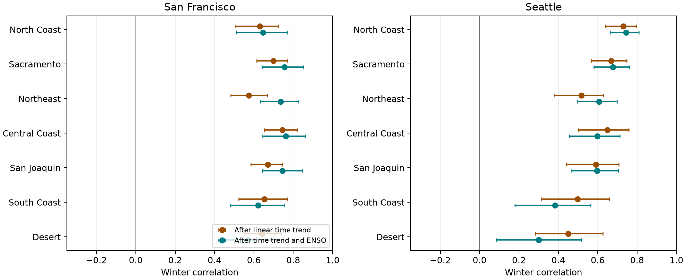
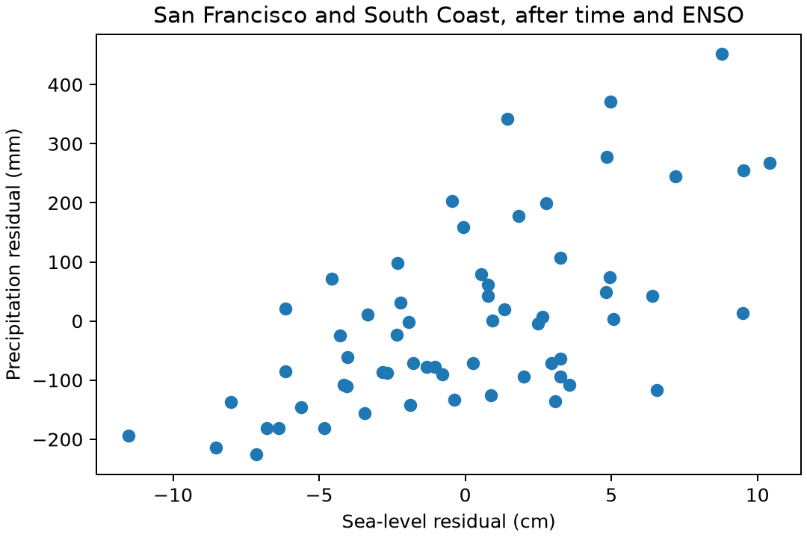

# Winter sea level and South Coast precipitation remained linked after linear ENSO adjustment in 1961-2025

At San Francisco, winter mean sea level and California South Coast winter precipitation had a correlation of 0.622 after adjustment for a linear time trend and winter Nino 3.4. The 95% five-year block interval was 0.478 to 0.753. There were 62 complete winters in 1961-2025. A linear ENSO term did not account for all of this link.



Figure 1. Brown points show correlations after removal of a linear time trend. Teal points also remove linear winter ENSO. Bars show pointwise 95% five-year block intervals. The primary pair is San Francisco and South Coast. Other pairs are descriptive. Divisions and sites are dependent and are not separate independent repeats.

## Question and prior work

Do wet California winters coincide with high coastal mean sea level? Does a linear winter ENSO term account for this link? A seasonal link can help define tests of compound coastal hazards. It cannot show that heavy rain and coastal flooding occurred on the same day.

[Hamlington et al. (2015)](https://doi.org/10.1002/2014JC010602) found an ENSO contribution to US coastal sea level with a space-time decomposition. [Jong et al. (2016)](https://doi.org/10.1088/1748-9326/11/5/054021) found that the California precipitation response depends on region, season, and ENSO strength. [Jiang et al. (2022)](https://doi.org/10.1175/BAMS-D-21-0252.1) linked much of California winter precipitation variation to circulation independent of ENSO. These results motivate a test of the shared seasonal signal that remains after a simple ENSO adjustment. Our analysis does not discover ENSO effects or establish a new physical cause.

We searched the campaign before choosing this question. The saved search is in `files/campaign_search.json`. We read the signed [precipitation forecast study](sci:sha256:613b0ddfe29853a816c1880f84c061841d758ecaa5365c184a32464943d46fda) and [seasonal sea-level forecast study](sci:sha256:930a0d10f6cec93dd1d38dd77d327bff857fbdec3f10ae12d24e5acd73c429d8). They used the same shared sources. They tested advance forecasts, rather than concurrent links between land and ocean. We wrote new code. This package adds a fixed seasonal data table, an ENSO covariance split, and an audit of this land-ocean link. Search does not prove that this question is new to all prior science.

## Data

All raw files were read in place. No shared file was changed. Exact absolute paths, source URLs, byte counts, snapshot metadata and SHA-256 hashes are in `files/provenance.json`. The shared root is `/mnt/dell-data/shared_datasets`. The four sources are:

- `noaa-coops-9414290-monthly-1960-2025-msl-lst-20261108/data.json`: San Francisco monthly NOAA CO-OPS records.
- `noaa-coops-9447130-monthly-1960-2025-msl-lst-20261108/data.json`: Seattle monthly NOAA CO-OPS records.
- `noaa-nclimdiv-precip-divisions-v1-20261006/climdiv-pcpndv-v1.0.0-20261006.txt`: NOAA nClimDiv v1.0.0 precipitation, dated 20261006.
- `noaa-cpc-nino-monthly-ersstv5-9120-20261107/nino-monthly.ascii.txt`: CPC ERSSTv5 monthly regional SST table, with 1991-2020 anomaly reference.

The package keeps exact California precipitation source lines for 1960-2025, the small full SST source, and the used monthly sea-level fields. It does not duplicate the full national precipitation file or full CO-OPS responses. Raw API snapshots have no separate release number; their hashes define the versions. `prepare.py` checks the four raw hashes against their shared metadata before extraction. Retrieval URLs are in the provenance file. Later retrievals can differ; use the preserved extracts for the fixed result.

Winter y means December y-1 plus January and February y. We sum the three precipitation months after conversion from inches to mm. Precipitation includes the water equivalent of snow. We average the three monthly mean sea levels with equal weights, in cm. Levels use a fixed local MSL datum; their anomalies are not zero by definition. Site datum offsets drop out of each regression. We use the last anomaly column of the SST file for winter mean Nino 3.4, not an event label.

All three sea-level months must exist, be finite, and have inferred flag zero. We do not fill gaps. San Francisco loses winters 1977 and 1978 due to inferred months and 2024 due to missing months. Seattle has all 65 winters. All required precipitation and SST values exist. Missing sea-level support can cause selection bias. One January 2026 row returned by each API is excluded. California division codes 01 to 07 are North Coast, Sacramento, Northeast, Central Coast, San Joaquin, South Coast, and Desert. Each is an area aggregate, not a point rain gauge.

## Method

The plan in `files/plan.md` was written before joint outcomes were computed. The primary pair is San Francisco and South Coast. Seven divisions at both Pacific gauges form the secondary set. We did not choose the primary pair based on its outcome.

For each pair, fit each response to an intercept and linear winter year by ordinary least squares. Correlate the two residual series to obtain the detrended correlation. Then add concurrent Nino 3.4 to both regressions and correlate the new residuals. This gives the partial correlation. These are full-period association fits, not forecasts.

Let S and P be time-detrended sea level and precipitation and E be time-detrended ENSO. Write S = bS E + u and P = bP E + v. Least squares gives the exact sample identity:

`mean(S P) = bS bP mean(E^2) + mean(u v)`.

We report the first term divided by total covariance as the linear ENSO projection fraction. This fraction is a statistical description. It is not a causal share. It is also not the proportional decrease in correlation: the residual variances change too.

Use 4,999 circular moving-block samples of the 65 calendar positions, with five-year blocks and seed 11072031. Keep missing years in each calendar resample, drop missing pairs after resampling, and refit all regression terms. The same index draws apply across sites and divisions. Percentiles 2.5 and 97.5 give pointwise intervals. The primary index arrays and six estimate columns are saved in `bootstrap.npz`. Column order is detrended correlation, partial correlation, their difference, ENSO covariance fraction, detrended covariance, and remaining covariance. Covariance units are cm mm. The intervals assume the fitted record can represent dependence within blocks. They do not cover source error, all long climate cycles, or future change.

We use no multiple-test claim for secondary pairs. Three- and ten-year blocks check dependence assumptions for the primary pair. Other planned checks use an added squared ENSO term, ranked responses with average ties before adjustment, deletion of winters 1983, 1998 and 2016 with new fits, and separate early and late periods. These latter checks have point estimates only. The rank check is a rank-response partial correlation with raw ENSO adjustment, not a full partial Spearman correlation. For the nonlinear check, the covariance-fraction column still describes the linear projection; only the partial correlation and remaining covariance use both ENSO terms.

## Results

The primary detrended correlation is 0.653 (95% interval 0.523 to 0.771). The partial correlation is 0.622 (0.478 to 0.753). Their difference is only 0.031, with an interval of -0.061 to 0.149. We cannot establish a decrease in correlation from adjustment. This null contrast does not mean the ENSO covariance component is zero.

The detrended covariance is 706.03 cm mm. Its linear ENSO component is 255.45 cm mm, or 36.2% (interval 13.3% to 60.4%). The remaining covariance is 450.58 cm mm (276.23 to 602.50). Thus, linear winter ENSO leaves a positive shared component in these data. This rejects complete removal by this specific linear adjustment under the stated block assumptions; it does not reject more complex ENSO effects.



Figure 2. The 62 complete primary winters after removal of time and linear winter ENSO from both variables. Each point is one winter, not one storm.

| Primary check | Partial correlation |
| --- | ---: |
| Main linear adjustment | 0.622 |
| Added squared ENSO | 0.619 |
| Ranked responses | 0.525 |
| Remove 1983, 1998, 2016 | 0.604 |
| 1961-1992, 30 complete winters | 0.441 |
| 1993-2025, 32 complete winters | 0.748 |

Three-year and ten-year block intervals for the primary partial correlation are 0.458 to 0.751 and 0.463 to 0.760. The sign is stable in these checks. The difference between early and late estimates is descriptive; we did not test a change in coupling. All 14 adjusted point estimates are positive (range 0.300 to 0.762). `results.json` holds each estimate and pointwise interval. This is broad geographic context, not evidence from 14 independent tests.

## Interpretation and limits

Shared atmospheric circulation is a possible source of the remaining link. Pressure, wind-driven coastal water motion, and weather patterns can affect both sea level and precipitation. River input is another possible local contribution. We did not measure pressure, wind, river flow, waves, or ocean heat content. We cannot separate these mechanisms. Conditioning on a measured ENSO index can also leave nonlinear or delayed ENSO effects and effects of index error. The positive residual correlation is not proof of ENSO-independent physics.

This is a retrospective observational test at two selected harbor gauges and seven state divisions. It uses one precipitation product and one SST reconstruction. Trends are linear, records are short, and winters are dependent. The circular bootstrap joins the record ends and assumes enough local stability for resampling. Results can depend on period and missing observations. The large early-late difference warrants a new test with longer records and measured circulation. Seasonal totals and means do not give flood frequencies, joint daily extremes, water supply, damage, or recovery. No climate attribution or causal mediation claim follows.

## Reproduce and inspect

Use Python 3.11 or later with NumPy and Matplotlib. The exact analysis environment is in `files/environment.txt`. Keep library threads at one. On this campaign host, from the bundle root:

```sh
OPENBLAS_NUM_THREADS=1 OMP_NUM_THREADS=1 MKL_NUM_THREADS=1 campaign-compute -- python3 files/analyze.py /tmp/earth_ocean_repeat
python3 files/audit.py
```

Choose a fresh local output directory. Outside the campaign, run the Python command under equivalent resource limits. The saved extracts and `seasons.csv` allow an offline analysis. To rebuild the seasonal table from the exact shared files, run `python3 files/prepare.py /mnt/dell-data/shared_datasets`. That step rewrites derived inputs in the local draft, so do it in a copy before signing. Source URLs and expected raw hashes permit retrieval and identity checks. Do not silently substitute a revised source if its hash differs.

`audit.py` independently aggregates all 910 seasonal rows from saved monthly fields and source lines. It checks the primary partial correlation with the scalar correlation identity, without NumPy. It checks the covariance split for all pairs. The saved audit passed. A second full analysis in a separate local directory reproduced the numerical outputs; see `files/repeat_check.json`. The first analysis attempt stopped before bootstrap output because circular indices lacked wraparound; the code was corrected to use modulo 65 and then run twice. This did not change the plan.

## Campaign record and license

Job: `sci-1107-dell-earth-and-ocean-sciences-0eb8ffc3c3a8`. Topic: `earth-and-ocean-sciences`. Campaign: `11_07_2026`. Machine: `dell`. Account: `codex-andrii`. Model: `gpt-6.1-sol`, high reasoning effort, through T3 Code and Codex. No child agents were used. Substantial analysis used `campaign-compute` with library threads set to one. No remote archive or index received this work. The campaign-machine key signs file integrity; it does not claim personal authorship. Baseline license terms apply to original text, code, figures, and derived data. NOAA source material keeps its source status and attribution.
