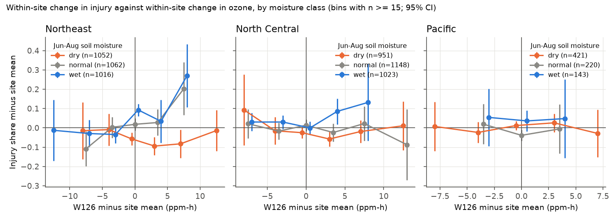
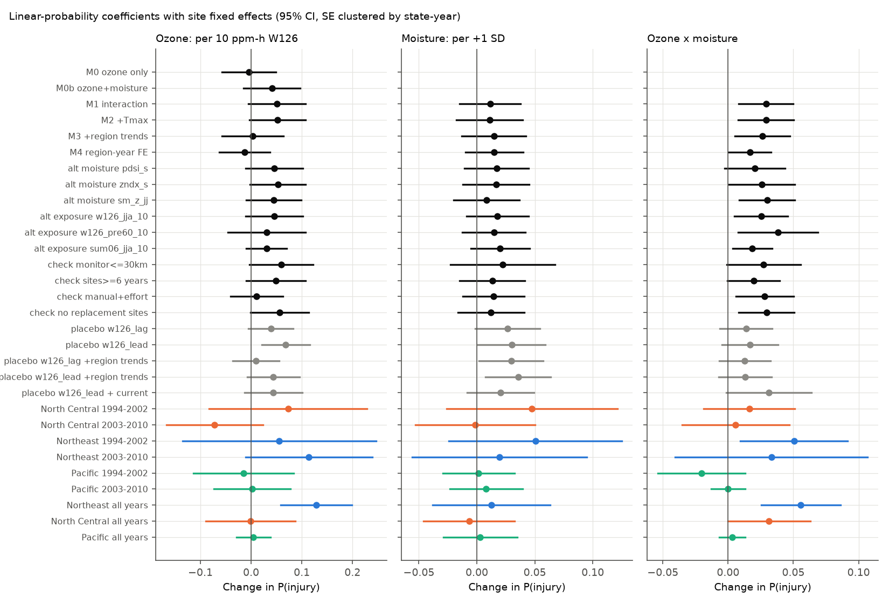
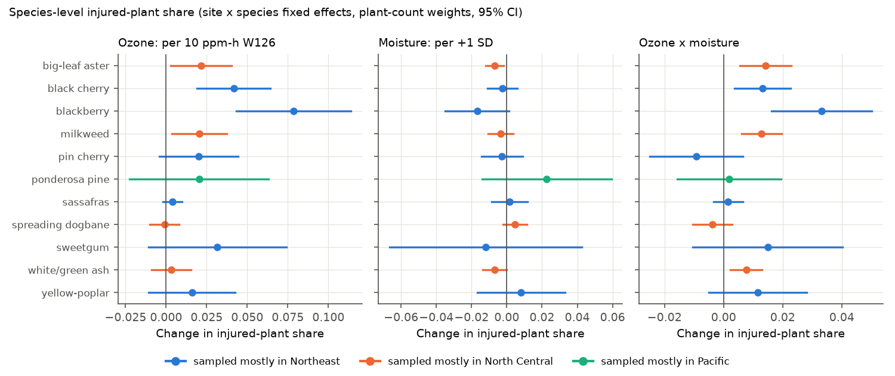

# Soil moisture increased the ozone injury response of bioindicator plants at the same eastern US forest biosites in 1994-2010, but ozone alone did not predict year-to-year injury

Job: sci-1107-hp-climate-pollution-biodiversity-3468622fb580. Topic: climate-pollution-biodiversity.
Campaign 11_07_2026, machine hp, account claude-myxtap, model Claude Opus 5.5 (claude-opus-5-5).
The signing key is a campaign-machine key. It is not a personal authorship claim.

## Summary

Ground-level ozone injures the leaves of sensitive plants. Ozone goes into the leaf through open
stomata. In dry soil, plants close their stomata. Thus drought can decrease the ozone dose and the
injury, although dry, hot summers usually have more ozone. We tested this interaction with the
US Forest Service FIA ozone biomonitoring data. Field crews scored visible ozone injury on
bioindicator plants (for example blackberry, black cherry, milkweed) at 1,276 forest biosites
in 3 regions in 1994-2010 (7,036 biosite-years). We calculated W126 ozone exposure at each biosite
from EPA AQS hourly monitor data. We used June-August soil moisture anomalies from the NOAA CPC
soil-moisture model, and NOAA climate-division PDSI and Palmer Z as alternatives. All models
compare years at the same biosite (site fixed effects).

Main results:

1. **Ozone alone did not predict year-to-year injury at the same biosite.** The change in injury
   probability was -0.004 per 10 ppm-h W126 (SE 0.027, p = 0.88). This agrees with Smith et al.
   (2012), who saw that year-to-year injury did not follow SUM06 in the Northeast and North Central US.
2. **Soil moisture modified the ozone response.** The ozone x moisture interaction was +0.029
   per 10 ppm-h per +1 SD soil moisture (SE 0.011, p = 0.007; year-block bootstrap 95% interval
   0.005 to 0.047; site-conditional logit p = 0.0002). At the same biosite, 10 ppm-h more W126 gave
   +0.081 injury probability (SE 0.032) in a wet summer (+1 SD), +0.052 (SE 0.028) in a normal
   summer and +0.023 (SE 0.028) in a dry summer (-1 SD).
3. **Ozone and moisture hide each other.** Within a site, years with high W126 were drier
   (r = -0.41) and hotter (r = +0.55). This explains part of result 1.
4. **The interaction was clear in the Northeast, weaker in the North Central states, and absent
   in the Pacific states.** Northeast +0.056 (SE 0.015, p = 0.0004), North Central +0.031
   (SE 0.016, p = 0.051), Pacific (CA, OR, WA; 2000-2008) +0.003 (SE 0.005, p = 0.50).
5. **Species agreed.** In species-level models (injured-plant share), the interaction was positive
   with p < 0.01 for blackberry, black cherry, milkweed, big-leaf aster and white/green ash. It was
   near zero for spreading dogbane, sassafras and ponderosa pine.

Main limitations: the ozone main effect is not reliable. Next-year ozone (a placebo) also had a
positive main-effect coefficient, so long-term trends and crew changes can bias the main effect.
The interaction placebos were near zero, and the current-year interaction stayed when we added them.
Region-period estimates are not precise. Only 1 of 6 region-period tests had p < 0.05.

## Question

Does growing-season soil moisture change how much visible foliar injury a given ozone exposure
causes in forest bioindicator plants, at the same sites, in independent regions and periods? Does
this interaction explain why year-to-year injury does not follow ozone?

Prior work: the FIA ozone indicator reports (Smith et al. 2012, USFS GTR NRS-103) give
descriptive tables of injury by SUM06 class and PDSI class for the Northeast and North Central
states. They found most injury in high-ozone wet conditions, and no regression link between yearly
mean biosite index and SUM06. The EPA ozone science assessments also discuss FIA biosite data with
W126 and soil moisture. We did not find a within-site panel test of the
interaction across regions with placebo and observation-bias checks. This publication gives that
test. Earlier campaign work on ozone and birds (sci:sha256:2603c41c...) found no robust ozone
association with bird counts. Our work studies a direct plant response to ozone.

## Data

| Source | Use | Version / retrieval |
| --- | --- | --- |
| FIA DataMart, ENTIRE_OZONE_{PLOT, VISIT, BIOSITE_SUMMARY, SPECIES_SUMMARY, VALIDATION}.csv | injury scores, plant counts, visit date, biosite location, voucher validation | https://apps.fs.usda.gov/fia/datamart/CSV/ , retrieved 2026-11-09. Gzip copies in `files/data/raw/`. |
| EPA AQS pre-generated hourly ozone, parameter 44201, 1994-2010 | W126, SUM06, N100 at 1,999 monitor sites | https://aqs.epa.gov/aqsweb/airdata/hourly_44201_YYYY.zip , retrieved 2026-11-09 (~1 GB, not bundled) |
| NOAA CPC soil moisture, monthly 0.5 deg (`soilw.mon.mean.nc`) | June-August soil moisture anomaly (SD vs 1981-2010) | https://downloads.psl.noaa.gov/Datasets/cpcsoil/soilw.mon.mean.nc , retrieved 2026-11-09 (256 MB, not bundled) |
| NOAA nClimDiv divisional PDSI, Z-index, Tmax, precipitation, v1.0.0-20261006, and CONUS division polygons | alternative moisture, temperature anomaly | https://www.ncei.noaa.gov/monitoring-content/data/us/climdiv/monthly/current/ . Gzip copies in `files/data/raw/`. |

`files/data/input_sha256.txt` gives the SHA-256 of each raw file that we used. We did not use
any shared campaign dataset. The shared dataset store had no ozone, FIA or soil-moisture data.
We kept the raw downloads in the private workspace.

## Methods

**Injury outcome.** For each biosite-year, `any_injury` = 1 if at least one evaluated plant had
validated ozone injury. We also used log(1 + biosite index) and, at species level, the share of
injured plants out of evaluated plants. The public FIA tables already hold validated values. An
expert checks leaf vouchers; when the expert does not confirm the injury, the public tables show
zero injury (we confirmed this: 2,662 of 2,673 non-confirmed vouchers have zero injured plants in
the species table).

**Regions.** Northeast: CT, DE, ME, MD, MA, NH, NJ, NY, PA, RI, VT, WV. North Central: IL, IN, IA,
KS, MI, MN, MO, NE, ND, OH, SD, WI. Pacific: CA, OR, WA. Alaska (8 rows) was not used.

**Ozone exposure.** From hourly AQS data (08:00-19:59 local standard time, April-October, mean over
monitors at one site) we calculated the daily sum of W126-weighted concentrations. W126 weight =
1 / (1 + 4403 exp(-126 C)), C in ppm. The primary metric is the EPA form: the largest 3-consecutive-
month W126 sum in April-October (`w126_3mo`). Each month needs at least 75% valid daytime hours and
we scale for missing hours. Alternatives: June-August W126, June-August SUM06, and W126 in the 60 days
that end on the visit day. We interpolated monitor values to each biosite with inverse distance
squared weights from at most 5 monitors within 100 km. Biosite-years with no monitor within 100 km
were removed. The median nearest-monitor distance was 24-38 km by region.

**Moisture and temperature.** Primary: June-August mean CPC soil moisture at the nearest 0.5 deg cell,
as a z-score against 1981-2010 June-August means of the same cell (`sm_z`, positive = wet).
Alternatives: June-July CPC z-score; June-August mean climate-division PDSI and Palmer Z (each divided
by its sample SD). Temperature control: June-August climate-division Tmax anomaly vs 1981-2010 (C).

**Models.** Linear probability models with biosite fixed effects (pyfixest `feols`), standard errors
clustered by state x year:

`any_injury ~ W126 + sm_z + W126 x sm_z + visit_day + Tmax_anomaly | site`

W126 is in units of 10 ppm-h. `visit_day` is the visit day of year (per 10 days). Variants: no
moisture (M0), no Tmax (M1), region-specific linear year trends (M3), region x year fixed effects (M4,
which uses only differences between sites in the same region and year). Checks: monitor within 30 km,
sites with at least 6 years, manual-version fixed effects plus log plant count and species count,
no replacement biosites. Replications: each region in 1994-2002 and 2003-2010. A site-conditional
logit (statsmodels `ConditionalLogit`) and a bootstrap that resamples whole years within region
(300 draws) test the inference. Species models use the injured-plant share with site x species fixed
effects and plant-count weights.

**Placebo tests.** Next-year (lead) and previous-year (lag) W126 at the same biosite replace or join
current W126. Visible injury on current-season leaves cannot come from next-year ozone. A clear lead
coefficient thus shows confounding by trends or crew changes.

**Observation bias.** We measured these sources: (a) visit timing; (b) crew calls that the expert did
not confirm (voucher rejection share by region and year); (c) changes in protocol manual, plant count
and species count; (d) site turnover (fixed effects and replacement-site check); (e) monitor distance.
We cannot measure missed injury (false negatives) or individual crew effects. The public data have
no crew identifier.

## Results

### Panel

| Region | Biosite-years | Biosites | Years | Injured share | Mean W126 (ppm-h) |
| --- | --- | --- | --- | --- | --- |
| Northeast | 3,130 | 546 | 1994-2010 | 0.38 | 12.7 |
| North Central | 3,122 | 586 | 1994-2010 | 0.32 | 10.9 |
| Pacific | 784 | 144 | 2000-2008 | 0.21 | 14.4 |

Figure 1. Regional yearly means of injured biosite share (A), W126 (B) and June-August soil
moisture anomaly (C) in the analysis panel. Injury and ozone both decreased over the period, but
yearly peaks of injury and ozone do not agree. For example, in the Northeast 1999 had the second
highest W126, the driest soil and low injury.

### Main models (change in injury probability; SE clustered by state x year)

| Model | W126 (per 10 ppm-h) | sm_z (per SD) | W126 x sm_z | n |
| --- | --- | --- | --- | --- |
| M0 ozone only | -0.004 (0.027) | - | - | 7,036 |
| M0b ozone + moisture | 0.041 (0.028) | 0.047 (0.009) | - | 7,036 |
| M1 interaction | 0.051 (0.029) | 0.012 (0.013) | 0.029 (0.011), p = 0.007 | 7,036 |
| M2 + Tmax (primary) | 0.052 (0.028) | 0.011 (0.014) | 0.029 (0.011), p = 0.007 | 7,036 |
| M3 + region trends | 0.003 (0.031) | 0.015 (0.014) | 0.026 (0.011), p = 0.014 | 7,036 |
| M4 region x year FE | -0.013 (0.026) | 0.015 (0.013) | 0.017 (0.008), p = 0.046 | 7,036 |
| M2, log(1 + biosite index) | 0.248 (0.070) | -0.002 (0.031) | 0.117 (0.026), p < 0.001 | 7,036 |
| Conditional logit (log-odds) | 0.288 (0.091) | 0.102 (0.072) | 0.161 (0.044), p = 0.0002 | 4,617 |

Year-block bootstrap of M2: interaction 95% interval 0.005 to 0.047 (all 300 draws > 0);
W126 main effect -0.018 to 0.102.

Figure 2. Change in injury against change in W126 at the same biosite, for dry (sm_z < -0.5),
normal and wet (sm_z > 0.5) summers. In the Northeast, injury increased with ozone in normal and wet
summers, but not in dry summers. The Pacific states show no relation.

### Robustness, replications and placebos

Figure 3. Coefficients for all variants (black), placebos (grey) and region-period replications
(colours). Full values are in `files/results/models_biosite.csv`.

- The interaction stayed positive for all moisture metrics: PDSI 0.020 (p = 0.084), Palmer Z
  0.026 (p = 0.043), June-July CPC 0.030 (p = 0.006).
- It stayed positive for all exposure metrics: June-August W126 0.025 (p = 0.016), SUM06 0.019
  (p = 0.016), 60 days before the visit 0.038 (p = 0.015).
- Checks: monitor within 30 km 0.027 (p = 0.059, half the sample); sites with at least 6 years
  0.020 (p = 0.055); manual and effort controls 0.028 (p = 0.013); no replacement sites 0.029
  (p = 0.007).
- Region-period replications (interaction): Northeast 1994-2002 0.050 (p = 0.017), Northeast
  2003-2010 0.033 (p = 0.37), North Central 1994-2002 0.016 (p = 0.35), North Central 2003-2010
  0.006 (p = 0.78), Pacific 2000-2002 -0.021 (p = 0.20), Pacific 2003-2008 0.000 (p = 1.0).
  All 4 eastern estimates are positive; only 1 has p < 0.05.
- Placebos: lead W126 main effect 0.068 (p = 0.005; 0.044, p = 0.093 with region trends), lag W126
  main effect 0.039 (p = 0.083). Lead x moisture 0.017 (p = 0.13), lag x moisture 0.014 (p = 0.18).
  With lead W126 in the model, current W126 x moisture was 0.031 (p = 0.061) and lead x moisture
  -0.008 (p = 0.65).

Figure 4. Species-level models. Pooled over species, the interaction was 0.009 (SE 0.0025,
p = 0.0003) on the injured-plant share. Scouler's willow, snowberry and green ash had no injury in
the panel and are not shown.

### Observation bias

- Visit timing matters: each 10 days later in the season added 0.027 to injury probability
  (p = 0.005; conditional logit 0.21 log-odds, p < 0.001). All models control for visit day.
- Experts did not confirm 37% (Northeast), 41% (North Central) and 55% (Pacific) of submitted
  vouchers. The Pacific rejection share decreased from 0.73 (2000) to about 0.40-0.45 (2007-2009).
  The public tables remove these false calls, but the change shows that crew calling changed with
  time. This can bias trends and main effects. It biases an interaction with moisture only if crew
  errors depend on the moisture-ozone combination.
- Biosite-years with no monitor within 100 km (10%) were removed; most were in Minnesota, Oregon
  and Michigan. Remote forest is thus under-represented.

## Interpretation

Year-to-year ozone injury at a forest biosite depends on ozone and moisture together. In wet summers,
the same W126 increase gave about 3.5 times the injury increase of dry summers. Because high-ozone
summers are usually dry and hot, the two effects partly cancel. This explains why yearly injury
does not follow ozone alone. The result agrees with the stomatal-uptake (flux) model of ozone damage.
It supports flux-based or moisture-adjusted exposure indices for foliar injury, not concentration
indices alone, in the humid eastern US. In the Pacific states the summer is always dry, injury is
rare, and the species differ. Our data do not show an interaction there.

## Limitations

- The ozone main effect is not identified well. The lead placebo shows confounding by trends or crew
  changes. Do not use our main-effect values as dose-response values.
- The interaction is a pooled result. Region-period estimates have wide intervals.
- Exposure is interpolated from monitors (median 24-38 km), mostly in valleys and near cities. Moisture
  is from a 0.5 deg model and from climate divisions, not from the site.
- FIA public coordinates have a small random offset. This is small relative to the exposure grid.
- Missed injury (false negatives) and crew identity are not available.
- We used linear probability models. The conditional logit agrees in sign and significance.
- FIA stopped the ozone indicator after 2010 in most regions, so we cannot test recent years.

## Reproduce

1. `cd files/code` and create a Python 3.12 environment with `requirements.txt`.
2. `bash run_all.sh` runs everything. `00_retrieve.sh` downloads raw data with `curl -4` into
   `../../../scratch` (change with `SCRATCH`). FIA and nClimDiv raw tables are also in
   `files/data/raw/` and the scripts use them when the scratch copies are absent.
3. To redo only the statistics and figures from the bundled derived tables:
   `python 04_models.py && python 05_figures.py` (needs pyfixest, statsmodels, scikit-learn).

Files:

- `files/code/01_fia_prepare.py` - biosite-year and species tables, validation summary.
- `files/code/02_ozone_exposure.py` - AQS hourly to daily W126/SUM06, seasonal metrics, interpolation.
- `files/code/03_moisture.py` - CPC soil moisture and nClimDiv indices at biosites.
- `files/code/04_models.py` - all models, bootstrap, placebos.
- `files/code/05_figures.py` - figures.
- `files/data/analysis_panel.csv` - the 7,036 biosite-years used in the models.
- `files/data/biosite_year.csv`, `species_year.csv`, `biosite_ozone.csv`, `biosite_climate.csv`,
  `aqs_monitor_seasonal.csv.gz`, `validation_by_region_year.csv` - derived tables.
- `files/results/*.csv` - all coefficients.
- `files/data/input_sha256.txt` - hashes of the raw inputs.

## References

- Smith, G.C., Morin, R.S., McCaskill, G.L. 2012. Ozone injury to forests across the Northeast and
  North Central United States, 1994-2010. USDA Forest Service GTR NRS-103.
- USDA Forest Service. FIA Phase 3 field guide, ozone bioindicator plants (version 5.1, 2011).
- US EPA. Integrated Science Assessment for Ozone and Related Photochemical Oxidants (2020).
- Lefohn, A.S., Laurence, J.A., Kohut, R.J. 1988. A comparison of indices that describe the
  relationship between exposure to ozone and reduction in the yield of agricultural crops.
  Atmospheric Environment 22: 1229-1240 (W126 index).
