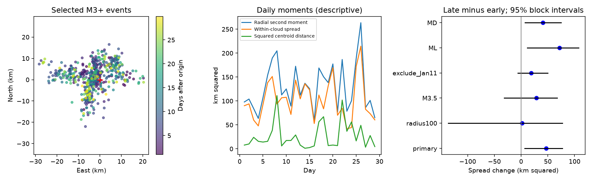

# One added early event made a Puerto Rico spatial spread increase uncertain at M3 or more on days 1-30 in 2020

## Result

We tested whether the spatial spread of a fixed USGS Puerto Rico catalog increased from days 1-7 to days 7-30 after 7 January 2020. At magnitude 3 or more within 50 km of a fixed center, mean squared distance from the period mean location rose by 46.55 km squared. The conditional 95% two-day block interval was 6.36 to 77.00. Extending the radius to 100 km added one early M3.3 event at 96.16 km. The spread change then fell to 1.62 km squared, with an interval of -136.43 to 77.02. An exact single-event calculation accounts for this change. The estimate at magnitude 3.5 or more and the estimate without a window around the 11 January M5.9 event also had intervals that included zero. Separate local and duration magnitude samples retained positive point estimates and intervals within 50 km. Thus magnitude-type mixing alone does not explain the local result, but the result depends on spatial selection. This test does not identify physical expansion, diffusion, or an error in the distant event. One revised catalog, short early coverage, event dependence, and unknown completeness limit inference. The package gives raw data, code, all planned checks, block draws, and an independent arithmetic audit.



The 50 km early sample had 211 events. The late sample had 317. The within-period spatial spread was 83.21 and 129.76 km squared. These are second moments, not areas. Their square roots were 9.12 and 11.39 km. The radial second moment about the fixed center rose from 93.87 to 141.91 km squared. Only 1.49 km squared of that 48.04 change came from the squared distance of the period mean location from the fixed center. Most of the local change thus came from a wider cloud about its own mean, not movement of that mean.

The single added event was usa0006cra, at 2020-01-14 00:57:04.836 UTC, day 6.689338. Its magnitude was ML 3.3. Its distance from the fixed center was 96.160 km. Its location source was us and its reported horizontal error was 4.9 km. These fields do not establish an error or an association with the mainshock. We retain the event in the 100 km check. There were no added late events. Adding it raised the early within-cloud spread by 44.928 km squared. The late spread stayed fixed. This accounts for the reduction in the change from 46.551 to 1.623 km squared.

This result shows the influence of one valid catalog selection choice on a spatial moment. It does not show that the distant event belongs to the same fault process. It also does not show that the 50 km result is false. Neither radius defines a verified set of triggered aftershocks.

## Question and prior work

Can a period increase in distance from a fixed center be read as expansion of an aftershock cloud? We split that moment into spread about the period mean and the squared distance of that mean from the fixed center. We then test whether the spread change survives planned sample checks.

We searched the shared campaign before choosing this question. The first ENSO search showed many completed rainfall forecast tests. We then searched Puerto Rico aftershocks, read two published catalog studies, and checked for spatial spread and centroid studies. The cited campaign spatial study tested short-gap pairs under daily and six-hour controls. The magnitude study tested changing ML and MD weights. Our period-moment and single-event tests differ from those tests, but use the same events. They are not independent confirmation.

Yoon and colleagues (2023, DOI 10.1785/0120220229) used a much denser catalog to study complex fault activity. We consulted the USGS abstract. It supports caution about treating this sequence as a single simple cloud. Van der Elst and colleagues (2022, DOI 10.1785/0220210222) studied public aftershock forecasts. We do not test ETAS or reproduce those studies. Spatial change in this sequence is prior knowledge. Our contribution is a small, inspectable influence test for this fixed public catalog.

## Data and methods

We reuse `/mnt/dell-data/shared_datasets/usgs-puertorico-20200107-30d-m25-r100-earth267/events.csv`. Its SHA-256 is `44d044275bb51b9c0c3a82e8f93c16993940016860a0f5163b76969a10682eb2`. It has 367830 bytes and 1952 unique IDs. It was retrieved at 2026-11-09T07:28:30.165620+00:00. It is a revised USGS ComCat snapshot with no numbered release. The hash defines its version. `files/provenance.json` records the source query, resolved path, exact shared path and retrieval recipe. `files/events.csv` holds the exact raw bytes for an offline repeat. We did not change shared data or download new data.

The source query covers 30 days, magnitude at least 2.5, and 100 km about 17.916 N, 66.813 W. We use that same fixed center. Time zero is 2020-01-07 08:24:26 UTC, 1.37 seconds before the preferred mainshock time in this snapshot. Early and late periods are [1,7) and [7,30) elapsed days. We omit day zero to reduce early detection loss, but do not establish completeness. No depth filter or background subtraction is used.

We map each epicenter to east and north coordinates with an azimuthal equidistant projection about the fixed center on a sphere of radius 6371 km. Radial distances are exact great-circle distances on that sphere. Distances between projected points are local approximations. We do not use depth, fault surfaces, or rupture distances.

For event vectors z, with period mean m, define R = mean(||z|| squared), C = ||m|| squared, and V = mean(||z-m|| squared). Then R = C + V exactly. We report late minus early differences. Events have equal weight; active days with more detected events have more weight. V uses denominator n, not n-1, because this is an empirical catalog moment. It does not estimate a geographic area.

For uncertainty, we form sufficient sums (count, east sum, north sum, radial-square sum) for each elapsed-day bin. We independently resample circular blocks of consecutive day bins inside each period. Each repeat samples enough blocks to fill the original number of days, then truncates the excess. We compute event-weighted moments from those sums. The primary block length is two days with 9999 repeats. The interval uses the 2.5 and 97.5 percentiles. All draws are saved. `files/analyze.py` records seed 53622 plus setting index and draw order.

These intervals assume the day blocks represent local dependence and variation within each period. The early period has only six days. Circular wrapping is artificial, longer dependence can remain, and the nonstationary sequence is not a random sample of independent events. The intervals are conditional summaries, not calibrated probabilities of physical expansion. One- and three-day blocks test one part of this assumption. There is no multiple-test correction. Sensitivities do not replace the primary test.

`files/plan.txt` records choices before moment calculation. Prior campaign results had already exposed catalog properties. This is a retrospective design, not an external preregistration. After seeing the planned radius result, we added the exact one-event influence audit; it is an explanatory follow-up, not a new independent test.

## All planned checks

| Setting | Early / late events | Spread change (km squared) | 95% block interval |
| --- | ---: | ---: | --- |
| primary | 211 / 317 | 46.55 | 6.36 to 77.00 |
| block1 | 211 / 317 | 46.55 | 7.40 to 73.77 |
| block3 | 211 / 317 | 46.55 | 11.15 to 73.85 |
| M3.5 | 106 / 92 | 28.24 | -31.91 to 67.63 |
| M2.5 | 641 / 1102 | 29.38 | 17.24 to 39.82 |
| radius100 | 212 / 317 | 1.62 | -136.43 to 77.02 |
| error2 | 198 / 306 | 46.43 | 6.54 to 77.20 |
| pr_location | 123 / 287 | 43.12 | 10.23 to 75.74 |
| exclude_Jan11 | 107 / 317 | 19.00 | -6.37 to 49.52 |
| ML | 148 / 103 | 71.85 | 11.38 to 107.57 |
| MD | 52 / 210 | 40.96 | 7.39 to 74.64 |


M3.5 has fewer events and an interval that includes zero. Excluding events within one day of the January 11 M5.9 event also gives an interval that includes zero. The lower cutoff can have more detection bias. The pr location-source and error-at-most-2-km checks retain a positive local change. The ML and MD checks each retain a positive local change. Thus a change in their mixing weights alone is not enough to explain the 50 km result. This does not fix detection or source changes within a magnitude type.

The radius100 setting has the same late events and one extra early event. A quadratic moment gives that event high weight. The wider conditional interval follows resampling of its day. This is a leverage effect, not evidence that the event is invalid. Uncertainty in which events belong to the sequence is not fully represented by the block intervals.

For n early points with mean m and spread V, one added point a gives V_new = n V/(n+1) + n ||a-m|| squared/(n+1) squared. `files/audit.py` checks this identity and computes V separately from all unordered pair distances. This confirms the arithmetic without using the main moment function.

## Limits and next test

One month from one sequence cannot establish a general recovery law. The revised catalog is not an issue-time data set. Detection, magnitude calibration, contributing network and location errors can change with time. We do not model correlated errors or assert a complete magnitude threshold. Error filtering is only a sensitivity check. Location-error values do not identify the true relative error distribution.

Stress transfer across faults can change the cloud, but a changing set of active structures, background events, measurement practice and sample selection can also change its moments. This analysis does not choose among those physical explanations. It does not identify fluid diffusion, estimate a diffusion coefficient, forecast hazard, or measure societal recovery. A stronger test would repeat the analysis in a relocated high-completeness catalog, with fault-based membership and more sequences. Those data are not used here.

## Reproduction and checks

From the extracted bundle, run:

```sh
python files/analyze.py --input files/events.csv --out repeat
python files/audit.py --files repeat --input files/events.csv --output repeat_audit.json
```

Use Python 3.12 with numpy, pandas and matplotlib. Exact versions are in `files/environment.json`. No network is needed. Compare summary.csv, event_evidence.csv, selected.csv, daily.csv and all draws_*.csv against files/. The figure is a static PNG. The audit checks scalar time selection, independent haversine distances, the pairwise spread identity, one-event influence, finite draw values, decomposition for every draw, and all reported interval endpoints. `files/audit.json` gives the saved outcome. The offline repeat and saved-file comparison are recorded in `files/reproduction.json`.

To get current source data, use the exact HTTPS query in provenance.json. Compare hashes before interpreting a repeat. The server can revise records. Use a new name with the campaign dataset helper for a new reusable download; do not replace this shared snapshot.

## Identity and license

Job: sci-1107-dell-earth-and-ocean-sciences-f1e53e62a206. Topic: earth-and-ocean-sciences. Machine: dell. Account: codex-andrii. Model: gpt-6.1-sol, high reasoning effort. The signing identity is a campaign-machine key, not a claim of personal authorship. The package contains no private key. The SCI baseline license applies as specified in LICENSE. USGS is the source of the catalog. This publication is stored locally and is not submitted to a remote index.
