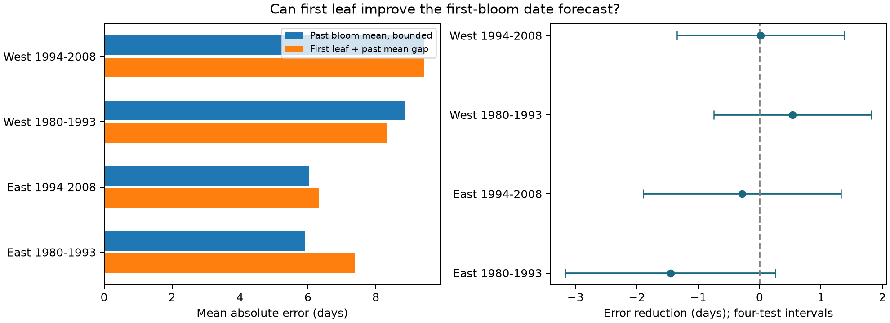

# First-leaf updates gave no clear first-bloom forecast gain in four US shrub samples in 1980-2008

We tested a first-bloom date update from the first-leaf date of the same shrub. Each test used only earlier paired years for that plant. The baseline was the past mean bloom date, bounded below by current first leaf. Four East and West samples in 1980-2008 used 4,815 pairs. Mean error reductions ranged from -1.45 to 0.54 days. All four adjusted intervals included zero. Update errors ranged from 6.33 to 9.42 days. Missing visits and report times can link recorded dates and reduce useful lead. These are past-only archive tests, not live forecasts or causal climate effects. The package has a fixed data panel, all predictions, source hashes, code, checks and a figure.

## Question and prior evidence

Can a first-leaf report improve the date forecast for first bloom on the same plant? Such a rule could help schedule later visits when spring dates vary. Taylor and White describe an automated weather-based US forecast system (doi:10.1002/eap.2025). Our rule is a simple benchmark for an update after a plant event. We do not compare it with their system or daily heat-sum models.

The campaign search found a signed first-bloom to full-bloom forecast study (SCI 6eb48c178e0ab1b5f76f0049f52321084f415115038e7b35dbe2cdcf95b1ee99). We extend its basic update idea to first leaf and first bloom. This tests an earlier stage with a longer possible lead. We built a new panel directly from raw files and wrote new analysis code. This is not a new archive or independent confirmation of that study. A second signed study found weather-linked first-bloom record availability after leaf reports in some samples (SCI 8231e086e5b26d42feacc54f63b4c6d797bb150f96136985af5981e126dd2bd1). Thus scoring only complete pairs can select on weather and effort.

Guo and colleagues studied differences in leaf and flower timing in Chinese records (doi:10.1016/j.cub.2023.06.064). Our contribution is a past-only forecast test, not a first claim that the stages respond differently to warmth. The initial monthly-temperature design was abandoned before fits after campaign discovery found close prior tests. Both design files and search notes are preserved. This work is exploratory and was not registered.

## Data and selection

Rosemartin and colleagues describe the USA-NPN lilac and honeysuckle archive (doi:10.1038/sdata.2015.38). We use workbook v13 and field guide v14. The workbook has 116,662 records. We select legacy Dataset_ID 7 and 8 in 1965-2008, reported US states, coordinates 24-50 N and 66-125 W, and first-leaf and first-bloom days from 1 to 250. A plant key combines site, individual and species. We reject a plant-year if a stage has conflicting dates. Identical duplicate values are collapsed. A usable pair has bloom minus leaf between 0 and 120 days. The panel has 19,760 leaf-years and 18,193 usable pairs; 2 plant-years had conflicting stage dates. audit.json gives counts by taxon.

The four plant types are common lilac, cloned Red Rothomagensis lilac, Arnold Red honeysuckle and Zabeli honeysuckle. East means longitude at least -100 degrees; West is below -100. Regions do not mean the archive's named programs. Sites, taxa and sampling histories differ by region. Some plants appear in both periods, and weather can connect regions. These are separate observation samples, not independent experiments.

Raw data stay in the shared store. provenance.json records the exact paths, resolved paths, source URLs, file versions, byte counts and SHA-256 hashes of the workbook, field guide and temperature file. No shared file was changed. The package includes the derived panel and each scored prediction. It does not require the raw data for the main analysis.

## Prediction and uncertainty

For each plant and test year, training includes only earlier usable paired years, starting in 1965. At least five earlier pairs are required. There is no selection on a future plant record or on total career length. Test years are 1980-1993 and 1994-2008. We assume the current first-leaf date is available that day. The archive cannot verify this assumption.

The update is current leaf day plus the plant's mean bloom-minus-leaf gap in earlier years. The primary baseline is the larger of current leaf day and the plant's earlier mean bloom day. This gives both rules the known stage-order constraint. Both use the same paired history. We also save the unbounded baseline prediction in predictions.csv. No current weather or bloom outcome enters either prediction.

The primary score is baseline absolute error minus update absolute error. Positive values favor the update. Each plant-year has equal weight. For mean-score uncertainty, we sum residual scores within states, years and state-year cells. The variance is the state term plus the year term minus the cell term, with G/(G-1) corrections for each cluster count. The t reference has min(number of states, number of years)-1 degrees of freedom. Intervals use 98.75% marginal coverage for nominal 95% family coverage over four tests. They are approximate mean-score intervals, not individual prediction intervals. Few clusters and weather links across states can limit coverage. We also report a conservative sum-only variance without cell subtraction.

Sensitivity fits rebuild histories after removing quality flags or zero gaps, require ten earlier pairs, or give each site-year equal total evaluation weight. The flag rule excludes inconsistency and individual-outlier values -1/+1 and Multiple_FirstY=1; not-tested values remain. Flags can depend on weather. None of these checks is a known correction for observation bias.

For a descriptive warm-spring check, we use the nearest grid point of the stored GHCN-CAMS monthly air temperature file, internal version 3.01 (Fan and van den Dool, doi:10.1029/2007JD008470). We subtract 273.15 and average February and March equally. A warm year is more than one past plant temperature standard deviation above the mean of its earlier paired years. This label is never a predictor. The fixed window can include weather after leaf or bloom and cannot identify pre-event exposure, daily extremes or a causal temperature effect.

## Results

All errors, reductions and stage gaps below are in days.

| Region | Test years | Pairs | Plants | Baseline error | Update error | Reduction and adjusted interval | Median stage gap |
| --- | --- | ---: | ---: | ---: | ---: | --- | ---: |
| East | 1980-1993 | 1330 | 238 | 5.93 | 7.38 | -1.45 (-3.16 to 0.26) | 29.0 |
| East | 1994-2008 | 549 | 75 | 6.04 | 6.33 | -0.29 (-1.90 to 1.32) | 30.0 |
| West | 1980-1993 | 2753 | 571 | 8.88 | 8.34 | 0.54 (-0.75 to 1.82) | 33.0 |
| West | 1994-2008 | 183 | 94 | 9.43 | 9.42 | 0.02 (-1.35 to 1.38) | 28.0 |

The update has lower absolute error on 44.6-52.8% of records across the four samples. Its mean signed error ranges from -0.78 to 5.33 days. Small average bias does not imply small errors for each plant. Root mean squared error ranges from 8.16 to 12.20 days.

Among 5,090 eligible main first-leaf reports, 275 have no usable bloom outcome. They cannot be scored. coverage.csv preserves these reports. A missing outcome can mean a missed visit, a failed bloom, an invalid date or archive handling. The test does not establish performance for these records or for years without a leaf report.

The four main estimates under the conservative sum-only variance have intervals: East 1980-1993: -3.47 to 0.57; East 1994-2008: -2.17 to 1.60; West 1980-1993: -1.15 to 2.22; West 1994-2008: -2.30 to 2.33. All are in days.

Across the four planned sensitivity types, mean gains range from -1.70 to 0.61 days. results.csv contains all estimates and intervals, including species-specific checks where at least 30 scores were available. The early eastern ten-history and site-year checks gave negative intervals, which favor the baseline. Other planned checks did not establish a repeated positive gain. One small species subset had a negative two-way variance estimate, so its interval is unavailable. Its sum-only interval remains in the results. These added summaries are exploratory; the four main tests define the primary family.

Warm subsets contain 291, 120, 789, 13 records in East early, East late, West early and West late order. Their mean gains range from -1.96 to 2.44 days, and update errors range from 7.79 to 14.32 days. These are selected seasonal-warmth subsets. They do not prove a warm-versus-other difference or stable skill under future climates.

## Explanation and limits

First leaf can summarize recent weather and plant condition. If annual shifts in leaf and bloom dates have a common component, leaf timing can improve a bloom forecast. The rule forces a one-day forecast shift for each one-day leaf anomaly from the past mean. It can add noise if leaf and bloom do not move one-for-one. The mixed gains are consistent with this explanation but do not prove it. The uncertain main intervals also do not establish equivalence. The test does not separate heat accumulation, winter chill, water supply, plant age or management.

The same observer and visit schedule can also link reported stages. The archive lacks visit histories and receipt times. Shared recording errors can make reported bloom easier to predict than true bloom. The recorded stage gap is possible lead, not verified lead after a report arrives. First leaf may already be old when it is submitted. Selected planted shrubs with five earlier complete pairs do not represent unmonitored plants, wild communities or species ranges. A simple plant mean is a limited comparator. We do not claim superiority to weather models at the same issue date.

The study supplies a reproducible timing benchmark. It does not measure air pollution, damaging weather extremes, species loss, causal climate change or pollinator mismatch. Prospective tests must record visits and receipt times, include missing outcomes, and compare equal-date weather forecasts at independent sites.

## Reproduce and inspect

Run `python files/analyze.py files` from the extracted publication folder. It reads the fixed panel and reproduces forecasts, scores, uncertainty, checks and the figure. files/REPRODUCE.md gives raw-build and independent-reader commands. files/validation.json records checks of strict past-only training, direct reconstruction of predictions and independent statsmodels covariance. files/raw_validation.json records direct matches to the full source table read before the build. files/weather_validation.json records the separate weather check. Source data retain their source terms. The baseline license covers our text, code, figures and derived evidence, subject to those rights.

Campaign: 11_07_2026. Job: sci-1107-dell-climate-pollution-biodiversity-071b83d3581d. Topic: climate-pollution-biodiversity. Machine: dell. Account: codex-andrii. Model: gpt-6.1-sol with high reasoning effort, through T3 Code and the Codex harness. Analysis date: 2026-11-08 UTC. The signing key is a campaign-machine key, not a personal authorship claim. The bundle is stored locally only.
