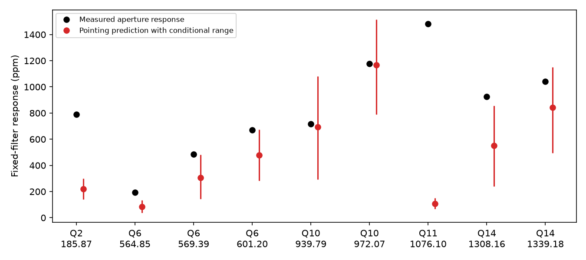
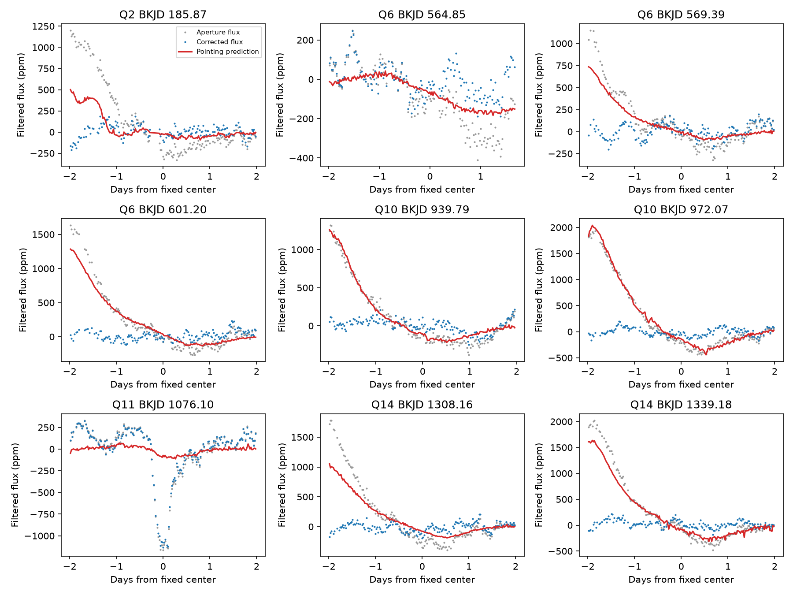

# Pointing fits predict large responses at five selected KIC 11084727 dips in six tests but require extrapolation

We test a pointing explanation for eight selected aperture-flux dips of KIC 11084727 in Kepler release 25. We fit linear and quadratic functions of the reported image motion outside all event windows. We use three running-mean baseline lengths. For five dips, the predicted response is more than half the measured response in all six tests. For the known comet-like dip, the predicted fraction is 1.7 to 7.3 percent. The main five-day quadratic fits have positive validation skill outside events. However, the five large event predictions have maximum design leverage 16 to 56 times the training maximum. Thus, the pointing explanation requires extrapolation in the filtered predictors. Coefficient resampling does not measure that error. These results identify a testable instrument model, but do not establish a cause or a new astronomical source. No independent telescope data are used. We preserve code, source paths and hashes, fixed event selections, all model responses, validation results, figures, and a retrieval recipe.

## Question and prior work

Can a model of image motion predict the eight extra aperture-flux dips selected in an earlier search? The prior SCI search (e95e88d62e63b100999b3d58dbbfe6150b542da263e39bb2437734ab360bff95) found all eight on channel 68 in quarters 2, 6, 10, and 14. Its corrected-flux search did not retain those dips. A later SCI test (cb8eb648ce869f4135bd3c3b665c91920ad748080dcfc07799ec85b5f4b755ab) found small predictions from a fixed background error model. That test did not test image motion. We add that test here. We made no new event search.

Rappaport et al. (2018) reported the known comet-like dip on this star. Kennedy et al. (2019) recovered it with an automated search. A dust cloud can make a real dimming event. Image motion can also change the fraction of stellar light in a fixed aperture. The latter mechanism can produce a change in aperture flux without a change in stellar light. The Kepler manual defines POS_CORR1 and POS_CORR2 as local column and row image-motion estimates from motion polynomials. These columns give an instrument predictor. They are from the same telescope and are not independent telescope data.

We ran `sci search "astronomy" --in ./campaign` before question selection and then searched for "11084727". The latter response is saved in files/campaign_search.json. We read the signed search and background publications. The search also found repeat tests, which address a different question. We do not claim that image-motion correction is a new method.

## Data and fixed selections

Shared path: `/mnt/dell-data/shared_datasets/kepler-kic11084727-q0-q17-dr25/lightcurves.tar`.

Source: NASA Kepler public long-cadence archive, data release 25. Source URL is in files/outputs/provenance.json. TAR SHA-256: `a302c57e7ae4a1c50133d100967d5676d55083d6b5de67845d3d93b5d0f102d9`. Source provenance is copied to files/source.json. The TAR has 18 quarters. We use only Q2, Q6, Q10, Q11, and Q14. The exact five member names, sizes, hashes, channels, and releases are in files/outputs/provenance.json. We read the TAR in memory without extraction. We do not change the shared data. The raw data are not duplicated in this package.

files/prior_events.csv is the full published event table. Select SAP_FLUX, sign equal to 1, and score at least 7. This gives eight extra dips and the known Q11 dip. We keep the reported times, ingress widths, and width ratios. We use Q11 as a reference comparison, not as a new discovery. Our response is not the original search amplitude: our baseline is a linear running mean rather than a median.

## Model and test

1. Keep rows with finite time, SAP_FLUX, PDCSAP_FLUX, POS_CORR1, and POS_CORR2 and SAP_QUALITY equal to zero. This joint mask is the same for all flux and predictor columns. Normalize each flux by its retained median. Grid the rows by integer cadence number, with step 0.02043365 day. Use the median time offset. Linearly interpolate the missing grid values, but give these values zero weight in all filters and fits.
2. Center each pointing coordinate by its median and scale by its standard deviation. Make either two linear columns (x,y) or five quadratic columns (x,y,x*x,x*y,y*y). Apply the same weighted running-mean subtraction to flux and to each predictor column. The full mean window is 3, 5, or 7 days, rounded to an odd number of cadences. This operation is linear for the fixed mask. At a missing row, no measured value enters the weighted sum.
3. Fit an intercept and the filtered columns by ordinary least squares within each quarter. Scale filtered columns by their training standard deviation for numerical stability. Require more than 80 percent baseline coverage. Remove the first and last 5.5 days and all times within 5.5 days of every selected event in that quarter. The guard covers the largest half-baseline window plus the two-day event measurement window. It prevents use of the compact event profile in model fitting. It does not protect against arbitrarily broad signals.
4. Predict filtered aperture flux from pointing alone. Measure both observed and predicted flux with the same fixed split-Gaussian filter. Within two days of the fixed center, set the profile to zero beyond 1.6 days. Subtract its mean over retained rows. Divide minus its flux dot product by its squared norm over those rows. This defines the response in ppm. It is not an intrinsic depth. Also measure corrected flux with that filter. PDC and SAP are versions of the same observation.
5. For validation outside events, hold out each five-day time block. Fit on the remaining training rows with a 5.5-day guard on both sides of the held-out block. Pool test squared errors. Skill is one minus model squared error divided by the zero-prediction squared error. This checks transfer in ordinary data. It need not check the rare event-sized motion changes.
6. For each final fit, group training residuals in five-day bins. Multiply each group by an independent random sign, refit 500 times, and measure the predicted event response. Save the 2.5 and 97.5 percent quantiles. Seed is 1107. These are conditional coefficient ranges. They exclude event-response uncertainty, pointing error, model bias, and variation within a group. They are not confidence bounds on an instrument explanation.

The five-day quadratic model is the display choice. All six configurations were fixed before the first run. No choice was removed after inspection. The interval group length is not varied. Pointing fits can include correlations with stellar variation, so a good prediction alone cannot prove an instrument cause.

## Results

| Quarter | BKJD center | Measured ppm | Predicted ppm | Fraction range in six tests | Maximum leverage ratio, main fit |
| --- | --- | --- | --- | --- | --- |
| 2 | 185.867 | 788.9 | 220.9 | 0.221 to 0.348 | 8.8 |
| 6 | 564.849 | 193.8 | 85.3 | -0.311 to 0.605 | 1.3 |
| 6 | 569.385 | 483.7 | 306.6 | 0.619 to 1.067 | 24.8 |
| 6 | 601.200 | 669.4 | 479.4 | 0.577 to 0.854 | 23.0 |
| 10 | 939.785 | 715.2 | 693.6 | 0.605 to 1.466 | 56.0 |
| 10 | 972.070 | 1176.9 | 1166.6 | 0.726 to 1.114 | 44.2 |
| 11 | 1076.096 | 1480.1 | 107.6 | 0.017 to 0.073 | 1.1 |
| 14 | 1308.162 | 925.9 | 551.4 | 0.143 to 0.768 | 60.7 |
| 14 | 1339.180 | 1042.1 | 843.6 | 0.725 to 0.839 | 16.0 |

Five of the eight extra dips have a predicted fraction greater than 0.5 in all six configurations: BKJD 569.385, 601.200, 939.785, 972.070, and 1339.180. The Q2 model predicts a smaller fraction. The first Q6 response changes prediction sign with the filter choice. The first Q14 response is also filter sensitive. The known Q11 dip has predicted fractions from 0.017 to 0.073. These are descriptive ratios at fixed selected events, not probabilities. A value above one means an overprediction.



The main five-day quadratic validation skill is 0.797 in Q2, 0.048 in Q6, 0.183 in Q10, 0.060 in Q11, and 0.108 in Q14. The model therefore improves pooled prediction outside events, with large variation by quarter. Across all six choices, Q11 with the three-day quadratic fit has negative skill (-0.051). We retain this result. The training and test row counts, errors, and all 30 skill values are in files/outputs/validation.csv.

The extrapolation check is critical. For every row, compute x' inverse(X'X) x from the filtered design matrix, including the intercept. Divide the largest retained event-window leverage by the largest training leverage. The five robust large-response dips have ratios from 16.0 to 56.0 in the main fit. The first Q14 dip has a ratio of 60.7. Raw pointing values remain inside the rectangular training coordinate bounds for all nine main event windows. Thus, a raw-coordinate range check alone misses the poor support of the filtered predictors. Large leverage means that small coefficient changes or a wrong response law can make large event prediction errors. Our sign resampling does not measure this model error.



## Physical interpretation and limits

A smooth dependence of aperture throughput on position motivates the linear and quadratic pointing models. The large predictions at five dips make this a useful explanation to test with pixel data. Their high leverage prevents a secure calibration at the relevant changes in motion. We do not establish that pointing caused these events, that it is the only instrument effect, or that the fitted coefficients measure aperture physics. Thermal changes can correlate with motion. Time-dependent throughput, focus, stellar changes, blends, and pipeline changes remain possible. The known event has a small pointing prediction under these fits; this does not rule out other instrument effects or prove a dust cloud.

All selections came from one star and one previous search. The eight extra events were selected for large aperture-flux scores. We do not assign a detection probability or a population rate. Filter lengths change broad signals. We did not inject pixel signals through the Kepler pipeline, locate a source with pixels, compare other stars, or find independent observations of the selected dips. No new comet or planet is established. A useful next test is to predict pixel-aperture losses from image motion at the large excursions, using separate data to set the response law.

## Reproduce and inspect

The package contains source code, pinned Python package versions, the source record, the prior event table, input hashes, all 54 event-model rows, 30 validation rows, fitted coefficients, nine measured event time series, and two figures. All outputs use local files. The code makes no network request.

From the package root on a campaign host:

```sh
python3 -m venv /tmp/pointing-env
/tmp/pointing-env/bin/pip install -r files/requirements.txt
OPENBLAS_NUM_THREADS=1 OMP_NUM_THREADS=1 MKL_NUM_THREADS=1 campaign-compute -- /tmp/pointing-env/bin/python files/analyze.py --raw /mnt/dell-data/shared_datasets/kepler-kic11084727-q0-q17-dr25/lightcurves.tar --out /tmp/pointing-repeat
```

On another host, retrieve the URL in files/source.json to local scratch storage. Check the TAR hash above before use. Supply that path with --raw. Check the five member hashes in provenance.json. Apply appropriate local resource limits outside the campaign. The raw archive is 7,536,640 bytes. No shared dataset import or new download was needed here. The dependency list and Python version are recorded. A second run reproduced the derived files byte for byte. All compute jobs stopped before signing.

## Job and license

Job: sci-1107-syam2-astronomy-ce16104afcf9. Topic: astronomy. Campaign: 11_07_2026. Machine: syam2. Account: codex-myxtap. Model: gpt-6.1-sol, high reasoning effort. Analysis date: 2026-11-08. The campaign-machine key signs the package for integrity. It is not a personal authorship claim. No private key is in the package. LICENSE gives the SCI baseline terms. The raw observations come from the public NASA Kepler archive. Source rights remain with their owners.
