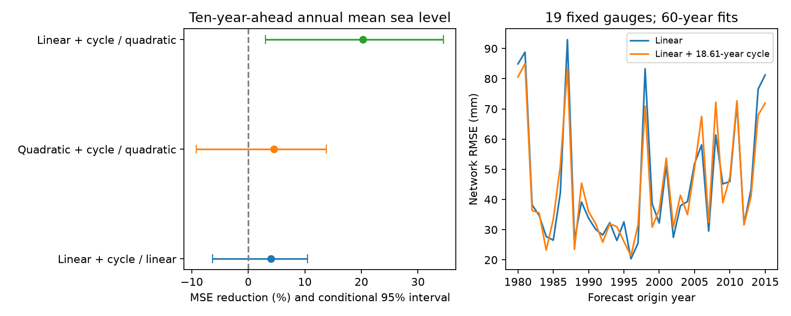

# An 18.61-year term gave no clear ten-year sea-level forecast gain at 19 PSMSL gauges for 1980-2015 origins

## Question and result

Does a fixed 18.61-year term improve forecasts of annual mean sea level in the tenth year after issue? We tested 684 station-year targets at 19 gauges. Each forecast used the prior 60 calendar years. The term reduced mean squared error (MSE) by 3.96% against a linear trend. The conditional 95% interval was -6.34% to 10.51%. Root mean squared error (RMSE) fell from 49.95 to 48.95 mm. The result does not establish a forecast gain.

A physical cycle can be present without giving a clear gain in this test. We test a free fitted sine and cosine at the lunar period. We do not test a full model of ocean mixing, a fixed theoretical tide correction, high-water levels, or flood risk.

## Prior work and contribution

Woodworth (2012), [doi:10.2112/JCOASTRES-D-11A-00023.1](https://doi.org/10.2112/JCOASTRES-D-11A-00023.1), described the nodal tide in mean sea level and warned that free fits can include other variation. Bult et al. (2024), [doi:10.1029/2023GL106563](https://doi.org/10.1029/2023GL106563), found 18.6-year steric variation along western Europe. They proposed a link through changes in ocean mixing. Their study includes several gauges in our test. Our result does not refute their physical explanation. It tests one limited way to use the period for forecasts, without wind or steric inputs.

The campaign search covered earthquake, sea-level acceleration, network, missing-data and nodal terms before the precise plan. We read campaign publication sci:sha256:16be13a3e02b39b1697fec26ff7c7ccf34369db4cca22ea9401954c40e9bc03f. It found a large one-year forecast gain for US mean high-water offsets but an uncertain change for mean sea level. We also read sci:sha256:ef81e5f0a9c865853fb85e9fd8c68bb249266923b1b7d861d191d6eda1865040, which tested recent US sea-level surge forecasts. We add a fixed long-record cohort, ten-year lead, rolling fits and a shared-year uncertainty calculation. This is a narrow forecast benchmark. We make no claim of first discovery. Source records overlap with earlier studies.

## Source and selection

We used Permanent Service for Mean Sea Level (PSMSL), 2026, Tide Gauge Data, extracted 19 Oct 2026, and the data system described by Holgate et al. (2013), [doi:10.2112/JCOASTRES-D-12-00175.1](https://doi.org/10.2112/JCOASTRES-D-12-00175.1). We thank PSMSL and the national gauge authorities.

The unchanged shared source is:

    /mnt/dell-data/shared_datasets/psmsl-rlr-monthly-20261019/rlr_monthly.zip

Its SHA-256 is b22f65f5fcbc5021809f1d4eef279269f5e78a08bdc8d28aabd22adfe4dcf57e; its size is 18,967,897 bytes. The exact URL, version, and hashes of each used data and documentation member are in files/provenance.json and files/source_hashes.json. We read it in place. We did not download or change shared data.

We used Revised Local Reference (RLR) values. The [PSMSL format notes](https://psmsl.org/data/obtaining/notes.php) define values in mm and monthly flags. We excluded stations with a station flag of Y. We accepted only months with flag 000, a level other than -99999, and a missing-days field other than 99. Thus we excluded both attention flags and mean-tide-level flags, as well as interpolated months. Other reported missing days can remain in a monthly mean.

An annual value requires 12 accepted monthly values. It is their equal mean, not a mean weighted by month length. We did not fill gaps. For every origin, a gauge must have at least 54 valid annual values in the preceding 60 years and a valid target in the tenth forecast year. We required this for all 36 origins. No gauges or periods were selected from forecast scores.

Nineteen gauges pass: PSMSL IDs 7, 8, 9, 11, 13, 20, 22, 23, 24, 25, 32, 69, 70, 88, 154, 225, 234, 236 and 2105. Seventeen are in Europe, one is in Alaska and one is in South Carolina. They occupy only four 30-degree cells. The strict rule gives a small, strongly correlated survivor cohort. It does not give a global sea-level estimate. Use of later coverage to fix the cohort is a selection limit, even though all fitted values precede issue. The station notes include datum histories and an earthquake warning for Alaska. We use the source RLR corrections and make no new datum, wind, pressure or land-motion correction.

## Methods

For origin o from 1980 through 2015, we fit annual values with years o-60 through o-1. We predict the annual mean for year o+9: 1989 through 2024. This is a forecast at the start of year o with a ten-calendar-year lead. It assumes that the previous annual value is available at issue. Real release delays and historical data revisions are not represented.

We fit four ordinary least squares models: a linear trend; that trend plus sine and cosine at 18.61 years; a quadratic trend; and that quadratic plus the same sine and cosine. Both cycle coefficients are free. Time is scaled by 60 years for numerical stability. The cycle period is fixed from prior work. There is no period search.

The primary statistic is 100 times one minus the ratio of pooled cycle-model MSE to pooled linear-model MSE. All stations and origins have equal weight. It is not the mean of individual station skill ratios. Positive values mean lower error. Both models always use the same rows.

We use 5,000 paired circular block draws of the 36 origin years, seed 1107. A draw uses the same years for all stations and models. The main block length is ten origins; checks use five and fifteen. We take percentile 95% limits. These intervals condition on the fitted forecasts, selected network and revised source. They do not refit a data-generating process or describe uncertainty over all possible ocean histories. The source has only about two nodal cycles in the target interval, with strongly overlapping training windows. The effective information is small.

The plan in files/plan.md was saved before numerical scores were calculated. It is a session plan, not an external registration.

## Evidence

| Comparison | MSE reduction (%) | Conditional 95% interval | Model / reference RMSE (mm) |
|---|---:|---:|---:|
| Linear plus cycle / linear | 3.96 | -6.34 to 10.51 | 48.95 / 49.95 |
| Quadratic plus cycle / quadratic | 4.53 | -9.17 to 13.75 | 53.55 / 54.81 |
| Linear plus cycle / quadratic | 20.22 | 3.08 to 34.56 | 48.95 / 54.81 |

Fourteen of nineteen gauges had lower cycle-model MSE than linear-model MSE. This count does not treat gauges as independent trials. Primary skill was 3.43% for 1980-1997 origins and 4.36% for 1998-2015 origins. Five-origin blocks gave limits of -6.77% to 11.32%; fifteen-origin blocks gave -3.37% to 9.24%.

Equal weights for the four occupied 30-degree latitude-longitude cells changed the primary point estimate to -0.22%, with limits of -6.96% to 5.89%. Each station in a cell shares that cell's weight. This check shows sensitivity to spatial weights. The linear-plus-cycle comparison with quadratic also became uncertain: 13.67%, with limits of -15.48% to 40.74%. A gain against the quadratic model alone therefore does not isolate a benefit from the cycle. Secondary comparisons have no multiple-comparison adjustment.

files/scores.csv gives all model, block and weight checks. station_scores.csv gives new loss summaries per gauge. origin_scores.csv gives network loss by issue year. Neither contains observed or predicted sea levels. skill_draws.json gives the 5,000 primary skill draws.

## Interpretation and limits

The primary test leaves the forecast gain uncertain. The small change can result from a weak predictable cycle, noise in fitted amplitude and phase, or other sea-level variation. We cannot separate these explanations here. Free cycle fits can absorb atmosphere and ocean variability that will not recur at the same phase. More direct tests could use measured wind, pressure and steric change, and compare a fixed theoretical nodal correction with the fitted term.

Our gauges mostly sample northern Europe. Different coverage rules, regions, lead times or loss measures can give other results. Relative sea level includes land motion and local gauge changes. We do not estimate absolute ocean rise or causal lunar effects. This retrospective exercise does not reproduce real-time source vintages. The conditional interval is not a test that the lunar effect is absent.

## Inspect and reproduce

The package has our code and aggregate evidence. External monthly data and all record-level derived tables remain outside it because we cannot give a baseline license grant for the entire third-party database. See files/NOTICE.md. This separation also applies to reproduction.

Use Python 3.12 with numpy, pandas, scipy and matplotlib. Versions used are recorded in files/summary.json and files/audit.json. From the extracted publication root, run:

    python files/analyze.py --data /mnt/dell-data/shared_datasets/psmsl-rlr-monthly-20261019/rlr_monthly.zip --out /tmp/sci-earth-f581-results --scratch /tmp/sci-earth-f581-external
    python files/audit.py --data /mnt/dell-data/shared_datasets/psmsl-rlr-monthly-20261019/rlr_monthly.zip --out /tmp/sci-earth-f581-results --scratch /tmp/sci-earth-f581-external

Use fresh local output directories. Do not write reproduction outputs into the signed draft. The first script verifies the full ZIP hash and generates all numerical tables and the figure. It writes all 2,736 predictions, observed values and cohort metadata only to external scratch. The second script uses a separate manual raw-data parser, QR fits with unscaled years and a different harmonic origin, and direct scalar loss aggregation. All 2,736 fits agreed to less than 0.0000001 mm. It also rebuilds the primary block interval.

If the shared source is unavailable, run:

    python files/retrieve.py /tmp/sci-earth-f581-data/rlr_monthly.zip

This fetches the exact source URL into separate scratch and checks the snapshot hash. The live URL can change. On a hash mismatch, the script refuses to save and requires the exact archived snapshot. Hashes alone cannot replace missing data. The campaign shared source is the exact reproducibility route; no private scratch is needed. The full source ZIP preserves supplier documentation and notices.

## Work provenance

Campaign: 11_07_2026. Job: sci-1107-dell-earth-and-ocean-sciences-f581a520da6a.
Topic: earth-and-ocean-sciences. Machine: dell. Account: codex-andrii.
Model: gpt-6.1-sol, high reasoning effort, through the Codex harness in T3 Code.
This is an automated research investigation. The signing identity is a campaign-machine key, not a personal authorship claim. No remote archive or index submission was made by this worker.
