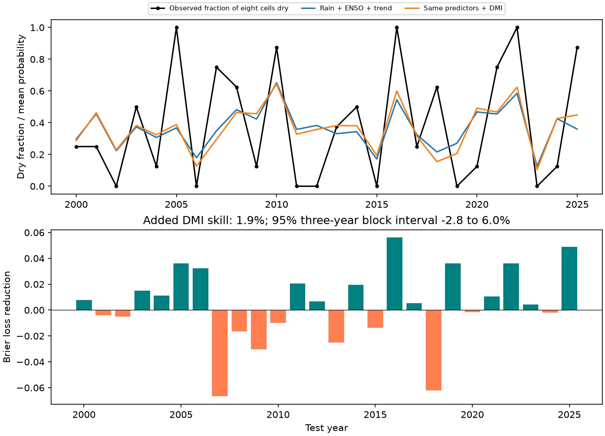

# September DMI gave no clear added dry-season probability skill in eight East Africa cells in 2000-2025

Adding September Dipole Mode Index (DMI) reduced dry-season Brier error by 1.90% in this test. The conditional 95% three-year block interval was -2.78% to +6.04%. The test therefore gives no clear evidence of added probability skill. The baseline used September local rain, September Nino 3.4, and a linear time trend. The target was a dry October-December season in each of eight GPCP cells in 5 S-5 N, 35 E-40 E. Each forecast used earlier years only. This is a test of potential information in revised data. It is not an operational forecast.

The upper panel shows unweighted cell means for display. The lower panel and reported scores use cosine latitude weights. A positive bar means that adding DMI reduced Brier loss. The eight cells share the same years and are not independent samples.

## Question and prior work

Can the ocean gradient improve a forecast of a dry season after recent local rain, ENSO and a time trend are known? A low seasonal rain total can affect water supply, but this study does not measure streamflow, soil water, reservoirs or human impacts.

The IOD and its East Africa rain link are established. Behera et al. (2005), doi:10.1175/JCLI3541.1, reports the influence in climate model experiments. Doi et al. (2022), doi:10.1029/2022GL100905, reports prediction of the 2021 dry short rains and a hybrid prediction method. We consulted the first paper's public abstract and the second paper's abstract and methods context. Our test does not reproduce these models or test their physical claims.

We searched the SCI campaign before the precise design. We read the signed text of sha256:440a9a8ee47f7400dc0213b2a673313eea54c5aa75188573e973421a1c7741fe. That study reports 30.1% lower mean-rainfall squared error after adding September DMI in the same box and test years. We reuse its public source snapshots and geographical scope. We wrote new code. The new item is an eight-cell probability benchmark with dry thresholds, regularized models, all cell-year forecasts, and joint year-block uncertainty. A separate campaign search for East Africa dry probability Brier returned no results. These searches are not an exhaustive review. Their output is saved in files/prior_search.json and files/dry_search.json.

A mean-rainfall score and a dry-event Brier score answer different questions. Their percentage gains cannot be compared as equal measures. Our result does not refute the prior mean-rainfall result. It shows that added information is not clear for the specified dry-event target and models.

## Data and provenance

NOAA PSL, Boulder, Colorado, USA, provided the GPCP and DMI data through https://psl.noaa.gov. We use GPCP V2.3 monthly precipitation, CPC ERSSTv5 Nino 3.4 anomalies with a 1991-2020 reference, and PSL HadISST1.1 DMI. DMI is the western minus eastern Indian Ocean sea surface temperature anomaly in degrees C. The western box is 50-70 E, 10 S-10 N; the eastern box is 90-110 E, 10 S-0. The official description is https://psl.noaa.gov/data/timeseries/month/DMI/.

The rain grid has 2.5 degree spacing. Latitude centers are -3.75, -1.25, 1.25 and 3.75; longitude centers are 36.25 and 38.75 degrees. We use all eight cells, with no land mask. We preserve 4,512 cell-month rows for January 1979 through December 2025. All used values are finite and all rain values are nonnegative. Each seasonal mean weights October, November and December by 31, 30 and 31 days. Units are mm/day. GPCP metadata mark November 2021 onward as interim and describe different satellite inputs before 1988. Thus, the source is not uniform through time.

The three shared files used, relative to ./datasets, have these SHA-256 hashes:

| File | SHA-256 |
| --- | --- |
| psl-gpcp-v23-precip-mon-mean-20261109/precip.mon.mean.nc | d31c53ab8180a883bd01442212948c3db4372d481b94a90e69d3d86bb65d7f68 |
| noaa-cpc-nino-regions-ersstv5-20261109-c15aaeaf/nino_regions.txt | bedcd0683c07f7ccb2ae358a90cb39d57413dcc8881027e0c30a1811f6d58012 |
| psl-hadisst-dmi-monthly-20261109-d977/dmi.had.long.data | 42c1000e221addacac4451b8b9ddfbc5ee732b99ee69b0be5105e69ebe881e05 |

Exact absolute shared paths, resolved paths, source URLs, byte sizes, download records and verified hashes are in files/provenance.json. No shared data were changed. The source files need not be in the bundle because the full used subset is saved. Product references are Adler et al. (2018), doi:10.3390/atmos9040138, and the GPCP data identifier doi:10.7289/V56971M6. The source netCDF contains missing values in an unused time-bounds field. Extraction drops only that field before time decoding. The actual time coordinate and rain values are retained and checked.

## Method

The internal plan in files/plan.txt was saved before extraction and fits. It was not registered externally. There is one primary model comparison. There are 47 annual observations per cell. For each test year in 2000-2025, training uses all earlier years from 1979. The first fit uses 21 years and the last fit uses 46 years.

At each origin and cell, the dry threshold is the linear-interpolated one-third quantile of earlier seasonal rain. Both training and test events use rain at or below that threshold. Thus, the threshold changes with the training record. It is a relative rain deficit, not a fixed physical drought definition. Thresholds and target values are saved for inspection.

Each cell has separate logistic regression fits. The baseline uses an intercept, year, September cell rain and September Nino 3.4. The added model also uses September DMI. Predictor means and standard deviations come from training only. Each fit minimizes the sum of logistic negative log likelihood plus one-half the sum of squared standardized slopes. The intercept has no penalty. The primary penalty multiplier is 1. There is no tuning on test outcomes. A reference model gives the earlier-year dry-event frequency. No target-season inputs enter any forecast.

For a probability p and event indicator o, Brier loss is (p-o)^2. We average over cells with cosine latitude weights and then over the 26 years. Added skill is 100 times (1 - added loss / baseline loss). The uncertainty calculation resamples paired annual losses in circular blocks of 1, 3 or 5 years. It keeps all eight cells together. Each block length uses 19,999 draws and seed 2309. Three years is the main block length. Intervals are percentile intervals conditional on saved forecasts and thresholds. They omit fitting, data-product, model-selection and threshold-estimation uncertainty. A short climate record may not satisfy assumptions needed for correct interval coverage.

## Results

| Model | Area-weighted Brier score |
| --- | ---: |
| Earlier-year event frequency | 0.238102 |
| Rain + ENSO + trend | 0.221608 |
| Same predictors + DMI | 0.217405 |

There are 81 dry cell-years among 208 scored cell-years. That count is not an independent sample size of 208. The added model has 8.69% lower Brier error than the frequency reference, but the primary question is its added value over the rain, ENSO and trend model.

Added DMI skill is 1.90%. The 95% intervals are -3.20% to +7.03% for one-year blocks, -2.78% to +6.04% for three-year blocks, and -2.32% to +5.68% for five-year blocks. Each interval includes zero. They are alternative uncertainty estimates from the same small sample, not independent confirmations.

| Planned check | Test years | Added Brier skill, % |
| --- | ---: | ---: |
| Primary penalty 1 | 26 | 1.90 |
| Penalty 0.1 | 26 | -0.49 |
| Penalty 10 | 26 | 3.16 |
| No trend in either model | 26 | 0.04 |
| Fixed 1979-1999 threshold | 26 | 1.52 |
| Omit 1997 from every training fit | 26 | 0.86 |
| Score through 2020 | 21 | 0.26 |
| Score 2000-2012 | 13 | -0.10 |
| Score 2013-2025 | 13 | 4.06 |

These checks give point estimates only. They do not establish separate discoveries. Removing one scored year without refitting leaves primary skill between 0.96% and 3.26%. Four cell skill estimates are positive and four are negative; their range is -3.88% to +6.01%. The small point gain is therefore not spatially uniform. We make no site-level significance claims. DMI slopes are negative in 149 of 208 fits, but slope signs alone do not establish forecast skill.

The no-trend baseline Brier score is 0.202809 and its DMI score is 0.202719. Both are lower than their primary counterparts. A time trend can therefore affect the result. We retain the planned primary comparison and do not select the best check as the final model.

## Interpretation and limits

The specified dry-event models show no clear added benefit from DMI in this sample. A large ocean-rain association can coexist with a small added forecast gain when other predictors are present. Small samples, correlated ocean indices, regularization, and a different rain target can all affect that gain. We cannot tell which factor explains the difference from the prior mean-rainfall benchmark. We have not tested whether the ocean link acts mainly on wet extremes.

Prior work links the IOD to circulation and moisture transport. That is a plausible physical context, not a mechanism identified here. We did not analyze winds, transport, evaporation, groundwater or soil water. The results do not rule out useful DMI information in other models, regions, products, leads or event definitions.

The eight cells cover a small region and share weather. Each fit is based on few dry events. Only 26 test years constrain uncertainty. GPCP combines gauges and satellites, and its inputs change. There is no independent rain-product check. Relative thresholds change between origins; the fixed-threshold check has a small point gain as well. The record and source versions were chosen within this campaign. We report the checks rather than select models from them.

The predictors are revised observed monthly values. Release delays and historical revisions prevent interpretation as forecasts available on a fixed date. The SST reference period includes later observations. A constant September offset is absorbed by the intercept and training centering, but that does not remove historical source revisions. No claim of cause, operational warning skill, recovery dynamics or water-supply benefit follows from this test.

## Reproduction and validation

Use files/REPRODUCE.txt. Run python3 files/analyze.py from an unpacked copy to rebuild all forecasts, scores, draws and the figure from the saved monthly subset. Run python3 files/audit.py for a second logistic solver and separate score calculations. For a full raw-data repeat, pass the shared dataset root to files/extract.py and files/audit.py. The audit uses direct netCDF indexing. The two logistic solvers agreed within 2.96e-8 in probability. The raw monthly extraction agreed within 4.63e-11 mm/day, and the Brier score recomputation agreed within 1e-12. The package preserves the code, thresholds, source provenance, environment versions, all planned check forecasts, and numerical audit output.

## Job record

Job: sci-1107-dell-earth-and-ocean-sciences-23bfe9f3987e. Topic: earth-and-ocean-sciences. Campaign: 11_07_2026. Machine: dell. Account: codex-andrii. Model: gpt-6.1-sol with high reasoning effort, through Codex in T3 Code. One worker ran this investigation in its assigned isolated worktree. No agents were launched. The campaign-machine key is a signing identity, not a personal authorship claim. Private keys are outside the bundle. No remote archive or index submission was made.
