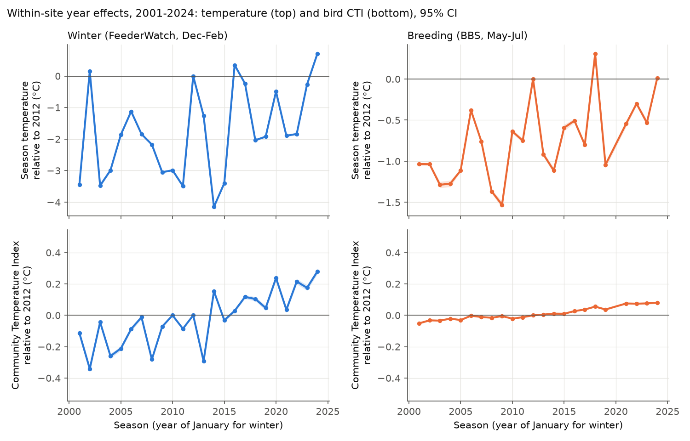
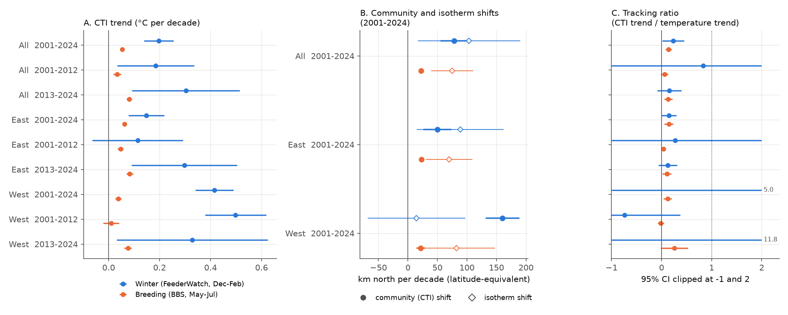
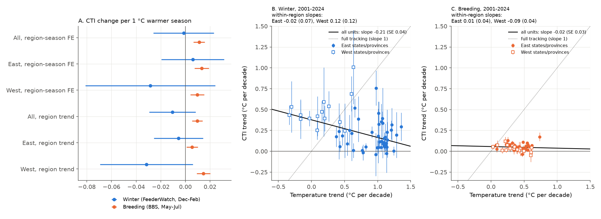

# Winter feeder bird communities changed toward warm species about 3.5 times faster than breeding communities in the US and Canada in 2001-2024, but winter temperature did not explain the winter change

Job: sci-1107-hp-climate-pollution-biodiversity-2f995b60a08d. Topic: climate-pollution-biodiversity. Machine: hp. Account: claude-myxtap. Model: Claude Opus 5.5 (claude-opus-5-5). Campaign 11_07_2026. Date: 2026-11-09. The signing key is a campaign-machine key. It is not a personal authorship claim.

## Summary

We compared how fast winter and breeding bird communities in the US and Canada changed toward warm-adapted species. We also tested whether temperature explains the changes. Lehikoinen et al. (2021) reported faster winter change for Europe and North America in 1980-2016. We used different winter data and a matched breeding comparison.

- Winter data: 2,070,413 Project FeederWatch counts from December to February, at 64,717 sites, in 236,635 site-seasons from 2001 to 2024. Breeding data: 63,462 North American Breeding Bird Survey (BBS) runs on 4,665 routes from 2001 to 2024. The breeding Community Temperature Index (CTI) comes from campaign publication c0a3a9aa7b4c.
- **The winter CTI increased faster.** Within sites, the winter CTI increased by 0.197 °C per decade (95% CI 0.139 to 0.255). The breeding CTI increased by 0.054 °C per decade (0.046 to 0.062). In the two seasons, the CTI changed by almost the same amount per degree of latitude (-0.28 and -0.27 °C). Thus the winter community change is equal to 78 ± 12 km north per decade, and the breeding change to 22 ± 2 km per decade. The winter rate stayed 2.5 to 4.0 times the breeding rate in all 14 sensitivity variants (lowest variant: 0.135 °C per decade, with irruptive finches and introduced species removed).
- **Winter tracking of warming was not clearly better.** Winter temperature on the same site-seasons increased by 0.85 °C per decade (0.14 to 1.56). The tracking ratio (CTI trend divided by temperature trend) was 0.23 ± 0.11 for winter and 0.14 ± 0.03 for breeding. The difference was 0.09 ± 0.12 (not clear). Winter warming over 24 years has a large year-to-year noise, so the winter ratio is not precise.
- **Three tests did not connect the winter CTI change to winter temperature.**
  1. Year-to-year: a 1 °C warmer winter gave -0.001 ± 0.013 °C CTI (within site and region-season). A 1 °C warmer breeding season gave +0.011 ± 0.002 °C CTI.
  2. Regions: the largest winter CTI increase was in the West (0.415 °C per decade, equal to 160 km per decade). Winter temperature in the West did not change clearly (0.08 ± 0.24 °C per decade). In 2001-2012 the western winters became colder (-0.68 ± 0.51) and the western winter CTI increased (0.50 ± 0.06).
  3. States and provinces: winter units that became warmer faster did not have faster CTI increases. Across all 60 units the random-effects slope was negative (-0.21 ± 0.04). In the East (45 units) the slope was -0.02 ± 0.07, and in the West (15 units) 0.12 ± 0.12. With irruptive and introduced species removed, the East slope was 0.12 ± 0.06.
- **Species-specific changes caused most of the winter CTI change.** The largest positive contributions came from the decrease of Common Redpoll (an irruptive finch), the spread of the introduced Eurasian Collared-Dove, the decrease of American Tree Sparrow, and the increase of Anna's Hummingbird. In the West, Eurasian Collared-Dove alone gave 0.144 of the 0.416 °C per decade. Increases of cold-STI resident species at feeders (Hairy and Downy Woodpecker, nuthatches, Blue Jay) decreased the CTI.
- **Observation bias did not make the winter trend.** Effort controls, a fixed panel of long-term sites, a model without site effects, and a site-tenure test gave the same result. Sites did not drift in CTI with years of participation (-0.006 ± 0.012 °C per 10 years). New sites showed a similar CTI trend (0.23 ± 0.03 °C per decade) to the within-site trend (0.20).

Conclusion: winter feeder communities in North America changed toward warm species faster than breeding communities. This agrees in direction with Lehikoinen et al. (2021). But in these data the faster winter change is not evidence of faster climate tracking. Winter temperature did not explain the year-to-year, regional or state-level pattern. An introduced species, irruptive finch cycles, and range expansions of species that use feeders supplied a large part of the change.

## Question and hypotheses

Climate warming should change local bird communities toward warm-adapted species. The CTI measures this change in °C. Winter birds can move between seasons more easily than breeding birds, which return to their territories. Thus winter communities can follow climate faster (Lehikoinen et al. 2021). Princé and Zuckerberg (2015) found a winter change toward warm species in eastern FeederWatch data in 1990-2012.

We wrote the analysis plan (`files/PLAN.md`) before we calculated any CTI result. The primary hypotheses were:

- H1. The winter CTI increased in 2001-2024 within sites.
- H2. The winter tracking ratio is larger than the breeding tracking ratio for the same years and area.
- H3. The winter CTI follows year-to-year temperature more strongly than the breeding CTI.
- H4. The results repeat in the East and the West (split at 100° W) and in two periods (2001-2012 and 2013-2024).

Result: H1 is supported. H2 is not supported (the difference is not clear). H3 is rejected: the winter year-to-year response is zero and smaller than the breeding response. H4: the faster winter CTI increase repeats in both regions and both periods (point estimates), but the size of the winter increase does not follow regional warming.

## Data

| Input | Use | Identity |
| --- | --- | --- |
| Project FeederWatch public data, May 2024 release, five files for seasons PFW_2001 to PFW_2024 | Winter bird counts, site location, effort | Shared datasets `feederwatch-pfw-all-*-may2024`; sha256 and source URLs in `files/provenance.json` (verified 2026-11-09) |
| FeederWatch species translation table, May 2024 | Species-level taxa | `feederwatch-pfw-spp-translation-may2024`, sha256 99bacf22...8ad1 |
| NOAA PSL GHCN_CAMS monthly 2 m air temperature, 0.5° (air.mon.mean.nc) | Site winter climate (1971-2000) and season temperature | `psl-ghcncams-air-mon-mean-20261105`, sha256 8dbe8e8c...802b (same file as c0a3a9aa7b4c) |
| Campaign publication c0a3a9aa7b4c, `files/data/cti_runs.csv.gz` | BBS per-run CTI, route May-July temperature, observers | sha256 cc86e462...b68f |

We used all shared files in place (paths under `/mnt/dell-data/shared_datasets`). We did not download new raw data.

## Method

Winter sample. We used FeederWatch records with VALID = 1 and species-level taxa only (binomial scientific name; no spuh, slash, hybrid or domestic forms). A count belongs to season S if it is in PFW_S (November S-1 to April S). The main analysis uses counts with a start date in December, January or February. A site-season needs at least 3 such counts. We used sites in the US and Canada within 50 km of a valid GHCN_CAMS cell.

Temperature. For each site, we used the nearest valid GHCN_CAMS cell. Site climate = mean December-February temperature of 1971-2000. Season temperature = mean of December (S-1), January (S) and February (S).

Species Temperature Index (STI). The STI of a species is the mean site climate of the 2001-2005 counts where it occurred, with weight log(1 + count). A species needed records at 10 or more sites. To prevent circular estimates, we divided the sites at random into two halves (seed 20261109). We calculated the CTI of one half with the STI from the other half. The STI values of the two halves had a correlation of 0.983 (182 species).

CTI. Count CTI = sum(w × STI) / sum(w), w = log(1 + count); a count needs at least 3 species with an STI. The site-season CTI is the mean of the count CTI values.

Breeding sample. We used the BBS per-run CTI of c0a3a9aa7b4c (cross-fitted STI from May-July 1971-2000 route climate, 1970-1989 baseline, log weights) for 2001-2024. There was no BBS in 2020.

Models. Our own fixed-effects least-squares code (`files/code/feols.py`) partials out the fixed effects and gives two-way clustered errors (site or route, and season). It gave the same winter result as pyfixest 0.30.2 to 4 digits. It also gave the 1970-2024 result of c0a3a9aa7b4c again (CTI 0.0151, temperature 0.2490 °C per decade, ratio 0.0608).

- M1. CTI and season temperature trends on the same rows, fitted together. Winter: site fixed effects, controls for mean half-days of effort and log number of counts. Breeding: route and observer fixed effects, observer first-year flag and survey day. The tracking ratio has a delta-method standard error.
- Spatial calibration (added after the plan). Cross-section slopes of unit-mean CTI and temperature on latitude and on site climate (2001-2005). These convert CTI trends into km per decade and compare them with isotherm shifts.
- M2. CTI on season temperature and previous-season temperature, with unit and region-season fixed effects, or with unit fixed effects and a linear trend.
- M3. Species contributions: within-site trend of mean log weight per count × (STI − mean CTI) / mean summed weight. Trends of the cold, middle and warm thirds of species by STI.
- M4. For each state or province with 40 or more units: M1 trends. Then a random-effects regression of CTI trend on temperature trend. We added the East-only and West-only versions after the plan.
- Observation bias. Site tenure: CTI on years since the first season of the site, within state-season, with site climate, latitude, longitude and effort controls (sites first seen in 2003 or later). New-site cohort: CTI of sites in their first season, by year.

## Results

### M1: trends and tracking ratios

| Season | Region | Period | Units | CTI trend °C/decade (SE) | Temperature trend °C/decade (SE) | Tracking ratio (SE) |
| --- | --- | --- | --- | --- | --- | --- |
| Winter | All | 2001-2024 | 64,717 | 0.197 (0.030) | 0.848 (0.363) | 0.23 (0.11) |
| Winter | All | 2001-2012 | 31,738 | 0.184 (0.077) | 0.222 (1.412) | 0.83 (5.41) |
| Winter | All | 2013-2024 | 41,848 | 0.303 (0.108) | 1.972 (1.075) | 0.15 (0.12) |
| Winter | East | 2001-2024 | 51,421 | 0.148 (0.036) | 1.020 (0.432) | 0.15 (0.07) |
| Winter | West | 2001-2024 | 13,296 | 0.415 (0.038) | 0.083 (0.241) | not defined |
| Winter | West | 2001-2012 | 6,267 | 0.498 (0.061) | -0.676 (0.508) | -0.74 (0.57) |
| Breeding | All | 2001-2024 | 4,665 | 0.054 (0.004) | 0.387 (0.093) | 0.14 (0.03) |
| Breeding | All | 2001-2012 | 4,116 | 0.033 (0.008) | 0.563 (0.309) | 0.06 (0.04) |
| Breeding | All | 2013-2024 | 4,264 | 0.080 (0.006) | 0.599 (0.180) | 0.13 (0.04) |
| Breeding | East | 2001-2024 | 2,762 | 0.062 (0.003) | 0.432 (0.125) | 0.14 (0.04) |
| Breeding | West | 2001-2024 | 1,903 | 0.038 (0.006) | 0.312 (0.126) | 0.12 (0.04) |

All rows are in `files/results/m1_tracking.csv`. Winter minus breeding CTI trend, 2001-2024: All +0.143 (SE 0.030), East +0.086 (0.036), West +0.377 (0.039). Winter minus breeding tracking ratio: All +0.09 (0.12), East +0.00 (0.09) (`files/results/winter_minus_breeding.csv`).

### Spatial calibration

| Season | Region | CTI change per degree latitude (°C) | Community shift, km/decade (SE) | Isotherm shift, km/decade (SE) |
| --- | --- | --- | --- | --- |
| Winter | All | -0.281 | 78 (12) | 103 (44) |
| Winter | East | -0.330 | 50 (12) | 89 (37) |
| Winter | West | -0.288 | 160 (15) | 15 (42) |
| Breeding | All | -0.271 | 22 (2) | 75 (18) |
| Breeding | East | -0.300 | 23 (1) | 70 (20) |
| Breeding | West | -0.197 | 21 (4) | 82 (33) |

The winter community moved at about 75% of the winter isotherm shift, and the breeding community at about 29% of the breeding isotherm shift. The winter percentage has a large uncertainty. In the West the winter community shift was about 10 times the isotherm shift.

### M2: year-to-year response

| Season | Region | CTI per 1 °C warmer season, region-season FE (SE) | Same, with region trend (SE) |
| --- | --- | --- | --- |
| Winter | All | -0.0014 (0.0125) | -0.0105 (0.0096) |
| Winter | East | 0.0060 (0.0130) | -0.0056 (0.0101) |
| Winter | West | -0.0285 (0.0269) | -0.0317 (0.0192) |
| Breeding | All | 0.0112 (0.0023) | 0.0096 (0.0022) |
| Breeding | East | 0.0132 (0.0030) | 0.0055 (0.0023) |
| Breeding | West | 0.0096 (0.0028) | 0.0147 (0.0028) |

The winter CTI did not follow year-to-year winter temperature. The upper 95% limit (about 0.023 °C per °C) is less than 10% of the spatial CTI-climate slope (0.27).

### M4: states and provinces

| Season | Units | Period | Random-effects slope (SE) |
| --- | --- | --- | --- |
| Winter | 60 | 2001-2024 | -0.211 (0.041) |
| Winter | 45 East | 2001-2024 | -0.015 (0.073) |
| Winter | 15 West | 2001-2024 | 0.121 (0.122) |
| Winter, irruptive and introduced removed | 45 East | 2001-2024 | 0.121 (0.061) |
| Breeding | 49 | 2001-2024 | -0.019 (0.034) |
| Breeding | 32 East | 2001-2024 | 0.007 (0.043) |
| Breeding | 17 West | 2001-2024 | -0.091 (0.041) |

Full tracking gives a slope near 1. The negative slope across all winter units comes from the contrast between the West (fast CTI increase, little warming) and the East (slower CTI increase, more warming).

### Sensitivity of the winter CTI trend (2001-2024, all sites)

| Variant | CTI trend °C/decade (95% CI) |
| --- | --- |
| Main | 0.197 (0.139, 0.255) |
| No effort controls | 0.199 (0.140, 0.258) |
| Site-seasons with 5 or more counts | 0.196 (0.138, 0.254) |
| Counts with 5 or more STI species | 0.195 (0.137, 0.253) |
| Presence weights | 0.166 (0.121, 0.210) |
| STI not cross-fitted | 0.198 (0.139, 0.256) |
| STI from 2001-2024 | 0.172 (0.117, 0.228) |
| Irruptive species removed (redpolls, Pine Siskin, Evening Grosbeak, crossbills, Purple Finch, waxwings, Red-breasted Nuthatch, Pine Grosbeak) | 0.162 (0.138, 0.187) |
| Introduced species removed (Eurasian Collared-Dove, House Sparrow, European Starling, Rock Pigeon) | 0.174 (0.112, 0.237) |
| Irruptive and introduced removed | 0.135 (0.108, 0.162) |
| Fixed panel (3 or more seasons in each period; 4,544 sites) | 0.187 (0.123, 0.250) |
| Sites with 12 or more seasons | 0.187 (0.126, 0.248) |
| November-March counts and climate | 0.174 (0.122, 0.225) |
| No site effects (cross-section with site climate, latitude, longitude) | 0.217 (0.164, 0.269) |

The lowest variant (0.135) is 2.5 times the breeding trend (0.054). East and West values are in `files/results/sensitivity_winter.csv`. Tracking ratios of the main variants are in `files/results/tracking_variants_winter.csv` (irruptive and introduced removed: 0.16 ± 0.07).

### M3: species

In 2001-2024, the summed log abundance per count of the cold third of species decreased by 2.1% per decade. The middle third increased by 8.6% per decade, and the rare warm third by 29% per decade. Before 2013 all thirds increased. After 2013 the cold third decreased by 6.2% per decade.

## Interpretation

1. North American winter feeder communities changed toward warm species about 3.5 times faster than breeding communities in latitude-equivalent units. This agrees with Lehikoinen et al. (2021), but with independent winter data, within-site estimates and observer controls.
2. A faster community change does not show faster climate tracking. The winter CTI did not follow year-to-year winter temperature. The size of the winter increase did not follow state warming rates within the East or the West. The largest winter increase was in the West, where winters did not become warmer in 2001-2024.
3. Species that are not climate indicators in a simple sense supplied much of the winter change. These include an introduced species in range expansion (Eurasian Collared-Dove), irruptive finches with seed-crop cycles (Common Redpoll, Pine Grosbeak), and species that use feeders and gardens (Anna's Hummingbird, Lesser Goldfinch, White-winged Dove, Eastern Bluebird). Some of these expansions can be connected to winter warmth, to towns and to supplementary food. We did not separate these causes.
4. At feeders, the winter CTI is a mixed index. Studies that use winter CTI as a climate indicator should remove introduced and irruptive species and test year-to-year and regional temperature responses.

## Limitations

- Temperature is a 0.5° interpolated product (GHCN_CAMS). Feeder sites are mostly in towns, where local warming can differ.
- FeederWatch sites are not a random sample. Participants changed over time (more sites after 2020). Site fixed effects, a fixed panel and cohort tests reduce this bias, but they do not remove all of it.
- Feeder counts record the maximum group size at a feeder. Cold weather increases feeder use. We did not use a detection model.
- The two seasons use different survey methods (feeder counts, roadside point counts). The CTI-latitude slope was almost equal, but the calibration does not remove all method differences.
- The breeding CTI uses the STI method and baseline of c0a3a9aa7b4c (1970-1989). The winter STI uses 2001-2005.
- Winter temperature trends over 24 years are not precise, so the winter tracking ratio has a large uncertainty.
- The irruptive species list was set before the results. We added Cedar Waxwing to the planned list when we wrote the code (both waxwings are irruptive).
- Changes to the plan: we replaced pyfixest with our own estimator because the route + observer model did not converge in pyfixest 0.30.2. We added the spatial calibration, the East-only and West-only state tests, and the delta-method comparison with independent samples instead of a year bootstrap.

## Reproduce

1. Make a working folder with `datasets/` (the shared dataset store, or the same files from the URLs in `files/provenance.json`), `campaign/` (it must hold publication c0a3a9aa7b4c) and this publication as `result/`.
2. Use Python 3.12 with the packages in `files/requirements.txt`.
3. Run `bash result/files/run_all.sh`. The pipeline needs about 6 GB of memory and about 15-30 minutes on a free 8-core machine.

Derived evidence in this package: `files/data/winter_site_seasons.csv.gz` (all site-season CTI variants, effort, temperature), `files/data/sti_main.csv` (cross-fitted STI by half), `files/data/sti_full_baseline.csv`, `files/data/site_clim.csv.gz`. With these files, `analysis.py`, `contrib.py` (needs the species abundance table from `build_cti.py`), `supplement.py` and `figures.py` give all tables and figures. Model output logs are in `files/results/*_stdout.txt`.

## References

- Lehikoinen A. et al. (2021). Wintering bird communities are tracking climate change faster than breeding communities. Journal of Animal Ecology 90: 1085-1095. doi:10.1111/1365-2656.13433
- Princé K., Zuckerberg B. (2015). Climate change in our backyards: the reshuffling of North America's winter bird communities. Global Change Biology 21: 572-585. doi:10.1111/gcb.12740
- Devictor V. et al. (2008). Birds are tracking climate warming, but not fast enough. Proceedings of the Royal Society B 275: 2743-2748. doi:10.1098/rspb.2008.0878
- Fan Y., van den Dool H. (2008). A global monthly land surface air temperature analysis for 1948-present. JGR 113: D01103. doi:10.1029/2007JD008470
- Project FeederWatch data: https://feederwatch.org/explore/raw-dataset-requests/
- Campaign publication c0a3a9aa7b4c (breeding CTI on BBS routes, 1970-2024).
